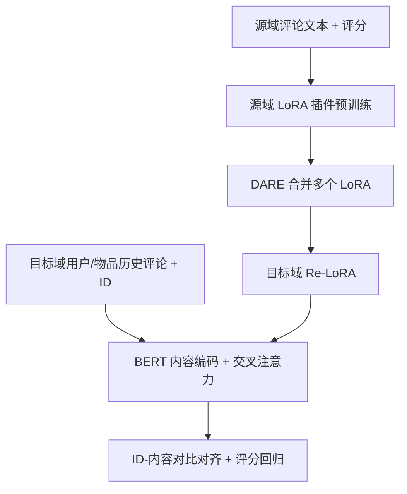
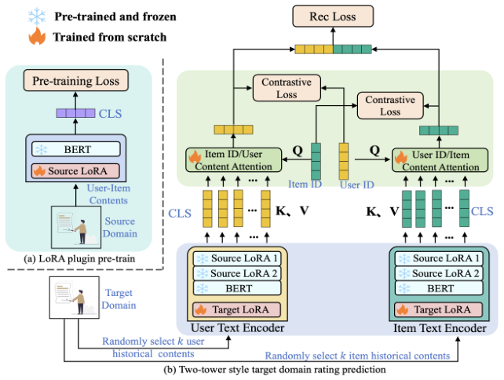

# Enhancing Content-based Recommendation via Large Language Model (基于大语言模型增强内容推荐)

- **会议/期刊**: CIKM 2024
- **作者与机构**: Wentao Xu, Qianqian Xie, Shuo Yang, Jiangxia Cao, Shuchao Pang；南京理工大学、快手
- **推荐链路定位**: 评分预测（内容推荐，偏精排）
- **研究方向**: 大语言模型推荐 / 跨域与多场景推荐
- **论文原文**: [https://arxiv.org/abs/2404.00236v2](https://arxiv.org/abs/2404.00236v2)
- **开源代码**: [https://github.com/cjx96/LoID](https://github.com/cjx96/LoID)

## TL;DR (1分钟核心速览)

针对内容推荐中“语义组件跨域需重调”与“ID/内容语义空间割裂”两个痛点，LoID 将源域 LoRA 作为可插拔语义插件，经 DARE 合并后冻结 BERT，再在目标域 Re-LoRA，并用注意力+hinge 对比拉近 ID 与内容表征。在 Amazon 11 个子域按 8:1:1 随机划分、MSE 回归评测下，LoID 相对最强基线 RGCL 在 CDs 降 19.8%、Instant Video 降 45.6%。

## Background & Motivation (背景与核心矛盾)

- **主流范式**: DeepCoNN/D-Attn 用 CNN/注意力聚合评论文本，ALFM/ANR 抽取多角度语义，RGCL 用 BERT 内容分数辅助图神经网络，均围绕内容语义增强评分预测。
- **前人局限**: 其一，语义组件通常按域重训，电子、影视、CD 等域需重复调参；其二，内容语义与用户/物品 ID 被分开建模，两个特征空间缺少显式对齐。
- **核心洞察 (Key Insight)**: 评论文本承载通用世界知识，域间可通过低秩增量迁移；同时内容与 ID 可视为同一交互的两种模态，应最大化其互信息。
- **本文切入点**: 用 LoRA 插件做跨域语义迁移，用 ID-based 对比学习把语义表征拉回 ID 空间。

## Method (核心方法设计)

### 1. 整体框架 (Overall Architecture)

输入为目标域用户/物品历史评论文本与 ID 表征。先在大规模源域上以评分回归预训练 LoRA 插件；再用 DARE 将多个源域 LoRA 合并进冻结 BERT，并在目标域训练新的 Target LoRA。随后分别编码用户/物品多条历史内容，经交叉注意力把语义信息注入 ID 表征，最后拼接用户/物品向量做评分回归，同时以对比损失对齐语义与 ID 空间。推理阶段仅需目标域 LoRA、冻结 BERT 与轻量 MLP。

<figure class="paper-figure" markdown="span">
  <figcaption>图 1</figcaption>
</figure>

### 2. 关键设计拆解 (Key Designs)

1. **源域 LoRA 插件与 DARE 合并**：痛点是为每个域重训语义组件成本高。LoRA 将权重更新写为 $\mathbf{W}_{\text{LoRA}}=\mathbf{W}_{\text{frozen}}+\mathbf{B}\mathbf{A}$，源域用 MSE 只训练低秩矩阵；DARE 对多个源域增量$\delta_{\text{Task}_i}$按概率$p$随机丢弃并按$1/(1-p)$ 重缩放，再相加合并。直觉是低秩增量捕获域特定语义，DARE 去冗余后合并可避免重训与灾难遗忘。
2. **ID-based 对比对齐**：痛点是内容语义与 ID 特征各自独立。模型用注意力把用户历史内容 $\{\mathrm{CLS}_u^k\}$注入物品 ID 表示$p_i$，反向注入用户表示，得到$v_i=\mathrm{Attn}(p_i,\{\mathrm{CLS}_u^k\},\{\mathrm{CLS}_u^k\})$，$v_u$同理；再以原始 ID 表征为正样本、批内其他表征为负样本，最小化$\mathcal{L}_{cl}=\max(0,\Delta+D(v_i,p_u^+)-D(v_i,p_u^-))+\max(0,\Delta+D(v_u,p_i^+)-D(v_u,p_i^-))$。直觉是用交互对约束语义增强表示不偏离 ID 空间。
3. **训练目标、负采样与推理效率**：总损失 $\mathcal{L}=\mathcal{L}_{rec}+\lambda\mathcal{L}_{cl}$，$\mathcal{L}_{rec}$ 为评分 MSE；对比负样本采用 in-batch negatives，未额外构造 hard negative。目标域只更新 Target LoRA 与预测层，源域 BERT 冻结；但文本编码仍是主要开销，论文未量化在线吞吐。

## Experimental Setup & Evaluation Protocol (实验设置与评估协议)

- **数据集与预处理**: Amazon 11 个子域；Electronics、Movies & TV、CDs & Vinyl 作为源域。正文仅给出两个域的统计，其余未逐项列出。

| 数据集 | #Users | #Items | #Interactions | 稀疏度/密度 | 特征/场景说明 |
| :--- | :---: | :---: | :---: | :---: | :--- |
| Electronics | 4,201,696 | 476,002 | 7,824,482 | 密度约 $3.9\times10^{-6}$ | 最大域，源域；评论+评分 |
| Musical Instruments | 339,231 | 83,046 | 500,176 | 密度约 $1.8\times10^{-5}$ | 最小域；评论+评分 |

- **数据划分与防穿越**: 随机按 8:1:1 划分训练/验证/测试，重复 5 个随机种子取平均；未见时间戳切分或冷启动划分。
- **排名评测协议**: 本文不是 Top-K 排名任务，不采用 Full-Ranking 或 Sampled Ranking，而是评分回归，报告 MSE（越低越好）；对比学习使用 in-batch 负采样。
- **对比基线与超参**: 基线含单角度 DeepCoNN/D-Attn、多角度 ALFM/ANR、图方法 BiGI/RGCL。Embedding 维度 768，dropout 0.5，学习率 1e-5，batch size 4；LoRA rank 16–48，$\lambda$0.2–0.5，历史内容条数$k$ 从 3 逐步增至 10；Adam 优化。论文未报告显著性检验。

## Key Experimental Results (实验关键数据)

### 1. 主实验对比 (Main Results)

Amazon 评分预测 MSE（越低越好；加粗为最优；“Improv.” 为相对 RGCL 的 MSE 降幅）：

| 方法 | Electronics | Movies & TV | CDs & Vinyl | Instant Video | Musical Instr. |
| :--- | :---: | :---: | :---: | :---: | :---: |
| DeepCoNN | 1.659 | 1.207 | 0.980 | 1.178 | 1.160 |
| D-Attn | 1.744 | 1.246 | 1.014 | 1.213 | 1.224 |
| ALFM | 1.563 | 1.193 | 0.956 | 1.075 | 1.072 |
| ANR | 1.445 | 1.112 | 0.914 | 1.009 | 1.034 |
| BiGI | 1.1433 | 1.3489 | 1.1831 | 1.2437 | 1.3580 |
| RGCL | 0.9621 | 0.9239 | 0.8180 | 0.9357 | 0.7211 |
| **LoID** | **0.8666** | **0.8362** | **0.6558** | **0.5094** | **0.5816** |
| Improv. | 9.9% | 9.5% | 19.8% | 45.6% | 19.4% |

### 2. 消融实验 (Ablation Study)

| 模型 | Movies & TV | CDs & Vinyl | Instant Video | Musical Instr. |
| :--- | :---: | :---: | :---: | :---: |
| LoID w/o ID CL | 0.8526 | 0.7001 | 0.5097 | 0.5878 |
| LoID | 0.8362 | 0.6558 | 0.5094 | 0.5816 |
| LoID + Elec 源插件 | 0.8167 | 0.6295 | 0.4891 | 0.5179 |
| LoID + Elec & Movie 源插件 | — | 0.6170 | 0.4731 | 0.5322 |

注：“—”表示该域作为源域，原文未按此设置报告。

### 3. 关键实验发现 (Key Findings)

1. **ID-内容对齐是稳定增益，但幅度依赖内容信号强度**：去掉 ID 对比后，CDs MSE 从 0.6558 升至 0.7001（+6.8%），Movies 从 0.8362 升至 0.8526（+2.0%），Musical 从 0.5816 升至 0.5878（+1.1%）；Instant Video 几乎不变（0.5094→0.5097），说明内容本身已足够区分时对齐收益变小。
2. **源域插件有效，且与域相似度正相关**：单源 Elec 使 Instant Video 0.5094→0.4891（4.0%）、Musical 0.5816→0.5179（10.9%）；双源在 CDs（0.6295→0.6170）和 Instant Video（0.4891→0.4731）继续下降。表 2 也显示相似度越高提升越大，如 Musical 与 Elec 相似度 0.22 时 MSE 提升 11%。
3. **BERT 比 GPT2-medium 更适合评分回归**：LoRA 微调后，BERT 在 Instant Video 的 F1 为 0.7472 对 0.6060，Digital Music 为 0.7712 对 0.7183，Musical 为 0.7382 对 0.5332；双向编码器在数值评分预测上更稳。

## Highlights & Limitations (亮点、对比与审稿批判)

- **与代表作对比 (vs. Prior Work)**: DeepCoNN/D-Attn 仅用文本，未处理跨域与 ID 对齐；RGCL 将 BERT 内容分数注入图，但语义组件仍按域训练，且未显式对齐 ID/内容空间；LoID 把“可插拔跨域语义”与“ID 对比对齐”解耦，插件可复用。
- **可迁移亮点**: DARE 合并多个 LoRA 插件可迁移到多场景/多业务推荐；用交互对构造 in-batch 对比，把内容表征拉回 ID 空间，可嵌入现有精排模型。
- **审稿级局限批判**: 其一，任务是评分预测而非 Top-K 排序，缺少 Full-Ranking/NDCG 评测，工业推荐说服力有限；其二，LLM 文本编码与 11 域 5 种子实验开销大，batch=4 使 in-batch 负样本过少，且未量化在线延迟；此外源域选择依赖域相似度，DARE 的丢弃率 $p$ 与 LoRA rank 的敏感性未充分展开。

## Rating (四维评分)

- **方法创新性 (Novelty)**: ⭐⭐⭐⭐ （LoRA 插件+DARE 合并+ID 对比对齐的组合较新颖，但各组件均有先例，理论分析偏弱）
- **评估协议与实验扎实度 (Protocol & Experiments)**: ⭐⭐⭐ （11 域、5 种子和消融较完整，但仅 MSE、缺少排名指标与显著性检验）
- **写作与数学规范度 (Clarity & Rigor)**: ⭐⭐⭐ （整体公式清楚，但注意力符号与部分变量定义略松，复杂度分析缺失）
- **工业落地与复现价值 (Industrial & Practical Value)**: ⭐⭐⭐ （插件式迁移思路实用且已开源，但 LLM 编码开销与在线吞吐仍需工程验证）

