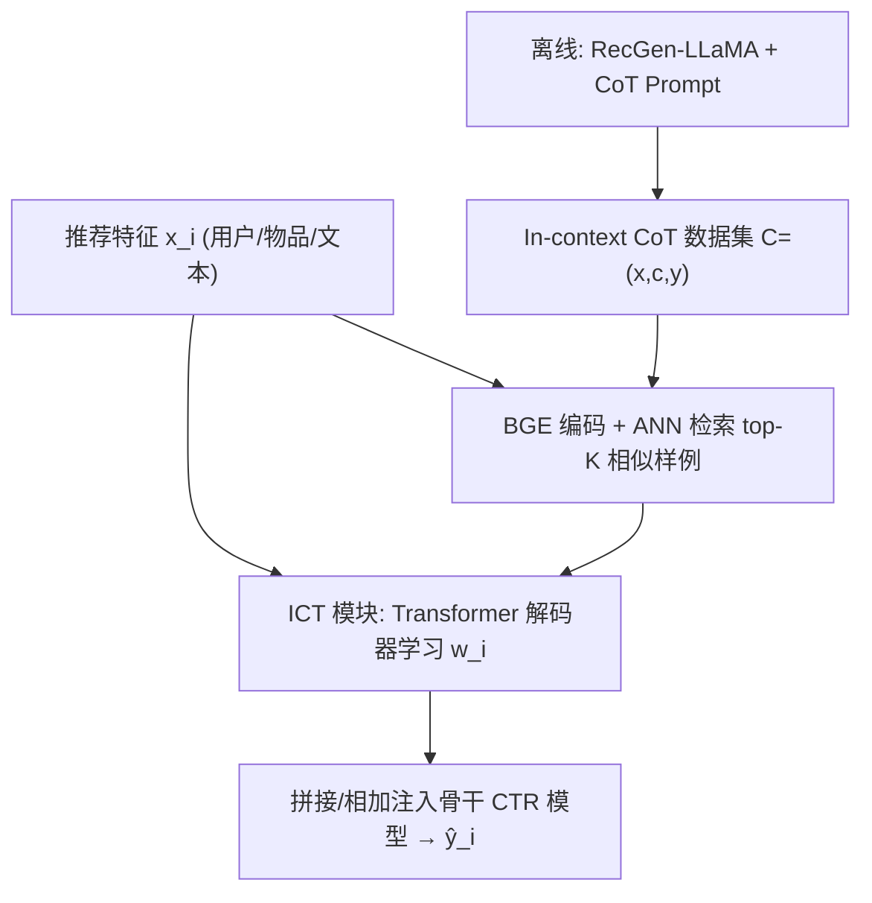
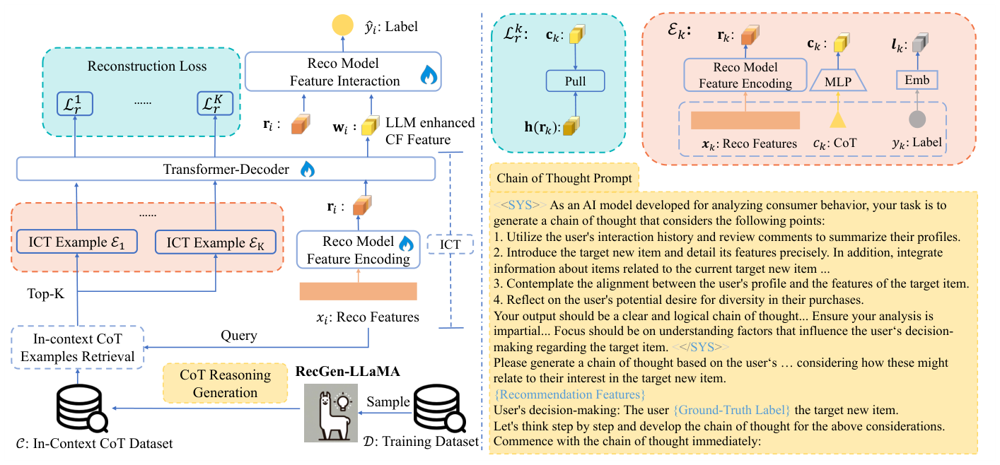
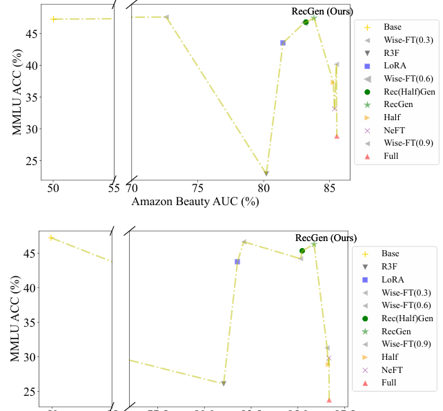

# Large Language Models Enhanced Collaborative Filtering (大语言模型增强的协同过滤)

- **会议/期刊**: CIKM 2024
- **作者与机构**: Zhongxiang Sun, Zihua Si, Xiaoxue Zang, Kai Zheng, Yang Song, Xiao Zhang, Jun Xu（中国人民大学高瓴人工智能学院 × 快手科技）
- **推荐链路定位**: 精排（CTR 预估）为主，兼验召回（Retrieval）
- **研究方向**: 大语言模型推荐 / CTR 预估与特征交叉
- **论文原文**: [论文原文链接](https://arxiv.org/abs/2403.17688v2)
- **开源代码**: [开源代码仓库链接](https://anonymous.4open.science/r/LLM-CF-AD78)

## TL;DR (1分钟核心速览)

现有 LLM 增强推荐要么把 LLM 当推荐器（在线推理昂贵），要么只把少量用户/物品字段喂给 LLM 取文本或 embedding（**协同过滤信号被稀释**，且新用户/新物品仍需实时生成）。本文提出 LLM-CF：离线以“推荐数据 + 通用指令数据”混合微调得 RecGen-LLaMA，用零样本 CoT 提示生成推理并构建 in-context CoT 数据集；在线用 BGE+ANN 检索 top-$K$ 相似样例，经 Transformer 解码器构成的 ICT 模块产出“世界知识+推理引导的 CF 特征”，以拼接/相加方式注入骨干模型。在 Amazon 三子集、Leave-One-Out + 1:1 负采样协议下，6 个骨干 CTR 模型 AUC 提升 0.16%–7.46% RelaImpr，且 LLM 完全离线、无在线推理延迟。

## Background & Motivation (背景与核心矛盾)

- **主流范式**: (1) *LLM as RS*——直接 prompt 或指令微调 LLM 输出 Yes/No 或物品名（TALLRec、P5、LLaMARec）；(2) *LLM-enhanced RS*——用 LLM 生成的富文本或语义 embedding 作为附加特征（KAR、HKF、ONCE）。
- **前人局限**: 前者参数庞大、推理慢，无法满足在线服务；后者只输入有限的当前用户/物品字段，**难以显式利用“相似用户历史”这一协同过滤核心信号**，且对新增用户/新物品仍需实时调用 LLM（KAR 仅靠 prestore 覆盖固定特征）。
- **核心洞察 (Key Insight)**: 协同过滤的本质恰好可以类比 LLM 的 In-Context Learning——把“相似用户的历史交互 + 推理过程”作为示范样例塞进上下文，比让 LLM 隐式“记住”CF 更有效；而 CoT 生成可以离线一次、在线复用。
- **本文切入点**: 将 LLM 的知识/推理“样例化、离线化”，在线只跑一个输入长度十余 token 的轻量解码器，把能力蒸馏进传统推荐模型。

## Method (核心方法设计)

### 1. 整体框架 (Overall Architecture)

LLM-CF 被显式解耦为离线与在线两段。**离线**：对 LLaMA2-7B-chat 采用“推荐数据 + LIMA/alpaca-gpt4 通用数据”混合全参微调得到 RecGen-LLaMA，再用零样本 CoT 提示（用户画像归纳 → 目标物品属性展开 → 画像-物品对齐 → 多样性需求反思）对训练集均匀采样 $M=\frac{1}{10}|D|$条样本生成推理$c_i$，构成 in-context CoT 数据集$\mathcal{C}=\{(x_m,c_m,y_m)\}$。**在线**：以当前样本文本特征为 query，BGE 编码 + ANN 检索 top-$K$相似历史样例，与当前样本拼成 ICT token 序列送入 2 层 Transformer 解码器，取末位隐状态作为增强特征$w_i$，最后$\hat{y}_i=f([x_i,w_i];\theta)$ 交给任意骨干模型。训练仅多一项 CoT 重构损失，推理阶段无 LLM 参与。

<figure class="paper-figure" markdown="span">
  <figcaption>图3：所提出模型 LLM-CF 的整体架构。(1) CoT 推理生成：利用思维链提示基于 RecGen-LLaMA 生成 CoT 推理。(2) 上下文 CoT 示例检索：找出与当前推荐数据最相似的前 K 个历史推荐数据，以构建上下文 CoT 示例。(3) 上下文思维链（ICT）模块：采用 Transformer 解码器层学习由世界知识与推理引导的 CF 特征。</figcaption>
</figure>

### 2. 关键设计拆解 (Key Designs)

1. **RecGen-LLaMA：兼顾推荐力与通用力的混合数据指令微调**：直接用推荐数据全参微调（Full）虽 AUC 最高，却导致 MMLU 断崖式下降、无法生成有意义文本；LoRA / NeFT / R3F / Wise-FT 在“推荐力-通用力”权衡曲线上均不占优。作者改为把推荐数据与高质量通用指令数据（LIMA、alpaca-gpt4）混采微调，得到 Pareto 前沿上的最优点；进一步发现仅用**一半**推荐数据（Rec(Half)Gen）即可达到相近推荐性能，显著降低微调开销。这一“数据混合即能力保持”的结论是本文最可迁移的工程经验。

<figure class="paper-figure" markdown="span">
  <figcaption>图4：使用多种方法在不同推荐数据上微调后，LLaMA2 的推荐能力与通用能力。</figcaption>
</figure>

2. **检索增强的 ICT 模块：把“相似用户历史+CoT”当作显式 CF 特征**：痛点在于 LLM 一次只能看少量字段，看不到邻域行为。做法是把检索样例、当前样本串成序列，用解码器建模其相互影响：
$$T=[x_1,c_1,y_1,\dots,x_K,c_K,y_K,x_i],\quad H=\mathrm{Decoder}(E),\quad w_i=h(r_i)$$
其中 $r_k,c_k,l_k$分别是推荐特征的 ID-Embedding+文本编码、CoT 文本经编码器+MLP 投影、标签 one-hot 嵌入。用 Transformer 解码器而非 mean pooling 的直觉是：in-context learning 能力与解码器结构强相关，因果注意力天然匹配“示范 → 查询”的顺序。两条防作弊约束至关重要：检索库**严格不含未来时间步**防穿越；强制$I_i$ 内正负例 1:1，堵住“标签分布捷径”，保证增益来自推理而非先验比例。

3. **训练目标、负采样与推理开销**：总损失为骨干损失与 CoT 重构损失的加权和：
$$\mathcal{L}=\frac{1}{N}\sum_{i=1}^{N}\left(\alpha\,\mathcal{L}^{r}_i+\mathcal{L}^{o}_i\right),\quad \mathcal{L}^{r}_i=\frac{1}{K}\sum_{k=1}^{K}\left(1-\frac{c_k\cdot h(r_k)}{\|c_k\|\,\|h(r_k)\|}\right)$$
重构项迫使 $w_i$的上下文表示能还原 CoT 语义，即“把推理压进 CF 特征”。负采样沿用骨干默认策略（CTR 任务 1:1 随机负样本；召回任务 sampled softmax + 128 负样本），**不引入额外难负样本设计**。在线只计算 ICT 模块（$K=4$、2 层 2 头、序列十余 token），开销与骨干同量级；LLM 仅在离线周期性更新样例库，新用户/新物品/新交互三种场景均无需实时生成。

## Experimental Setup & Evaluation Protocol (实验设置与评估协议)

- **数据集与预处理**: Amazon 2019 年三子集，全部评论视为正样本，无 5-core 过滤。

| 数据集 | #Users | #Items | #Interactions | 稀疏度 | 特征/场景说明 |
| :--- | :---: | :---: | :---: | :---: | :--- |
| Sports | 35,598 | 18,357 | 296,337 | 0.0453% | Sports & Outdoors 评论+元数据 |
| Beauty | 22,363 | 12,101 | 198,502 | 0.0734% | Beauty 评论+元数据 |
| Toys | 19,412 | 11,924 | 167,597 | 0.0724% | Toys & Games 评论+元数据 |

- **数据划分与防穿越**: CTR 任务采用 `Leave-One-Out` 划分训练/验证/测试；召回任务按序列预测下一物品，且 ICT 检索时屏蔽目标物品信息以防泄漏。
- **排名评测协议**: **Sampled Ranking**——CTR 每个正样本随机配 1 个负样本；召回任务每交互采样 128 个负样本。指标为 AUC、LogLoss、RelaImpr（CTR）与 HIT@{5,10}、NDCG@{5,10}（召回）。
- **对比基线与超参**: 6 个骨干（DeepFM、xDeepFM、AutoInt、DCNv1、DCNv2、DIN）× 3 种增强框架（None / KD 软标签蒸馏 / KAR）；Embedding 维 $d=32$，$M=\frac{1}{10}|D|$，$K=4$，$\alpha$以 0.1 步长在$(0,1]$调，显著性$p<0.05$。

## Key Experimental Results (实验关键数据)

### 1. 主实验对比 (Main Results)

CTR 任务 AUC（None 为骨干原始性能，括号为 RelaImpr，`*` 表示对次优框架显著）：

| 骨干模型 | Sports (None→LLM-CF) | RelaImpr | Beauty (None→LLM-CF) | RelaImpr | Toys (None→LLM-CF) | RelaImpr |
| :--- | :---: | :---: | :---: | :---: | :---: | :---: |
| DeepFM | 0.7990→**0.8137\*** | 4.916% | 0.7853→**0.8044\*** | 6.695% | 0.7681→**0.7881\*** | 7.460% |
| xDeepFM | 0.8158→**0.8196\*** | 1.203% | 0.8065→**0.8113** | 1.566% | 0.7836→**0.7947\*** | 3.914% |
| AutoInt | 0.8003→**0.8088\*** | 2.831% | 0.7949→**0.8090\*** | 4.781% | 0.7630→**0.7754\*** | 4.714% |
| DCNv1 | 0.8023→**0.8092\*** | 2.282% | 0.8146→**0.8182\*** | 1.144% | 0.7621→**0.7702\*** | 3.090% |
| DCNv2 | 0.8110→**0.8131\*** | 0.675% | 0.8028→**0.8033** | 0.165% | 0.7774→**0.7812** | 1.370% |
| DIN | 0.7986→**0.8089\*** | 3.449% | 0.7861→**0.7967\*** | 3.705% | 0.7586→**0.7783\*** | 7.618% |
| *参考* KAR/KD 最优 | KD 0.8043 / KAR 0.7991 | 1.773% | KD 0.8065*（DCNv1: KD 0.8147） | 3.715% | KAR 0.7898 | 2.186% |

召回任务（NDCG@10 / HIT@10，仅列代表性三项）：

| 模型 | Beauty | Sports | Toys |
| :--- | :---: | :---: | :---: |
| SASRec | 0.0293 / 0.0648 | 0.0101 / 0.0203 | 0.0251 / 0.0646 |
| +LLM-CF | 0.0293 / **0.0652** | **0.0154** / **0.0349** | **0.0321** / **0.0723** |
| GRU4REC | 0.0241 / 0.0470 | 0.0135 / 0.0268 | 0.0202 / 0.0411 |
| +LLM-CF | **0.0250** / **0.0504** | **0.0164** / **0.0317** | 0.0192 / 0.0380 |
| SRGNN | 0.0169 / 0.0341 | 0.0073 / 0.0146 | 0.0137 / 0.0284 |
| +LLM-CF | **0.0174** / **0.0359** | **0.0101** / **0.0210** | **0.0144** / **0.0302** |

### 2. 消融实验 (Ablation Study)

以 AUC 为例（S/B/T = Sports/Beauty/Toys）：

| 变体 | DeepFM (S / B / T) | AutoInt (S / B / T) |
| :--- | :---: | :---: |
| 骨干 None | 0.7990 / 0.7853 / 0.7681 | 0.8003 / 0.7949 / 0.7630 |
| w/o text | 0.8137 / 0.8030 / 0.7880 | 0.8071 / 0.8043 / 0.7710 |
| w/o CoT | 0.8009 / 0.7980 / 0.7766 | 0.7992 / 0.7940 / 0.7581 |
| w/o RecGen-LLaMA | 0.8132 / 0.7973 / 0.7806 | 0.8041 / 0.7993 / 0.7706 |
| w/o TF decoder | 0.8071 / 0.7986 / 0.7739 | 0.8017 / 0.7942 / 0.7592 |
| **LLM-CF (full)** | **0.8137 / 0.8044 / 0.7881** | **0.8088 / 0.8090 / 0.7754** |

### 3. 关键实验发现 (Key Findings)

1. **CoT 推理是增益主引擎，而非检索到的人群行为本身**：去掉 CoT 后 DeepFM 在三数据集分别掉 1.28/0.64/1.15 个 AUC 百分点（0.8137→0.8009、0.8044→0.7980、0.7881→0.7766），AutoInt 甚至跌回骨干水平（0.8088→0.7992），说明“相似样例”若无推理文本，几乎退化为普通检索式特征增强。
2. **“会推荐的 LLM”比“通用强 LLM”更关键**：把 RecGen-LLaMA 换成原始 LLaMA2-7B-chat 生成 CoT，DeepFM 在 Beauty 上 0.8044→0.7973、DCNv1 在 Beauty 上更从 0.8182 暴跌至 0.7891，验证了推荐域指令微调的不可替代性；同时混合数据微调使 MMLU 不降，说明“能力保持”并未牺牲推荐性能。
3. **$K=4$是收益-开销的拐点，且正负例配平不可省**：$K$从 2 增至 4 普遍提升（如 AutoInt-Sports n2 0.8041→n4 0.8092），而$K=8$ 在多数骨干上回落（DeepFM-Beauty 0.8158→0.7894 附近波动），说明上下文过长引入噪声；移除 1:1 正负约束（n4_noc）在部分设置略有升降（如 DeepFM-Beauty 0.8158），整体不优于配平版本，佐证增益并非来自标签分布捷径。此外召回侧并非全胜——GRU4REC 在 Toys 由 HIT@10 0.0411 降至 0.0380，说明对纯序列骨干的加法融合并不总稳。

## Highlights & Limitations (亮点、对比与审稿批判)

- **与代表作对比 (vs. Prior Work)**: 相比 **TALLRec/LLaMARec** 这类“LLM 当推荐器”，LLM-CF 把 LLM 彻底移出在线链路，延迟可控；相比 **KAR**，本文不止把用户/物品特征送给 LLM 生成偏好推理，而是引入“检索相似用户历史 + CoT”的显式 CF 上下文，并覆盖新用户/新物品场景（KAR 需实时生成）；相比 **KD 蒸馏**，本文避免了 LLM 词级交叉熵与推荐 BCE 的目标错配，且二者正交可叠加。
- **可迁移亮点**: ①“推荐数据 + 通用指令数据”混采微调是低成本保通用能力的手段，且验证了半量数据即可；②“正负例 1:1 约束 + 禁止未来时间步”的样例库构造范式，可迁移到任何 RAG-式推荐特征增强。
- **审稿级局限批判**: ①`w/o text` 变体几乎与完整模型持平（DeepFM 0.8137/0.8030/0.7880 vs 0.8137/0.8044/0.7881），说明多字段文本特征贡献甚微，模型增益主要来自 CoT 文本，与“特征交叉”叙事存在张力；②增益高度依赖离线 CoT 库的新鲜度，用户兴趣漂移时需周期性重生成，文中未量化重生成频率与性能衰减；③评估仅限 Amazon 评论域小规模数据与 Sampled 1:1 负采样，缺少工业级全库排序与线上 A/B 验证。

## Rating (四维评分)

- **方法创新性 (Novelty)**: ⭐⭐⭐⭐ （将 ICL+CoT 迁移为“检索式 CF 上下文蒸馏”，解耦离线生成与在线轻量解码的范式较新颖，但组件多为已有技术的巧妙组合）
- **评估协议与实验扎实度 (Protocol & Experiments)**: ⭐⭐⭐⭐ （6 骨干 × 3 数据集 × 双任务 + 4 组消融 + $K$/正负比敏感性分析完整，扣分在于仅 Sampled 负采样、无全库排序与线上验证）
- **写作与数学规范度 (Clarity & Rigor)**: ⭐⭐⭐⭐ （离线/在线两段式叙述清晰、公式简洁，但 ICT token 构造与文本编码器共享细节略紧，复杂度分析以定性为主）
- **工业落地与复现价值 (Industrial & Practical Value)**: ⭐⭐⭐⭐⭐ （LLM 完全离线、在线仅十余 token 解码、骨干模型无关，代码已匿名开源，工程可落地性强）

