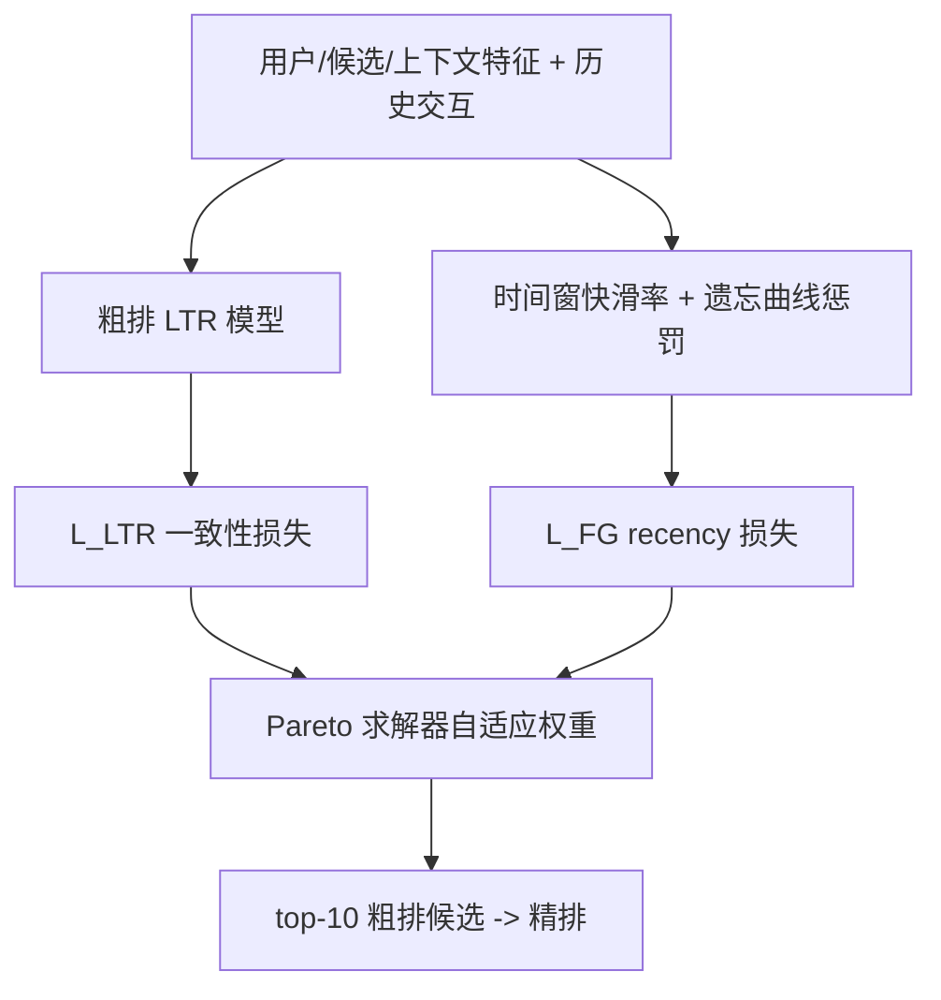
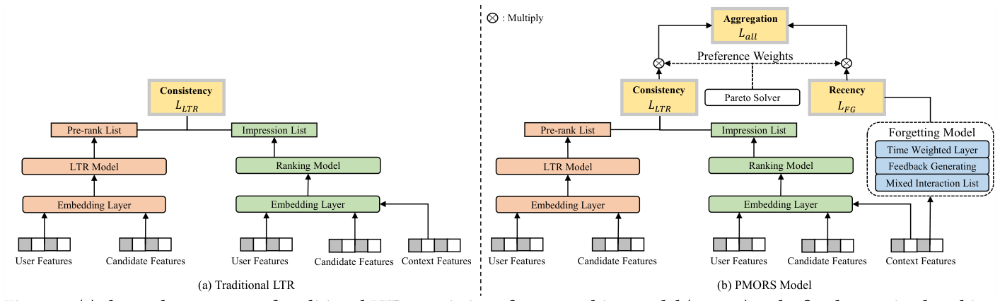
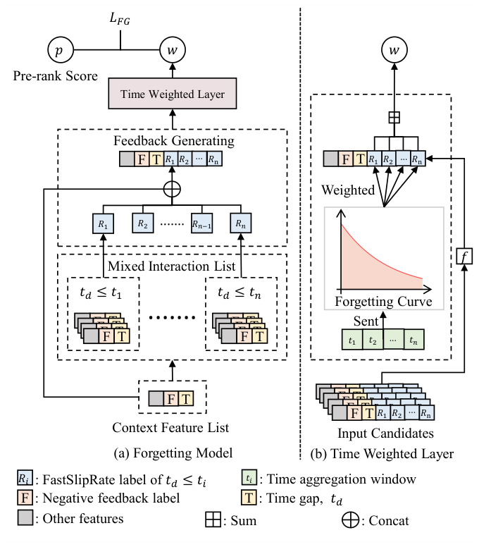

# Pareto-based Multi-Objective Recommender System with Forgetting Curve（基于帕累托与遗忘曲线的多目标推荐系统）

- **会议/期刊**: CIKM 2024
- **作者与机构**: Jipeng Jin, Zhaoxiang Zhang, Zhiheng Li, Xiaofeng Gao, Xiongwen Yang, Lei Xiao, Jie Jiang；上海交通大学、腾讯
- **推荐链路定位**: 粗排 / pre-ranking（级联粗精排一致性）
- **研究方向**: 多任务学习与列表级重排 / 去偏公平与工业架构
- **论文原文**: [论文原文链接](https://arxiv.org/abs/2312.16868v2)
- **开源代码**: 暂未开源

## TL;DR (1分钟核心速览)

针对短视频快滑负反馈在粗排中被一致性目标牺牲、固定权重多目标又易跷跷板的问题，PMORS 用 Ebbinghaus 遗忘曲线把 FastSlipRate 转成时间衰减惩罚，再用 Pareto 求解器自适应加权 LTR 一致性与 recency。KuaiRec 90/5/5 时间切分、采样 100 候选评估下，CTR/Recall@10_1 相对 RankNet 提升 11.35%/35.24%，微信视频号上线 GMV +1.45%。

## Background & Motivation (背景与核心矛盾)

- **主流范式**: 工业推荐采用级联架构，粗排用 Learning-to-Rank 对齐精排打分，主要优化一致性而非点击/转化。
- **前人局限**: 负反馈若独立惩罚会引入噪声、伤害主目标；固定权重/多任务模型（MMoE、ESMM）易出现 seesaw，进化式 Pareto 又收敛慢。
- **核心洞察 (Key Insight)**: 用户记忆存在 recency effect，近期快滑比久远快滑更能代表当前厌恶；曝光即复习，应按 Ebbinghaus 曲线指数衰减。
- **本文切入点**: 将“快滑率”建成独立 recency 目标，用 Pareto 求解器与一致性目标动态配权，避免人工调权。

## Method (核心方法设计)

### 1. 整体框架 (Overall Architecture)

输入用户、候选与上下文特征，粗排模型输出 $p(x)$；同时从混合交互列表按时间窗统计候选的快滑率，经遗忘曲线生成惩罚权重$w_i$。训练时固定精排模型提供排序监督，粗排计算一致性损失与遗忘损失，Pareto 求解器输出偏好权重并聚合总损失；推理时粗排从采样候选中选 top-10 交给精排。该框架模型无关，可用于任意可求梯度的多目标推荐。

<figure class="paper-figure" markdown="span">
  <figcaption>图2：(a) 展示传统 LTR 的结构，由预排序模型（橙色）和固定的预训练排序模型（绿色）组成。(b) 展示用于估计称为 recency 的新目标的遗忘模型（蓝色），以及一个 Pareto 优化求解器，该求解器聚合两个损失并给出使模型达到 Pareto 效率的偏好权重。</figcaption>
</figure>

### 2. 关键设计拆解 (Key Designs)

1. **遗忘模型：把快滑负反馈转成时间衰减惩罚**：按 $T=\{10\text{min},3\text{h},1\text{d},7\text{d}\}$统计$R_j=N(t_d\le t_j \land \text{neg})/N(t_d\le t_j)$，再用 Ebbinghaus 曲线加权$w_i=\sum_j f(R_j)e^{-t_j/S}$。损失$L_{FG}=-\sum_i w_i\log(1-p(x_i))$刻意惩罚粗排高分候选，因为高分候选对体验影响更大；$S$控制记忆强度，离线取$L=R(1)=0.7$，即$S=6.46$。

<figure class="paper-figure" markdown="span">
  <figcaption>图3：遗忘模型的总体结构</figcaption>
</figure>

2. **Pareto 求解器：用梯度方向求自适应权重**：固定标量权重难以兼顾一致性与 recency。PMORS 求 $\min_{\alpha}\|\sum_i \alpha_i\nabla_\theta L_i\|_2^2$，约束$\sum_i\alpha_i=1,\alpha_i\ge0$，用 Frank-Wolfe 迭代逼近 Pareto 平稳点。若最优值为 0，则满足 KKT；否则给出共同下降方向。直觉是用两损失的梯度冲突程度决定谁该多分权重，而非网格搜索。

3. **训练目标、负采样与推理效率**：总损失 $L_{all}=\alpha_{LTR}L_{LTR}+\alpha_{FG}L_{FG}$；$L_{LTR}=\sum_{i,j:q(x_i)>q(x_j)}\log(1+e^{-(p(x_i)-p(x_j))})$。每 impression 采样 10 个候选训练粗排，测试采样 100 个候选、粗排取 top-10、精排取 top-1。额外开销来自多一次前向/梯度与 Frank-Wolfe 内循环，但粗排网络轻量，线上可服务主流量。

## Experimental Setup & Evaluation Protocol (实验设置与评估协议)

- **数据集与预处理**: KuaiRec 短视频公开日志；原文未说明 `5-core` 过滤，负反馈/正交互沿用数据集定义。

| 数据集 | #Users | #Items | #Interactions | 稀疏度/密度 | 特征/场景说明 |
| :--- | :---: | :---: | :---: | :---: | :--- |
| KuaiRec | ~7,176（公开版） | ~10,728（公开版） | 12.5M | 约 16.3% | 短视频；快滑显式负反馈；用户/候选/上下文特征 |

- **数据划分与防穿越 (Splitting Strategy)**: 按样本时间戳做 90% 训练 / 5% 验证 / 5% 测试，属于全局时间切分。
- **排名评测协议 (Ranking Protocol)**: 非 Full-Ranking；训练每 impression 采样 10 候选，测试采样 100 候选，粗排 top-10 与精排 top-1 计算一致性。指标为 NDCG@10、Recall@10_1、CTR、FastSlipRate↓。
- **对比基线与超参设置**: 基线含 RankNet、LambdaMART、ESMM、MMoE、PO-EA、PE-LTR、CL；粗排 embedding $d=16$，三层 MLP 隐层 [128,64,32]，Adam，学习率 0.001，显著性$p<0.05$。

## Key Experimental Results (实验关键数据)

### 1. 主实验对比 (Main Results)

| Model | NDCG@10 | FSR↓ (%) | CTR (%) | Recall@10_1 (%) |
| :--- | :---: | :---: | :---: | :---: |
| RankNet | 0.6974 | 0.1458 | 0.3458 | 1.7293 |
| LambdaMART | **0.7067** | 0.1662 | 0.3686 | 1.9440 |
| ESMM | 0.5107 | **0.0218** | 0.2932 | 1.2962 |
| MMoE | 0.5515 | 0.0710 | 0.2987 | 1.4986 |
| PO-EA | 0.6131 | 0.1024 | 0.3804 | 2.1470 |
| PE-LTR | 0.6507 | 0.1021 | 0.3831 | 2.2530 |
| CL | 0.6907 | 0.1554 | 0.3582 | 2.0632 |
| **PMORS** | 0.6650 | 0.1064 | **0.3851** | **2.3386** |

相对 RankNet，PMORS 的 CTR +11.35%、Recall@10_1 +35.24%，FSR 相对下降 26.99%（表中 Impr. 负号即下降）；NDCG 为 -4.65%，但系统指标最优。

### 2. 消融实验 (Ablation Study)

以固定 $\alpha_{LTR}$替代 Pareto 求解器，$\alpha_{LTR}\in\{0.5,\dots,1.0\}$；$\alpha_{LTR}<0.5$时$L_{FG}$ 下溢崩溃。

| 设置 | CTR (%) | Recall@10_1 (%) |
| :--- | :---: | :---: |
| $\alpha_{LTR}=1$（无遗忘） | 0.3458 | 1.7293 |
| $\alpha_{LTR}=0.9$ | 0.3686 | 2.1135 |
| $\alpha_{LTR}=0.8$ | 0.3557 | 1.8627 |
| $\alpha_{LTR}=0.7$ | 0.3380 | 1.6402 |
| $\alpha_{LTR}=0.6$ | 0.3079 | 1.4833 |
| $\alpha_{LTR}=0.5$ | 0.2987 | 1.2572 |
| **PMORS (Pareto)** | **0.3851** | **2.3386** |

### 3. 关键实验发现 (Key Findings)

- 单目标最优不等于系统最优：LambdaMART NDCG 最高 0.7067，但 CTR 0.3686 低于 PMORS 0.3851；ESMM FSR 最低 0.0218，却把 NDCG 压到 0.5107，印证独立负反馈惩罚的副作用。
- Pareto 自适应权重优于最佳固定权重：比 $\alpha_{LTR}=0.9$ 的 CTR 0.3686、Recall 2.1135 再提升约 4.48%、10.65%，说明梯度冲突方向比人工网格更有效。
- 线上 A/B（微信视频号，2023-05）GMV +1.45%、FSR -0.63%、FastSlipAction -0.50%、CTR +0.89%、Recall@10_1 +3.0%，证明 recency 惩罚未牺牲商业收益。

## Highlights & Limitations (亮点、对比与审稿批判)

- **与代表作对比 (vs. Prior Work)**: PE-LTR 用标量化找 Pareto 权重，PO-EA 依赖进化算法，CL 采用间接惩罚；PMORS 把遗忘曲线做成显式 recency 目标，并用 MGDA/Frank-Wolfe 直接解梯度组合，更适合工业粗排。
- **可迁移亮点**: “时间窗快滑率 + 指数衰减权重”可迁移到短视频、直播、电商负反馈；Pareto 求解器可作为任意多目标粗排的权重学习插件。
- **审稿级局限批判**: 离线仅 KuaiRec 一个数据集且为采样排序，结论外推有限；$S$、时间窗、线上多维度$\lambda_m$ 较敏感，Frank-Wolfe 内循环也增加训练开销。

## Rating (四维评分)

- **方法创新性 (Novelty)**: ⭐⭐⭐⭐ （首次将 Ebbinghaus 遗忘曲线作为独立 recency 目标，并与 Pareto 梯度求解结合）
- **评估协议与实验扎实度 (Protocol & Experiments)**: ⭐⭐⭐⭐ （KuaiRec 时间切分、7 个基线、$p<0.05$ 与线上 A/B 较完整，但仅单离线数据集且为采样排序）
- **写作与数学规范度 (Clarity & Rigor)**: ⭐⭐⭐⭐ （LTR、遗忘损失与 KKT/Pareto 推导清楚，个别 Impr. 符号与线上细节略含糊）
- **工业落地与复现价值 (Industrial & Practical Value)**: ⭐⭐⭐⭐⭐ （模型无关、已在微信视频号主流量部署并带来 +1.45% GMV；可惜未开源代码）

