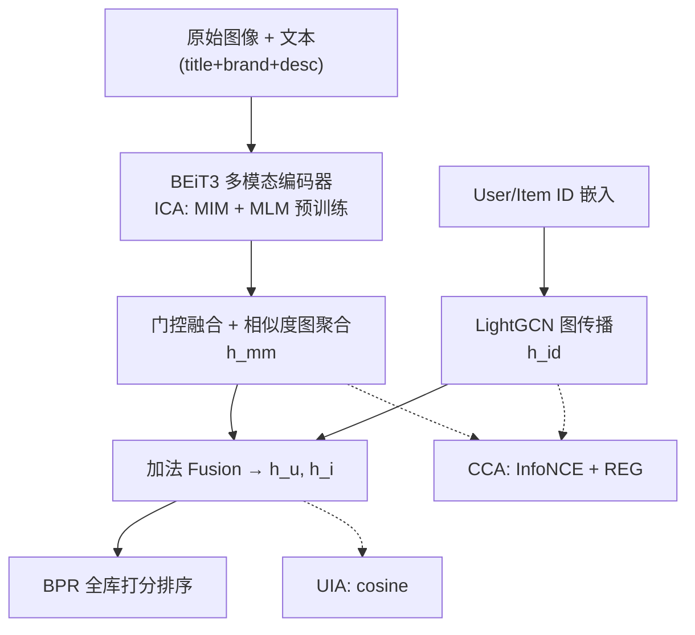
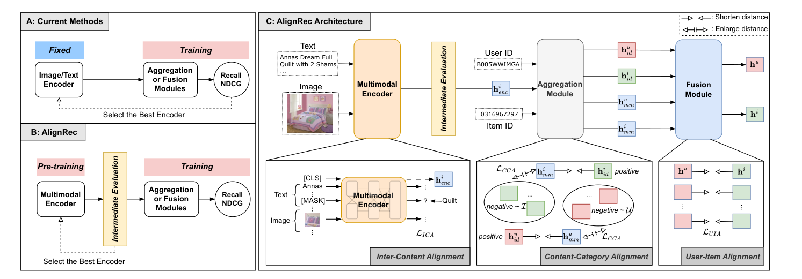

# AlignRec: Aligning and Training in Multimodal Recommendations (多模态推荐中的对齐与训练)

- **会议/期刊**: CIKM 2024
- **作者与机构**: Yifan Liu, Kangning Zhang, Weinan Zhang 等（上海交通大学）；Xiangyuan Ren, Yanhua Huang, Jiarui Jin 等（小红书）
- **推荐链路定位**: 召回 / 排序（物品表征学习 + 全库 Top-K 打分）
- **研究方向**: 多模态推荐 / 自监督对比与去噪
- **论文原文**: [arXiv:2403.12384v4](https://arxiv.org/abs/2403.12384v4)
- **开源代码**: [sjtulyf123/AlignRec_CIKM24](https://github.com/sjtulyf123/AlignRec_CIKM24)

## TL;DR (1分钟核心速览)

现有方法把图像/文本当作 ID 特征的"辅助输入"直接拼接或联合优化，但内容模态与 ID 模态分布不同源，同一物品的两类表征在空间中可以相距很远（余弦相似度仅 0.50），造成表征失配。AlignRec 把推荐目标分解为**内容内对齐 (ICA)、内容-类别对齐 (CCA)、用户-物品对齐 (UIA)** 三重目标，并用"先预训练 ICA、再联合训练后两者"的解耦策略解决学习速率不一致问题。在 Amazon Baby/Sports/Electronics 三个 5-core 数据集上，遵循 8:1:1 划分与无偏全库排序（Full-Ranking）协议，R@20 相对最优基线分别提升 6.19%、4.88%、8.02%（$p<0.01$）。

## Background & Motivation (背景与核心矛盾)

- **主流范式**: 以 LightGCN/BPR 为骨干，将多模态特征用于增强 ID 表征——VBPR 直接拼接，MMGCN/FREEDOM 用模态相似度构图，BM3/SLMRec 用自监督对比损失联合优化（图 1）。
- **前人局限 (1)**: 上述方法默认多模态与 ID 处于同一空间，未显式建模分布鸿沟；同一物品的内容向量与 ID 向量可被优化到相距甚远，导致多模态信息无法真正参与打分。
- **前人局限 (2)**: 端到端联合优化时，BEiT3/CLIP 级内容编码器收敛极慢且需海量图文对，而 ID 侧图卷积数轮即收敛——两者学习速率失配，结果是"ID 学好了、内容还没学好"，物品表征不足。
- **核心洞察 (Key Insight)**: 应把 ID 视为**一类特殊模态（categorical modality）**，从而与图像、文本一起纳入统一的"对齐"框架；同时作者发现预抽取的 Amazon 视觉特征几乎无用——VBPR 去掉视觉后 R@20 反升 9.0%，掩蔽 50% 视觉特征反而更好。
- **本文切入点**: 用"三重对齐 + 两阶段解耦训练 + 三类中间评估协议"替代"拼接 + 端到端联合优化"。

<figure class="paper-figure" markdown="span">
  ![图 1：VBPR \[8\]、FREEDOM \[38\]、BM3 \[39\] 与 AlignRec 的对比。L𝐼𝐶𝐴、L𝐶𝐶𝐴、L𝑈𝐼𝐴 分别为内容间对齐、内容-类别对齐和用户-物品对齐的损失。虚线表示对齐损失的范围。](../../../../assets/papers/2403.12384v4/figure_1.png)<figcaption>图 1：VBPR [8]、FREEDOM [38]、BM3 [39] 与 AlignRec 的对比。L𝐼𝐶𝐴、L𝐶𝐶𝐴、L𝑈𝐼𝐴 分别为内容间对齐、内容-类别对齐和用户-物品对齐的损失。虚线表示对齐损失的范围。</figcaption>
</figure>

## Method (核心方法设计)

### 1. 整体框架 (Overall Architecture)

物品原始图像与文本经多模态编码器 $MMEnc$（BEiT3-base 骨干，跨模态专家 + mask-then-predict）输出统一表征$\mathbf{h}^{enc}_i$；随后在 Aggregator 中分两路：ID 侧用$L$层 LightGCN 在用户-物品二部图上传播得到$\mathbf{H}_{id}$，内容侧先以门控方式把$\mathbf{h}^{enc}_i$与 ID 嵌入融合为$\mathbf{h}^{con}_i$，再沿物品多模态相似度图$S$（每物品保留$K'=10$条边）聚合为$\mathbf{h}^{mm}_i$，用户侧沿交互矩阵聚合得到$\mathbf{h}^{mm}_u$；最后 Fusion 模块做逐元素相加得到$\mathbf{h}_i,\mathbf{h}_u$ 并以内积全库排序。训练上先在大规模原始数据（未过滤 5-core）上预训练 ICA，得到统一 768 维多模态特征后，再与 CCA、UIA、BPR 联合训练。

<figure class="paper-figure" markdown="span">
  <figcaption>图 2：AlignRec 概览，输入为用户 ID、物品 ID、文本和图像，输出为用户和物品表示。A 和 B 展示训练时 AlignRec 与现有方法的差异，其中 AlignRec 提出了中间评估模块和两阶段训练策略。C 展示 AlignRec 的整体架构。</figcaption>
</figure>

### 2. 关键设计拆解 (Key Designs)

1. **内容内对齐 ICA（把图像与文本压进同一空间）**：Amazon 数据的视觉特征来自 VGG/CNN、文本来自 Transformer，天然分布不齐。AlignRec 不做后处理投影，而是直接在编码器内部做掩码建模：掩掉 15% 文本 token 与 40% 图像 patch，用另一模态 + 本模态剩余 token 联合预测被掩内容，$\mathcal{L}_{ICA}=\mathcal{L}_{MIM}+\mathcal{L}_{MLM}$。跨注意力被迫让每个模态去"看"另一个模态，表征在逐步预测中被自然对齐，且该任务可完全自监督地吃下全部原始图文对（远超 5-core 过滤后的数据量）。

2. **内容-类别对齐 CCA + 相似度正则 REG（消除跨模态分布鸿沟）**：聚合层的 MLP/GCN 会让内容与 ID 两路隐表征各自漂移。作者在**聚合后**做 in-batch InfoNCE，令同物品/同用户的 $\mathbf{h}^{mm}$与$\mathbf{h}^{id}$ 靠近、与他者远离：
$$
\mathcal{L}_{CCA} = \mathrm{InfoNCE}(i) + \mathrm{InfoNCE}(u), \quad \mathrm{InfoNCE}(x) = -\log\frac{\exp(\mathbf{h}^{mm}_x\cdot(\mathbf{h}^{id}_x)^\top/\tau)}{\sum_{\tilde{x}}\exp(\mathbf{h}^{mm}_x\cdot(\mathbf{h}^{id}_{\tilde{x}})^\top/\tau)}
$$
但盲目把内容表征拉向 ID 会引发**表征坍塌**（丢失内容自身的语义相似结构）。故加正则 $\mathcal{L}_{REG}=\Vert C(\mathbf{h}^{mm}_i,\mathbf{h}^{mm}_j)-\mathrm{sg}(C(\mathbf{h}^{enc}_i,\mathbf{h}^{enc}_j))\Vert_2$，用 stop-gradient 冻结的原编码器相似度作为"教师"，这一项在消融中贡献最大。

3. **两阶段解耦训练、负采样与推理开销**：负样本全部来自 in-batch（CCA）与均匀采样（BPR 的 $i'$），无需难负样本挖掘。总目标$\mathcal{L}=\mathcal{L}_{BPR}+\alpha\mathcal{L}_{CCA}+\beta\mathcal{L}_{UIA}+\lambda\mathcal{L}_{REG}$，其中$\mathcal{L}_{UIA}=1-C(\mathbf{h}_i,\mathbf{h}_u)$。**阶段一**只优化$\mathcal{L}_{ICA}$，**阶段二**冻结编码器优化其余项；权重最优区间为$\alpha\approx 0.01$、$\beta\approx 0.1$、$\lambda\approx 0.1$，过大会挤占其他目标导致骤降。作者另设计三类**中间评估协议**（Zero-Shot 用历史物品均值召回下一物品、Item-CF 用纯内容相似度复现协同相似度、Mask Modality 随机掩蔽 50% 模态），可在不训练推荐模型的前提下筛选编码器，把超参搜索复杂度从$n\times m$降为$n+m$。推理侧参数量仅 7.17M（Baby），单物品只需存一个 768 维向量。

## Experimental Setup & Evaluation Protocol (实验设置与评估协议)

- **数据集与预处理**: Amazon 评论三子集，**按 5-core 过滤**（用户与物品交互数 ≥ 5）；用户评分即正交互。

| 数据集 | #Users | #Items | #Interactions | 密度 | 特征/场景说明 |
| :--- | :---: | :---: | :---: | :---: | :--- |
| Baby | 19,445 | 7,050 | 160,792 | 0.117% | 母婴，原始 531,890 条 |
| Sports | 35,598 | 18,357 | 296,337 | 0.045% | 户外运动，原始 1,990,521 条 |
| Electronics | 192,403 | 63,001 | 1,689,188 | 0.014% | 电子产品，规模最大最稀疏 |

- **数据划分与防穿越**: 沿用 FREEDOM/BM3 的 **8:1:1 比例划分**（train/valid/test）；ICA 预训练在**未过滤的原始全量数据**上进行，与推荐训练数据严格分层，不构成测试集泄漏（原始图文对不含交互标签）。
- **排名评测协议**: 采用**无偏 Full-Ranking（对全部未交互物品排序）**，指标 R@10/20、N@10/20；以验证集 R@20 选最优模型后报测试集结果，t-test 显著性 $p<0.01$。
- **对比基线与超参**: 2 个纯 CF（BPR、LightGCN）+ 7 个多模态（VBPR、MMGCN、GRCN、DualGNN、BM3、MGCN、FREEDOM）；骨干统一为 LightGCN，BEiT3 预训练 lr=5e-4、batch=1024、AdamW，图像分辨率 $224^2$，文本拼接 "title+brand+description"。

## Key Experimental Results (实验关键数据)

### 1. 主实验对比 (Main Results)

| 数据集 | 指标 | BPR | LightGCN | VBPR | BM3 | MGCN | FREEDOM | **AlignRec** | Improv. |
| :--- | :--- | :---: | :---: | :---: | :---: | :---: | :---: | :---: | :---: |
| Baby | R@20 | 0.0575 | 0.0754 | 0.0663 | 0.0883 | 0.0964 | 0.0985 | **0.1046** | +6.19% |
| Baby | N@20 | 0.0249 | 0.0328 | 0.0284 | 0.0383 | 0.0427 | 0.0416 | **0.0458** | +7.26% |
| Sports | R@20 | 0.0653 | 0.0864 | 0.0856 | 0.0980 | 0.1106 | 0.1077 | **0.1160** | +4.88% |
| Sports | N@20 | 0.0298 | 0.0387 | 0.0384 | 0.0438 | 0.0496 | 0.0476 | **0.0517** | +4.23% |
| Electronics | R@20 | 0.0367 | 0.0540 | 0.0458 | 0.0648 | 0.0643 | 0.0588 | **0.0700** | +8.02% |
| Electronics | N@20 | 0.0161 | 0.0250 | 0.0202 | 0.0302 | 0.0298 | 0.0262 | **0.0321** | +6.29% |

### 2. 消融实验 (Ablation Study)

| 变体 | Baby R@20 | Baby N@20 | Sports R@20 | Sports N@20 | Δ(R@20, Sports) |
| :--- | :---: | :---: | :---: | :---: | :---: |
| AlignRec 完整模型 | **0.1046** | **0.0458** | **0.1160** | **0.0517** | — |
| w/o CCA | 0.0972 | 0.0428 | 0.1028 | 0.0451 | −11.4% |
| w/o UIA | 0.0998 | 0.0439 | 0.1110 | 0.0490 | −4.3% |
| w/o REG | 0.0946 | 0.0411 | 0.1059 | 0.0463 | −8.7% |
| w/o Vision | 0.0962 | 0.0423 | 0.1124 | 0.0499 | −3.1% |
| w/o Text | 0.0925 | 0.0400 | 0.1022 | 0.0461 | −11.9% |

**中间评估（Baby, R@20, 纯内容特征，表 3）**: Zero-Shot 下 Amazon 0.0058 / CLIP 0.0158 / **AlignRec 0.0231**；Item-CF 下 0.0318 / 0.0714 / **0.1005**。

### 3. 关键实验发现 (Key Findings)

1. **防坍塌正则比单条对齐损失更关键**：去掉 $\mathcal{L}_{REG}$ 后 Sports R@20 掉 8.7%，甚至超过去掉整条 UIA（4.3%）；说明"把内容拉向 ID"必须与"保住内容自身相似结构"配对，否则 CCA 会把模态信息洗成 ID 的副本。同时 w/o Text（−11.9%）跌幅远大于 w/o Vision（−3.1%），文本才是该框架的信息主力。
2. **对齐后的统一特征可跨模型迁移且更省**：把 AlignRec 生成的单一 768 维特征替换 Amazon 的 4096 维视觉 + 384 维文本，喂给 VBPR/BM3/FREEDOM 全部涨点（Baby 上 FREEDOM R@20 0.0985→0.0999），同时显存分别下降 7.28%–27.54%；整体参数量 7.17M vs FREEDOM 33.56M、BM3 31.57M，推理总耗时 2.15s 反而更快。
3. **原始 Amazon 视觉特征实为噪声**：VBPR 去掉视觉后 R@20 从 0.0663 升至 0.0723（+9.0%），Zero-Shot 下掩蔽 50% 视觉反而从 0.0058 升至 0.0065；这直接证伪了"多模态信息越多越好"的默认假设，也解释了为何"先评估特征再训练推荐"（中间评估协议）是必要的工程步骤。t-SNE 上同物品内容-ID 对余弦相似度由 0.5035 升至 0.8631。

## Highlights & Limitations (亮点、对比与审稿批判)

- **与代表作对比**: VBPR 只做特征拼接，完全忽略分布鸿沟；FREEDOM 仅用多模态相似度构图当作"边权指标"，未让内容进入打分函数；BM3 虽有多视图对比损失，但把内容间损失与用户-物品损失端到端同批优化，学习速率失配导致物品内容表征不足。AlignRec 的差异在于**把 ID 升格为模态、把对齐显式化为三项目标、并把训练解耦**。
- **可迁移亮点**: (i) 用 stop-gradient 教师相似度约束对齐后的表征，是防止跨模态对齐坍塌的通用技巧，可直接搬到跨域/序列对齐；(ii) "中间评估协议"这一评测范式（Zero-Shot / Item-CF / Mask Modality）成本极低，适合在特征选型阶段替代昂贵的端到端试错。
- **审稿级局限批判**: (i) 预训练依赖 BEiT3-base 在原始全量图文对上训练，附录显示层数 $l$ 从 12 增到 16 收益极微（Baby R@20 0.1046→0.1052）、20 层反而下降，说明该流程对算力敏感而收益已饱和，工业侧复现门槛偏高；(ii) 评估仍局限于 Amazon 三子集的比例划分，缺少**时间戳切分**与冷启动/新物品划分，且未报告线上 A/B 或延迟-吞吐权衡曲线，对"长尾有效"的结论仅以交互 <4 次的测试物品子集佐证，说服力有限。

## Rating (四维评分)

- **方法创新性 (Novelty)**: ⭐⭐⭐⭐ （把 ID 视作"类别模态"并将推荐目标分解为三重对齐，视角清晰；但 ICA 用 MIM+MLM、CCA 用 InfoNCE 均为成熟组件的组合式创新）
- **评估协议与实验扎实度 (Protocol & Experiments)**: ⭐⭐⭐⭐ （三数据集 + 9 基线 + Full-Ranking + $p<0.01$ 检验 + 5 seed 方差齐备，且新增中间评估与特征替换实验；扣分在缺少时间切分与线上验证）
- **写作与数学规范度 (Clarity & Rigor)**: ⭐⭐⭐⭐ （三重对齐动机与公式一一对应，附录补全 MIM/MLM 与超参网格、参数量/时延表；聚合模块的相似度图构建细节略简）
- **工业落地与复现价值 (Industrial & Practical Value)**: ⭐⭐⭐⭐ （代码与对齐后特征已开源，7.17M 参数、2.15s 推理、显存降 27% 极具吸引力；但需自建 BEiT3 预训练管线，落地成本主要在阶段一）

