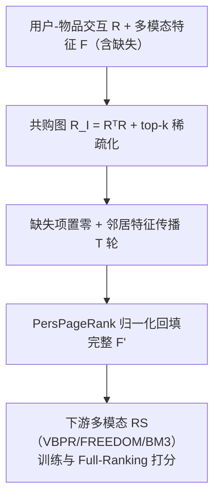
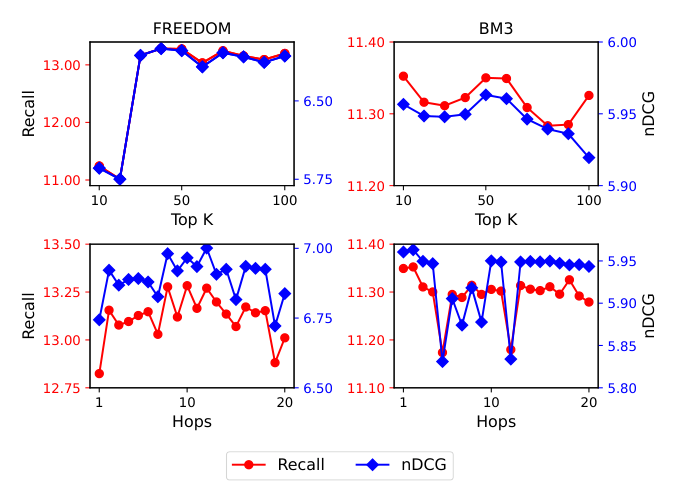

# Do We Really Need to Drop Items with Missing Modalities in Multimodal Recommendation? (多模态推荐中真的需要丢弃缺失模态的物品吗？)

- **会议/期刊**: CIKM 2024 (Short Paper Track)
- **作者与机构**: Daniele Malitesta (CentraleSupélec/Inria)、Emanuele Rossi (VantAI)、Claudio Pomo & Tommaso Di Noia (Politecnico di Bari)、Fragkiskos D. Malliaros (CentraleSupélec/Inria)
- **推荐链路定位**: 召回（多模态召回模型的数据预处理前置阶段）
- **研究方向**: 多模态推荐 / 自监督与交互去噪
- **论文原文**: [https://arxiv.org/abs/2408.11767v1](https://arxiv.org/abs/2408.11767v1)
- **开源代码**: [https://github.com/sisinflab/Graph-Missing-Modalities](https://github.com/sisinflab/Graph-Missing-Modalities)

## TL;DR (1分钟核心速览)

多模态推荐领域长期默认"物品缺失视觉/文本特征就直接丢弃"，本文指出该做法在 Amazon 三域上会连带丢弃 27%–34% 的交互与大量用户（Music 物品从 3,568 降到 2,453）。作者提出一个**免训练、即插即用的插补预处理管线**，包含 3 种传统策略与 3 种利用 item-item 共购图的多跳特征传播策略。在 80/20 划分、Full-Ranking、Recall@20/nDCG@20 协议下，插补使 FREEDOM 在 Beauty 上从 10.99/5.76 升至 13.28/7.00（+20.8%/+21.5%），且多模态模型相对纯 CF 的增益被系统性放大。

## Background & Motivation (背景与核心矛盾)

- **主流范式**: 多模态推荐（VBPR、FREEDOM、BM3 等）以视觉/文本特征增强稀疏交互，但数据管线默认把"缺任一模态"的物品整条删除，得到干净但对齐的子集。
- **前人局限**: ①真实与学术数据集（Amazon Reviews）中缺失模态普遍存在（Beauty 有 977 个物品缺文本、7 个缺视觉），删除会连锁损失用户与交互，与"用多模态缓解稀疏"的初衷完全相反；②已有的缺失模态工作（LRMM）走端到端训练路线，需改动模型本体，无法插到任意现成多模态 RS 上。
- **核心洞察 (Key Insight)**: 推荐数据本身是二部图，共购物品在语义上高度相似（与 CF 的同质性假设同源），因此缺失模态可由 item-item 共购图上邻居的**已有特征**传播填补，无需任何训练。
- **本文切入点**: 将插补从"模型内模块"降级为"模型前预处理"，用图特征传播（参考 GNN 特征传播与图扩散）一次性修补特征张量 $\mathbf{F}$，之后任意多模态 RS 均可直接训练。

## Method (核心方法设计)

### 1. 整体框架 (Overall Architecture)

模型不改动任何推荐器本体，只替换数据管线中的过滤算子。输入为用户-物品交互矩阵 $\mathbf{R}\in\mathbb{R}^{|U|\times|I|}$与多模态张量$\mathbf{F}\in\mathbb{R}^{|I|\times|M|\times c}$；先构造共购矩阵$\mathbf{R}_I=\mathbf{R}^{\top}\mathbf{R}$并做 top-$k$稀疏化去掉噪声边，随后对每个缺失的$\mathbf{F}_{im}$依所选插补策略用邻居特征填充（缺失项先初始化为零向量，$T$ 轮迭代后回填），得到完整张量后交给 VBPR / FREEDOM / BM3 等下游模型正常训练与全库打分。整个过程无梯度、无参数、可离线一次性完成。

### 2. 关键设计拆解 (Key Designs)

1. **NeighMean / MultiHop：把 GlobalMean 搬到图邻居上**：全局均值忽略了"谁和谁一起被买"，故将均值限定在一跳邻居 $\mathcal{N}_i$ 内，再做对称拉普拉斯归一化的多跳迭代，避免高度数邻居主导：
$\mathbf{F}_{im}^{(t)}=\sum_{j\in\mathcal{N}_i}\frac{\mathbf{F}_{jm}^{(t-1)}}{\sqrt{|\mathcal{N}_i|}\sqrt{|\mathcal{N}_j|}},\ \forall t\in\{1,\dots,T\}$
直觉：共购边等价于"语义近邻边"，多跳传播把稀疏的单物品观测扩散成局部共识特征；每轮把已有模态物品的特征重置回原值，防止真实特征被自身平滑掉。

2. **PersPageRank：用个性化 PageRank 抑制噪声边**：多跳均匀传播在稠密共购图上会把远距离噪声也搬进来，故用 PPR 重写传播核，以遥概率 $\alpha$ 保留局部性：
$\mathbf{F}_{im}^{(t)}=\sum_{j\in\mathcal{N}_i}(\alpha\mathbf{B}^{-1})_{ij}\mathbf{F}_{jm}^{(t-1)},\quad \mathbf{B}_{ij}=1-\frac{1-\alpha}{\sqrt{|\mathcal{N}_i|}\sqrt{|\mathcal{N}_j|}}\ (i=j),\ \mathbf{B}_{ij}=-\frac{1-\alpha}{\sqrt{|\mathcal{N}_i|}\sqrt{|\mathcal{N}_j|}}\ (i\neq j)$直觉：$\alpha$ 越小越偏向近邻，等价于有限步扩散，兼顾"补全"与"不引入跨类污染"。

3. **训练目标、负采样与推理效率**: 本文无自建损失，训练目标完全由下游 RS 决定（BPR 成对损失 + 多模态对齐/去噪正则）。插补阶段零参数、零负采样，计算量仅是一次稀疏矩阵乘法的 $T$次迭代，$O(T\cdot|\mathcal{E}_I|\cdot c)$，可离线预计算并缓存，线上推理开销与原始模型**完全一致**，这是相对 LRMM 类端到端方案的核心工程优势。

## Experimental Setup & Evaluation Protocol (实验设置与评估协议)

- **数据集与预处理**: Amazon Reviews 三个类目，两套版本——`dropped`（删除任一模态缺失物品）与 `imputed`（本文插补后保留）。视觉特征用预训练 CNN、文本特征用 sentence encoder 抽取。

| 数据集 | #Users 原/删后 | #Items 原/删后 | #Interactions 原/删后 | 密度(原) | 缺失物品数 V / T |
| :--- | :---: | :---: | :---: | :---: | :---: |
| Office | 4,905 / 4,891 | 2,420 / 1,746 | 53,258 / 35,185 | 0.449% | 0 / 674 |
| Music | 5,541 / 5,349 | 3,568 / 2,453 | 64,706 / 51,516 | 0.327% | 2 / 1,114 |
| Beauty | 22,363 / 22,293 | 12,101 / 11,124 | 198,502 / 165,772 | 0.073% | 7 / 977 |

- **数据划分与防穿越**: 随机 `比例划分` 80%/20%（train/test），再从训练集中留 10% 作验证集，以验证 Recall@20 早停；无时间戳切分，故不涉及严格时序防穿越。
- **排名评测协议**: `Full-Ranking`（测试集正样本对全库未交互物品打分排序），指标 Recall@20 与 nDCG@20；训练沿用各基线的 BPR 成对负采样。
- **对比基线与超参**: CF 侧 BPRMF / NGCF / LightGCN / SGL，多模态侧 VBPR / NGCF-M / FREEDOM / BM3；学习率 $\{1\text{e-}4,\dots,1\text{e-}2\}$，正则$[1\text{e-}5,1\text{e-}2]$，batch 1024，epoch 200；top-$k\in[10,100]$、跳数$T\in[1,20]$ 网格搜索。

## Key Experimental Results (实验关键数据)

### 1. 主实验对比 (Main Results)

插补设定下 8 个基线在三域的表现（Bold 为最优，下划线为次优）：

| 模型 | Office R@20 | Office nDCG | Music R@20 | Music nDCG | Beauty R@20 | Beauty nDCG |
| :--- | :---: | :---: | :---: | :---: | :---: | :---: |
| BPRMF | 8.51 | 4.55 | 24.59 | 13.69 | 9.43 | 4.85 |
| NGCF | 8.18 | 3.91 | 24.12 | 13.06 | 8.92 | 4.56 |
| LightGCN | 11.55 | 6.12 | 26.61 | 14.49 | 11.61 | 6.02 |
| SGL | 10.28 | 5.81 | _27.59_ | **15.86** | _12.20_ | _6.72_ |
| VBPR | 10.09 | 5.51 | 26.25 | 14.58 | 10.93 | 5.74 |
| NGCF-M | _11.65_ | 5.85 | 25.18 | 13.64 | 11.00 | 5.76 |
| FREEDOM | **12.79** | **6.76** | _27.18_ | _14.91_ | **13.28** | **7.00** |
| BM3 | 11.28 | _6.15_ | 25.11 | 13.55 | 11.49 | 6.04 |

**多模态增益对比（RQ1，Table 2）**: VBPR vs BPRMF 在 dropped 设定下 Music 为 **−4.83%/−3.72%**（多模态反而劣于纯 CF），在 imputed 设定下转为 **+6.75%/+6.50%**；NGCF-M vs NGCF 在 Office 上由 +31.32%/+41.65% 升至 **+42.42%/+49.62%**，Beauty 由 +12.04%/+15.42% 升至 **+23.32%/+26.32%**。

### 2. 消融实验 (Ablation Study)

在 FREEEDOM / BM3 上替换 6 种插补策略（Music / Beauty）：

| 插补策略 | FREE-Music R | FREE-Music nDCG | FREE-Beauty R | FREE-Beauty nDCG | BM3-Music R | BM3-Music nDCG | BM3-Beauty R | BM3-Beauty nDCG |
| :--- | :---: | :---: | :---: | :---: | :---: | :---: | :---: | :---: |
| Zeros | 25.60 | 13.78 | 10.99 | 5.76 | 24.64 | 13.00 | 11.31 | 5.96 |
| Random | 26.81 | 14.46 | 13.00 | 6.73 | 24.29 | 12.93 | 11.35 | 5.88 |
| GlobalMean | 26.62 | 14.61 | 13.02 | 6.80 | 24.27 | 12.88 | 11.35 | 5.91 |
| NeighMean | 26.17 | 14.35 | _13.23_ | _6.88_ | 24.46 | 12.95 | _11.48_ | 6.01 |
| MultiHop | _27.09_ | **14.91** | _13.26_ | _6.96_ | **25.00** | **13.55** | **11.49** | **6.04** |
| PersPageRank | **27.18** | _14.88_ | **13.28** | **7.00** | _25.11_ | _13.44_ | 11.35 | 5.96 |

### 3. 关键实验发现 (Key Findings)

1. **"丢弃"确实在制造负增益**：Music 上 dropped 设定让 VBPR 相对 BPRMF 的 Recall 变为 −4.83%，即多模态特征非但没帮忙还拖了后腿；换成插补后同一对模型转为 +6.75%。说明此前文献中"多模态增益不稳定"的报告很可能部分源于过滤而非模型缺陷。
2. **图感知优于传统插补，且差距在稀疏域更大**：Beauty 上 FREEEDOM 用 Zeros 仅 10.99/5.76，换 PersPageRank 达 13.28/7.00（+20.8%/+21.5%）；Music 上差距缩小到 27.18 vs 25.60（+6.2%），表明共购图密度越高、传播补全收益越明显。
3. **插补策略并非普遍最优，存在模型-数据耦合**：BM3 在 Beauty 上 PersPageRank（11.35/5.96）竟与 Zeros 持平，反被 MultiHop（11.49/6.04）超越；且 BM3-Music 上 Zeros（24.64）也优于 GlobalMean（24.27）。说明对已含强去噪/自举正则的模型，过度平滑的传播核可能与其内在表征对齐机制冲突。

## Highlights & Limitations (亮点、对比与审稿批判)

- **与代表作对比 (vs. Prior Work)**: ①vs **LRMM**（唯一先行工作）：LRMM 需端到端训练模态相关性与重构自编码器，绑定模型结构；本文是零参数前置预处理，可插到任意 RS。②vs **FREEDOM / BM3**：这两者解决的是"模态图噪声"，仍以完整模态为前提；本文补上其前提假设的缺口，且与之正交可叠加（实验即在其上验证）。③vs 传统 **GlobalMean**：把"全局统计"换成"图局部共识"，是本文全部增量所在。
- **可迁移亮点**: ①"item-item 共购图 + PPR 多跳传播"可直接迁移到冷启动物品特征补全、跨域特征对齐等场景；②把数据过滤算子当作可替换的"前置插补算符"这一视角，可推广到序列推荐中缺失 side-info 的处理。
- **审稿级局限批判**: ①实验仅覆盖 Amazon 商品域与两种模态，未触及"整个模态向量缺失"以外的部分维度缺失、也未验证多模态数 $>2$的情形；②PPR 的超参$\alpha$、top-$k$、跳数$T$三者耦合（图 1 显示 FREEEDOM 需$k\ge30$、$T\approx10$，BM3 在$k\approx50$ 更佳），缺少自适应选择准则，落地时需逐数据集调参；③下游指标提升未报告显著性检验，且短论文未给训练时长/内存的定量开销对比。

<figure class="paper-figure" markdown="span">
  <figcaption>图1：top-𝑘 稀疏化（上）和传播跳数（下）对 Beauty 数据集上 PersPageRank 的影响。</figcaption>
</figure>

## Rating (四维评分)

- **方法创新性 (Novelty)**: ⭐⭐⭐ （问题定义本身比算子更值钱：把"缺失模态"从模型内问题改写为数据管线问题，但图传播/PersPageRank 本身是成熟技术的直接移植）
- **评估协议与实验扎实度 (Protocol & Experiments)**: ⭐⭐⭐⭐ （三域 × 8 基线 × 6 插补策略的全组合矩阵，且用"模型对差值"巧妙规避两套数据不可直接比较的问题；扣分在无显著性检验与线上验证）
- **写作与数学规范度 (Clarity & Rigor)**: ⭐⭐⭐⭐ （符号统一、公式简洁，PersPageRank 的 $\mathbf{B}$ 定义虽略显绕但可复现；短论文篇幅下缺少复杂度与收敛性讨论）
- **工业落地与复现价值 (Industrial & Practical Value)**: ⭐⭐⭐⭐⭐ （零参数、零推理开销、代码开源，是极少见的"改数据管线即可涨点"的工作，工程迁移成本近乎为零）

