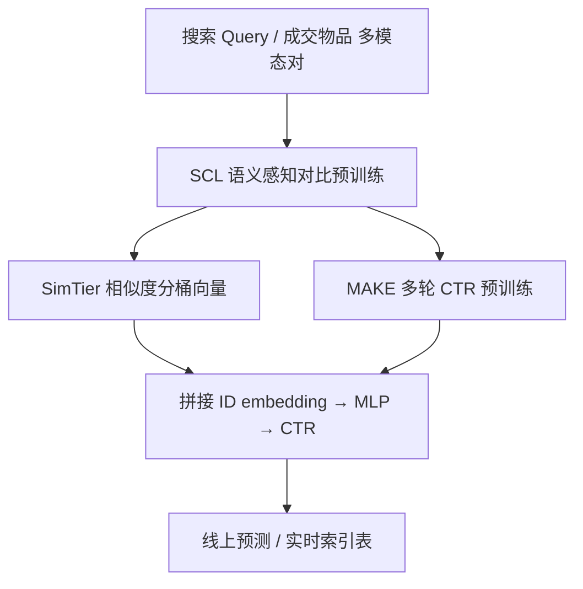
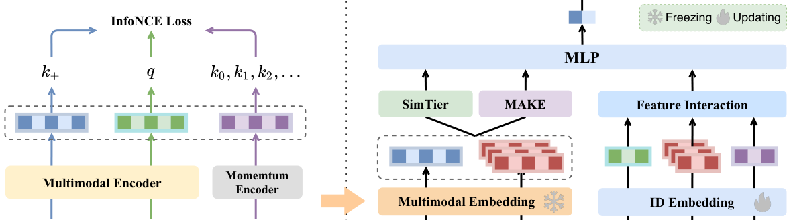
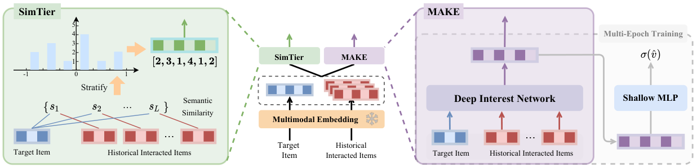

# Enhancing Taobao Display Advertising with Multimodal Representations: Challenges, Approaches and Insights (淘宝展示广告的多模态表征增强：挑战、方法与洞见)

- **会议/期刊**: CIKM 2024
- **作者与机构**: Xiang-Rong Sheng, Feifan Yang, Litong Gong, Biao Wang, Han Zhu 等，阿里巴巴集团
- **推荐链路定位**: 精排 / 重排（CTR 预估），并复用于粗排与召回
- **研究方向**: 多模态推荐 / 冷启动与长尾推荐
- **论文原文**: [https://arxiv.org/abs/2407.19467v1](https://arxiv.org/abs/2407.19467v1)
- **开源代码**: 暂未开源

## TL;DR (1分钟核心速览)

工业级 ID 基推荐模型仅依赖稀疏 ID，无法捕捉物品的视觉/文本语义，且冷启动物品几乎无信号。本文提出两阶段框架：阶段一用「搜索 query↔成交物品」构造电商语义对齐对，以 MoCo+InfoNCE+Triplet 做语义感知对比预训练 (SCL)；阶段二用 SimTier 把目标物品与历史交互物品的相似度做分桶计数、用 MAKE 以多轮预训练解耦多模态参数与 ID 参数。在淘宝展示广告一周曝光日志上，Full-Ranking 口径 GAUC +1.25%、AUC +0.75%，线上 A/B 广告 CTR +3.5%，24h 内新广告 CTR +6.9%，秒级完成新物品表征生成。

## Background & Motivation (背景与核心矛盾)

- **主流范式**: 工业推荐仍以 ID 特征为主干，多模态数据多以「拼接 side-info」方式挂接在 embedding 后送入行为建模与 MLP。
- **前人局限**: 其一，通用 CLIP 表征无法区分电商场景中「高度相似但细节不同」的同款商品（图 5 的枕头样例）；其二，ID 模型仅训 1 epoch 即过拟合，而多模态参数需多轮才能收敛，联合训练下多模态侧学习不足。
- **核心洞察 (Key Insight)**: 作者实测发现「纯多模态模型 GAUC 随 epoch 持续上升」（图 3），印证 ID 与多模态存在**训练轮次错配**；且预训练 Acc@1 与下游 GAUC 强正相关（图 6a），可作为低成本的表征质量代理指标。
- **本文切入点**: 用电商成交信号定制对比预训练 → 用分桶相似度与双轨训练分别解决「表征怎么用」与「轮次怎么对齐」两个工程难题。

## Method (核心方法设计)

### 1. 整体框架 (Overall Architecture)

框架分两阶段：阶段一离线以图像/文本 encoder + 动量 encoder 在 query-成交物品对上做 SCL 对比预训练，得到语义可分表征；阶段二把预训练表征接入 ID 基排序模型——SimTier 将「目标 vs 历史交互」相似度统计为定长向量，MAKE 以 CTR 为代理任务多轮预训练多模态相关参数，再将其输出拼接进主模型 MLP。线上由实时编码器 + 多模态索引表支撑新物品秒级可见。

<figure class="paper-figure" markdown="span">
  <figcaption>图1：我们的两阶段框架概览：多模态表示的预训练，随后将预训练表示集成到推荐模型中。在第一阶段（参见图(a)），我们通过语义感知对比学习进行预训练。该方法使多模态表示具备识别语义相似物品的能力。随后，在第二阶段（参见图(b)），我们引入提出的SimTier，并采用方法将预训练多模态表示有效融入推荐模型。</figcaption>
</figure>

### 2. 关键设计拆解 (Key Designs)

**① SimTier：把高维相似度压成分桶计数向量**。拼接 embedding（Vector）在联合训练中参数学不动，作者改为降维使用：先算目标 $v_c$与历史$v_i$的内积$s_i=v_i\cdot v_c$，再把$[-1,1]$均分为$N$个 tier，用$\lceil (s_i+1)/2\cdot N\rceil$落桶并对每桶计数，得到$\mathbf{h}\in\mathbb{R}^N$。其直觉是用「多少历史物品与目标相似」替代「每个历史物品的具体向量」，既降噪又让相似度可直接被精排利用。

**② MAKE：用多轮预训练分离多模态参数优化**。痛点来源是 ID 1-epoch 过拟合与多模态多 epoch 收敛冲突。MAKE 先以 DIN 聚合多模态历史 $v_{\text{MAKE}}=\text{DIN}(\{v_i\}_{i=0}^{L},v_c)$，接四层 MLP 输出$\hat v=\text{MLP}_{\text{MAKE}}(v_{\text{MAKE}})$，以交叉熵$\mathcal{L}_{\text{MAKE}}$训练多轮，再把$v_{\text{MAKE}}$ 及中间层拼入下游主模型。这样多模态侧参数在多轮中充分收敛，而非被动随 ID 侧单轮更新。

**③ 训练目标、负采样与推理**. SCL 采用 $\mathcal{L}_{\text{InfoNCE}}=-\log\frac{\exp(q\cdot k^+/\tau)}{\sum_{i=0}^{K}\exp(q\cdot k_i/\tau)}$，$\tau$可学习，memory bank$K=196{,}800$，并对每个$\langle q,k^+,k^-\rangle$ 三元组叠加 Triplet Loss 以区分难负例（硬负例=正样本触发的点击图）。推理侧只需编码器前向 + 索引查表，新物品表征延迟仅数秒。

<figure class="paper-figure" markdown="span">
  <figcaption>图2：所提出的SimTier与多模态知识提取器（MAKE）方法的示意图，细节分别见第4.2节和第4.3节。</figcaption>
</figure>

## Experimental Setup & Evaluation Protocol (实验设置与评估协议)

- **数据集与预处理**: 数据均来自淘宝展示广告系统，规模未公开（工业保密）。预训练集为 $\langle$图像 query, 成交物品图$\rangle$ 三元组，CTR 集为**一周曝光日志**。

| 数据集 | 规模 | 稀疏度 | 场景说明 |
| :--- | :---: | :---: | :--- |
| 预训练集 | 未披露 | — | 搜索 query + 成交物品（含硬负例点击图） |
| CTR 数据集 | 一周曝光日志 | 极稀疏（ID 为主） | 淘宝展示广告精排 |

- **数据划分与防穿越**: 原文未明确披露切分比例；工业场景默认按曝光日志时间顺序切分训练/测试，以规避未来信息泄漏（需注意原文未给出具体时间窗口）。
- **排名评测协议**: CTR 侧采用工业常规**离线全样本排序**（AUC/GAUC 全量口径，未采用 sampled 负采样），配合线上 A/B 作为无偏佐证。
- **对比基线与超参**: 预训练对比 CLIP-O / CLIP-E / SCL（含 w/o Triplet、w/o Triplet&MoCo 变体）；集成对比 ID-based、Vector、SimScore、SimTier、MAKE。指标为 AUC/GAUC 与 Acc@N（检索命中率）；原文未报告显著性检验（$p$ 值未披露）。

## Key Experimental Results (实验关键数据)

### 1. 主实验对比 (Main Results)

CTR 预估各集成方式相对 ID-based 基线的离线增益（% 为相对提升）：

| Method | GAUC | AUC |
| :--- | :---: | :---: |
| ID-based Model (prod baseline) | — | — |
| Vector | +0.29% | +0.18% |
| SimScore | +0.77% | +0.40% |
| SimTier | +0.96% | +0.59% |
| MAKE | +0.93% | +0.51% |
| **SimTier + MAKE** | **+1.25%** | **+0.75%** |

预训练表征质量（Acc@N 检索准确率）：

| Method | Acc@1 | Acc@5 |
| :--- | :---: | :---: |
| CLIP-O | 0.2559 | 0.3575 |
| CLIP-E | 0.2952 | 0.3917 |
| **SCL** | **0.7474** | **0.8850** |

### 2. 消融实验 (Ablation Study)

| 配置 | Acc@1 | Acc@5 | 结论 |
| :--- | :---: | :---: | :--- |
| SCL 完整 | **0.7474** | **0.8850** | 最优 |
| w/o Triplet Loss | 0.6957 | 0.8604 | −6.9% / −2.8% |
| w/o Triplet & MoCo | 0.5760 | 0.7590 | −22.9% / −14.2% |

| 集成组件 | GAUC | AUC |
| :--- | :---: | :---: |
| 仅 SimTier | +0.96% | +0.59% |
| 仅 MAKE | +0.93% | +0.51% |
| 二者组合 | **+1.25%** | **+0.75%** |

### 3. 关键实验发现 (Key Findings)

1. **语义对齐比通用预训练更关键**: SCL 的 Acc@1 (0.7474) 是 CLIP-E (0.2952) 的 2.5 倍，说明电商成交信号构造的正对远比通用图文对齐更贴近下游检索分布。
2. **降维使用优于直接拼接**: SimTier(+0.96% GAUC) 明显优于 Vector(+0.29%)，印证「用相似度统计替代原始向量」可缓解多模态参数在单轮联合训练中欠拟合导致的训练不足。
3. **多模态对长尾/新物品收益更大**: 图 6(b) 显示低频物品组相对 AUC 提升更显著，线上 24h 新广告 CTR +6.9%/ROI +7.7% 远超整体（+3.5%/+2.9%），验证多模态对冷启动的系统级价值。

## Highlights & Limitations (亮点、对比与审稿批判)

- **与代表作对比**: 相较通用 CLIP 直接拼接 (Vector) 与硬负例三元组方案，本文以电商 query-成交对定义相似度（类比 MoCo/CLIP 但场景定制）、并以分桶相似度+双轨训练解决 ID 与多模态 epoch 错配，工业落地性是核心差异。
- **可迁移亮点**: (1) 用「预训练 Acc@N 与下游 GAUC 强相关」作为低成本表征质量代理指标，可加速多模态预训练迭代；(2) SimTier 的相似度分桶计数可作为通用「目标-历史语义匹配」特征插入任意序列模型。
- **审稿级局限批判**: 其一，数据集规模、划分窗口与显著性检验均未披露，离线增益缺乏统计置信度支撑；其二，论文为工业经验报告，SimTier/MAKE 为经验性设计，缺少与更复杂跨模态注意力融合方案的系统对比，普适性论证偏弱。

## Rating (四维评分)

- **方法创新性 (Novelty)**: ⭐⭐⭐⭐ （SCL 电商语义对齐 + SimTier 分桶 + MAKE 双轨训练三项均为场景定制式创新，工程洞察扎实，但理论新颖度中等）
- **评估协议与实验扎实度 (Protocol & Experiments)**: ⭐⭐⭐ （离线 AUC/GAUC + 线上 A/B 双证据充分，但数据规模、划分与显著性检验披露不足，消融相对完整）
- **写作与数学规范度 (Clarity & Rigor)**: ⭐⭐⭐⭐ （框架图清晰、公式简洁规范，工程细节落地性强；理论推导与复杂度分析偏少）
- **工业落地与复现价值 (Industrial & Practical Value)**: ⭐⭐⭐⭐⭐ （线上真实部署秒级延迟、CTR +3.5% 且新广告 +6.9%，工业参考价值极高，但因未开源复现门槛较高）

