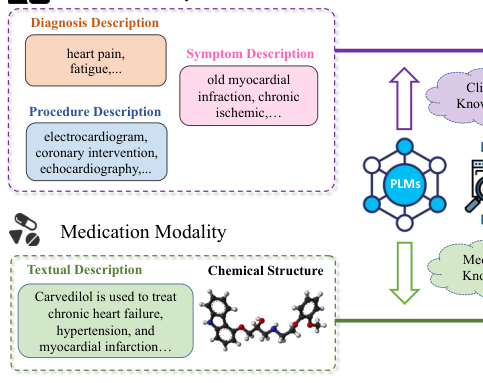
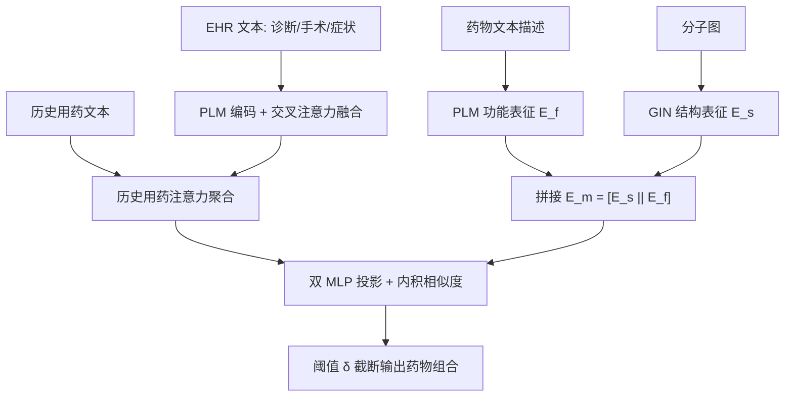
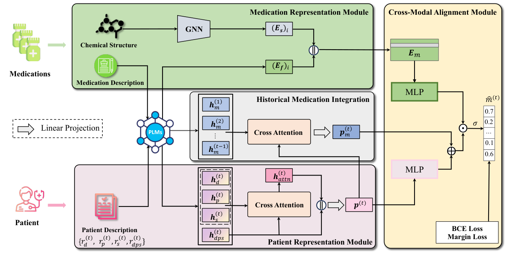

# Natural Language-Assisted Multi-modal Medication Recommendation (自然语言辅助的多模态用药推荐)

- **会议/期刊**: CIKM 2024
- **作者与机构**: Jie Tan, Hong Cheng, Helen Meng 等（香港中文大学）；Yu Rong, Tingyang Xu（阿里达摩院 / 湖畔实验室）；Kangfei Zhao（北京理工大学）
- **推荐链路定位**: 召回（患者向量与药物向量的相似度检索）
- **研究方向**: 多模态推荐与内容理解 / LLM 语义表征增强
- **论文原文**: [https://arxiv.org/abs/2501.07166v1](https://arxiv.org/abs/2501.07166v1)
- **开源代码**: [https://github.com/jtan1102/NLA-MMR_CIKM_2024](https://github.com/jtan1102/NLA-MMR_CIKM_2024)

## TL;DR (1分钟核心速览)

组合用药推荐（CMR）现有方法只用 EHR 结构化编码与药物分子图，**丢弃了药物功能文本描述**，且患者侧文本知识利用率极低。本文提出 NLA-MMR，把患者（诊断/手术/症状文本）与药物（文本描述 + 化学结构）视为两个模态，用冻结的领域 PLM 编码后投影到同一隐空间做内积对齐，并把推荐转为“患者向量检索药物向量”。在 MIMIC-III/IV/eICU 上（随机 2/3-1/6-1/6 划分、阈值多标签评估）Jaccard 相对最优基线分别提升 2.86%、7.01%、6.95%，平均 +4.72%。

## Background & Motivation (背景与核心矛盾)

- **主流范式**: SafeDrug / MoleRec / DrugRec 等纵向模型以 RNN 串起历史就诊，用分子图（GIN）或 SMILES 编码药物，再拼 EHR 多热向量做多标签预测。
- **前人局限一**: 药物表征仅有化学结构，而 PubChem/DrugBank 上“Carvedilol 用于治疗慢性心衰、高血压、心梗”这类功能文本被完全忽略，无法建立患者症状与药理语义的显式关联。
- **前人局限二**: 结构化外部知识（BioKG、DDI 矩阵）在抽取与采样阶段存在信息损失与偏置；患者侧诊断/手术/症状文本亦被压成 ID 多热向量，语义被稀释。
- **核心洞察 (Key Insight)**: 若把“患者”与“药物”当作两个模态，领域 PLM 已在其预训练语料中内化了临床语义，可直接充当统一的语义基座，使二者在同一空间可比。
- **本文切入点**: 用 PLM 表征 + 跨模态对齐替代“ID 拼接 + 分类头”，把推荐变成相似度检索问题。

<figure class="paper-figure" markdown="span">
  <figcaption>图1：借助从 PLMs 提取知识进行组合用药推荐的示意图</figcaption>
</figure>

## Method (核心方法设计)

### 1. 整体框架 (Overall Architecture)

输入为患者第 $t$次就诊的诊断/手术/症状文本$r^{(t)}=(r_d,r_p,r_s)$、历史用药文本$r_m^{(i)}$、以及药物集$\mathcal{M}$的文本描述与分子图。患者侧：PLM 编码拼接文本得$\boldsymbol{h}_{dps}^{(t)}$，并对三类文本做交叉注意力融合；历史用药侧：以患者向量为 query 对既往用药文本 embedding 做注意力聚合。药物侧：GIN 编码分子图得$\boldsymbol{E}_s$，PLM 编码功能描述得$\boldsymbol{E}_f$，拼接成$\boldsymbol{E}_m$。两侧经 MLP 投影到联合隐空间，内积 + sigmoid 打分，推理时按相似度排序并以阈值$\delta$ 截断输出药物组合。

<figure class="paper-figure" markdown="span">
  <figcaption>图2：NLA-MMR 的架构。NLA-MMR 由三个模块组成：(a) 患者表示模块以 PLMs 为基础编码器，从诊断、手术和症状构建患者模态的表示。(b) 药物表示模块融合由药物文本描述和化学结构得到的嵌入，以构建药物模态的表示。(c) 跨模态对齐模块以患者和药物模态的表示为输入，并在同一潜在空间中对齐它们。我们进一步考虑历史……</figcaption>
</figure>

### 2. 关键设计拆解 (Key Designs)

1. **患者侧交叉注意力融合**：直接拼接三类文本会淹没稀有但关键的证候（如症状）。以拼接文本 $\boldsymbol{h}_{dps}^{(t)}$ 为 query、三类文本为 key 计算权重后加权求和，再与基础表征拼接：
$\{w_c\}_{c\in\{d,p,s\}}=\mathrm{softmax}\!\left(\frac{\boldsymbol{H}^{(t)}\boldsymbol{W}_1\boldsymbol{W}_2^{\top}\boldsymbol{h}_{dps}^{(t)\top}}{\sqrt{d_K}}\right),\ \boldsymbol{p}^{(t)}=[\boldsymbol{h}_{attn}^{(t)}\|\boldsymbol{h}_{dps}^{(t)}]\boldsymbol{W}_r+\boldsymbol{b}_r$。
直觉：让“全局摘要”反向选择它最需要的子模态证据，避免固定拼接的等权偏置。
2. **跨模态对齐即检索**：以往用药物 ID 分类头，药物间语义不可迁移。本文对 $\boldsymbol{p}^{(t)}$与$\boldsymbol{E}_m$各过一个 MLP 后做内积：$\hat{m}_i^{(t)}=\sigma(\tilde{\boldsymbol{p}}^{(t)\top}\tilde{\boldsymbol{E}}_{m,i})$。药物向量与患者向量共享几何空间，新药只需文本+结构即可“零样本”入池，这是相对 ID 分类头的本质增量。
3. **历史用药注意力 + 双损失**：既往研究只回看诊断历史，而复诊患者“上次开了什么药”信息量更高。以 $\boldsymbol{p}^{(t)}$为 query 对历史用药文本嵌入加权：$\boldsymbol{p}_m^{(t)}=(\sum_{i<t}w_m^{(i)}\boldsymbol{h}_m^{(i)})\boldsymbol{W}_m+\boldsymbol{b}_m$，最终 query 为$\tilde{\boldsymbol{p}}^{(t)}+\boldsymbol{p}_m^{(t)}$。训练用$\mathcal{L}=\alpha\mathcal{L}_{bce}+(1-\alpha)\mathcal{L}_{mar}$，其中$\mathcal{L}_{mar}=\sum_t\sum_{i:m_i=1}\sum_{j:m_j=0}\frac{\max\{1-(\hat{m}_i-\hat{m}_j),0\}}{|\mathcal{M}|}$拉大正负药边际；$\alpha=0.95$。PLM 全程冻结、无负采样（未开具药物即隐式负例），推理仅一次矩阵内积。

## Experimental Setup & Evaluation Protocol (实验设置与评估协议)

- **数据集与预处理**（沿用 DrugRec 处理，标签为 ATC 三级码；eICU 无手术记录、无 DDI 表）：

| 数据集 | #Users | #Items(药) | #Interactions(就诊) | 平均就诊/药物数 | 特征/场景说明 |
| :--- | :---: | :---: | :---: | :---: | :--- |
| MIMIC-III | 5,208 | 112 | 13,490 | 2.59 / 11.30 | 诊断1895、手术1378、症状428 |
| MIMIC-IV | 6,136 | 121 | 17,813 | 2.90 / 6.68 | 诊断1851、手术4001、症状163 |
| eICU | 9,539 | 31 | 20,912 | 2.19 / 5.98 | 仅诊断1371，无手术/症状 |

- **数据划分与防穿越**: 按患者随机划分为 train/val/test = 2/3、1/6、1/6；患者内就诊次序保持时间序（第 $t$次预测只能看到$<t$ 的记录），但划分本身非全局时间戳切分。
- **排名评测协议**: 非 Full-Ranking，而是**阈值式多标签判定**——对全部 $|\mathcal{M}|$个药物打分后以$\delta=0.5$ 截断成集合，报告 Jaccard、F1、PRAUC；不做负采样排序。
- **对比基线与超参**: 3 个 instance-based（LR、ECC、LEAP）+ 7 个纵向基线（RETAIN、GAMENet、MICRON、SafeDrug、COGNet、DrugRec、MoleRec）。GIN 4 层、$d_s=64$、$d_{enc}=768$、投影 MLP [768,256,256]、dropout 0.2、lr$5\times10^{-4}$、110 epoch、5 个 PLM（BioBERT/SciBERT/ClinicalBERT/PubMedBERT/BlueBERT）均冻结。

## Key Experimental Results (实验关键数据)

### 1. 主实验对比 (Main Results)

| 方法 | MIMIC-III Jaccard | F1 | PRAUC | MIMIC-IV Jaccard | F1 | PRAUC | eICU Jaccard |
| :--- | :---: | :---: | :---: | :---: | :---: | :---: | :---: |
| LR | 0.4896 | 0.6491 | 0.7568 | 0.3844 | 0.5379 | 0.6568 | 0.4199 |
| GAMENet | 0.5039 | 0.6609 | 0.7632 | 0.3957 | 0.5525 | 0.6479 | 0.4590 |
| MICRON | 0.5076 | 0.6634 | 0.7685 | 0.4009 | 0.5545 | 0.6584 | 0.3741 |
| SafeDrug | 0.5090 | 0.6664 | 0.7647 | 0.4082 | 0.5651 | 0.6495 | 0.4474 |
| COGNet | 0.5134 | 0.6706 | 0.7677 | 0.4131 | 0.5660 | 0.6460 | 0.4588 |
| DrugRec | 0.5220 | 0.6771 | 0.7720 | 0.4194 | 0.5713 | 0.6558 | 0.4508 |
| MoleRec | 0.5278 | 0.6825 | 0.7736 | 0.4197 | 0.5772 | 0.6644 | 0.4476 |
| **NLA-MMR** | **0.5429** | **0.6958** | **0.7890** | **0.4491** | **0.6051** | **0.6921** | **0.4787** |
| Improv. (vs. 最优基线) | +2.86% | +1.95% | +1.99% | +7.01% | +4.84% | +4.17% | +6.95% |

### 2. 消融实验 (Ablation Study)

| 变体 | Jaccard | F1 | PRAUC |
| :--- | :---: | :---: | :---: |
| (a) w/o 结构表征 $\boldsymbol{E}_s$ | 0.5368 | 0.6909 | 0.7872 |
| (b) w/o 文本表征 $\boldsymbol{E}_f$ | 0.4747 | 0.6352 | 0.7394 |
| (c) w/o 交叉注意力融合 | 0.5348 | 0.6892 | 0.7815 |
| (d) w/o 历史用药整合 | 0.5303 | 0.6848 | 0.7794 |
| (e) 融合时去掉诊断 $h_d$ | 0.5413 | 0.6946 | 0.7867 |
| (f) 融合时去掉手术 $h_p$ | 0.5425 | 0.6955 | 0.7884 |
| (g) 融合时去掉症状 $h_s$ | 0.5415 | 0.6946 | 0.7883 |
| Full NLA-MMR | **0.5429** | **0.6958** | **0.7890** |

### 3. 关键实验发现 (Key Findings)

1. **文本分支是性能主引擎，结构是补丁**：去掉 $\boldsymbol{E}_f$ 使 Jaccard 从 0.5429 崩到 0.4747（−12.6%），甚至低于仅用 ID 的 DrugRec；而去掉 GNN 结构仅降 1.1%，说明 PLM 语义对齐贡献了主要增益，分子图只在 t-SNE 上呈现可分的化学性质聚类，起互补作用。
2. **历史用药注意力优于单纯回看病史**：去掉该模块 Jaccard −2.3%；就诊数从 1 增到 2 时三个指标明显上升，之后饱和，作者据此指出“仅最近两次就诊信息有效，过旧处方反而误导”。
3. **PLM 领域纯度比规模更关键**：BioBERT 最优（0.5429），ClinicalBERT/BlueBERT 混入 MIMIC 临床记录反而退化到 0.5382/0.5296，支持“患者文本与药物文本属异质模态、混合领域预训练有害”的假设；同时 $\alpha=0$（纯 margin 损失）性能急剧下降，BCE 为主损失不可替代，$\alpha\in[0.90,1.0]$ 内稳定。

## Highlights & Limitations (亮点、对比与审稿批判)

- **与代表作对比 (vs. Prior Work)**: 相比 SafeDrug/MoleRec 把药物当“ID + 子结构”，本文让药物成为可检索向量，具备新药冷启动与跨数据集迁移潜力；相比只用结构化 BioKG/DDI 的 GAMENet，规避了知识抽取的信息损失；相比 DrugRec 的 SMILES 字符串，文本功能描述直接对应治疗意图。效率上训练 50.8 s/epoch、推理 7.7 s，远快于 MoleRec（479 s / 27.5 s）。
- **可迁移亮点**: (i) 用“患者 query 注意力聚合历史行为文本”替代 RNN 序列建模，轻量且可解释；(ii) 双塔内积 + 阈值截断的组合推荐范式，可直接迁移到多标签召回与 bundle 推荐。
- **审稿级局限批判**: (i) 安全性未被约束——DDI 只作为事后 $\Delta DDI$指标（本文最接近 ground truth），损失函数中并无 DDI 惩罚，无法保证输出组合安全；(ii) 评估依赖固定阈值$\delta=0.5$ 且未做全库排序或时间戳切分，eICU 的药物文本还需人工把 GTC 映射到 ATC，泛化与可扩展性存疑；PLM 冻结也意味着 768 维编码在更大药物库上可能成为瓶颈。

## Rating (四维评分)

- **方法创新性 (Novelty)**: ⭐⭐⭐⭐ （首个把患者/药物显式视为双模态并对齐成检索问题，思路清晰但组件均为成熟模块的组合）
- **评估协议与实验扎实度 (Protocol & Experiments)**: ⭐⭐⭐⭐ （三数据集 + 10 基线 + 多 PLM + 效率与可视化齐全，但阈值式评估与随机划分不及全库排序严格）
- **写作与数学规范度 (Clarity & Rigor)**: ⭐⭐⭐⭐ （模块公式与复杂度分析完整，个别符号如 $d_K$与$\boldsymbol{W}_3$ 维度定义略松）
- **工业落地与复现价值 (Industrial & Practical Value)**: ⭐⭐⭐⭐ （代码开源、推理开销低于多数基线，但依赖冻结 PLM 与人工文本标注，安全约束缺失限制临床直用）

