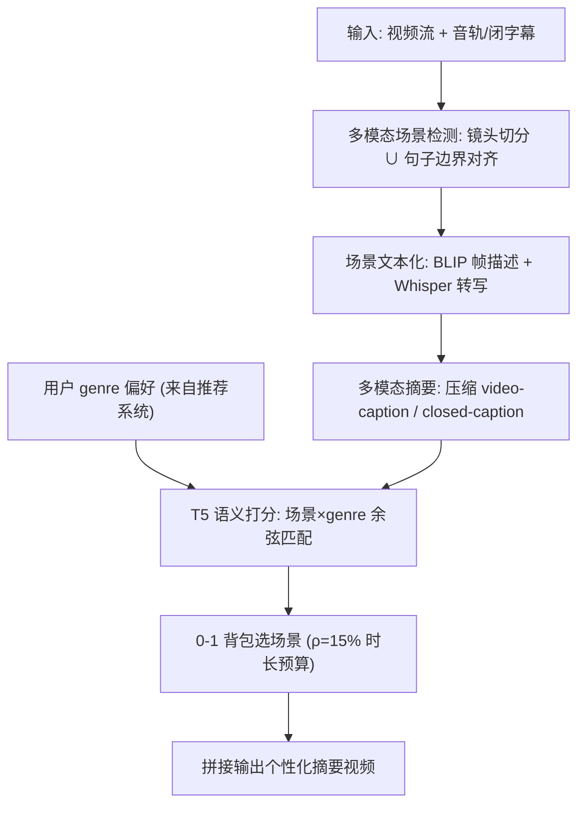
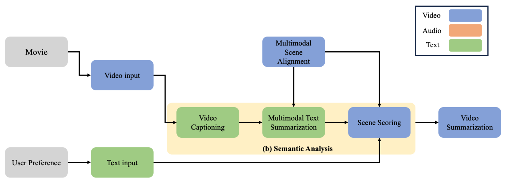

# Personalized Video Summarization by Multimodal Video Understanding (基于多模态视频理解的个性化视频摘要)

- **会议/期刊**: CIKM 2024 (Applied Research Track)
- **作者与机构**: Brian Chen, Xiangyuan Zhao, Yingnan Zhu（Samsung Research America, VDIL）
- **推荐链路定位**: 端到端生成式（推荐系统下游的内容呈现/摘要生成）
- **研究方向**: 多模态推荐 / 大语言模型推荐
- **论文原文**: [论文原文链接](https://arxiv.org/abs/2411.03531v1)
- **开源代码**: 暂未开源（作者声明将随 UserPrefSum 标注一并放出）

## TL;DR (1分钟核心速览)

推荐系统天然持有用户的 genre 偏好标签，但现有 query-guided 摘要模型只会理解 "A shark is swimming" 这类描述句，无法理解 "Sci-Fi / Romance" 这类抽象题材词，且每换一个用户偏好就要重跑一次视频编码器。本文提出 **VSL**：先用多模态场景检测切场景，把每个场景用 BLIP 帧描述 + Whisper 字幕转成文本并摘要，再用 T5 在文本空间计算场景与 genre 特征的余弦相似度打分，最后在 15% 时长预算下背包选场景。在自建 UserPrefSum（1008 部电影、1800 条 query、9000 个 moment）上 **F1 26.8 vs. UniVTG 23.6（+13.6%）**，且完全免摘要训练、genre 组合数扩张时推理时间恒定。

## Background & Motivation (背景与核心矛盾)

- **主流范式**: 视频摘要分两支——无监督通用摘要（CA-SUM / RS-SUM / AC-SUM-GAN，仅凭视觉显著性找重复亮点）与 query-guided 监督摘要（MomentDETR / QD-DETR / UniVTG，把自然语言 query 与视频特征做 cross-attention 后直接回归 moment 坐标）。
- **前人局限**: ① 监督模型只会匹配**描述性句子**，训练数据（QV-highlight）中根本没有 "Sci-Fi" 这类单词级高层语义标签，故 genre query 需额外微调才能适配；② DETR 类模型每换一组用户偏好就要把 video 特征重新过一遍 encoder，偏好组合数从 1 扩到 3 时 UniVTG 直接掉 3.5 个点（23.6→20.1），无法支撑线上按用户实时生成。
- **核心洞察 (Key Insight)**: 参照内容推荐系统假设——"喜欢某类电影的用户也会喜欢同类内容"，作者用 **genre 作为用户偏好的可计算代理**，从而把主观的"个性化摘要"转化为客观的"场景-题材相关性检索"；而题材匹配本质是**语义**问题，应该发生在文本空间而非像素空间。
- **本文切入点**: 把视频整体"翻译"成文本再做匹配，使摘要任务完全落在预训练语言模型的零样本能力上，用一次性视频侧离线处理换取偏好维度上的常数时间。

## Method (核心方法设计)

### 1. 整体框架 (Overall Architecture)

VSL 沿用 Socratic 模型的四段式流水线：输入电影的**视频流与音轨/闭字幕**分别进入**多模态场景检测**，将镜头切分边界与 ASR 句子级边界取并集对齐，得到既不截断画面也不截断对白的场景集合 $\{s_1,\dots,s_N\}$；每个场景经 **BLIP** 对子采样帧生成逐帧描述、经 **Whisper-timestamped** 获得带时间戳字幕，二者一起送入**多模态摘要模块**压缩为场景级文本；**场景打分模块**用预训练 T5 分别编码 video-caption 摘要$f^{vc}_i$与 closed-caption 摘要$f^{cc}_i$，与离线预计算的 genre 特征$f_{g_l}$做余弦匹配求和，得到显著性分数$M_i$；最后由**选帧模块**在总时长$\le 15\%$ 的预算下做 0-1 背包，拼接得分最高的场景输出个性化摘要。全流程**无任何摘要标注训练**，仅做推理。

<figure class="paper-figure" markdown="span">
  <figcaption>图3：VSL 的详细结构包括三个主要步骤。（a）第一步，输入电影的音频和视频骨干网络通过多模态场景检测进行处理。（b）第二步，执行语义分析，其根据多模态场景检测的结果为每个场景生成一个得分。（c）最后一步涉及视频摘要，其中选择得分最高的场景生成摘要视频。</figcaption>
</figure>

### 2. 关键设计拆解 (Key Designs)

1. **多模态场景检测（Multimodal Scene Detection）**：前人（MovieCLIPs）只用视觉镜头检测，常在对话中途切断，摘要观感破碎。本文并行跑视频 shot detection 与音频句子级分段，在帧级按**边界并集**合并：$t^{bound}=\mathrm{merge}\big(\{t^{v}_k\}\cup\{t^{a}_j\}\big)$。直觉很朴素但有效——把"语义完整"定义为画面与对白**同时**不被切断，因此任何一侧的边界都必须被尊重，是后续语义打分的可靠性前提。

2. **文本空间语义匹配打分（Text-Space Genre Scoring）**：痛点是把跨模态特征（CLIP 视频特征 vs. genre 文本）硬对齐，监督信号又缺失。VSL 改为同一 T5 编码器下做双路匹配：
$M_i=\sum_{l=1}^{L}\left(\frac{f^{vc}_i\cdot f_{g_l}}{\|f^{vc}_i\|\|f_{g_l}\|}+\frac{f^{cc}_i\cdot f_{g_l}}{\|f^{cc}_i\|\|f_{g_l}\|}\right)$,
即"画面看到什么"与"角色说了什么"各贡献一半证据。因为 genre 特征 $f_{g_l}$只依赖 query，可**完全离线预计算**，所以打分阶段对偏好数量是$O(1)$ 的——这正是 runtime 分析中 VSL 曲线持平的根本原因。

3. **训练目标、负采样与推理效率**：本文**无训练损失、无负采样**（零样本 pipeline），"监督"信号全部来自 CLIP 零样本标注 + 预训练 VLM/T5。推理形式化为 0-1 背包：
$\max_{x}\sum_{i}M_i x_i \quad \text{s.t.}\ \sum_i \ell_i x_i \le \rho\sum_i \ell_i,\ x_i\in\{0,1\}$,
短于 5 分钟的视频用背包求精确解以保证场景多样性，长视频用同预算下的贪心/得分排序截断。视觉端 15 FPS 子采样、单卡 V100 16GB 即可推理。

**数据集构建（UserPrefSum）**：在 Condensed Movies 上，CLIP 零样本算 genre prompt $g_l$与帧$v_t$ 的相似度
$M_{lt}=\frac{g_l^{\top}v_t}{\|g_l\|_2\|v_t\|_2}$，
按场景做时序平均池化得 $G_l$，取 top-5 genre；再用 GT 电影级题材标注过滤（每场景最多 3 类）；对每个 genre query 取置信度 **top 15%** 场景作正样本；多偏好时把$G_l$ 相加后同法过滤。人工抽检 10% 标注，IAA = 74.3%。

## Experimental Setup & Evaluation Protocol (实验设置与评估协议)

- **数据集与预处理**:

| 数据集 | #Videos | #Queries | #Moments | 特征/场景说明 |
| :--- | :---: | :---: | :---: | :--- |
| UserPrefSum (本文) | 1,008 | 1,800 | 9,000 | 21 类 genre，平均 9 moments/query（对比旧数据集 <2） |
| TVSum | 50 | 电影元数据 genre | — | 通用摘要基准，用作跨数据集泛化检验 |
| SumMe | 25 | 视频标题 | — | 用户生成视频（UGC），检验非电影场景适配 |

- **数据划分与防穿越**: UserPrefSum 按**视频级划分**（标注由 CLIP + GT 题材自动生成，模型零训练，故无泄漏风险）；TVSum/SumMe 直接在官方 test split 上推理，不使用任何 train split。
- **排名评测协议**: 本文**并非 ranking 评测**，而是时长重叠式 F1——precision = 预测与 GT 重叠时长 / 预测时长，recall = 重叠时长 / GT 时长，$F=2PR/(P+R)$；摘要长度强制限制为原视频 **15%** 以对齐既有协议，随机基线约 15%。
- **对比基线与超参设置**: 无监督组 AC-SUM-GAN / CA-SUM / RS-SUM（TVSum 上预训练，GoogleNet 特征）；query-guided 组 MomentDETR / QD-DETR / UniVTG（QV-highlight 或 10 数据集预训练，CLIP 特征，用官方最佳 checkpoint）。VSL 侧 BLIP 用 COCO 预训练，ASR 用 whisper-timestamped，视觉采样 15 FPS，比较了 Glove / T5-base / T5-large / T5-XL 四种语义匹配编码器。

## Key Experimental Results (实验关键数据)

### 1. 主实验对比 (Main Results)

| 模型 | 训练数据 | UserPrefSum F1 (1 genre) | 2 genres | 3 genres | TVSum F1 | SumMe F1 |
| :--- | :--- | :---: | :---: | :---: | :---: | :---: |
| MomentDETR | QV-highlight | 22.5 | 23.3 | 20.4 | — | 32.1 |
| QD-DETR | QV-highlight | 23.1 | 23.2 | 23.4 | — | 31.5 |
| UniVTG | 10 datasets | 23.6 | 22.3 | 20.1 | — | 32.6 |
| AC-SUM-GAN | TVSum | — | — | — | 60.6 | — |
| CA-SUM | TVSum | — | — | — | 61.4 | — |
| RS-SUM | TVSum | — | — | — | 61.4 | — |
| **VSL (本文)** | **无 (零样本)** | **26.8 (Improv. +13.6%)** | **25.4** | **24.1** | **62.0 (+1.0%)** | **34.8 (+6.7%)** |

分题材看（13 类）：VSL 在 Biography 34.2（vs. 25.5）、Family 35.5（vs. 24.3）、SciFi 37.7（vs. 26.1）、Horror 30.5（vs. 24.0）大幅领先；但在 Animation（24.5 vs. UniVTG 26.4）、Fantasy（31.8 vs. 31.9）、SciFi 之外的纯视觉类题材上基本无增益。

### 2. 消融实验 (Ablation Study)

| 变体 | 评测集 | F1 | Δ |
| :--- | :--- | :---: | :---: |
| VSL 完整 | SumMe | **34.8** | — |
| w/o 多模态摘要（改用最高频 caption） | SumMe | 31.4 | −3.4 |
| VSL（LM = T5-XL） | UserPrefSum | **26.8** | — |
| LM = T5-large | UserPrefSum | 22.7 | −4.1 |
| LM = T5-base | UserPrefSum | 22.9 | −3.9 |
| LM = Glove | UserPrefSum | 25.5 | −1.3 |

### 3. 关键实验发现 (Key Findings)

1. **免训练即可跨域泛化**：VSL 在完全没有摘要训练数据的前提下，UserPrefSum 提升 13.6%、SumMe 提升 6.7%、TVSum 亦反超在 TVSum 上预训练过的 CA-SUM/RS-SUM（62.0 vs. 61.4），说明"文本空间的语义匹配"可替代大规模人工标注监督，且对电影以外的 UGC 视频同样成立。
2. **偏好数扩张时优势扩大**：genre 从 1 增到 3，UniVTG 由 23.6 跌至 20.1（−3.5）、MomentDETR 由 22.5 跌至 20.4，而 VSL 仅从 26.8 降到 24.1（−2.7）且始终领先——原因是 DETR 类每次要重新做 video-query cross-attention，而 VSL 的 genre 特征可离线缓存、场景文本可复用，故 runtime 曲线随偏好组合数（300 组）保持恒定，而 QD-DETR 随视频数与偏好数双重增长。
3. **摘要模块是最大单点增益，但依赖大模型规模**：去掉多模态摘要后 SumMe F1 从 34.8 掉到 31.4（−9.8%），说明"先压缩再匹配"比直接用原始 caption 更能聚合同题材场景；而语义匹配器 T5-base/large（22.9/22.7）竟不如 Glove（25.5），只有 T5-XL 才达到 26.8，暗示抽象 genre 标签的理解存在明显的规模阈值效应，中小模型反而引入语义漂移。

## Highlights & Limitations (亮点、对比与审稿批判)

- **与代表作对比 (vs. Prior Work)**: 相比 CA-SUM/RS-SUM，本文引入了偏好条件，把"通用显著性"升级为"个性化显著性"；相比 MomentDETR/QD-DETR，本文把跨模态对齐从"视频特征空间 + 监督"改成"文本空间 + 零样本"，规避了开放集 genre 无法微调的困境；相比 UniVTG 的多任务预训练，VSL 用工程化的四段式 pipeline 换来更强的偏好扩展性与更低的推理开销。
- **可迁移亮点**: ① "视频→文本→语义打分"的中间表征化思路，可直接迁移到短视频推荐的内容理解与相关性打标，把昂贵的跨模态对齐一次性离线化；② 用推荐系统的标签（genre）作为偏好代理来构造 benchmark，是低成本、可复现的个性化评测范式。
- **审稿级局限批判**: ① 评测本质是**时长 IoU 式 F1 而非全库排序**，且 GT 由 CLIP 零样本自标注（IAA 仅 74.3%），模型与标注共享同一套语义偏差，存在"自证"风险；② 偏好被压缩为单/多 genre 这一极简形式，多模态摘要与 BLIP 描述的幻觉、15 FPS 采样丢弃细节、以及摘要长度必须固定 15% 的假设，都限制了真实场景下的个性化粒度；③ 工程链条长（PySceneDetect + Whisper + BLIP + T5-XL），级联误差与端到端延迟未做定量拆解。

## Rating (四维评分)

- **方法创新性 (Novelty)**: ⭐⭐⭐ （"文本化再匹配"思路并不激进，但对 genre 类开放集偏好的零样本建模与常数时间推理设计有实用新意）
- **评估协议与实验扎实度 (Protocol & Experiments)**: ⭐⭐⭐ （三数据集交叉验证 + 多偏好设定 + runtime 分析较完整，但无显著性检验、GT 为自动标注、缺少同协议下的排序式评测）
- **写作与数学规范度 (Clarity & Rigor)**: ⭐⭐⭐⭐ （pipeline 描述清晰、公式简洁、四个关键模块与消融一一对应；选帧算法在长视频分支上描述偏简略）
- **工业落地与复现价值 (Industrial & Practical Value)**: ⭐⭐⭐⭐ （免训练、单卡 V100 可跑、偏好维度 $O(1)$ 扩展，对推荐系统"摘要/预览片段"场景直接可用；数据集与代码释放后将进一步增值）

