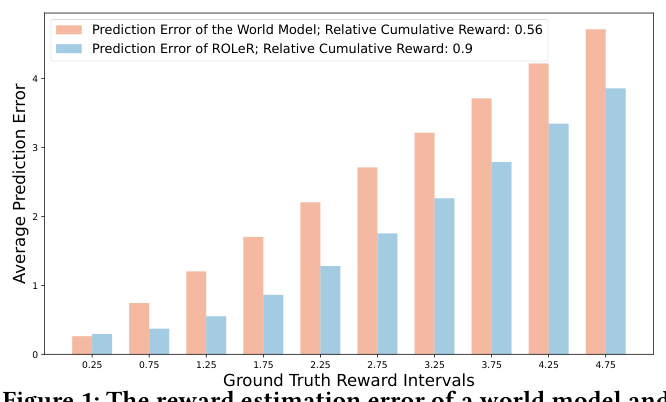
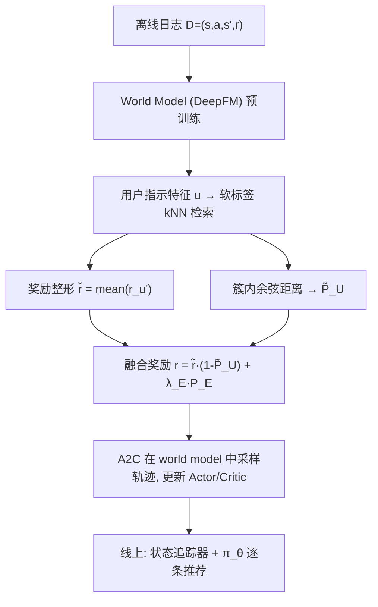

# ROLeR: Effective Reward Shaping in Offline Reinforcement Learning for Recommender Systems (离线强化学习推荐系统中的高效奖励整形)

- **会议/期刊**: CIKM 2024 (33rd ACM International Conference on Information and Knowledge Management)
- **作者与机构**: Yi Zhang, Ruihong Qiu, Jiajun Liu, Sen Wang（The University of Queensland / CSIRO DATA61）
- **推荐链路定位**: 端到端策略学习（基于 world model 的离线 RL 决策）
- **研究方向**: 强化学习与动态探索推荐 / 去偏与工业可信（Matthew 效应与日志偏差缓解）
- **论文原文**: [https://arxiv.org/abs/2407.13163v2](https://arxiv.org/abs/2407.13163v2)
- **开源代码**: [https://github.com/ArronDZhang/ROLeR](https://github.com/ArronDZhang/ROLeR)

## TL;DR (1分钟核心速览)

Model-based 离线 RL 推荐（DORL/CIRS 一类）的性能瓶颈不在策略网络，而在 world model 的**奖励估计精度**：离线日志极稀疏（KuaiRand 密度仅 0.697%），DeepFM 补全的奖励矩阵误差大，且不确定性惩罚被死死绑定在 world model 集成（ensemble）上。ROLeR 提出两条免训练改动：用用户指示特征做**软标签 kNN 奖励整形** $\tilde{r}_u(s,a)=\frac{1}{k}\sum_{u'\in kNN(u)}r_{u'}(s,a)$，再用**簇内余弦距离**替代 ensemble 方差作不确定性，乘性融合进奖励。在 KuaiRec 全观测模拟器上累积奖励$R_{tra}$ 从 DORL 的 20.49 提升到 33.25（+62.2%），达到真值奖励上界的 90.5%，KuaiRand/Coat/Yahoo 分别 +13.5%/+6.7%/+3.0%。

## Background & Motivation (背景与核心矛盾)

- **主流范式**: 把推荐建模为 MDP，先用离线日志训练 world model（DeepFM 拟合 $\hat{T},\hat{R}$），再让 A2C/PPO 在该模拟环境中采样轨迹学策略；为压制 OOD 高估，主流做法是$r=\bar{r}-\lambda_U P_U+\lambda_E P_E$，其中$P_U$来自$M$ 个 world model 的集成方差（DORL 用 GPM，MOPO 用 ensemble 距离）。
- **前人局限（矛盾一）**: 奖励矩阵补全质量从未被单独审视——离线数据稀疏到无法覆盖真实反馈，$\bar{r}=\frac{1}{M}\sum_j W_j(e_i,e_u)$ 的均值化并不能修复系统性偏差，反而把误差传进 critic 的 Bellman 目标。
- **前人局限（矛盾二）**: 不确定性 $P_U=\max_{k\in\mathcal{E}}\sigma^2_{\theta_k}$与 world model 强耦合，模型不准时惩罚项本身也不准；且需训练$M$个模型，推理与显存开销随$M$ 线性增长。
- **核心洞察 (Key Insight)**: 作者在 KuaiRec 上按真值奖励分桶统计误差（图 1），发现 DORL 的奖励预测误差在所有区间普遍偏高（相对累积奖励仅 0.56），而"用户兴趣可聚类"这一推荐系统固有性质未被利用：若两个用户的指示特征（静态画像或 world model 学到的 user embedding）相近，则他们对同一批物品的反馈可互相推断。
- **本文切入点**: 把奖励估计从"参数化矩阵补全"改成"非参数邻域聚合"，并让不确定性直接由聚类质量（邻域距离）给出，从而解耦 world model 集成。

<figure class="paper-figure" markdown="span">
  <figcaption>图1：世界模型和ROLeR在不同区间上的奖励估计误差。我们无需训练的奖励塑形始终优于当前世界模型的奖励塑形，并达到更高的相对累积奖励。</figcaption>
</figure>

## Method (核心方法设计)

### 1. 整体框架 (Overall Architecture)

流程沿用 DORL 的两阶段范式，但把第二阶段的奖励函数整体替换。第一阶段用离线日志预训练 DeepFM world model，输出物品/用户 embedding、奖励预测 $\hat{r}$与（本文不用的）集成方差；第二阶段先用全部训练用户构造指示特征库，对每个用户离线检索$k$近邻并缓存$\tilde{r}$与$\tilde{P}_U$，再将其与 DORL 的熵惩罚$P_E$ 融合成最终奖励，驱动 A2C 在 world model 中采样轨迹更新 actor/critic。推理时只保留状态追踪器与策略网络，kNN 部分完全离线，线上零额外开销。

### 2. 关键设计拆解 (Key Designs)

1. **软标签 kNN 非参数奖励整形**：稀疏日志下参数化补全必然过拟合曝光分布，因此改用邻域投票——以用户指示特征 $u$检索$k$个最近邻，直接平均其对同一物品的反馈$\tilde{r}_u(s,a)=\frac{1}{k}\sum_{u'\in kNN(u)}r_{u'}(s,a)$。物理直觉是"相似用户的反馈可互为反事实样本"，等价于在用户流形上做一次局部平滑，不需要任何梯度更新即可显著降低奖励误差。
2. **簇内距离不确定性 + 乘性融合**：把不确定性定义为邻域离散度 $\tilde{P}_U(u)=\frac{1}{k}\sum_{u'\in kNN(u)}d(u,u')$（实现取余弦距离），邻域越松散说明该用户越"孤立"、聚合结果越不可信。最终奖励改为乘性折扣$r=\tilde{r}\times(1-\tilde{P}_U)+\lambda_E P_E$，即在低置信区整体压低奖励而非简单相减，避免$\tilde{r}-\lambda d$在奖励尺度差异大的数据集上过度惩罚；$1-\tilde{P}_U$恰为余弦相似度，等价于相似度加权平均。本文并给出下界（Assumption 1 假设 Bellman 算子$L$-Lipschitz，$d_m$为邻域最大距离）：$|V^{\hat{\pi}^*}-V^*|\le\frac{2(L d_m+Q_m\epsilon(k,N,\delta))}{1-\gamma}$。
3. **训练目标与推理效率**：critic 与 actor 沿用 A2C 原式 $L_{critic}=\mathbb{E}_\tau[(r_t+\gamma\max_{a'}Q(s_{t+1},a';\phi)-Q(s_t,a_t;\phi))^2]$、$J_{actor}=\mathbb{E}_\tau[\log\pi_\theta(a_t|s_t)A(s_t,a_t)]$；无负采样需求（动作空间即物品集，靠 world model 采样轨迹），kNN 检索一次性预计算，训练开销 ≤2 GPU 小时（DORL ≤3）。另在 KuaiRec 上把 DORL 的均值状态追踪器换成 Transformer 追踪器并随机高斯初始化动作表征，作为兼容性增强。

## Experimental Setup & Evaluation Protocol (实验设置与评估协议)

| 数据集 | #Users | #Items | #Interactions | 密度 | 特征/场景说明 |
| :--- | :---: | :---: | :---: | :---: | :--- |
| KuaiRec (train) | 7,176 | 10,728 | — | 16.277% | 短视频；奖励=归一化观看时长；测试集天然全观测 (99.620%, 1,411×3,327) |
| KuaiRand-Pure (train) | 27,285 | 7,551 | — | 0.697% | 随机插入视频构造全观测测试矩阵；奖励=is_click |
| Coat (train) | 290 | 300 | — | 8.046% | 电商评分 1–5；自选物品训练，随机采样物品测试 (5.287%) |
| Yahoo (train) | 15,400 | 1,000 | — | 2.024% | 音乐评分；同 Coat 的自选/随机双分布切分 (1.000%) |

- **数据划分与防穿越 (Splitting Strategy)**: 采用**有偏日志训练 + 全观测（或 DeepFM 补全）测试模拟器**的切分，等价于"曝光分布→无偏评估分布"的反事实切分；KuaiRec 测试集真实全观测，其余三套用 DeepFM 补全测试矩阵，且所有方法共享同一奖励函数以保证公平。
- **排名评测协议 (Ranking Protocol)**: 非 Top-N 排序指标，而是**交互轨迹模拟**——每 epoch 在 100 条测试轨迹上评估，200 epoch 取均值；同一物品不重复推荐；设退出机制（近 $N=4$次交互中出现$M=0$个同类别物品即终止），轨迹上限 30 步。指标为累积奖励$R_{tra}$、单步奖励$Reach$、轨迹长度$Length$与主流类别支配度$MCD$（仅在 KuaiRec/KuaiRand 可算）。
- **对比基线与超参设置**: 5 个 model-based 离线 RL（MBPO、MOPO、IPS、DORL、CIRS）、4 个 model-free（SQN、BCQ、CQL、CRR）、2 个 bandit（UCB、$\epsilon$-greedy），外加用真值奖励训练的 GT Reward 作上界参考；全部共享同一 DeepFM world model。$k$按数据集网格搜索（KuaiRec 5–50、KuaiRand 25–200、Coat 10–35、Yahoo 10–100），$\lambda_E,\lambda_U$ 各自调优，报告 200 epoch 的均值±标准差。

## Key Experimental Results (实验关键数据)

### 1. 主实验对比 (Main Results)

累积奖励 $R_{tra}$（↑，200 epoch 均值±std，**加粗为最优**）：

| 方法 | KuaiRec | KuaiRand | Coat | Yahoo |
| :--- | :---: | :---: | :---: | :---: |
| BCQ | 2.1234 | 0.8515 | 68.8012 | 61.7388 |
| CQL | 2.5062 | 2.0323 | 68.9835 | 62.2909 |
| MBPO | 12.0426 | 10.9325 | 71.1930 | 64.5500 |
| MOPO | 11.4269 | 10.9344 | 71.1805 | 65.5098 |
| IPS | 12.8326 | 3.6287 | 73.8872 | 57.8499 |
| DORL (SOTA) | 20.4942 | 11.8500 | 71.3992 | 66.3509 |
| **ROLeR** | **33.2457** | **13.4553** | **76.1603** | **68.3637** |
| GT Reward (上界) | 36.7475 | 14.3689 | 80.0895 | 68.8791 |
| **Improv. vs DORL** | **+62.2%** | **+13.5%** | **+6.7%** | **+3.0%** |

单步奖励 $Reach$（↑）：

| 方法 | KuaiRec | KuaiRand | Coat | Yahoo |
| :--- | :---: | :---: | :---: | :---: |
| DORL | 0.7673 | 0.4284 | 2.3800 | 2.2117 |
| **ROLeR** | **1.2293** | **0.4574** | **2.5387** | **2.2788** |
| GT Reward | 1.5600 | 0.4993 | 2.6696 | 2.2960 |

### 2. 消融实验 (Ablation Study)

$R_{tra}$，`ku` = kNN 奖励整形，`kr` = kNN 不确定性（KuaiRec 基线为叠加 Transformer 追踪器 + 高斯动作初始化的 DORL=24.4308，故与主表 20.4942 不同）：

| 配置 | KuaiRec | KuaiRand | Coat | Yahoo |
| :--- | :---: | :---: | :---: | :---: |
| DORL (× ×) | 24.4308 | 11.8500 | 71.3992 | 66.3509 |
| ROLeR w/o $k_r$ (√ ×) | 23.4512 | 12.5136 | 72.6059 | 66.1680 |
| ROLeR w/o $k_u$ (× √) | 30.7430 | 12.7339 | 72.6055 | 68.0083 |
| **ROLeR (√ √)** | **33.2457** | **13.4553** | **76.1603** | **68.3637** |

### 3. 关键实验发现 (Key Findings)

1. **奖励整形与不确定性必须协同，且协同增益非线性叠加**：KuaiRec 上仅加 $k_r$得 30.74（+25.8%），仅加$k_u$反而跌到 23.45（−4.0%），二者同时启用才达 33.25（+36.1%）；原因是乘性融合$\tilde{r}(1-\tilde{P}_U)$需要"整形后的奖励"与"邻域距离"同源同尺度，单独替换任一项都会破坏 DORL 原有的$\bar{r}-\lambda_U P_U$ 量纲平衡。
2. **奖励精度是性能的第一性变量，world model 结构改良只是次要项**：KuaiRec 上把 DORL 换 Transformer 状态追踪器 + 高斯动作初始化仅从 20.49 升到 24.43（+19.2%），而在此基础上叠加奖励整形再增 36.1% 到 33.25；同时 Reach 从 0.7673 跃至 1.2293（+60.2%），印证误差分桶图（图 1）中"奖励更准→相对累积奖励 0.56→0.9"的直接因果链。
3. **MCD 需落在中等区间，轨迹长度与多样性不可偏废**：CQL/BCQ 的 MCD 高达 0.78/1.00，轨迹长度仅 3.2/3.0；IPS 的 MCD 极低（0.215）但轨迹仅 12.8；ROLeR 在 KuaiRec/KuaiRand 上 MCD 为 0.4439/0.4049，长度 27.01/29.27（KuaiRand 逼近上限 30），说明"适度多样性"而非"最大多样性"才支撑长轨迹累积收益。此外 $k$在各自搜索区间内变动时$R_{tra}$ 波动普遍 <2，鲁棒性良好。

## Highlights & Limitations (亮点、对比与审稿批判)

- **与代表作对比**: 与 **DORL** 的本质差异是把不确定性从"world model 集成方差"搬到"用户邻域距离"，彻底解耦集成规模 $M$；与 **MOPO** 相比不再依赖$M$ 个模型的预测分歧，而是用离线数据自身的聚类质量度量风险；与 **CIRS** 相比不引入因果推断模块、也不使用 PPO，仅用朴素 A2C 便超越，说明"先把世界模型做准"优先于"把策略算法做复杂"。
- **可迁移亮点**: (i) 软标签 kNN 奖励整形可直接插到任意 model-based 离线 RL 推荐管线中，无需重训奖励模型；(ii) 用邻域距离替代 ensemble 方差，可把不确定性估计的内存/推理成本从 $O(M)$ 降到一次近邻检索，对工业级大规模 item 库尤其实用。
- **审稿级局限批判**: (i) $k$与不确定性融合形式高度依赖数据集（KuaiRec 最优为$\tilde{r}-\lambda d$，其余三套为$\tilde{r}(1-\tilde{d})$），需逐数据集网格搜索，缺乏自适应选择机制；(ii) 评估完全建立在模拟器与 DeepFM 补全的测试矩阵上，无真实线上 A/B，且用户指示特征$u$ 的具体构造（静态画像 vs. world model embedding）未做系统对比，理论下界也依赖 Lipschitz 与"聚类有意义"的强假设。

## Rating (四维评分)

- **方法创新性 (Novelty)**: ⭐⭐⭐⭐ （把奖励整形落到非参数 kNN 与聚类质量上，思路朴素但切中 model-based 离线 RL 的真正瓶颈，并配有 Lipschitz 下界分析）
- **评估协议与实验扎实度 (Protocol & Experiments)**: ⭐⭐⭐⭐ （四套含全观测测试矩阵的基准 + 11 个基线 + 200 epoch 均值方差 + 完整消融/不确定性设计/世界模型/超参四组 RQ，缺线上验证）
- **写作与数学规范度 (Clarity & Rigor)**: ⭐⭐⭐⭐ （公式推导链条清晰、定理证明骨架完整，但符号 $u$/$U$与状态$s$ 偶有混用，部分符号排版欠规整）
- **工业落地与复现价值 (Industrial & Practical Value)**: ⭐⭐⭐⭐⭐ （代码已开源、kNN 部分可完全离线预计算、训练 ≤2 GPU 小时，且相对 DORL 去掉 ensemble 后工程成本显著下降）

