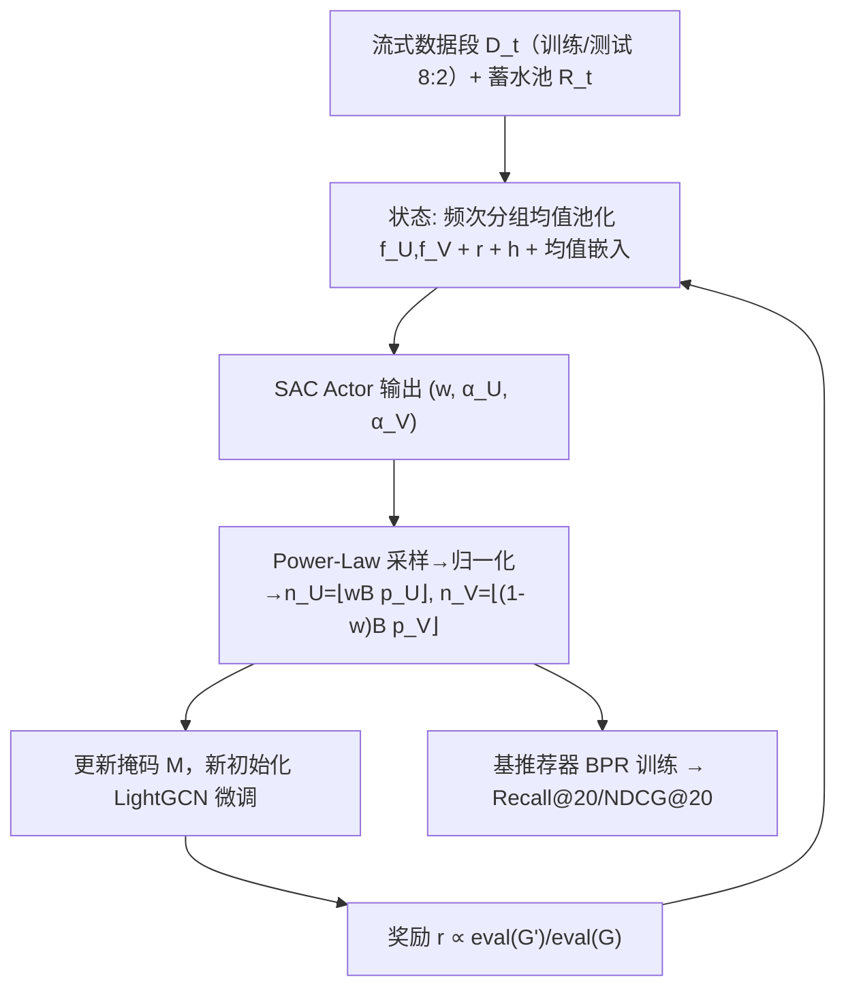
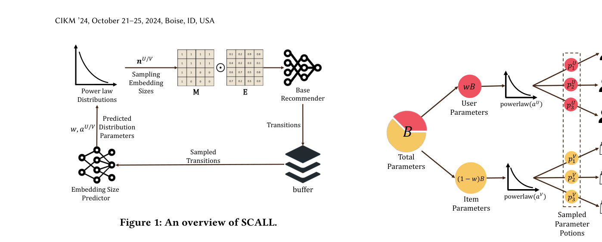
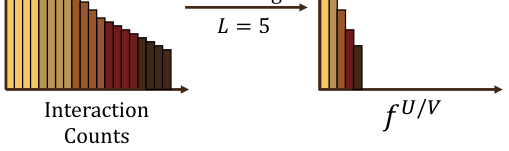

# Scalable Dynamic Embedding Size Search for Streaming Recommendation (面向流式推荐的可扩展动态嵌入维度搜索)

- **会议/期刊**: CIKM 2024
- **作者与机构**: Yunke Qu, Liang Qu, Tong Chen, Xiangyu Zhao, Quoc Viet Hung Nguyen, Hongzhi Yin（昆士兰大学、南方科技大学、香港城市大学、格里菲斯大学）
- **推荐链路定位**: 召回（嵌入表存储/参数分配层）
- **研究方向**: 强化学习与动态探索推荐 / 冷启动与长尾推荐
- **论文原文**: [https://arxiv.org/abs/2407.15411v4](https://arxiv.org/abs/2407.15411v4)
- **开源代码**: [https://github.com/qykcq/Scalable-Dynamic-Embedding-Size-Search-for-Streaming-Recommendation](https://github.com/qykcq/Scalable-Dynamic-Embedding-Size-Search-for-Streaming-Recommendation)

## TL;DR (1分钟核心速览)

流式推荐中用户/物品持续涌入，统一维度的嵌入表成为存储瓶颈；已有动态维度搜索方法（ESAPN/DESS/AutoEmb）既**无法约束总参数预算**，又**只能增不能减**，且不能给新用户/物品分配维度。SCALL 把维度分配建模为 SAC 智能体输出 $(w,\alpha_U,\alpha_V)$、再从 Power-Law 分布采样并归一化到固定预算$B$，从构造上保证"预算可控 + 可增可减 + 免重训"。在 Yelp / Amazon-Book 的 8–10 个时间分段上，以 Recall@20/NDCG@20 评估，$c=32$ 时较最强基线 BET 提升约 3%–4%，较 ES 提升 15.3%。

## Background & Motivation (背景与核心矛盾)

- **主流范式**: 混合维度嵌入（CIESS/BET/MR）按交互频次给用户/物品分配不同维度；流式场景则用 AutoEmb（多分类软选择）、ESAPN/DESS（二分类式"是否扩容"）逐段调整。
- **前人局限**: ① ESAPN/DESS 只看"是否需要变大"，热度衰退的用户仍占大维度，参数随时间单调膨胀，**必然突破预设预算**；② 静态方法（BET/CIESS）每段需从头重训，且**无法给新加入的 $u/v$分配维度**；③ 状态向量长度随$|U|+|V|$ 变化，策略网络无法直接迁移到下一段。
- **核心洞察 (Key Insight)**: 只要把"总参数预算 $B$"作为硬约束写进动作生成过程（先定预算再按分布切分），维度分配就变成"零和再分配"，热度下降者自动让出参数。
- **本文切入点**: 用连续动作 $a=(w,\alpha_U,\alpha_V)$参数化两个 Power-Law 分布，采样归一化后即得每用户/物品的维度，天然满足$\|\mathbf{M}\|_{1,1}\le B$。

## Method (核心方法设计)

### 1. 整体框架 (Overall Architecture)

基推荐器 LightGCN 以二值掩码 $\mathbf{M}$裁剪嵌入表$\mathbf{E}\odot\mathbf{M}$得到变长嵌入；智能体（SAC 的 actor/critic）观察由**分组均值池化频次 + 上一轮奖励 + 维度离散度 + 均值嵌入**拼接的定长状态，输出$(w,\alpha_U,\alpha_V)$，据此采样出全表维度并冻结掩码；随后**新初始化**一个基推荐器在该段数据上微调，其早停 Recall@20/NDCG@20 相对"未调维度前"的比值构成奖励回传。搜索与训练交替进行，全程不需在时间段间重训。

### 2. 关键设计拆解 (Key Designs)

1. **预算可控的 Power-Law 维度采样**：针对"预算不可控"痛点，先把 $B$按$w$分为用户/物品两份，再各自采样$\boldsymbol{q}_U\sim\text{powerlaw}(\alpha_U)$并归一化：$\boldsymbol{p}_U=\boldsymbol{q}_U/\sum_{u}q_{U,u}$，$\boldsymbol{n}_U=\lfloor wB\,\boldsymbol{p}_U\rfloor$（物品同理用$(1-w)B$）。$\alpha\to\alpha_{\max}$时趋于均分、$\to\alpha_{\min}$时集中给高频者，因此**只需调$\alpha$ 即可在任意预算内做公平性/精度权衡**，且无需额外超参搜索。

<figure class="paper-figure" markdown="span">
  <figcaption>图2：本例中，总参数被分配给3个用户和3个物品。每个圆的大小对应参数数量，圆越大表示参数数量越多。</figcaption>
</figure>

2. **定长状态与均值池化**：$|U|$逐段膨胀导致状态维度不可固定。作者按频次降序分$L=256$组取组均值得$\boldsymbol{f}_U,\boldsymbol{f}_V$（类似 CNN 均值池化），并用**归一化极差**$h_U=\frac{\max(\boldsymbol{n}_U)-\min(\boldsymbol{n}_U)}{d_{\max}-d_{\min}}$刻画维度离散度（而非方差或$\alpha$，因二者对尺度不敏感，会把$[2,1,1]$与$[1,1,1]$误判为等价）。最终$s=(\boldsymbol{f}_U,\boldsymbol{f}_V,r,\frac{|U|}{|U|+|V|},h_U,h_V,\boldsymbol{m}_U,\boldsymbol{m}_V)$ 长度恒定，**支持给未见过的新用户/物品直接分配维度**。

<figure class="paper-figure" markdown="span">
  <figcaption>图3：采用平均池化获得融合频率信息的固定长度向量。本例中的用户或物品被分为5组。</figcaption>
</figure>

3. **训练目标、奖励与推理开销**：基推荐器优化 $\mathcal{L}_{BPR}=\sum_{(u,v,v')}-\ln\sigma(\hat{y}_{uv}-\hat{y}_{uv'})+\eta\|\Theta\|_2^2$，约束$\|\mathbf{M}\|_{1,1}\le B$；负例沿用 BPR 的均匀采样。奖励定义为$r\propto \text{eval}(G'_{t,j}|D^{te}_t)/\text{eval}(G_{t,j}|D^{te}_t)$（$\text{eval}$为 Recall@20 与 NDCG@20 的均值集成，归一化到$(0,10)$），用**比值而非绝对值**消除时间段间指标不可比问题；且每轮**重新初始化**基模型，避免旧维度"自我强化"。在线部署只需存稀疏表，无额外推理延迟。

## Experimental Setup & Evaluation Protocol (实验设置与评估协议)

| 数据集 | #Users | #Items | #Interactions | 过滤 | 特征/场景说明 |
| :--- | :---: | :---: | :---: | :---: | :--- |
| Amazon-Book | 66,351 | 57,270 | 5,076,971 | 30-core | 图书评分，长尾显著 |
| Yelp | 99,011 | 56,441 | 2,762,098 | 10-core | 本地商户评分，热度漂移强 |

- **数据划分与防穿越**: 每新增 15,000 个用户/物品即切出一个时间分段（Yelp 10 段、Amazon 8 段）；段内按**时间顺序** 80%/20% 切分训练/测试，测试严格晚于训练；另设蓄水池 $\mathcal{R}_t$ 回放历史交互缓解灾难遗忘。
- **排名评测协议**: 对全部物品排序取 top-20 的 `Full-Ranking`（论文未采用采样负例评估），报告各段 Recall@20 / NDCG@20 的**跨段均值**；配对 Student's $t$-test，$p<0.02$（表 2）/$p<0.03$（表 3）。
- **对比基线与超参**: 基线含固定维度 ES、随机混合 MR、静态搜索 CIESS/BET、流式搜索 ESAPN/DESS/AutoEmb；$d_{\max}=256$、$d_{\min}=1$，批量 10,000，学习率 0.03、每 200 步衰减 0.95，早停 patience=3，actor/critic 为单隐层 512 维 MLP。

## Key Experimental Results (实验关键数据)

### 1. 主实验对比 (Main Results)

固定平均维度 $c$（Yelp / Amazon-Book，$c=32$）：

| Method | Yelp R@20 | Yelp N@20 | Amazon R@20 | Amazon N@20 |
| :--- | :---: | :---: | :---: | :---: |
| ES | 0.0524 | 0.0281 | 0.0478 | 0.0265 |
| MR | 0.0488 | 0.0260 | 0.0416 | 0.0229 |
| CIESS | 0.0564 | 0.0309 | 0.0484 | 0.0274 |
| BET | 0.0581 | 0.0318 | 0.0501 | 0.0282 |
| **SCALL** | **0.0604** | **0.0329** | **0.0516** | **0.0290** |
| Improv. vs BET | +3.96% | +3.46% | +3.00% | +2.84% |

不受控预算的流式基线（括号内为其实际平均维度）：Yelp 上 ESAPN(84)=0.0592/0.0323、DESS(39)=0.0586/0.0318、AutoEmb(74)=0.0560/0.0307；而 SCALL 仅用 $c=64$即取得 **0.0623/0.0335**，全面反超。固定预算$B$场景（表 3）：Yelp$B$=5MB 时 SCALL 0.0545/0.0300 vs BET 0.0524/0.0289；Amazon 5MB 时 0.0462/0.0259 vs BET 0.0439/0.0248。

### 2. 消融实验 (Ablation Study)

$c=32$，Yelp / Amazon-Book：

| 变体 | Yelp R@20 | Yelp N@20 | Amazon R@20 | Amazon N@20 |
| :--- | :---: | :---: | :---: | :---: |
| Full SCALL | **0.0604** | **0.0329** | **0.0516** | **0.0290** |
| w/o $\boldsymbol{m}_{U/V}$（均值嵌入） | 0.0594 | 0.0324 | 0.0510 | 0.0286 |
| w/o $h_{U/V}$（维度离散度） | 0.0589 | 0.0323 | 0.0507 | 0.0284 |
| Dummy（用户/物品合并成单一分布） | 0.0501 | 0.0268 | 0.0387 | 0.0217 |
| 分布换成 Pareto | 0.0602 | 0.0325 | 0.0512 | 0.0287 |
| 分布换成 Normal | 0.0602 | 0.0329 | 0.0504 | 0.0285 |

### 3. 关键实验发现 (Key Findings)

1. **预算控制带来"以少胜多"**：SCALL 在平均 64 维下即超过 ESAPN 的 84 维（Yelp 0.0623 vs 0.0592，+5.2%）与 AutoEmb 的 74 维，说明旧方法把参数堆给"曾经热门"的节点是纯浪费，零和再分配比单纯扩容更有效。
2. **用户/物品分离采样是最大单点增益**：合并为单一分布的 Dummy 掉到 0.0501（$-17.1\%$），远超去掉$h$（$-2.5\%$）或$\boldsymbol{m}$（$-1.7\%$）的影响，印证用户与物品的频次分布形状差异巨大，必须两套$\alpha$ 分别建模。
3. **分布族几乎不敏感、蓄水池大小弱敏感**：Power-Law/Pareto/Normal 三者差距 <0.5%，说明收益来自"预算约束+RL 再分配"机制而非分布先验；$\gamma$在 Yelp 上 0.1–0.5 几乎无差异，Amazon 上$\gamma=0.1$ 最优，工程调参成本低。案例研究（图 5）显示用户 10120 热度上升后维度在第 4 段追平高频用户 1546，而 1546 的维度被"封顶"，证明**高低频之间的参数让渡**确实发生。

## Highlights & Limitations (亮点、对比与审稿批判)

- **与代表作对比**: 相较 ESAPN/DESS 的"二分类扩容"（单调、不可控、无新节点能力），SCALL 用分布采样实现**可增可减且硬约束预算**；相较 BET/CIESS 的静态表级搜索（每段需重训、不支持新节点），SCALL 用定长池化状态实现**跨段免重训迁移**。
- **可迁移亮点**: ① "先定预算、再按分布切分"的参数分配范式可直接迁移到多模态融合权重、序列模型层宽分配；② 用**比值型奖励** + 重新初始化消除跨时间段指标漂移，是所有流式 NAS/RL 调参的通用技巧。
- **审稿级局限批判**: ① 状态与动作完全由**频次**驱动，对低频但高价值（高转化/高客单）节点存在系统性歧视，作者自己也承认需引入模型置信度等信号；② 每段都要新初始化基模型并微调 200 步来算奖励，搜索期的算力开销未与基线做定量对比，且 $L=256$分组、$\alpha$ 边界等超参缺乏敏感性分析；③ 仅用 LightGCN + 两个评分数据集验证，未在工业级千亿参数嵌入表或 CTR 模型上验证可扩展性。

## Rating (四维评分)

- **方法创新性 (Novelty)**: ⭐⭐⭐⭐ （把"预算硬约束"内嵌进动作生成而非奖励惩罚，是嵌入维度搜索中少见的构造性保证，思路干净）
- **评估协议与实验扎实度 (Protocol & Experiments)**: ⭐⭐⭐⭐ （8–10 段时间序划分 + 双预算视角 + $t$ 检验齐全，但仅两数据集、缺采样负例说明与搜索开销对比）
- **写作与数学规范度 (Clarity & Rigor)**: ⭐⭐⭐⭐ （动作/状态/奖励定义与复杂度交代清楚；表 3 中 BET 的 NDCG 数值疑似笔误，公式排版有个别符号瑕疵）
- **工业落地与复现价值 (Industrial & Practical Value)**: ⭐⭐⭐⭐⭐ （代码开源、部署只需稀疏表零额外延迟、任意内存预算即插即用，对资源受限的流式推荐场景落地价值高）

