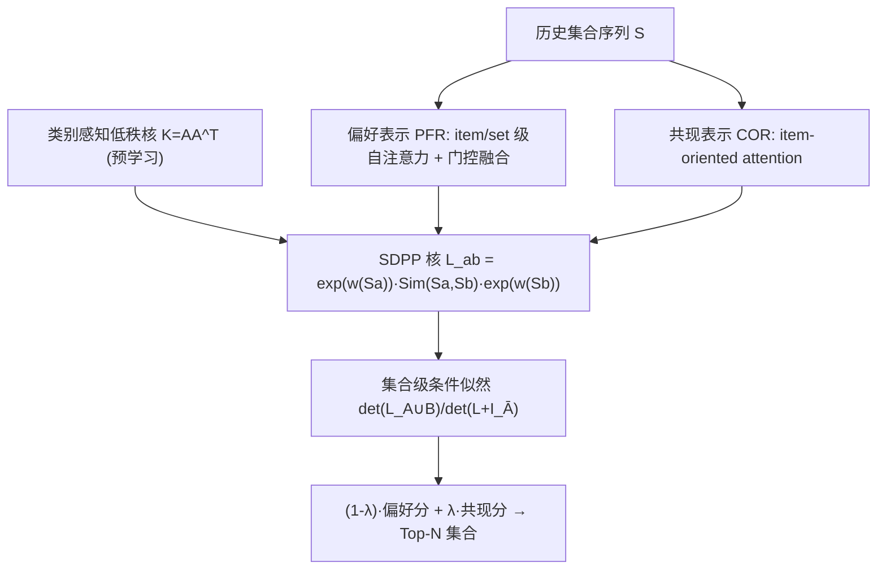
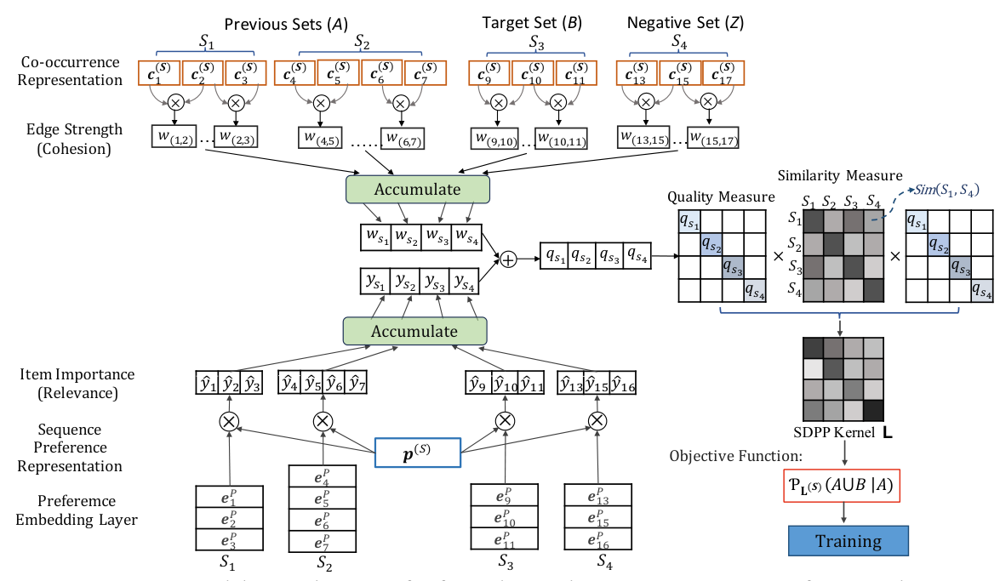

# A Universal Sets-level Optimization Framework for Next Set Recommendation (面向下一集合推荐的通用集合级优化框架)

- **会议/期刊**: CIKM 2024
- **作者与机构**: Yuli Liu, Min Liu (青海大学 / 青海省智能计算与应用实验室), Christian Walder (Google DeepMind), Lexing Xie (ANU)
- **推荐链路定位**: 召回（下一集合 / 下一购物篮预测）
- **研究方向**: 序列与会话推荐 / 列表级重排与多目标优化
- **论文原文**: [https://arxiv.org/abs/2410.23023v1](https://arxiv.org/abs/2410.23023v1)
- **开源代码**: 暂未开源

## TL;DR (1分钟核心速览)

下一集合推荐 (NSRec, 含下一购物篮 / 时序集合预测) 长期沿用下一物品推荐的 item-level BCE/BPR，逐物品比较既忽略集合内共现 (DinS)、又忽略集合间依赖 (DacSs)，更完全放弃集合多样性。本文提出 SNSRec：借助结构化行列式点过程把每个时序集合当作一个「结构元素」，用「偏好+共现」质量项与类别感知低秩多样性核构造 SDPP 核，并给出集合级条件似然 $\frac{\det L_{A\cup B}}{\det(L+I_{\bar A})}$ 作为可微损失。在 TaoBao/JD-buy/JD-add/TaFeng 上（Leave-Last-Set-Out，全库排序）Recall@50 相对最优基线提升 9.3%–18.5%，F1 提升 8.7%–14.2%。

## Background & Motivation (背景与核心矛盾)

- **主流范式**: NBRec/TSP 主要堆叠 RNN、Transformer 多头注意力、动态图传播来编码 item-level 与 set-level 表征，但损失仍是加权 MSE、BCE、multi-label soft margin 或 BPR。
- **前人局限 (1)**: 逐物品损失隐含「预测物品相互独立」的假设，无法体现一个集合作为整体的紧密程度；BPR 累加正负物品 margin，集合内商品组合关系被完全抹平。
- **前人局限 (2)**: 多样性完全不在优化目标内。CDSL 虽用 DPP，但把 DPP 似然当作 item-level 损失，只做物品级重排去冗余，不认识「集合结构」。
- **核心洞察 (Key Insight)**: 若把整个时序集合视作 SDPP 中的一个结构元素，则集合内聚合 (DinS) 与跨集合依赖 (DacSs) 可被同一个全局概率测度同时表达；且 DPP 核的 $\det$ 天生带排斥性，多样性成为质量的免费副产品。
- **本文切入点**: 用「质量分解 × 结构相似度」的 SDPP 核 + 序列指定条件似然，把 NSRec 转化为「在给定前序集合为 SDPP 子集条件下，完整集合序列被抽中的概率最大化」。

## Method (核心方法设计)

### 1. 整体框架 (Overall Architecture)

输入用户的历史集合序列 $\boldsymbol{S}=\{S_1,\dots,S_t\}$。双通道表征：偏好通道 (PFR) 用多头自注意力分别学 item-level 与 set-level 表示，再经门控融合得到$\mathbf{p}(\boldsymbol{S})$；共现通道 (COR) 用 item-oriented attention 输出全库共现表征$\mathbf{C}(\boldsymbol{S})$。二者分别给出候选物品的重要性分数与集内边强度，累加成集合质量$w(S_a)$；同时离线预训练一个类别感知低秩多样性核$\mathbf{K}=AA^\top$提供结构相似度$\mathrm{Sim}(S_a,S_b)$。两者相乘构成 SDPP 核$L_{ab}$，代入集合级条件似然端到端训练。推理时用$1-\lambda$与$\lambda$加权融合两路分数，对全库物品排序后取 Top-$N$ 组成下一集合。

<figure class="paper-figure" markdown="span">
  <figcaption>图2：SNSRec 优化框架构建的详细示意图。</figcaption>
</figure>

### 2. 关键设计拆解 (Key Designs)

1. **结构化质量建模 (Quality, C1)**：痛点是「一个集合好不好」不能只看单物品相关性——{手机, iPad} 与 {手机, 钢化膜} 相关性相当但内聚性迥异。作者把质量定义为节点重要性与边强度之和 $w(S_a)=\sum_r \hat{y}^{P}_{r}+\sum_{\alpha\neq\beta}\hat{y}^{C}_{\alpha\beta}$，其中$\hat{y}^{P}_i=\mathbf{p}(\boldsymbol{S})^\top \mathbf{e}^{P}_i$、$\hat{y}^{C}_{\alpha\beta}=\mathbf{c}(\boldsymbol{S})_\alpha^\top\mathbf{c}(\boldsymbol{S})_\beta$。直觉：共现项把「历史篮子中常一起出现」的强内聚对推向高分，从而区分相关性相近的候选集合。

2. **类别感知多样性核与结构相似度 (Diversity, C2)**：SDPP 要求 $\mathrm{Sim}(S_a,S_b)=\phi(S_a)^\top\phi(S_b)=\sum_{\alpha,\beta}\phi_\alpha^\top\phi_\beta$可分可算，但全秩核$\mathbf{K}\in\mathbb{R}^{|V|\times|V|}$在万级物品上不可行。作者用$\mathbf{K}=AA^\top$ 低秩分解，并以「类目尽量分散的正子集 vs 同尺寸随机负子集」对比学习：
$\ell=\sum_{(T^+,T^-)}\log\det\mathbf{K}_{T^+}-\log\det\mathbf{K}_{T^-}$。
直觉：$\log\det$ 是体积度量，最大化它等价于把不同类目的物品向量正交化，故核的 off-diagonal 相似度天然表达「跨类互补」，训练完成后冻结作为相似度来源。

3. **集合级条件似然、负采样与推理开销**：核心损失为
$P^{(\boldsymbol{S})}(Y=A\cup B\mid Y=A)=\frac{\det L^{(\boldsymbol{S})}_{A\cup B}}{\det(L^{(\boldsymbol{S})}+I_{\bar A})}$，
其中 $A$为历史集合、$B$为目标集合、$Y(\boldsymbol{S})$只含「该序列相关结构」以免枚举指数级结构空间，$I_{\bar A}$为不在$A$中的元素的对角指示阵。目标$\mathcal{L}(\Theta)=\sum_u\sum_{\boldsymbol{S}}\log P^{(\boldsymbol{S})}$，梯度$\mathrm{tr}(L^{-1}\partial L/\partial\Theta)$形式，全链路可微（Adam 优化）。负集合$Z$采用随机采样（实验中$Z=1$），无需 hard negative；推理时 COR 打分需对全库$|V|$求平均内聚度，$\hat{y}_i=(1-\lambda)\mathbf{p}^\top\mathbf{e}^P_i+\lambda\frac{1}{|V|}\sum_n\mathbf{c}_i^\top\mathbf{c}_n$，复杂度$O(|V|d)$，与常规双塔召回同阶。

## Experimental Setup & Evaluation Protocol (实验设置与评估协议)

- **数据集与预处理**: 同一天内同一用户的购买/加购行为聚合为一个时序集合；TaFeng 类目粒度最细 (650 类)。

| 数据集 | #Users | #Items | #Sets | #Categories | 场景说明 |
| :--- | :---: | :---: | :---: | :---: | :--- |
| TaoBao | 12.0K | 14.2K | 85.9K | 68 | 阿里电商 购买+点击 |
| JD-buy | 13.5K | 19.6K | 76.8K | 77 | 京东 购买记录 |
| JD-add | 3.4K | 12.1K | 16.1K | 75 | 京东 加购记录（最稀疏） |
| TaFeng | 10.3K | 8.7K | 73.3K | 650 | 线下超市小票 |

- **数据划分与防穿越**: 采用 `Leave-Last-Set-Out`（每用户最后一个集合测试、倒第二个验证、其余训练），沿用 NBRec/TSP 标准协议，非全局时间戳切分。
- **排名评测协议**: `Full-Ranking` 全库未交互物品排序；指标 Recall@{20,50}、NDCG@{20,50}、CC（类目覆盖）、ILD（列表内距离）与调和 F1@N $=\frac{2\cdot Q@N\cdot D@N}{Q@N+D@N}$。
- **对比基线与超参**: 8 个基线覆盖 RNN (DREAM)、DPP (CDSL)、矩阵分解 (FPMC)、CTR 注意力 (DIN)、集合序列 (Sets2Sets, DSNTSP)、图 (ETGNN)、专用网络 (SFCN)；基线嵌入 $d=128$，PFR/COR 各 64 维，4 头注意力，4 个 query；默认$\lambda=0.2,A=3,B=1,Z=1$；最优基线加 `*`，提升在$p<0.01$ 下显著。

## Key Experimental Results (实验关键数据)

### 1. 主实验对比 (Main Results)

| 数据集 | 方法 | R@20 | R@50 | N@20 | N@50 | CC@20 | ILD@20 | F1@20 |
| :--- | :--- | :---: | :---: | :---: | :---: | :---: | :---: | :---: |
| TaoBao | DREAM | 0.1053 | 0.1526 | 0.0885 | 0.1033 | 0.0905 | 0.6613 | 0.1541 |
| | CDSL | 0.1306 | 0.1855 | 0.1092 | 0.1184 | 0.1253 | 0.6668 | 0.1841 |
| | FPMC | 0.1032 | 0.1639 | 0.0850 | 0.1007 | 0.0912 | 0.6028 | 0.1481 |
| | Sets2Sets | 0.1286 | 0.1920 | 0.1001 | 0.1211 | 0.0986 | 0.6492 | 0.1751 |
| | ETGNN | 0.1503 | 0.2138 | 0.1170 | 0.1294 | 0.1104 | 0.6190 | 0.1956 |
| | DSNTSP | 0.1457 | 0.2046 | 0.1095 | 0.1363\* | 0.1187 | 0.6105 | 0.1890 |
| | SFCN | 0.1544\* | 0.2152\* | 0.1084 | 0.1343 | 0.1126 | 0.6400 | 0.1948 |
| | **SNSRec** | **0.1716** | **0.2549** | **0.1247** | **0.1490** | **0.1360** | **0.6957** | **0.2185** |
| | Improv.% | +11.14 | +18.45 | +6.58 | +9.32 | +8.54 | +4.33 | +11.68 |
| JD-add | CDSL | 0.1107 | 0.1562 | 0.0957 | 0.1043 | 0.1118 | 0.6384\* | 0.1619 |
| | ETGNN | 0.1306\* | 0.1734\* | 0.1027 | 0.1165 | 0.1085 | 0.6214 | 0.1768 |
| | DSNTSP | 0.1291 | 0.1616 | 0.1160\* | 0.1252\* | 0.1112\* | 0.6352 | 0.1845\* |
| | SFCN | 0.1250 | 0.1705 | 0.1085 | 0.1190 | 0.1090 | 0.6209 | 0.1769 |
| | **SNSRec** | **0.1640** | **0.1910** | **0.1430** | **0.1521** | **0.1125** | **0.6535** | **0.2192** |
| | Improv.% | +25.57 | +10.15 | +23.28 | +21.49 | +6.30 | +2.37 | +18.78 |

（JD-buy、TaFeng 上趋势一致：JD-buy Recall@50 0.4634 vs ETGNN 0.4153（+11.58%）；TaFeng NDCG@20 0.0630 vs ETGNN 0.0562（+12.10%）。）

### 2. 消融实验 (Ablation Study)

| 变体 | 关键设置 | 观测结果 |
| :--- | :--- | :--- |
| w/o COR | $\lambda=0$，质量仅由偏好相关性构成 | TaoBao/JD-add 上 Recall、NDCG 均明显低于 Full，验证 DinS 边强度不可省 |
| w/o PFR | $\lambda=1$，仅共现分排序 | 低于$\lambda=0$，共现只能做补充，不能主导相关性 |
| Full SNSRec | $\lambda\approx0.4$| 达到峰值（TaoBao F1@20=0.2185），$\lambda>0.4$ 后单调下滑 |
| 前序集长度 $A$|$A:2\to5$，$B=1,Z=1$| NDCG@20/50 先升后饱和；目标集数$B:1\to4$ 同趋势 |
| Re-DREAM / Re-ETGNN | 原模型嵌入 SNSRec 框架 | 图 3 显示两者在 NDCG 与 CC 上均较原版显著提升 |

### 3. 关键实验发现 (Key Findings)

1. **集合级损失的增益远大于换骨干网络**：TaoBao Recall@50 从 SFCN 0.2152 升至 0.2549（+18.45%），JD-add NDCG@20 从 DSNTSP 0.1160 升至 0.1430（+23.28%），而各基线彼此差距多在 3–5%；说明 NSRec 的瓶颈在目标函数而非编码器结构。
2. **多样性不是以相关性为代价**：TaoBao 上 CC@20 达 0.1360（比 CDSL 的 0.1253 高 8.54%）、ILD@20 达 0.6957，同时 NDCG@20 仍是最优；反观 item-level DPP 的 CDSL 只把 ILD 抬到 0.6668 却牺牲了 NDCG（0.1092），印证集合级多样性度量优于物品级排斥。
3. **数据越稀疏、集合越短，收益越大**：仅 16.1K 个集合的 JD-add 取得最大 Recall@20 提升（+25.57%），说明 SDPP 的全局概率归一化在全库排序中提供了强结构正则；而 TaFeng 因 650 个细粒度类目导致类别感知核区分力下降，CC@20 仅提升 0.90%，是该方法的边界条件。

## Highlights & Limitations (亮点、对比与审稿批判)

- **与代表作对比**: 相比 DSNTSP/SFCN/ETGNN 等只换编码器的 TSP 工作，本文是首个专门设计集合级目标函数的工作；相比 CDSL 把 DPP 似然降格为 item-level 损失，本文把 SDPP 提升为「集合即元素」的序列条件似然，同时把质量拆成偏好+共现、多样性用预学习核注入；相比 FPMC/DREAM 的池化篮子表示，本文保留集合的结构化分解。其「通用框架」定位（Re-DREAM/Re-ETGNN 均受益）是相对新颖的卖点。
- **可迁移亮点**: (i) 预学习低秩类别感知核 $\mathbf{K}=AA^\top$ 是一个与主模型解耦的插件式多样性度量，可直接挂到任何 Top-N 重排阶段；(ii) item-oriented attention 产出的全库 COR 表征可作为「购物篮补全 / bundle 推荐」的通用边强度特征。
- **审稿级局限批判**: (i) 训练需两阶段（先学 $\mathbf{K}$再学主模型），且预测时 COR 打分对全库$|V|$求平均，在千万级物品的工业召回中成本偏高，论文未给 FLOPs 或时延数据；(ii) 负集合仅取$Z=1$随机采样，$\det(L+I_{\bar A})$归一化项被严重低估，缺少对 hard negative 与$Z$敏感性的消融；(iii) 只做离线四个公开数据集，无线上 A/B；$\lambda,A,B,Z$ 四个超参交互，泛化风险未量化（无多次运行方差/置信区间）。

## Rating (四维评分)

- **方法创新性 (Novelty)**: ⭐⭐⭐⭐ （首次把 SDPP 的结构化元素视角引入 NSRec 并给出可微集合级条件似然，质量-多样性分解思路清晰，但 SDPP 与 DPP 的数学骨架沿用前人，属组合式创新）
- **评估协议与实验扎实度 (Protocol & Experiments)**: ⭐⭐⭐⭐ （四个跨场景数据集 + Full-Ranking + 相关性/多样性/F1 三组指标 + $p<0.01$ 显著性，消融与通用性实验齐全；扣分在于无重复实验方差与负样本敏感性分析）
- **写作与数学规范度 (Clarity & Rigor)**: ⭐⭐⭐⭐ （核分解、梯度与预测融合公式推导完整，符号统一；但正文对 $I_{\bar A}$、$Y(\boldsymbol{S})$ 的定义略绕，SDPP 部分符号密度偏高）
- **工业落地与复现价值 (Industrial & Practical Value)**: ⭐⭐⭐ （无需开源即可按公式复现，框架可插拔于现有召回模型；但两阶段训练、全库共现求和与缺少时延评估，使其在大规模线上召回的部署成本仍需验证）

