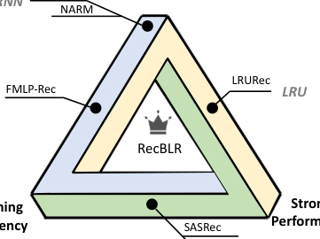
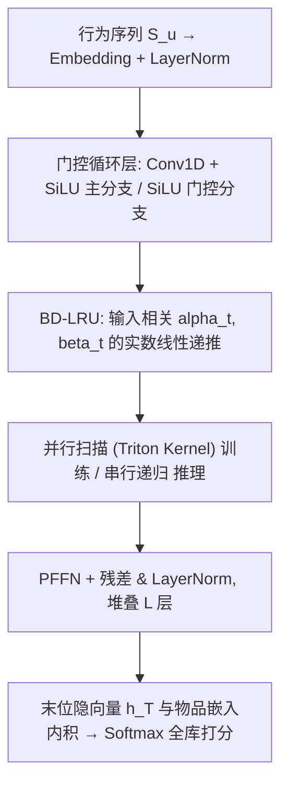
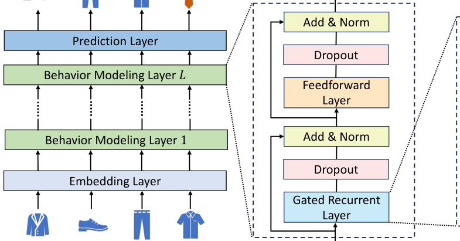
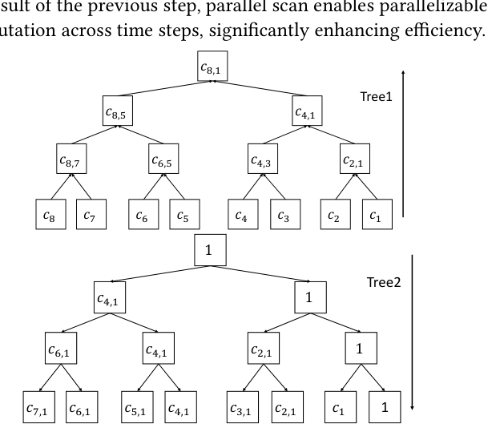

# Behavior-Dependent Linear Recurrent Units for Efficient Sequential Recommendation (面向高效序列推荐的行为依赖线性循环单元)

- **会议/期刊**: CIKM 2024
- **作者与机构**: Chengkai Liu, Jianghao Lin, Hanzhou Liu, Jianling Wang, James Caverlee（Texas A&M University / 上海交通大学）
- **推荐链路定位**: 召回（用户序列编码器，Next-Item 预测）
- **研究方向**: 序列与会话推荐
- **论文原文**: [https://arxiv.org/abs/2406.12580v2](https://arxiv.org/abs/2406.12580v2)
- **开源代码**: [https://github.com/chengkai-liu/RecBLR](https://github.com/chengkai-liu/RecBLR)

## TL;DR (1分钟核心速览)

序列推荐长期受困于"不可能三角"：RNN 推理便宜但训练不可并行、Transformer 精度高但推理因二次复杂度昂贵、MLP 易灾难遗忘、LRURec 训练又慢。本文提出 RecBLR：把 LRU 的复数域静态参数换成 **实数域、输入相关的门控线性循环单元 (BD-LRU)**，并自研 Triton 并行扫描 + embedding padding 加速。在 5 个公开数据集（5-core、Leave-One-Out、Full-Ranking）上全指标超越 8 个基线，ML-1M HR@10 相对最佳基线提升 7.46%，XLong 长序列训练时间 5958s 降至 263s。

## Background & Motivation (背景与核心矛盾)

- **主流范式**: 序列推荐的行为建模算子历经 Markov 链 → CNN/RNN（GRU4Rec、NARM）→ 自注意力（SASRec、BERT4Rec）→ 滤波 MLP（FMLP-Rec）→ 线性循环单元（LRURec），核心竞争维度是"精度 / 训练并行性 / 推理成本"三者取舍。
- **前人局限**: (1) RNN 类推理便宜但序列内不可并行，训练慢；(2) Transformer 精度高，但 $O(T^2)$ 复杂度与 KV-Cache 显存随序列长度爆炸，长行为序列下不可扩展；(3) LRURec 虽已兼顾精度与推理，却因引入非线性与**序列 padding**（补到 2 的幂）导致训练低效，且其参数**与输入行为无关**——所有行为经同一组静态转移矩阵，无法区分"随手浏览"与"决定购买"的关键行为。
- **核心洞察 (Key Insight)**: LRU 之所以必须"行为无关 + 复数域"，只是为了能对复对角矩阵 $A$ 做特征分解以并行展开；而对推荐这类**离散序列**，复数隐状态并无模态优势反而加参数（易过拟合）。因此可放弃该约束，代价换来用并行扫描补回训练效率。
- **本文切入点**: 用实数、输入依赖的门控参数化替换静态 $A$，再用硬件感知的关联扫描（associative scan）把训练并行性重新"赚回来"。

<figure class="paper-figure" markdown="span">
  <figcaption>图1：序列推荐模型设计中三个黄金原则构成的三角形。1 引言</figcaption>
</figure>

## Method (核心方法设计)

### 1. 整体框架 (Overall Architecture)

输入为用户行为序列的物品 ID，经 Embedding + Dropout + LayerNorm 得到 $H\in\mathbb{R}^{T\times D}$（循环结构天然带位置信息，故丢弃位置编码）；随后堆叠$L$层行为建模层，每层由**门控循环层**（含两条分支：Conv1D+SiLU 主分支经 BD-LRU，另一分支 SiLU 作门）与 **PFFN**（$D\to4D\to D$，SiLU 激活）组成，配残差、LayerNorm、Dropout；最后取末位隐表示与物品嵌入做 softmax 全库打分。训练时 BD-LRU 内部用 Triton 实现的并行扫描前向/反向，推理时退化为串行递归，只需$O(1)$ 状态。

<figure class="paper-figure" markdown="span">
  <figcaption>图2：RecBLR的整体架构。</figcaption>
</figure>

### 2. 关键设计拆解 (Key Designs)

1. **行为依赖线性循环单元 (BD-LRU)**：痛点是把 LRU 的静态转移矩阵换成随输入变化的标量门，同时保持线性可扫描。核心算子为
$h_t=\alpha_t\odot h_{t-1}+\beta_t\odot x_t$，
其中门与缩放因子由当前输入（而非 $h_{t-1}$）决定：
$r_t=\sigma(\mathbf{W}_r x_t+b_r),\ i_t=\sigma(\mathbf{W}_i x_t+b_i)$，
$\alpha_t=\exp(-\mathrm{softplus}(\Lambda)\odot r_t),\ \beta_t=\sqrt{1-\alpha_t^{2}}\odot i_t$。
$\alpha_t\in[0,1]$天然构成"遗忘衰减"，$\sqrt{1-\alpha_t^2}$保证能量稳定不发散。直觉上$r_t$像一个**逐维软滤波器**：对与最终购买无关的探索性行为把$\alpha_t$压小（快速遗忘），对关键行为保持接近 1 的长记忆，从而在单一线性递推中实现多兴趣选择；$\Lambda$沿用 LRU 初始化使$\exp(-\mathrm{softplus}(\Lambda))\sim U[0.9,0.999]$。

2. **关联算子与并行扫描**：由于 $\alpha_t,\beta_t$依赖输入，无法再用特征分解展开，作者转而把递推重写为前缀扫描。定义$c_1=\beta'_1$，$c_t=(\alpha_t,\beta'_t)\ (t>1)$，$\beta'_t=\beta_t\odot x_t$，并构造结合算子
$c_{t+1}\bullet c_t=(\alpha_{t+1}\odot\alpha_t,\ \alpha_{t+1}\odot\beta'_t+\beta'_{t+1})$，
于是 $H=[h_1,\dots,h_T]=\mathrm{Scan}(\bullet,c_{1:T})$，用两棵完美二叉树（up-sweep + down-sweep）在$O(T\log T)$ 工作量的并行时间内算出全部隐状态。

3. **训练目标、padding 与推理效率**：损失为标准下一项全库 softmax 交叉熵，**不使用负采样**；序列需补齐到 2 的幂，作者只在每个 BD-LRU 前后做 **embedding padding**（左补零），Conv1D/FFN 仍按真实长度计算，避免 LRURec 式序列 padding 的冗余算力。推理为纯递归，每步 $O(1)$、无 KV-Cache，适合在线长序列增量更新。

<figure class="paper-figure" markdown="span">
  <figcaption>图3：计算隐藏表示的并行扫描。</figcaption>
</figure>

## Experimental Setup & Evaluation Protocol (实验设置与评估协议)

- **数据集与预处理**（沿用 SASRec 设定，过滤交互数 < 5 的用户与物品，即 `5-core`，按时间戳排序）：

| 数据集 | #Users | #Items | #Interactions | 平均长度 | 场景说明 |
| :--- | :---: | :---: | :---: | :---: | :--- |
| ML-1M | 6,040 | 3,416 | 999,611 | 165.5 | 电影评分，稠密长序列 |
| Gowalla | 64,115 | 164,533 | 2,018,421 | 31.5 | LBS 签到 |
| Steam | 25,389 | 4,090 | 328,378 | 12.9 | 游戏购买/评论 |
| Amazon-Beauty | 22,363 | 12,101 | 198,502 | 8.9 | 稀疏电商短序列 |
| Amazon-Sports | 35,598 | 18,357 | 296,337 | 8.3 | 稀疏电商短序列 |
| XLong | 5,000 | 329,722 | 66,822,348 | 785.9 | 阿里超长行为序列（采样 5000 用户，效率实验） |

- **数据划分与防穿越**: `Leave-One-Out`（末位为测试目标、倒数第二位为验证），依据 SASRec/RecBole 默认协议，验证集早停（NDCG@10 连续 10 轮不升即停）。
- **排名评测协议**: `Full-Ranking`（对全物品库未交互项排序，1 正样本 + 全库候选），指标 HR@10/20、NDCG@10/20、MRR@10/20；显著性检验 $p<0.01$。
- **对比基线与超参**: 8 个基线覆盖 Markov（FPMC）、CNN（Caser）、RNN（NARM/GRU4Rec）、Transformer（SASRec/BERT4Rec）、MLP（FMLP-Rec）、LRU（LRURec）；统一嵌入维度 $d=64$、2 层行为建模层、Adam lr=0.001、训练 batch 2048（XLong 512）；最大序列长按数据集平均长度设定（XLong 1000、ML-1M 200、Gowalla 100、其余 50），单卡 A100-40G。

## Key Experimental Results (实验关键数据)

### 1. 主实验对比 (Main Results)

| Dataset | Metric | Caser | GRU4Rec | NARM | SASRec | BERT4Rec | FMLP-Rec | LRURec | **RecBLR** | Improv. |
| :--- | :--- | :---: | :---: | :---: | :---: | :---: | :---: | :---: | :---: | :---: |
| ML-1M | HR@10 | 0.2399 | 0.2937 | 0.2836 | 0.2993 | 0.2950 | 0.2732 | 0.3057 | **0.3285** | +7.46% |
| ML-1M | NDCG@10 | 0.1283 | 0.1638 | 0.1597 | 0.1692 | 0.1664 | 0.1416 | 0.1772 | **0.1901** | +7.28% |
| Gowalla | HR@10 | 0.0747 | 0.0953 | 0.0983 | 0.1202 | 0.1033 | 0.1152 | 0.1189 | **0.1248** | +3.83% |
| Gowalla | NDCG@10 | 0.0438 | 0.0513 | 0.0528 | 0.0565 | 0.0537 | 0.0569 | 0.0574 | **0.0601** | +4.70% |
| Steam | HR@10 | 0.1369 | 0.1327 | 0.1315 | 0.1391 | 0.1366 | 0.1305 | 0.1397 | **0.1421** | +1.72% |
| Beauty | HR@10 | 0.0582 | 0.0606 | 0.0627 | 0.0829 | 0.0780 | 0.0798 | 0.0759 | **0.0881** | +6.27% |
| Beauty | NDCG@10 | 0.0318 | 0.0332 | 0.0333 | 0.0409 | 0.0399 | 0.0407 | 0.0393 | **0.0446** | +9.05% |
| Sports | HR@10 | 0.0310 | 0.0318 | 0.0333 | 0.0477 | 0.0459 | 0.0474 | 0.0464 | **0.0500** | +4.82% |
| Sports | NDCG@10 | 0.0162 | 0.0164 | 0.0170 | 0.0225 | 0.0208 | 0.0229 | 0.0230 | **0.0238** | +3.48% |

长序列 XLong（序列长 ≈800）上差距进一步拉开：SASRec HR@10/NDCG@10 = 0.1946/0.1507，LRURec = 0.2576/0.2571，**RecBLR = 0.2696/0.2675**（HR@10 +4.66% vs. LRURec）。

### 2. 消融与效率实验 (Ablation & Efficiency)

| 变体 | ML-1M HR@10 / NDCG@10 | Beauty HR@10 / NDCG@10 | Gowalla HR@10 / NDCG@10 |
| :--- | :---: | :---: | :---: |
| Default RecBLR | **0.3285 / 0.1901** | **0.0881 / 0.0446** | **0.1248 / 0.0601** |
| Single Recurrent Layer | 0.3127 / 0.1802 | 0.0808 / 0.0403 | 0.1240 / 0.0585 |
| BD-LRU Only（去门控/投影/Conv1D） | 0.3010 / 0.1695 | 0.0840 / 0.0405 | 0.1199 / 0.0579 |
| w/o Conv1D | 0.3245 / 0.1855 | 0.0843 / 0.0433 | 0.1241 / 0.0599 |
| w/o PFFN | 0.3139 / 0.1780 | 0.0840 / 0.0425 | 0.1209 / 0.0576 |
| w/o Custom Initialization | 0.3263 / 0.1894 | 0.0834 / 0.0427 | 0.1188 / 0.0572 |

| 扫描/补齐方案 | ML-1M | Gowalla | XLong |
| :--- | :---: | :---: | :---: |
| Serial Scan | 1022s | 908s | 5958s |
| Parallel Scan + 序列 padding | 75s | 103s | 595s |
| Parallel Scan + **Embedding padding** | **61s** | **91s** | **263s** |

### 3. 关键实验发现 (Key Findings)

1. **序列越长收益越大，且效率优势同步放大**：XLong 上 RecBLR 相比 LRURec HR@10 提升 4.66%、相比 SASRec 提升 38.5%，而每轮训练时间从 5958s（串行扫描）降到 263s（并行扫描 + embedding padding），较 LRURec 的序列 padding 方案在极端 padding（255 位）下再省约 56%，说明扫描核与 padding 策略是长序列场景的真正瓶颈解法。
2. **行为依赖门控是唯一不可替代的增益源**：去掉门控/投影/Conv1D 的 BD-LRU Only 变体在 ML-1M 上 HR@10 掉 8.4%、NDCG@10 掉 10.8%，显著大于去 PFFN（-4.4%）、去 Conv1D（-1.2%）、去自定义初始化（-0.7%），证明"输入相关的 $\alpha_t/\beta_t$"而非网络深度是提升主因。
3. **收益集中于排序质量而非命中率**：Beauty 上 NDCG@10 提升 9.05% 明显高于 HR@10 的 6.27%，Sports 上 MRR@10 仅 +1.26% 而 HR@20 +5.60%，说明模型主要把用户偏好项排得更靠前；同时单层版本仅损失约 5% HR@10 却能大幅提速，为线上时延敏感场景提供可调档位。

## Highlights & Limitations (亮点、对比与审稿批判)

- **与代表作对比 (vs. Prior Work)**: 相较 SASRec，本文把 $O(T^2)$注意力换成$O(T\log T)$ 扫描的线性递推，长序列显存与时间不再爆炸；相较 LRURec，本文去除复数参数（参数更少、避免小数据过拟合）并把静态转移矩阵改为输入相关门控，同时用并行扫描 + embedding padding 找回被抛弃的并行训练；相较 FMLP-Rec，循环结构天然缓解灾难遗忘与长程依赖。
- **可迁移亮点**: (1) `Embedding padding` 只在需要 2 的幂的扫描算子内部补齐、周围层按真实长度计算，这一"局部 padding"技巧可迁移到任何 Mamba/SSM 类序列推荐；(2) 用 $\sqrt{1-\alpha_t^{2}}$的三角参数化 +$\alpha_t$ 的软滤波语义来构造可解释的多兴趣遗忘门，亦可移植到会话推荐与长周期用户画像更新。
- **审稿级局限批判**: (1) 训练强依赖自定义 Triton/CUDA Kernel 与 2 的幂长度约束，跨硬件（非 A100）与跨框架的复现成本高，工业部署需重写算子；(2) 全部结论基于离线 Full-Ranking 与 `5-core` 稠密过滤后的数据，未做线上 A/B，且 XLong 仅采样 5000 用户；此外 dropout 需按稀疏度手工调（0.2→0.5）、扩展因子固定为 2，超参敏感度未被系统量化。

## Rating (四维评分)

- **方法创新性 (Novelty)**: ⭐⭐⭐⭐ （把 SSM/LRU 的输入相关门控与结合扫描引入序列推荐，去掉复数约束的思路干净且有明确动机）
- **评估协议与实验扎实度 (Protocol & Experiments)**: ⭐⭐⭐⭐ （5 数据集 + 长序列 XLong、8 基线、$p<0.01$ 显著性、消融与效率/显存/超参分析齐全，缺线上验证）
- **写作与数学规范度 (Clarity & Rigor)**: ⭐⭐⭐⭐ （BD-LRU 与扫描算子推导清晰、配套算法框与二叉树图示直观，门控语义的稳定性说明略简）
- **工业落地与复现价值 (Industrial & Practical Value)**: ⭐⭐⭐⭐ （代码开源、推理 $O(1)$ 状态无 KV-Cache、XLong 训练提速 20 倍以上，但依赖定制 Kernel 与长度约束增加工程成本）

