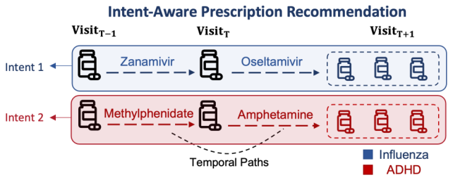
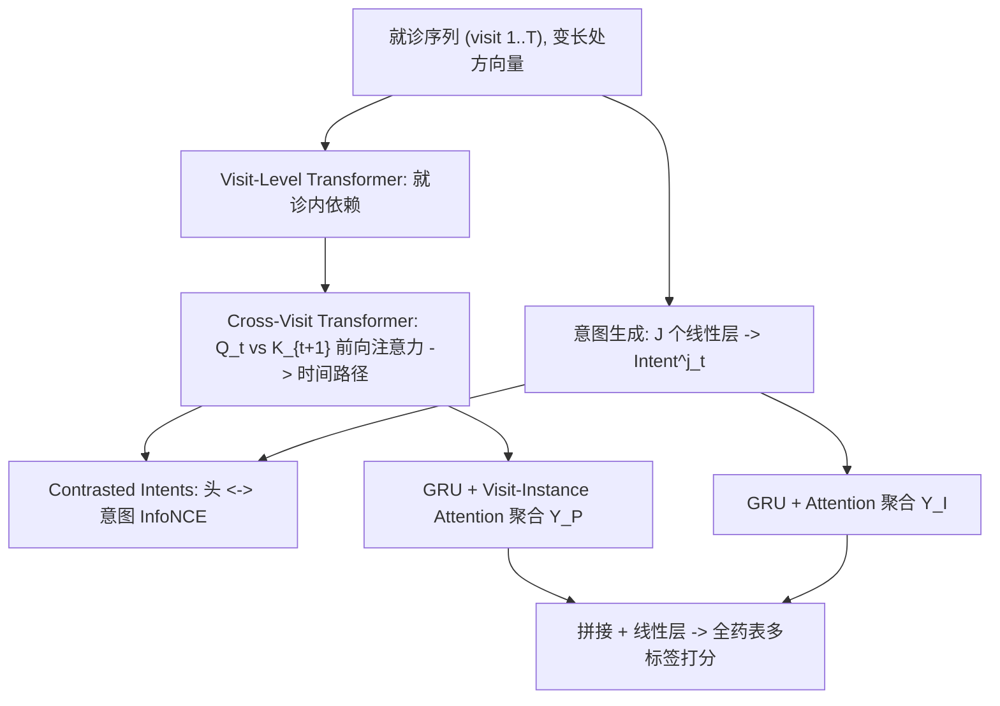
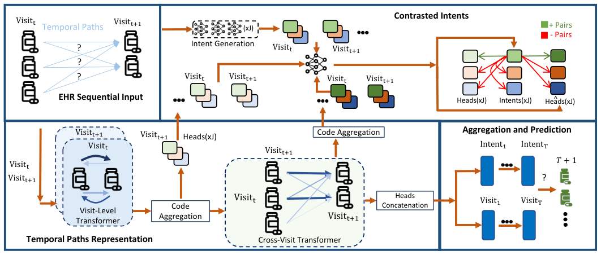

# Contrastive Learning on Medical Intents for Sequential Prescription Recommendation (面向序列处方推荐的医疗意图对比学习)

- **会议/期刊**: CIKM 2024 (33rd ACM CIKM, Boise, ID, USA)
- **作者与机构**: Arya Hadizadeh Moghaddam, Mohsen Nayebi Kerdabadi, Mei Liu (University of Florida), Zijun Yao (University of Kansas)
- **推荐链路定位**: 精排 / 下一就诊（Next-Visit）多标签处方预测
- **研究方向**: 序列与会话推荐 / 自监督对比学习与交互去噪
- **论文原文**: [https://arxiv.org/abs/2408.10259v1](https://arxiv.org/abs/2408.10259v1)
- **开源代码**: [https://github.com/aryahm1375/ARCI](https://github.com/aryahm1375/ARCI)

## TL;DR (1分钟核心速览)

EHR 中同一患者的连续就诊序列可同时承载多条由不同医疗意图（如流感 vs. ADHD）驱动的处方线索，而现有序列模型（Retain/Transformer 等）只建模单一同质时序依赖。ARCI 用两级 Transformer 抽取"就诊内 + 跨就诊"时间路径，并把每个注意力头与一个医疗意图绑定、用对比损失强制意图互斥可分。在两个真实数据集、随机 80/20 划分 + 全库排序协议下，Hit@1 相对最优基线 Retain 提升 7.0%（MIMIC-III）与 5.3%（AKI）。

## Background & Motivation (背景与核心矛盾)

- **主流范式**: 处方推荐沿两条线演进——RNN 系（Dr. Agent、Retain、Micron）做就诊级注意力与残差健康状态更新；GNN/结构系（GAMENet、SafeDrug、MoleRec）以 DDI 图或分子结构约束药物安全。
- **前人局限**: ① 电影/电商式序列模型假设"每个时间步只含单个物品"，无法适配 EHR 的「就诊序列 → 就诊内医疗码集合」两级异构结构；② 即便多头注意力能产生不同表示，各头之间缺乏显式排斥约束，容易塌缩到重叠子空间，无法覆盖患者并存的多种疾病侧面。
- **核心洞察 (Key Insight)**: 一条就诊序列在医学上可被"解耦"为多条并行的时间路径（temporal path），每条路径对应一个专门化的健康画像（medical intent）；意图越互斥，患者表征越全面。
- **本文切入点**: 将意图作为对比学习的锚点（anchor），让"同一头的意图—头表示"为正对、"不同头"为负对，用 InfoNCE 把多头注意力推开成互补的医疗侧面。

<figure class="paper-figure" markdown="span">
  <figcaption>图1：在EHR中，患者的就诊序列常包含由不同医疗意图（如流感和ADHD）驱动的多条处方用药线索。我们使用时间路径来区分与不同意图相关的医疗编码之间的不同依赖关系。</figcaption>
</figure>

## Method (核心方法设计)

### 1. 整体框架 (Overall Architecture)

输入患者就诊序列 $\mathbf{X}_p=\langle \mathbf{x}_1,\dots,\mathbf{x}_T\rangle$，每次就诊是变长的处方码集合。Visit-Level Transformer 先编码就诊内（intra-visit）处方依赖，得到各头表示$\mathbf{E}^j_t$；Cross-Visit Transformer 以$t$的 Query 对$t+1$的 Key 做"前向"注意力，把$t$的处方语义沿时间步注入$t+1$，形成时间路径$\hat{\mathbf{e}}^j_{t+1}$，再与$\mathbf{V}^j_{t+1}$拼接经线性层得$\hat{\mathbf{E}}^j_{t+1}$。并行地，每次就诊的池化表示$\hat{\mathbf{P}}_t$经$J$个线性层生成$J$个意图；Contrasted Intents 模块用对比损失对齐"头"与"意图"。最后经两次 GRU + 可解释 visit-instance attention 分别聚合成$\mathbf{Y}_P$、$\mathbf{Y}_I$，拼接后线性映射为全药物词表上的打分$\hat{\boldsymbol{y}}$。

<figure class="paper-figure" markdown="span">
  <figcaption>图2：在ARCI框架中，就诊序列首先在Temporal Paths Representation模块中处理，该模块包含Visit-Level Transformer以提取就诊内依赖关系，以及Cross-Visit Transformer以基于就诊间编码依赖生成时间路径。同时，每次就诊的输入嵌入经过多个线性层以生成多个医疗意图，并进一步利用对比学习目标在Contrasted Intents模块中细化注意力头。最后，Temporal Paths Representation的输出</figcaption>
</figure>

### 2. 关键设计拆解 (Key Designs)

1. **跨就诊前向注意力（Cross-Visit Temporal Path）**: 常规自注意力在同一序列内做对称的 $QK^\top$，无法刻画"上一就诊的用药如何触发下一就诊的用药"。本文刻意错位取 Query 与 Key，并对注意力矩阵转置，使"列和为 1"（每个$t+1$ 处方接收的注意力归一），实现处方向后传播：
   $\mathrm{Att}^j_{t+1}=\mathrm{softmax}\!\left(\left(\frac{\hat{Q}^j_t(\hat{K}^j_{t+1})^{\top}}{\sqrt{d/J}}+\hat{M}\right)^{\top}\right),\quad \hat{\mathbf{e}}^j_{t+1}=\mathrm{Att}^j_{t+1}\hat{V}^j_t$其中$\hat{M}$ 依据两侧实际可用处方码掩码。直觉：把"时间演化"建模为一次有向的码—码信息搬运，而非整体序列池化。
2. **意图—注意力头绑定与对比正则（Contrasted Intents）**: 多头若自由训练会冗余。本文令意图数 = 头数 $J$，$\mathrm{Intent}^j_t=\hat{\mathbf{P}}_t W^j_I$，并将每个头的时间路径池化后投影得$Z^j_O$、$\hat{Z}^j_O$，与$Z^j_I$构成正对，其余$k\neq j$为负对（含意图间互斥项$I_i$）：
   $\mathcal{L}_I=\sum_{j=1}^{J}\Big(\mathcal{L}^{j}_{CL}(\text{Intent}^j,\text{Visit-Level})+\hat{\mathcal{L}}^{j}_{CL}(\text{Intent}^j,\text{Cross-Visit})\Big)$物理直觉：余弦相似度 + 温度$\tau$ 的排斥力使不同头占据不同子空间，从而"每个头 = 一个专科侧面"。
3. **训练目标与推理开销**: 主任务为多标签分类，总损失 $\mathcal{L}=\mathcal{L}_{BCE}+\gamma\mathcal{L}_{I}+\lambda\mathcal{L}_{multi}$，其中$\mathcal{L}_{multi}$为多标签 hinge（要求正例分数比负例至少高 1 个 margin）；无负采样（全药表 191/222 类直接二分类）；Adam 优化，$d=256$、batch 128、$\tau=0.05$，MIMIC-III 取$J=4$、$\gamma=0.2$，AKI 取$J=6$、$\gamma=0.1$。推理仅需两次 Transformer 前向 + 两次 GRU 聚合，复杂度对$T$、$L$、$J$ 线性。

## Experimental Setup & Evaluation Protocol (实验设置与评估协议)

- **数据集与预处理**: 处方归一到 ATC-3 层级；**剔除所有就诊间重复出现的处方**（主干实验），另设包含重复处方的对照实验；过滤仅 1 次就诊的患者。

| 数据集 | #Users(patients) | #Items(药物) | #Interactions(目标就诊) | 稀疏度/密度 | 特征/场景说明 |
| :--- | :---: | :---: | :---: | :---: | :--- |
| MIMIC-III | 6,442 | 191 | 10,104 | 每就诊均 10.86 药 | ICU 重症 2001–2012，最多 4 次就诊，平均输入 2.52 次 |
| AKI | 63,940 | 222 | 63,940 | 每就诊均 8.28 药 | KUMC 2009–2021，含非 ICU 住院，固定 3 次就诊（2 输入 1 目标） |

- **数据划分与防穿越 (Splitting Strategy)**: **随机比例划分 80%/20%**（非时间戳切分），重复 7 次不同随机种子取均值与 95% 置信区间；所有输入严格限定在目标就诊 $T+1$ 之前，无未来信息泄漏。
- **排名评测协议 (Ranking Protocol)**: **Full-Ranking 全库排序**——模型对全部 $H$种药物输出 sigmoid 分数后整体排序，计算 Hit@K / NDCG@K（无负采样、无候选裁剪）；分类指标 PRAUC/F1/Jaccard 的判定阈值$\theta$在$[0,1]$ 上以 0.1 步长贪心搜索；另报 DDI 互作率（越低越好，注意本文未把 DDI 损失加入训练）。
- **对比基线与超参设置**: 7 个基线——Dr. Agent、Retain（RNN 双注意力）、Transformer Encoder、Micron、SafeDrug、MoleRec、GAMENet；$d=256$，超参用贪心搜索，基于 PyHealth 实现。

## Key Experimental Results (实验关键数据)

### 1. 主实验对比 (Main Results)

| Method | MIMIC Hit@1 ↑ | MIMIC NDCG@5 ↑ | MIMIC PRAUC ↑ | AKI Hit@1 ↑ | AKI NDCG@5 ↑ | AKI PRAUC ↑ |
| :--- | :---: | :---: | :---: | :---: | :---: | :---: |
| Dr. Agent | 0.416 | 0.488 | 0.324 | 0.407 | 0.608 | 0.350 |
| Retain | 0.459 | 0.534 | 0.367 | 0.398 | 0.606 | 0.351 |
| Micron | 0.333 | 0.410 | 0.273 | 0.383 | 0.587 | 0.329 |
| SafeDrug | 0.350 | 0.411 | 0.270 | 0.396 | 0.590 | 0.336 |
| MoleRec | 0.336 | 0.414 | 0.275 | 0.380 | 0.587 | 0.328 |
| GAMENet | 0.409 | 0.484 | 0.319 | 0.394 | 0.593 | 0.345 |
| Transformer | 0.416 | 0.493 | 0.340 | 0.383 | 0.585 | 0.333 |
| **ARCI** | **0.491** | **0.556** | **0.376** | **0.419** | **0.631** | **0.366** |
| Improv.% (vs. best baseline) | +7.0% | +4.1% | +2.5% | +5.3% | +3.8% | +4.3% |

DDI 率上 ARCI 为 0.051 / 0.063，略高于 Micron（0.047 / 0.055）与 MoleRec（0.046 / 0.057）；即在不使用 DDI 损失的前提下，以约 0.5%–0.8% 的安全性代价换取 10.1%（MIMIC）/3.7%（AKI）的 PRAUC 增益。包含重复处方时 ARCI PRAUC 为 0.727 / 0.472，仍优于最强的 MoleRec（0.714 / 0.453）。

### 2. 消融实验 (Ablation Study)

| 变体 | MIMIC Hit@1 | MIMIC NDCG@5 | MIMIC PRAUC | AKI Hit@1 | AKI PRAUC |
| :--- | :---: | :---: | :---: | :---: | :---: |
| Transformer (baseline) | 0.416 | 0.493 | 0.340 | 0.383 | 0.333 |
| ARCI w/o intent（仅加 Cross-Visit） | 0.462 | 0.532 | 0.352 | 0.408 | 0.354 |
| ARCI w/ intent, w/o $\mathcal{L}_I$ | 0.475 | 0.538 | 0.366 | 0.412 | 0.360 |
| **ARCI (full)** | **0.491** | **0.556** | **0.376** | **0.419** | **0.366** |

### 3. 关键实验发现 (Key Findings)

1. **跨就诊路径是主要增益来源，对比正则做二次放大**：MIMIC Hit@1 上 Cross-Visit 单独带来 0.416→0.462（+11.1%），再叠加意图线性层到 0.475，最后加 $\mathcal{L}_I$ 到 0.491；说明"多头≠多意图"，显式排斥项仍贡献 3.4% 的增量。
2. **意图数 $J$与疾病异质性正相关**：AKI（6.4 万患者、非 ICU 更杂）最优$J=6$，MIMIC-III 最优$J=4$；无$\mathcal{L}_I$时曲线随$J$增大而趋平甚至微降，有$\mathcal{L}_I$时$J$ 增大持续获益，印证对比项在"防止头冗余"上的作用。
3. **表示层面可验证的解耦**：t-SNE 显示各注意力头按意图聚成互不重叠的簇，且意图均值落在对应簇中心附近；个案分析中"止吐药 A04A → 抗真菌 P01A"、"止咳 R05C → 咽部制剂 R02A"等路径与文献一致，提供可解释性。损失消融还显示 BCE 主导性能，hinge 仅提供小幅提升，$\mathcal{L}_I$在$J$ 较小时收益最大。

## Highlights & Limitations (亮点、对比与审稿批判)

- **与代表作对比 (vs. Prior Work)**: Retain 的**就诊级注意力**只回答"哪次就诊重要"，ARCI 进一步回答"哪条时间线上哪个码触发了哪个码"；SafeDrug/MoleRec/GAMENet 把 DDI 图或分子结构作为硬约束写进损失，本文则完全放弃 DDI 监督而靠意图解耦提升准确率；与电商意图推荐（ICL、ASLI）相比，本文将意图从"用户偏好簇"迁移为"与注意力头一一绑定的医疗画像"，并新增了跨时间步的有向注意力算子。
- **可迁移亮点**: ① Query 取 $t$、Key 取$t+1$ 并转置 softmax 的"有向跨步注意力"，可直接移植到多行为序列、会话内 item-set 推荐；② "头数 = 意图数 + InfoNCE 对齐"是一种轻量、无需额外标注的表示解耦正则，适合任何多头序列模型。
- **审稿级局限批判**: ① 采用**随机 80/20 划分而非全局时间戳切分**，同一患者的多次就诊可能跨训练/测试集，存在患者级信息泄漏风险，性能可能被高估；② 评价仅限两个药物词表仅 ~200 类的小规模数据集，且剔除重复处方后任务被人为简化，DDI 安全率反而劣于 Micron/MoleRec，临床可用性存疑；③ $J$、$\gamma$、$\lambda$、$\tau$ 均需按数据集贪心搜索，意图数对数据异质性敏感，跨机构迁移成本较高。

## Rating (四维评分)

- **方法创新性 (Novelty)**: ⭐⭐⭐⭐ （有向跨就诊注意力 + 头—意图绑定的对比正则组合较新，但两个组件均可在意图推荐/多头正则文献中找到原型）
- **评估协议与实验扎实度 (Protocol & Experiments)**: ⭐⭐⭐ （7 基线 × 两类指标 × 7 次重复 + 置信区间较完整，但随机比例划分缺乏时间切分与冷启动划分，削弱说服力）
- **写作与数学规范度 (Clarity & Rigor)**: ⭐⭐⭐⭐ （公式与掩码定义清晰、复杂度可推，但对比损失符号与意图池化细节表述略显冗长重复）
- **工业落地与复现价值 (Industrial & Practical Value)**: ⭐⭐⭐⭐ （代码开源且兼容 PyHealth，推理仅为两次 Transformer 前向，可解释注意力对临床审核友好；但小词表与超参敏感性限制直接上线）

