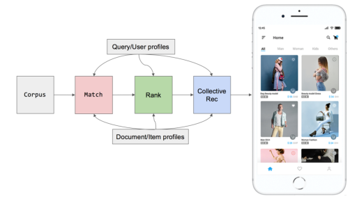
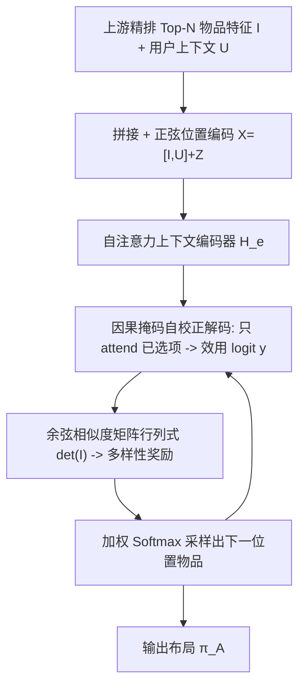
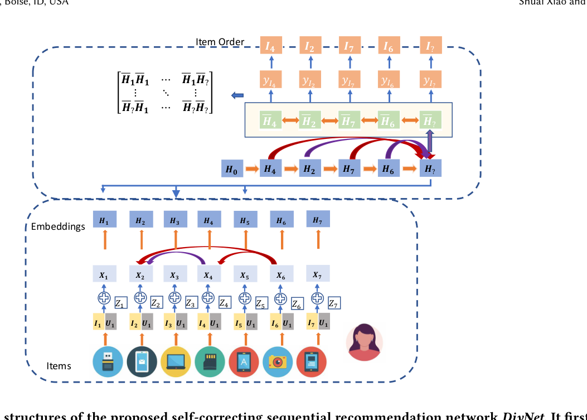
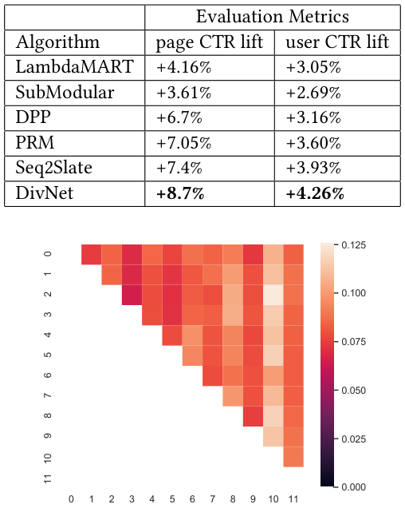

# DivNet: Diversity-Aware Self-Correcting Sequential Recommendation Networks (多样性感知的自校正序列推荐网络)

- **会议/期刊**: CIKM 2024 (33rd ACM CIKM, 7 pages)
- **作者与机构**: Shuai Xiao, Zaifan Jiang（阿里巴巴集团）
- **推荐链路定位**: 重排（collective recommendation，精排之后的整页布局优化）
- **研究方向**: 序列与会话推荐 / 多任务学习与列表级重排
- **论文原文**: [https://arxiv.org/abs/2411.00395v1](https://arxiv.org/abs/2411.00395v1)
- **开源代码**: 暂未开源

## TL;DR (1分钟核心速览)

本文针对工业推荐链路最后一环"集体推荐"的痛点：同屏物品之间存在强烈相互激发（self-exciting）与视觉组合效应，而子模/DPP 只会做类别去重、PRM/Seq2Slate 又不显式建模多样性。DivNet 把列表生成改写为"因果掩码的逐步选择"——每步对已选项做 masked attention 得到自校正效用 logit，并把当前候选与已选项余弦相似度矩阵的行列式作为多样性奖励注入采样概率；训练用 REINFORCE(NDCG) + 逐步多标签交叉熵正则以抑制序列暴露偏差。在 Yahoo/Microsoft/电商三套数据上 NDCG@10 达 0.7619/0.4756/0.3562，线上部署（100% 流量）page CTR 相对 Wide&Deep 提升 +8.7%、user CTR +4.26%。

## Background & Motivation (背景与核心矛盾)

- **主流范式**: 工业链路为 matching → 粗排/精排 → collective recommendation（图1黄框），前几级点式/成对/列表打分后按分数降序铺页，最后一级才真正决定"哪些物品放在一起、放在哪里"。
- **前人局限**: ① 子模函数与 DPP 只依赖 pair-wise 相似度或类别重复度做贪心，隐含"单品效用与邻域无关"的常数假设，无法刻画高阶、位置相关的相互激发，且行列式/子模贪心计算昂贵；② PRM、Seq2Slate 虽用 Transformer/指针网络建模上下文，却完全不显式建模多样性；③ 基于 Bayesian 先验的方案需大量数据才能估准用户偏好先验，冷启动与短周期营销活动直接失效。
- **核心洞察 (Key Insight)**: 用户是按位置自上而下顺序浏览的，前面已展示的物品会改变后续物品的点击倾向（点过程中的 self-correcting/self-exciting），距离越近影响越强；同时曝光日志只覆盖极小一部分物品组合，形成严重的序列暴露偏差（OOD 组合估计不可靠）。
- **本文切入点**: 把"整页布局"当作一个序列决策问题——逐个位置地选物品，边选边把已选项影响传给后续，同时用行列式奖励强制多样性。

<figure class="paper-figure" markdown="span">
  <figcaption>图1：工业级推荐系统的典型架构，包括特征层、匹配和排序。黄色框中的最后一层是集体推荐，它对推荐物品及其布局进行最终完善，以优化点击率或停留时间等目标。</figcaption>
</figure>

## Method (核心方法设计)

### 1. 整体框架 (Overall Architecture)

输入上游精排给出的候选集 $\mathcal{A}=\{a_i\}_{i=1}^{N}$（含离散特征 embedding 与连续特征）与用户上下文$\mathbf{U}$；先把二者拼接并加正弦位置编码，再用自注意力让每个物品的表示吸收"同屏邻居"的信息；解码阶段从第 1 个位置起逐步选择，每步用上三角因果掩码只 attend 已选物品，得到"考虑已选上下文"的效用 logit；同时计算候选与已选项的余弦相似度矩阵行列式作为多样性项，与 logit 加权后 softmax 采样下一个物品；训练端以 REINFORCE 优化 NDCG 奖励，并叠加逐步多标签交叉熵做监督正则；推理时对上游列表一次前向 + 采样即得布局$\pi_{\mathcal{A}}$。

<figure class="paper-figure" markdown="span">
  <figcaption>图2：所提出的自校正序列推荐网络 DivNet 的网络结构。它首先在感知上下文物品存在的情况下将物品投影到隐空间；然后，DivNet 在考虑先前已选物品影响的同时依次选择物品，并将其影响传递给后续物品。注意，如解码网络所示，当用户依次浏览推荐物品时，DivNet 显式考虑了物品交互的序列自校正。</figcaption>
</figure>

### 2. 关键设计拆解 (Key Designs)

1. **位置感知的上下文编码**：为打破"单品独立打分"假设，物品特征与广播后的用户向量拼接后再加正弦位置编码 $\mathbf{X}=[\mathbf{I},\mathbf{U}]+\mathbf{Z}$，随后做自注意力$\mathbf{H}_e=\mathrm{LayerNorm}(\mathrm{Softmax}(\mathbf{Q}_e\mathbf{K}_e^{\top}/\sqrt{D_K})\mathbf{V}_e\mathbf{W}^O_e+\mathbf{Q}_e)$。这样每个物品的 embedding 已内含"与谁同屏"的竞争/协同信息，是后续序列选择的基础。
2. **自校正序列选择 + 行列式多样性**：第 $t$步仅对已选序列$\hat{\mathbf{H}}=[H_{\pi_1},\dots,H_{\pi_t}]$做掩码注意力$\bar{\mathbf{H}}=\mathrm{Softmax}(\mathbf{Q}_d\mathbf{K}_d^{\top}\odot\mathbf{U}/\sqrt{D_K})\mathbf{V}_d$（$\mathbf{U}$为上三角掩码，保证因果性），效用$y_{\pi_t}=\sigma(\mathbf{W}_d\bar{\mathbf{H}}_{\pi_t}+b)$；多样性项取相似度矩阵行列式$\det(I_{\pi_t})=\det[L_{ij}]$，$L_{ij}=\cos(\bar{\mathbf{H}}_i,\bar{\mathbf{H}}_j)$，最终选择概率
$$P(I_{\pi_t})=\frac{y_{\pi_t}+\alpha\det(I_{\pi_t})}{\sum_{I_{\pi'_t}\in R_t}\left(y_{\pi'_t}+\alpha\det(I_{\pi'_t})\right)}$$
   直觉：行列式随"新物品与已选项越不相似"而增大（DPP 的体积解释），把去冗余直接写进采样分布而非事后规则；$\alpha$ 控制多样性强度。
3. **训练目标、正则与推理开销**：目标是 $\min_\theta -\mathbb{E}_{\pi\sim P_\theta}[R(\pi,y)]+\lambda\mathcal{L}$，$R$取 NDCG，梯度用 REINFORCE 蒙特卡洛近似；由于采样空间巨大、REINFORCE 方差高且偶发收敛到异常点，作者加入逐步多标签交叉熵$\mathcal{L}=\sum_t w_t\mathcal{L}_t$，$\mathcal{L}_t=-\sum_{I_{\pi'_t}\in R_t}y_{I_{\pi'_t}}\log P(I_{\pi'_t})$，权重$w_t=1/\log(t+1)$模拟 NDCG 位置折扣。该监督项把搜索限制在原始曝光序列邻域内，正是对暴露偏差的显式约束；训练与推理均采用采样而非贪心（消融证明贪心更差）。推理为$N$ 步串行解码，每步需对剩余候选算一次行列式，是主要延迟来源。

## Experimental Setup & Evaluation Protocol (实验设置与评估协议)

- **数据集与预处理**: 两个公开 LTR 数据集 + 一个真实电商日志集（相关性 0–4 分，0–2 记为负、3–4 记为正）：

| 数据集 | #Users(查询) | #Items(文档) | #Interactions | 稀疏度/密度 | 特征/场景说明 |
| :--- | :---: | :---: | :---: | :---: | :--- |
| Yahoo Webscope | 29K | 700K | — | — | 搜索引擎查询-文档，文本+统计特征 |
| Microsoft 10K | 10K | 1.2M | — | — | Bing 查询-文档，统计特征 |
| E-commerce | 862K | 8.3M | 29.4M | — | 营销页整页推荐，含点击/未点击响应 |

- **数据划分与防穿越 (Splitting Strategy)**: 三个数据集统一按 **0.8 / 0.1 / 0.1 比例随机划分** 训练/验证/测试（未做全局时间戳切分，存在轻微时序泄漏风险）；Yahoo/Microsoft 的初始候选列表由 LambdaMART 生成后再交给下游模型重排，属"同一上游、只比重排"的受控设置。
- **排名评测协议 (Ranking Protocol)**: 在给定查询的候选文档集合上做**全候选排序（Full-Ranking，非负采样）**，指标 NDCG@10、MAP@10、Pre@K；点击/相关性标签二值化，未做位置偏差校正。
- **对比基线与超参设置**: 无集体推荐基线 Wide&Deep；列表级 LambdaMART；多样性基线 Submodular、DPP；上下文/序列基线 PRM、Seq2Slate。Embedding 与 $D_K,D_V$均为 64，均匀初始化$[-0.1,0.1]$，Adam lr=0.01，batch=256，$\lambda$在$[0.01,1]$ 内搜索；**未报告多种子方差与显著性检验**。

## Key Experimental Results (实验关键数据)

### 1. 主实验对比 (Main Results)

| 方法 | Yahoo NDCG@10 | Yahoo MAP@10 | MS NDCG@10 | MS MAP@10 | E-comm NDCG@10 | E-comm MAP@10 |
| :--- | :---: | :---: | :---: | :---: | :---: | :---: |
| Wide&Deep | 0.7202 | 0.6954 | 0.4261 | 0.4880 | 0.3196 | 0.2902 |
| LambdaMART | 0.7346 | 0.7121 | 0.4683 | 0.4971 | 0.3382 | 0.3194 |
| Submodular | 0.7274 | 0.7026 | 0.4562 | 0.4932 | 0.3367 | 0.3151 |
| DPP | 0.7379 | 0.7148 | 0.4536 | 0.4907 | 0.3423 | 0.3293 |
| PRM | 0.7526 | 0.7223 | 0.4592 | 0.5143 | 0.3435 | 0.3304 |
| Seq2Slate | 0.7562 | 0.7264 | 0.4623 | 0.5214 | 0.3421 | 0.3210 |
| **DivNet** | **0.7619** | **0.7351** | **0.4756** | **0.5298** | **0.3562** | **0.3436** |
| Improv. (vs Seq2Slate) | +0.75% | +1.20% | +2.88% | +1.61% | +4.12% | +7.04% |

线上 A/B（电商营销页，100% 流量，两个月日志：训练 4.7M UV/100M PV，测试 27K UV/210K PV）：DivNet page CTR **+8.7%**、user CTR **+4.26%**；对照 LambdaMART +4.16%/+3.05%、DPP +6.7%/+3.16%、PRM +7.05%/+3.60%、Seq2Slate +7.4%/+3.93%。

### 2. 消融实验 (Ablation Study)

| 变体 (E-commerce) | NDCG@10 | MAP@10 | ΔNDCG | ΔMAP |
| :--- | :---: | :---: | :---: | :---: |
| DivNet 完整 | **0.3562** | **0.3436** | — | — |
| w/o SL ($\lambda=0$，纯 REINFORCE) | 0.3493 | 0.3402 | −1.94% | −0.99% |
| w/o Sampling（贪心解码） | 0.3514 | 0.3416 | −1.35% | −0.58% |

### 3. 关键实验发现 (Key Findings)

1. **"逐步选"优于"全局一次打分"**：Seq2Slate 在 MS MAP 上已超 PRM（0.5214 vs 0.5143），而 DivNet 在电商 MAP 上比 Seq2Slate 高 7.04%、比 PRM 高 4.0%——说明增益主要来自因果掩码序列解码，而非更强的编码器。
2. **多样性约束并非"牺牲相关性换新奇"**：DivNet 在三个数据集的 NDCG 与 MAP 同时最优，DPP 只在 Yahoo/电商优于 Submodular、在 Microsoft 反而更差（0.4536 vs 0.4562），说明静态 pair-wise 相似度矩阵对异构分布的泛化差，而把行列式嵌入效用打分可随上下文自适应。
3. **采样与监督正则都是必需项**：去掉 SL 掉 1.94% NDCG（论文亦提到纯 REINFORCE 会收敛到异常点），改贪心解码掉 1.35%——采样扩大了训练分布覆盖、缩小训练/测试分布差，验证了"暴露偏差"是真实的性能瓶颈而非修辞。图3的可视化进一步显示同品类物品（item 10 受 item 2/4/8）激发强度最大，与"距离近、品类同则影响强"的直觉一致。

<figure class="paper-figure" markdown="span">
  <figcaption>图3：物品之间典型的自激发模式。</figcaption>
</figure>

## Highlights & Limitations (亮点、对比与审稿批判)

- **与代表作对比 (vs. Prior Work)**: 相比 Submodular/DPP 的"先算单品分、再启发式去重"两阶段解耦，DivNet 把多样性写进选择概率，实现效用与多样性的联合优化；相比 PRM 的全局注意力打分、Seq2Slate 的指针式序列生成，DivNet 显式引入行列式多样性项并追加监督正则，同时首次把 self-correcting 点过程语言搬进集体推荐。
- **可迁移亮点**: ① "效用 logit + $\alpha\cdot\det(\cdot)$ 加权 softmax" 是一个与主干网络解耦的通用去冗余算子，可挂到任意列表生成器；② 用"原始曝光序列邻域内的监督交叉熵"抑制 REINFORCE 高方差，是离线日志下策略梯度训练的廉价稳定器。
- **审稿级局限批判**: ① 每步需对剩余候选计算行列式（矩阵随已选长度增长），串行 $N$步解码叠加$O(t^3)$ 行列式，论文未给复杂度/延迟分析，与"computationally-efficient"的自述存在张力；② 实验仅 3 个数据集、单次划分、无方差与显著性检验，Yahoo/MS 是从 LTR 数据集改造而来，缺乏真实整页布局与视觉信号；③ 曝光偏差仅靠监督正则隐式缓解，未像因果/IPS 方法那样显式纠偏。

## Rating (四维评分)

- **方法创新性 (Novelty)**: ⭐⭐⭐⭐ （把 self-correcting 点过程与 DPP 行列式嵌入指针式序列解码，组合方式新颖且物理直觉清晰，但各组件本身均为已知技术）
- **评估协议与实验扎实度 (Protocol & Experiments)**: ⭐⭐⭐ （三数据集全候选 Full-Ranking + 真实线上 100% 流量 A/B 有说服力，但仅两组消融、无多种子与显著性检验，划分未做时间切分）
- **写作与数学规范度 (Clarity & Rigor)**: ⭐⭐⭐ （整体流程与公式可读，但部分符号排版错乱、缺复杂度分析与 $\alpha/\lambda$ 敏感性实验）
- **工业落地与复现价值 (Industrial & Practical Value)**: ⭐⭐⭐⭐ （已在电商营销页承载 100% 流量并取得 +8.7% page CTR，工程可信度高；未开源，串行解码与行列式计算需自研优化）

