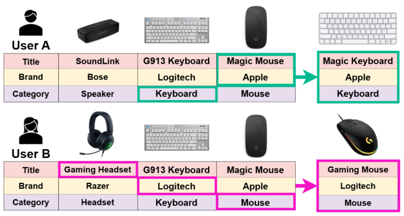
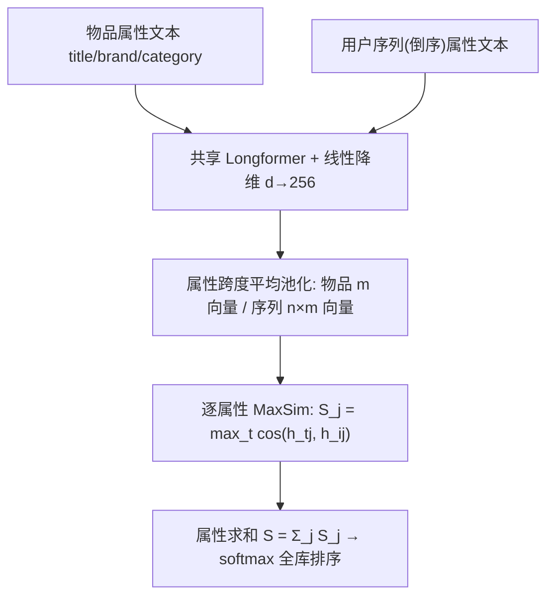
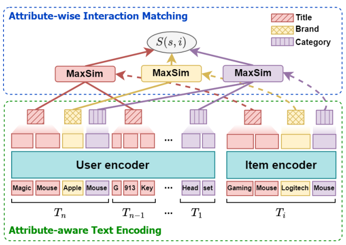

# MARS: Matching Attribute-aware Representations for Text-based Sequential Recommendation (面向文本序列推荐的属性感知表征匹配)

- **会议/期刊**: CIKM 2024 (Short Paper)
- **作者与机构**: Hyunsoo Kim, Junyoung Kim, Minjin Choi, Sunkyung Lee, Jongwuk Lee（成均馆大学 SKKU）
- **推荐链路定位**: 召回（序列下一物品预测 / 端到端文本打分）
- **研究方向**: 序列与会话推荐 / 大语言模型推荐（PLM 文本表征）
- **论文原文**: [https://arxiv.org/abs/2409.00702v2](https://arxiv.org/abs/2409.00702v2)
- **开源代码**: [https://github.com/junieberry/MARS](https://github.com/junieberry/MARS)

## TL;DR (1分钟核心速览)

现有文本序列推荐（UniSRec/Recformer/MIRACLE）把用户序列与物品各自压成**一个粗粒度向量**，无法表达"多属性偏好"，也难处理同一历史序列下不同用户兴趣分叉的情形。MARS 保留物品 title/brand/category 三条属性，用共享 Longformer 编码后对每个属性跨度做平均池化，得到物品的 $m$个向量与序列的$n\times m$ 个向量；再用逐属性 MaxSim 动态对齐并求和打分。在 5 个 Amazon `5-core` 数据集、`Leave-One-Out` + 全库排序协议下，R@10 与 N@10 相对最强基线最高提升 24.43% / 29.26%，零样本迁移平均提升 13.11%。

## Background & Motivation (背景与核心矛盾)

- **主流范式**: ID 类模型（SASRec/BERT4Rec）靠随机初始化 ID 向量 + Transformer；文本类模型（UniSRec/Recformer/MIRACLE）用 PLM 编码物品文本，以语义相似度做匹配，从而支持冷启动物品与跨数据集知识迁移。
- **前人局限 (i)**: 单向量表征把"品牌=罗技"与"类目=鼠标"混为一谈，无法表达属性级偏好；MIRACLE 虽引入多兴趣向量，但兴趣数固定且**物品仍是单向量**，匹配只能做用户侧多向量 × 物品单向量。
- **前人局限 (ii)**: 同一段历史（Magic Mouse + Keyboard）对不同用户应导向不同目标（Apple 键盘 vs 游戏鼠标），全局单一相似度无法刻画这种"因属性而异的注意力分配"。
- **核心洞察 (Key Insight)**: 用户的下一步偏好是**属性条件化**的——历史中与候选物品同一属性（同 key）的那一段才是有效证据，故应在属性维度上分别建模匹配而非先聚合。
- **本文切入点**: 把"编码"和"匹配"同时细粒度化：属性级多向量编码 + 属性内 MaxSim 匹配，其余流程保持不变（序列推荐范式零改动）。

<figure class="paper-figure" markdown="span">
  <figcaption>图1：两个用户序列的动机示例。绿色和粉色框表示与目标物品高度相关的不同用户兴趣。</figcaption>
</figure>

## Method (核心方法设计)

### 1. 整体框架 (Overall Architecture)

物品 $i$用$m=3$个 key-value 属性（如 `Category: Keyboard`）拼成一段文本$X_i$，前缀 `[BOS]` 后送入共享的 Longformer（$d=768$）编码；经线性层降维到$d'=256$后，对属于同一属性跨度的 token 隐状态做平均池化，得到物品属性向量$\mathbf{h}_{i,j}$与序列中每个历史物品的属性向量$\mathbf{h}_{t,j}$（序列按时间**倒序**拼接以防近期物品被 1024 token 截断）。打分阶段对每个属性$j$，让候选物品属性向量去检索整段序列中"最像"的历史属性向量（MaxSim），再把$m$个属性的分数求和得到最终得分。训练用全库 softmax 交叉熵 + 两阶段训练（先冻结/更新物品表征至收敛，再固定最优物品向量继续训练），推理时离线预计算全部物品属性向量、在线只做$m\times n$ 次余弦相似度。

<figure class="paper-figure" markdown="span">
  <figcaption>图2：MARS 的模型架构。每个物品包含三个属性，例如标题、品牌和类别。为简洁起见，我们仅展示属性值，省略其键。</figcaption>
</figure>

### 2. 关键设计拆解 (Key Designs)

1. **属性跨度池化编码 (Attribute-aware Encoding)**：痛点是不存在 token 级的属性边界标注，单 `[BOS]` 向量又丢失属性语义。做法是先记录每个属性 $a_{i,j}$对应 token 区间$X_{i,j}$，再仅对该区间的降维隐状态求均值：$\mathbf{h}_{i,j}=\mathrm{AvgPool}(\{\mathbf{o}'_l \mid x_l\in X_{i,j}\})$，得到$\mathrm{Enc}(T_i)=[\mathbf{h}_{i,1},\dots,\mathbf{h}_{i,m}]$，序列侧同理得$\mathrm{Enc}(T_s)=[\mathbf{h}_{n,1},\dots,\mathbf{h}_{n,m},\dots,\mathbf{h}_{1,1},\dots,\mathbf{h}_{1,m}]$。直觉：**局部池化 = 无额外参数的属性解耦**，让每个向量只承载一个语义面，共享编码器则保证 user/item 属性向量处于同一语义空间。
2. **属性内最大相似匹配 (Attribute-wise MaxSim)**：多向量对多向量直接池化会抹平"哪段历史相关"。本文按属性分别匹配：$S_j(s,i)=\max_{t\in\{n,\dots,1\}}\cos(\mathbf{h}_{t,j},\mathbf{h}_{i,j})$，$S(s,i)=\sum_{j=1}^{m}S_j(s,i)$。这一步等价于隐式的属性条件化注意力——候选物品的品牌属性只与历史中最相关的品牌证据对齐，类目属性只与最相关类目证据对齐；而"按属性求和"则相当于假设各属性对偏好的贡献可加（见局限）。
3. **训练目标、负采样与推理效率**：$\mathcal{L}=-\log\frac{\exp(S(s,i^+)/\tau)}{\sum_{i\in\mathcal{I}}\exp(S(s,i)/\tau)}$，$\tau=0.05$，分母遍历全库物品（**无显式负采样**，靠全库 softmax 隐式构造难负例），故训练成本主要在 PLM 前向。推理侧：物品属性向量离线缓存，在线复杂度$O(m\cdot n\cdot d')$（$n\le 50$，$m=3$），$d'$ 从 768 降到 256 只带来可忽略的性能损失却显著降低内存，是本文最重要的工程取舍。

## Experimental Setup & Evaluation Protocol (实验设置与评估协议)

- **数据集与预处理**: Amazon Review，全部按 `5-core` 过滤（剔除交互 <5 的用户/物品，并剔除缺 title 的物品）；序列仅保留最近 50 个物品，单属性截断 32 token，输入总长 1024。

| 数据集 | #Users | #Items | #Interactions | 稀疏度/密度 | 特征/场景说明 |
| :--- | :---: | :---: | :---: | :---: | :--- |
| Scientific | 8,442 | 4,385 | 59,427 | 0.16% | 工业科学品，属性文本规范 |
| Pantry | 13,101 | 4,898 | 126,962 | 0.20% | 食品杂货，序列短、重复购买多 |
| Instruments | 24,962 | 10,832 | 231,392 | 0.09% | 乐器，品牌属性区分度强 |
| Arts | 45,486 | 21,019 | 395,150 | 0.04% | 手工艺术，类目极分散 |
| Office | 87,004 | 25,982 | 684,837 | 0.03% | 办公用品，规模最大、最稀疏 |

- **数据划分与防穿越 (Splitting Strategy)**: `Leave-One-Out`（最后 1 个交互为 test、倒数第 2 个为 valid，其余为 train），与 SASRec/Recformer/S³Rec 保持一致，无时间戳切分、无冷启动物品划分。
- **排名评测协议 (Ranking Protocol)**: 全库未交互物品排序（损失为全库 softmax，正文未声明采样负例与候选规模，属可复现性瑕疵），指标 R@10 / N@10；基线在 RecBole 或官方代码上复现，文本基线均用公开预训练权重初始化。
- **对比基线与超参设置**: ID 类 GRU4Rec/SASRec/BERT4Rec；ID+Text 类 FDSA/S³Rec；文本类 UniSRec/Recformer/MIRACLE（后两者为 inductive，不用 ID 向量）。PLM 为 Longformer-base（$d=768$）、$d'=256$、$\tau=0.05$、lr$5\times10^{-5}$、batch 8 + 16 步梯度累积、800 warm-up、early stop patience 5；显著性用 5 次重复的 paired$t$-test（$p<0.01$）。

## Key Experimental Results (实验关键数据)

### 1. 主实验对比 (Main Results)

| 模型 | Scientific R@10 / N@10 | Pantry | Inst. | Arts | Office |
| :--- | :---: | :---: | :---: | :---: | :---: |
| GRU4Rec (ID) | 0.0562 / 0.0353 | 0.0368 / 0.0190 | 0.0551 / 0.0352 | 0.0678 / 0.0421 | 0.0562 / 0.0353 |
| SASRec (ID) | 0.1350 / 0.0840 | 0.0781 / 0.0487 | 0.0934 / 0.0632 | 0.1342 / 0.0908 | 0.1187 / 0.0841 |
| BERT4Rec (ID) | 0.0616 / 0.0365 | 0.0441 / 0.0289 | 0.0699 / 0.0459 | 0.1048 / 0.0646 | 0.0985 / 0.0701 |
| FDSA (ID+Text) | 0.1160 / 0.0827 | 0.0664 / 0.0441 | 0.0766 / 0.0537 | 0.1275 / 0.0918 | 0.0999 / 0.0715 |
| S³Rec (ID+Text) | 0.0745 / 0.0462 | 0.0540 / 0.0293 | 0.0723 / 0.0447 | 0.0823 / 0.0581 | 0.0723 / 0.0450 |
| UniSRec (Text) | 0.1040 / 0.0720 | 0.0548 / 0.0386 | 0.0828 / 0.0642 | 0.1095 / 0.0830 | 0.0990 / 0.0810 |
| MIRACLE (Text) | 0.1006 / 0.0829 | 0.0512 / 0.0379 | 0.0871 / 0.0720 | 0.1140 / 0.1005 | 0.1098 / 0.0982 |
| Recformer (Text) | 0.1435 / 0.1002 | 0.0840 / 0.0535 | 0.0941 / 0.0691 | 0.1501 / 0.1094 | 0.1263 / 0.0920 |
| **MARS (Ours)** | **0.1533** / **0.1086** | **0.0928** / **0.0591** | **0.1082** / **0.0846** | **0.1684** / **0.1306** | **0.1571** / **0.1270** |
| `Improv.%` vs 最强基线 | +6.83% / +8.38% | +10.47% / +10.53% | +14.98% / +17.46% | +12.23% / +19.45% | +24.43% / +29.26% |

**零样本迁移**（8 类预训练 → 5 类未见数据，不微调）：MARS 全面超越三种文本基线，平均提升 13.11%；相对 Recformer 在 Inst. 上 R@10 +24.65%、N@10 +36.23%，在 Office 上 +22.79% / +33.09%，Pantry 上 +17.80% / +20.05%。

### 2. 消融实验 (Ablation Study)

| 变体 | Scientific | Pantry | Inst. | Arts | Office |
| :--- | :---: | :---: | :---: | :---: | :---: |
| `[BOS]` 单向量表征 | 0.1373 / 0.0991 | 0.0790 / 0.0527 | 0.0935 / 0.0742 | 0.1531 / 0.1201 | 0.1342 / 0.1095 |
| 按物品均值池化 | 0.1441 / 0.1039 | 0.0897 / 0.0568 | 0.1046 / 0.0823 | 0.1652 / 0.1296 | 0.1527 / 0.1215 |
| 属性表征 + Mean 匹配 | 0.1420 / 0.1016 | 0.0832 / 0.0553 | 0.0993 / 0.0775 | 0.1534 / 0.1216 | 0.1384 / 0.1091 |
| **MARS (属性 + MaxSim)** | **0.1533 / 0.1086** | **0.0928 / 0.0591** | **0.1082 / 0.0846** | **0.1668 / 0.1326** | **0.1588 / 0.1270** |

### 3. 关键实验发现 (Key Findings)

1. **稀疏度越高、属性区分度越强的数据集收益越大**：Office（密度 0.03%、品牌/类目高度规范）R@10 提升 24.43%、N@10 提升 29.26%，而 Scientific（密度 0.16%）仅 6.83%/8.38%，说明属性级匹配在协同信号最匮乏处才真正替代了 ID 共现信息。
2. **"属性切分"比"是否多向量"更关键**：按物品均值池化（也是多向量）已在 Office 上从 0.1342 升到 0.1527，但再做属性切分只多 +0.0061；而在 Arts 上属性切分反而几乎无增益（0.1652→0.1668），提示增益主要来自匹配算子的配合而非表征数量。
3. **MaxSim 是必要拼图**：把 MaxSim 换成 Mean 后性能大幅回落（Office R@10 0.1588→0.1384，甚至低于仅均值池化的 0.1527），证明"逐属性取最大"承担了动态兴趣选择的功能，一旦平均化即退化为粗糙的属性平均，验证了属性内软对齐的有效性。

## Highlights & Limitations (亮点、对比与审稿批判)

- **与代表作对比 (vs. Prior Work)**: 相比 Recformer（单 `[BOS]` 向量 + 序列级对比）、UniSRec（单向量 + 词级语义聚合）、MIRACLE（多兴趣用户侧但物品单向量、且兴趣数固定），MARS 是唯一**双侧多向量 + 属性内匹配**的方案，且与 MIRACLE 的 max-pooling 打分形成直接对照（Office N@10 0.0982 → 0.1270）。
- **可迁移亮点**: ①"token 跨度 → 属性向量"的零参数局部池化，可直接复用到任何带结构化字段（品牌/类目/价格带）的文本召回模型；②$d\to d'=256$ 的降维 + 离线物品向量预计算，是 PLM 类召回可行的工程模板（性能近乎无损、内存大幅下降）。
- **审稿级局限批判**: ①打分仅为"同 key 属性之间"匹配后等权求和，无法建模跨属性交互（如品牌与价格带的联合偏好），且默认各属性贡献相同，缺少可学习权重；②仅 5 页短文，未给出采样负例/候选规模说明与延迟实测，主干 Longformer 编码 1024 token、单属性 32 token，在线开销与序列长期行为（>50 物品）的扩展性均未验证。

## Rating (四维评分)

- **方法创新性 (Novelty)**: ⭐⭐⭐（把属性跨度池化与文本匹配里的 MaxSim 迁移到序列推荐，机制直观有效但组合创新为主，缺乏理论分析）
- **评估协议与实验扎实度 (Protocol & Experiments)**: ⭐⭐⭐（5 个数据集 + 零样本 + 消融齐全并有 $p<0.01$ 检验，但仅 `Leave-One-Out` 全库排序、未声明负例与候选规模、缺少时间切分与冷启动专门评估）
- **写作与数学规范度 (Clarity & Rigor)**: ⭐⭐⭐⭐（公式紧凑、符号一致，编码-匹配-训练三块边界清晰；短文导致部分实现细节如 token 区间对齐、两阶段训练切换点略欠说明）
- **工业落地与复现价值 (Industrial & Practical Value)**: ⭐⭐⭐⭐（代码开源、可离线预计算物品向量、$d'$ 降维直接省内存，但 PLM 编码开销与全库 softmax 训练成本在超大物品库下需额外工程改造）

