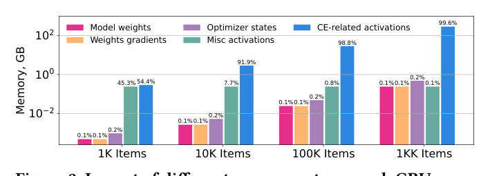
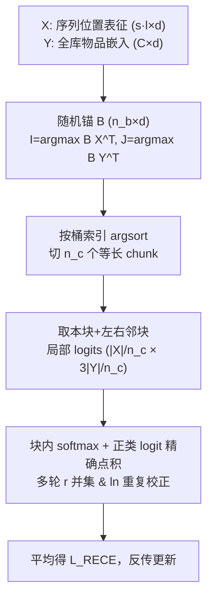
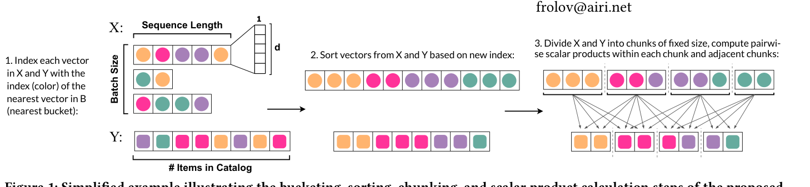

# RECE: Reduced Cross-Entropy Loss for Large-Catalogue Sequential Recommenders (面向大目录序列推荐的精简交叉熵损失)

- **会议/期刊**: CIKM 2024 (5 pages, short paper)
- **作者与机构**: Danil Gusak, Gleb Mezentsev, Ivan Oseledets, Evgeny Frolov (Skoltech / AIRI / HSE University)
- **推荐链路定位**: 召回 (Next-Item 训练目标，推理侧零改动)
- **研究方向**: 序列与会话推荐 / 协同过滤与双塔召回
- **论文原文**: [https://arxiv.org/abs/2408.02354v3](https://arxiv.org/abs/2408.02354v3)
- **开源代码**: [https://github.com/dalibra/RECE](https://github.com/dalibra/RECE)

## TL;DR (1分钟核心速览)

大目录场景下，序列推荐用 full Cross-Entropy (CE) 训练时，logits 张量大小为 $s\cdot l\times C$，显存随物品数线性爆炸，逼得工业界退回 BCE+负采样而损失 SOTA 质量。RECE 从 CE 的梯度结构出发：只有$|\text{softmax}_k-\mathbb{I}[k=z|]$ 大的 logit 才影响更新，故可用"近似 MIPS"只算这些项；作者用随机投影 LSH 分桶 + 排序分块 + 邻块扩展，把 MIPS 完全 GPU 化。在 4 个数据集、全局时间戳切分 + Full-Ranking 协议下，RECE 峰值显存最多降 12×（训练快 2.5–6.7×），Gowalla 上 NDCG@10 反超最强基线 8.19%。

## Background & Motivation (背景与核心矛盾)

- **主流范式**: Transformer 序列推荐（SASRec/BERT4Rec）做 next-item 预测；后续工作（gSASRec、CE−）证明 full CE 与校准后的多负样本 BCE 效果最好，成为 SOTA 标配。
- **前人局限**: ① full CE 需物化 $s\cdot l\times C$ 的 logits，PyTorch 剖析显示 CE 相关激活在 100K→1M 物品时从 0.8% 涨到 **99.6%** 峰值显存（见 <figure class="paper-figure" markdown="span">
  <figcaption>图2：不同组件对使用交叉熵损失的 SASRec 训练期间峰值 GPU 内存占用的影响。测量使用 PyTorch 性能分析工具进行。</figcaption>
</figure> 所示的内存构成），大目录下不可行；② 均匀/流行度/In-batch 负采样缺乏 hard negative 导致过度自信，而基于 MIPS/NNS 选硬负样本的方法依赖哈希表等 GPU 不友好算子，无法批处理。
- **核心洞察 (Key Insight)**: CE 对 logits 的梯度 $\partial\mathcal{L}_{CE}/\partial \text{logit}_{i,k}=\text{softmax}(\text{logit}_i)_k-\mathbb{I}[k=z_{i+1}]\in(-1,1)$。只需保证绝对值最大的那些分量（即被误判为正的负类）被算准，就能保住绝大部分梯度信息——这本质是一个 MIPS 问题，而 MIPS 可以被"粗糙但全向量化"的 LSH 以极低显存近似。
- **本文切入点**: 用一个可微调粒度（桶数/块数/轮数）的分块采样器替代整个 $C$ 维 softmax 分母，使 CE 的显存开销降到与 BCE 同级，且随预算连续可调。

## Method (核心方法设计)

### 1. 整体框架 (Overall Architecture)

RECE 不改动 SASRec 编码器与推理路径，只替换训练期 softmax 归一化的计算域。每个 batch 把序列位置输出 $X\in\mathbb{R}^{sl\times d}$（batch 与序列维已折叠）和全库嵌入$Y\in\mathbb{R}^{C\times d}$分别对$n_b$个随机高斯锚向量$B\in\mathbb{R}^{n_b\times d}$求最近锚（两次矩阵乘 + argmax）得到桶索引；按索引 argsort 后把两边各切成$n_c$个等长 chunk，使"语义相近的 query 与 item 物理相邻"。随后只在本 chunk 及其左右相邻 chunk 构成的$3|Y|/n_c$列子空间内计算负类 logits 并做局部 softmax，正类 logit 单独精确点积；该过程可在$r$个随机轮次并行重复取并集，重复计数通过从 logit 减去$\ln(\text{重复次数})$ 校正归一化。推理与打分完全不变，零额外开销。

<figure class="paper-figure" markdown="span">
  <figcaption>图1：简化示例，说明所提出的 RECE 方法的分桶、排序、分块和标量积计算步骤。不同颜色表示属于不同桶。</figcaption>
</figure>

### 2. 关键设计拆解 (Key Designs)

1. **梯度驱动的硬负样本筛选（Gradient-aware Selection）**：痛点是不想算全库却又不愿退化成随机负采样。由梯度式可知只有接近 1 的项关键，因此把"选负样本"改写为 MIPS：$\arg\max_{j}\ x_i^\top y_j$。本文不求解精确 MIPS，而用随机投影 LSH 的桶隶属近似：$I=\arg\max_{b} BX^\top,\ J=\arg\max_{b} BY^\top$，同桶即"高内积"的粗代理。直觉：一次$O(sl\cdot n_b + C\cdot n_b)$的稠密矩阵乘即可完成全库分区，无哈希表、无 Python 循环，显存仅为$n_b\cdot d$。
2. **排序-分块-邻块扩展（Sort / Chunk / Neighbor Chunks）**：LSH 桶大小极不均，无法直接批量 softmax。本文按索引排序后强制等分成 $n_c$块，用"块内 + 左右邻块"召回被桶边界切散的近邻，并用$n_{ec}$显式控制召回宽度：$Y_{c}^{*}=Y[J_{c-1}\cup J_c\cup J_{c+1}]$。这相当于用可控的近似误差换取完全规整的 tensor 形状，使 GPU 占用率接近饱和。
3. **训练目标、负采样与推理效率**：块内损失
$$\mathcal{L}_{\text{RECE}}=\frac{1}{|X|}\sum_{c}\sum_{i}-\log\frac{\exp(\text{logit}^{+}_{c,i})}{\exp(\text{logit}^{+}_{c,i})+\sum_{j=1}^{3|Y|/n_c}\exp(\text{logit}^{-}_{c,i,j})}$$
  负样本由分桶隐式给出（无需负采样率超参），多轮 $r$重算的重复对被$\ln$校正。取最优锚数$n_b^{*}=\sqrt{4\alpha_{bc}(1+2n_{ec})\cdot\min(C,sl)}$，总显存$2r\sqrt{\alpha_{bc}(1+2n_{ec})}\cdot\min(C,sl)\cdot\max(C,sl)$，比 full CE 小$\sqrt{\min(C,sl)}\big/\big(2r\sqrt{\alpha_{bc}(1+2n_{ec})}\big)$ 倍；推理阶段无任何额外算子。

## Experimental Setup & Evaluation Protocol (实验设置与评估协议)

- **数据集与预处理**（物品 <5 交互、用户 <20 交互均剔除）：

| 数据集 | #Users | #Items | #Interactions | 密度 | 领域 |
| :--- | :---: | :---: | :---: | :---: | :--- |
| BeerAdvocate | 7,606 | 22,307 | 1,409,494 | 0.83% | 食品评论 |
| Behance | 8,097 | 32,434 | 546,284 | 0.21% | 艺术社交 |
| Kindle Store | 23,684 | 96,830 | 1,256,065 | 0.05% | 电商 |
| Gowalla | 27,516 | 173,511 | 2,627,663 | 0.06% | 社交签到 |

- **数据划分与防穿越**: 主实验采用**全局时间戳切分**——取全部交互的 0.95 分位时间点，之前为训练、之后为测试，测试用户与训练用户不相交，避免 leave-one-out 常见的"未来信息泄漏"；验证集取每个测试用户的倒数第二次交互（早停用）。补充实验在 Amazon Beauty 上回退到 `Leave-One-Out` 以对齐 CBiT/DuoRec 等协议的公平比较。
- **排名评测协议**: 无偏 **Full-Ranking**（全库未交互物品排序），指标 NDCG@{1,5,10}、HR@{1,5,10}，另报 COV@{1,5,10} 覆盖度；同时记录训练峰值 GPU 显存与训练时长（NVIDIA V100 16GB）。
- **对比基线与超参**: 同一 SASRec 骨干下的 SASRec-BCE+（多负样本）、SASRec-CE（full CE）、CE−（Klenitskiy 等）、gSASRec/gBCE（Petrov 等）。RECE 侧关键超参为 $n_b,n_c,n_{ec},r$，按显存预算网格搜索（$n_c=n_b$、$n_{ec}$ 随 batch 增大）。

## Key Experimental Results (实验关键数据)

### 1. 主实验对比 (Main Results)

| 数据集 | 指标 | BCE+ | gBCE | CE− | CE | RECE | Improv. |
| :--- | :--- | :---: | :---: | :---: | :---: | :---: | :---: |
| BeerAdvocate | NDCG@10 | 0.0171 | 0.0155 | **0.0212** | 0.0183 | 0.0197 | −6.92% |
| BeerAdvocate | HR@10 | 0.0324 | 0.0301 | 0.0378 | 0.0351 | **0.0388** | +2.56% |
| Behance | NDCG@10 | 0.0570 | 0.0570 | **0.0592** | 0.0580 | 0.0574 | −3.04% |
| Behance | HR@10 | 0.0972 | 0.0992 | 0.0967 | 0.0947 | **0.0993** | +0.07% |
| Kindle | NDCG@10 | **0.0725** | 0.0681 | 0.0644 | 0.0711 | 0.0714 | −1.56% |
| Kindle | HR@10 | **0.1010** | 0.0933 | 0.0938 | 0.0972 | 0.0985 | −3.92% |
| Gowalla | NDCG@10 | 0.0415 | 0.0410 | 0.0402 | 0.0388 | **0.0449** | +8.19% |
| Gowalla | HR@10 | 0.0739 | 0.0733 | 0.0729 | 0.0674 | **0.0787** | +6.50% |

同质量下的显存/时间对比（Pareto 前沿）：

| 数据集 | RECE 显存 | 同质量最优对手显存 | 显存节省 | 训练加速 |
| :--- | :---: | :---: | :---: | :---: |
| Behance | 0.526 GB | 6.48 GB | **12.3×** | 2.5–6.7× |
| Kindle Store | 3.15 GB | 9.73 GB | 3.1× | — |
| Gowalla | 0.78 GB | 5.13 GB | 6.6× | — |
| Amazon Beauty (LOO) | NDCG@10 0.0525 / HR@10 0.0897 | CBiT 0.0537 / 0.0905 | 质量持平 | — |

### 2. 消融与敏感性 (Ablation & Sensitivity)

由于 RECE 为损失层替换、无独立结构模块，作者以"预算-质量前沿 + 超参敏感性"代替传统 w/o 消融：

| 配置变化 | 观察到的效果 | 结论 |
| :--- | :--- | :--- |
| $n_{ec}$ 过小（仅本块） | 桶边界近邻被切散，质量下降 | 邻块扩展是召回兜底的必要项 |
| $r=1$→ 多轮 | 负样本并集扩大、重复项$\ln$ 校正 | 轮数随 batch 增大而增加更优 |
| $n_c=n_b$($\alpha_{bc}=1$) | 给定显存下最优 | 块数无需超过桶数 |
| $n_b<n_b^{*}$ | 显存更低但近似误差上升 | 显存-质量可连续调节 |
| Yelp 数据集（附录） | NDCG@10 落后最优 6.2%，但训练快 1.9× | 启发式超参选择在部分数据上次优 |

### 3. 关键实验发现 (Key Findings)

1. **收益与目录规模强正相关**：CE 激活占比从 1K 物品的 0.1% 升到 1M 物品的 99.6%，因此 Gowalla（173K 物品）上 RECE 仅用 0.78GB 就把 NDCG@10 推到 0.0449，反超 BCE+ 的 0.0415（+8.19%）；Behance 更以 12.3× 显存差达到同等质量，说明瓶颈是 logits 张量而非 batch size。
2. **小目录存在反噬**：BeerAdvocate（22K 物品）上 RECE 0.0197 低于 CE− 的 0.0212（−6.92%），此时 $C/(s\cdot l)$比值小、随机投影漏桶概率高，近似误差与$\ln$重复校正的偏差主导；可推断方法适用阈值大致为$C\gg s\cdot l$ 的大目录场景。
3. **硬负样本聚焦提升命中却牺牲覆盖**：Gowalla/BeerAdvocate 的 HR@10 提升 +6.50%/+2.56%，但 COV@10 相对最强基线下降 11.8%/19.3%（0.18 vs 0.204、0.0963 vs 0.119），提示线上部署需在 RECE 训练后追加多样性重排或覆盖度约束。

## Highlights & Limitations (亮点、对比与审稿批判)

- **与代表作对比 (vs. Prior Work)**: 与 CE−/gBCE 等"改负采样分布 + 分数校准"的路线不同，RECE 不动采样分布而改**归一化分母的计算域**，因而保留了 full CE 的校准性与 SOTA 性；与基于 MIPS/NNS 选硬负样本的工作（依赖哈希表或 CPU 侧检索）相比，其分桶全部由稠密 GEMM 完成，天然适配 GPU 批处理。相对 SASRec-BCE+ 的本质差异在于分母中包含近似全库而非固定 $n$ 个负样本。
- **可迁移亮点**: ① "梯度幅值定界 → 只算 top-logit → LSH 近似 MIPS"的推导可平移到 NLP 大词表 softmax、双塔召回对比学习、搜索粗排等任意大类别 softmax 场景；② 排序-分块-邻块的张量整形技巧可复用于任何需要"稀疏选择但要求规整批处理"的 GPU 算子。
- **审稿级局限批判**: ① 质量对 $n_b,n_c,n_{ec},r$敏感且最优锚数依赖启发式公式，论文在 Yelp 上即出现 −6.2% 的失效案例，缺少自适应选择策略与理论误差界；② 仅以 SASRec 为骨干、未验证 BERT4Rec/GRU4Rec 或双塔检索模型，且$r>1$ 会重复计算带来额外算力开销；③ 主要收益点为训练显存，推理侧无改进，对线上服务延迟无直接贡献。

## Rating (四维评分)

- **方法创新性 (Novelty)**: ⭐⭐⭐⭐ （从 CE 梯度界 $(-1,1)$ 反推出"只需算大 logit"，并用 LSH 分桶把 MIPS 变成稠密 GEMM，思路干净且可解释；但近似误差无理论保证）
- **评估协议与实验扎实度 (Protocol & Experiments)**: ⭐⭐⭐⭐ （全局时间戳切分 + Full-Ranking 全库排序在短文中属高标准，含显存/时延 Pareto 与 LOO 跨协议复核；不足是仅 4+1 个数据集、单骨干、无显著性检验）
- **写作与数学规范度 (Clarity & Rigor)**: ⭐⭐⭐⭐ （梯度推导、最优 $n_b^*$与显存复杂度给出闭式并开源推导；但正文对$\ln$ 重复校正与邻块召回率的说明偏简，算法与图注存在排版冗余）
- **工业落地与复现价值 (Industrial & Practical Value)**: ⭐⭐⭐⭐⭐ （代码开源且基于常用 SASRec.pytorch；显存最多降 12×、训练快至 6.7×，直接把 CE 训练推进到百万级物品目录，落地门槛极低）

