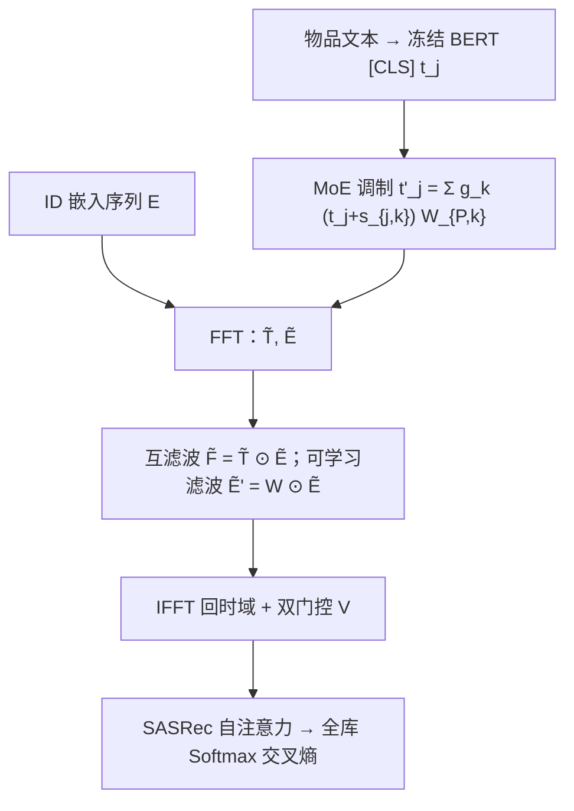
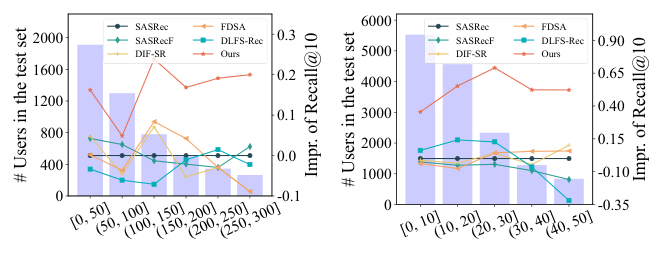

# Sequence-level Semantic Representation Fusion for Recommender Systems (面向推荐系统的序列级语义表示融合)

- **会议/期刊**: CIKM 2024
- **作者与机构**: Lanling Xu, Zhen Tian, Bingqian Li, Junjie Zhang, Jinpeng Wang, Mingchen Cai, Wayne Xin Zhao（中国人民大学高瓴人工智能学院、美团）
- **推荐链路定位**: 召回（序列 Next-Item 预测）
- **研究方向**: 序列与会话推荐 / 多模态推荐（文本-ID 双模态融合）
- **论文原文**: [论文原文链接](https://arxiv.org/abs/2402.18166v1)
- **开源代码**: [RUCAIBox/TedRec](https://github.com/RUCAIBox/TedRec)

## TL;DR (1分钟核心速览)

现有序列推荐把物品文本向量与 ID 向量在**物品级**直接相加/拼接，文本只在目标位置起作用、既无法跨位置传播全局上下文，又因 BERT 表征同质化而缺乏区分度。TedRec 将文本与 ID 序列经 FFT 变换到频域做**逐维 Hadamard 互滤波**，再 IFFT 回时域并双门控融合，理论上等价于时域循环卷积（含过去+未来双向上下文）；同时用 MoE 调制嵌入注入位置信息以提升文本区分度。五个数据集、Leave-One-Out 划分 + Full-Ranking 全库排序下，ML-1M 与 OR 上 NDCG@10 分别提升 14.86% 与 38.24%，训练开销与 SASRec 同量级。

## Background & Motivation (背景与核心矛盾)

- **主流范式**: 序列推荐以 SASRec/DIF-SR 等自注意力骨干为主，文本侧信息融合分早融合（SASRecF 拼接）、晚融合（FDSA logits 拼接）、解耦注意力（DIF-SR）、分布表征（DLFS-Rec）四条路线。
- **前人局限一**: 融合是**物品级 (item-level)** 的——文本向量只增强当前物品表征，在同序列内其它位置未经过注意力交互前无法被利用，浪费了跨位置的语义冗余。
- **前人局限二**: 文本编码器（BERT）输出对相似商品区分度低，“iPhone 15 Pro”与“iPhone 14 case”向量高度接近，直接相加会污染 ID 协同信号。
- **核心洞察 (Key Insight)**: 频域中序列的**全局时序特征天然被聚合进每个频点**，故频域逐点相乘在数学上对应时域循环卷积，可一次性实现“双向上下文卷积”式的序列级融合。
- **本文切入点**: 冻结 PLM + MoE 调制提升文本区分度，再以频域互滤波替代时域逐物品相加，形成可插拔的序列级融合层。

## Method (核心方法设计)

### 1. 整体框架 (Overall Architecture)

物品文本（title/category/brand）经**冻结** BERT 取 [CLS] 得 $\boldsymbol{t}_j$，先由 MoE 调制注入位置感知得到$\boldsymbol{t}'_j$；ID 序列$\boldsymbol{E}$与$\boldsymbol{T}'$沿特征维做 FFT 得到频域谱$\tilde{\boldsymbol{T}},\tilde{\boldsymbol{E}}$，通过 Hadamard 互滤波$\tilde{\boldsymbol{F}}=\tilde{\boldsymbol{T}}\odot\tilde{\boldsymbol{E}}$并辅以可学习滤波${\tilde{\boldsymbol{E}}}'=\boldsymbol{W}\odot\tilde{\boldsymbol{E}}$去噪；IFFT 回时域后用双门控加权得融合表征$\boldsymbol{V}$，送入 SASRec 自注意力，最后以全库 Softmax 交叉熵训练、按概率取 Top-N。整体即插即用，可替换骨干与文本编码器。

### 2. 关键设计拆解 (Key Designs)

1. **MoE 增强的文本调制（提升区分度）**：痛点是不带位置信息的文本向量在序列中高度同质。做法是在文本侧注入与位置相关的调制嵌入并由门控路由多个专家：$\boldsymbol{t}'_j=\sum_{k=1}^{G} g_k\cdot(\boldsymbol{t}_j+\boldsymbol{s}_{j,k})\cdot\boldsymbol{W}_{Pk}$，$\boldsymbol{g}=\mathrm{Softmax}(\boldsymbol{t}_j\boldsymbol{W}_G+\boldsymbol{\delta})$，$\boldsymbol{\delta}$ 为高斯噪声以均衡专家负载。直觉：同一句描述在不同序列位置/上下文应读出不同语义，多专家+位置调制相当于给文本做“上下文消歧”，与 Transformer 绝对位置嵌入（用于融合后注意力）职责互补。
2. **频域文本-ID 互滤波（序列级融合的核心）**：痛点来自时域逐物品相加无法利用跨位置信息。做法是频域逐维相乘 $\tilde{\boldsymbol{F}}=\mathcal{F}(\boldsymbol{T}')\odot\mathcal{F}(\boldsymbol{E})$，再$\boldsymbol{V}=2\sigma(\mathrm{Gate}(\boldsymbol{F}))\cdot\boldsymbol{F}+2\sigma(\mathrm{Gate}(\boldsymbol{E}'))\cdot\boldsymbol{E}'$。文中 **Lemma 3.1** 证明其等价于时域循环卷积：

$$\boldsymbol{f}_j=\mathcal{F}^{-1}_j(\tilde{\boldsymbol{T}}\odot\tilde{\boldsymbol{E}})=\sum_{k=0}^{n-1}\boldsymbol{t}_k\odot\boldsymbol{e}_{(j-k)\boldsymbol{o}d n}$$

**Lemma 3.2** 进一步指出 $\boldsymbol{f}_j=\underbrace{\mathcal{S}(0,j)}_{\text{过去}}+\underbrace{\mathcal{S}(j+1,n-1)}_{\text{未来}}$，即每个位置的融合表征同时吸收前缀与后缀上下文（类 BERT 双向建模）。直觉：这相当于在注意力之前先做一次“文本×ID 的上下文卷积”，使文本语义沿序列传播，而不仅是给物品打补丁。
3. **训练目标与开销**：损失为带温度 $\tau$的全库交叉熵$\mathcal{L}_{CE}=-\log\frac{\exp(\hat{\boldsymbol{x}}_n^\top\boldsymbol{e}_j/\tau)}{\sum_{j'}\exp(\hat{\boldsymbol{x}}_n^\top\boldsymbol{e}_{j'}/\tau)}$，即**免负采样**的全 Softmax；PLM 全程冻结，仅训练骨干、MoE 与滤波器，复杂度$O(n(G+\log n)d)$，自注意力部分无额外开销。

## Experimental Setup & Evaluation Protocol (实验设置与评估协议)

- **数据集与预处理**: 全部采用 `5-core` 过滤（用户与物品交互数 ≥5）：

| 数据集 | #Users | #Items | #Interactions | 稀疏度 | 文本字段 |
| :--- | :---: | :---: | :---: | :---: | :--- |
| ML-1M | 6,040 | 3,416 | 993,571 | 95.19% | title+genre+year |
| OR (Online Retail) | 16,520 | 3,469 | 503,386 | 99.12% | description |
| Office | 87,346 | 25,986 | 597,491 | 99.97% | title+category+brand |
| Food | 115,349 | 39,670 | 912,064 | 99.98% | 同上 |
| Movies | 281,700 | 59,203 | 2,945,031 | 99.98% | 同上 |

- **数据划分与防穿越**: `Leave-One-Out`（每用户最后一条为测试、倒数第二条为验证）。
- **排名评测协议**: 无偏 `Full-Ranking`（在全部 |V| 个物品中排序），指标 Recall@{10,20}、NDCG@{10,20}，对全用户取平均。
- **对比基线与超参**: 基线含 ID-only（SASRec、FMLP-Rec、FEARec）与文本增强（SASRecF、FDSA、S³-Rec、DIF-SR、UniSRec、DLFS-Rec、SMLP4Rec），全部基于 RecBole 复现，batch=2048、Adam、lr∈{5e-4,1e-3,5e-3}、early stopping（NDCG@10 十轮不升）；显著性用 paired t-test（$p<0.01$，标 `*`）。

## Key Experimental Results (实验关键数据)

### 1. 主实验对比 (Main Results)

| 数据集/指标 | SASRec | FMLP-Rec | FEARec | DIF-SR | UniSRec | DLFS-Rec | SMLP4Rec | **TedRec** | Improv. |
| :--- | :---: | :---: | :---: | :---: | :---: | :---: | :---: | :---: | :---: |
| ML-1M R@10 | 0.2300 | 0.2363 | 0.2407 | 0.2313 | 0.2257 | 0.2179 | 0.2157 | **0.2623*** | +8.97% |
| ML-1M N@10 | 0.1146 | 0.1234 | 0.1258 | 0.1164 | 0.1140 | 0.1238 | 0.1107 | **0.1445*** | +14.86% |
| OR R@10 | 0.1545 | 0.1492 | 0.1532 | 0.1522 | 0.1526 | 0.1634 | 0.1515 | **0.2234*** | +36.72% |
| OR N@10 | 0.0699 | 0.0690 | 0.0775 | 0.0708 | 0.0717 | 0.0952 | 0.0650 | **0.1316*** | +38.24% |
| Office R@10 | 0.1061 | 0.1138 | 0.1172 | 0.1162 | 0.1233 | 0.1131 | 0.1183 | **0.1356*** | +9.98% |
| Food N@10 | 0.0736 | 0.0745 | 0.0780 | 0.0786 | 0.0733 | 0.0912 | 0.0688 | **0.1012*** | +10.96% |
| Movies R@10 | 0.1453 | 0.1477 | 0.1496 | 0.1440 | 0.1493 | 0.1504 | 0.1425 | **0.1611*** | +7.11% |

### 2. 消融实验 (Ablation Study)

原文消融以图 3 柱状图呈现（ML-1M 与 OR 的 Recall@10），未给数值表；结合正文表述整理如下，另补骨干迁移的定量表（表 4）：

| 变体 | 替换内容 | 结论 |
| :--- | :--- | :--- |
| w/o MM | 多专家调制 → UniSRec 式 MoE 白化（无调制嵌入） | 下降，文本区分度确有贡献 |
| w/o AG | 双门控自适应权重 → 直接相加 | 下降，动态平衡文本/ID 权重必要 |
| w/o IF | 取消频域 ID 滤波项 $\tilde{\boldsymbol{E}}'$ | 下降，ID 去噪分支有效 |
| w/o TF | 频域互滤波 → 时域向量积（退化为物品级融合） | **降幅最大**，OR 上尤甚 |

| 骨干 (R@10/N@10) | 原模型 | + TedRec 融合层 |
| :--- | :---: | :---: |
| UniSRec (ML-1M) | 0.2257 / 0.1140 | **0.2623 / 0.1445** |
| DLFS-Rec (ML-1M) | 0.2179 / 0.1238 | **0.2513 / 0.1386** |
| UniSRec (OR) | 0.1526 / 0.0717 | **0.2234 / 0.1316** |
| DIF-SR (OR) | 0.1522 / 0.0708 | **0.1666 / 0.0893** |

### 3. 关键实验发现 (Key Findings)

1. **越稀疏收益越大**：在稀疏度最高的 OR（99.12%）上 R@10 提升 36.72%、N@10 提升 38.24%，而稠密 ML-1M 上仅 8.97%/14.86%——说明序列级文本传播主要补足的是协同信号不足时的语义短板。
2. **频域卷积是不可替代的增量**：`w/o TF`（退回时域物品级相乘）是掉点最严重的变体，在 OR 上尤为明显，直接印证 Lemma 3.1 的“卷积式跨位置融合”而非“更精细的拼接”才是性能来源；同时 DLFS-Rec 虽是最强基线，仍因分布拼接属物品级操作而被超越。
3. **可插拔且高效**：四类骨干一致增益（UniSRec 在 OR 上 R@10 +46.4%），且 Fig. 4 显示每 epoch 训练时间与 SASRec 同区间，显著快于 FEARec（对比学习数据重构）与 DLFS-Rec（Wasserstein 距离），兼顾效果与工程可用性。
4. **文本编码器不是越强越好**：BERT-base [CLS] 最优（ML-1M N@10 = 0.1445），LLaMA2-7B mean-pooling 仅 0.1420，随机向量 0.1238——说明该框架吃的是“区分度”而非“语义规模”，直接换 LLM 并不能白捡收益。

<figure class="paper-figure" markdown="span">
  <figcaption>图 5</figcaption>
</figure>

## Highlights & Limitations (亮点、对比与审稿批判)

- **与代表作对比**: 相比 SASRecF/FDSA 的拼接式早/晚融合，本文把融合从“物品内部”搬到“序列全局”，且有卷积等价性证明；相比 DIF-SR 在注意力内部解耦侧信息，本文在注意力**之前**完成融合，实现更轻、可插拔；相比 DLFS-Rec 的分布拼接，本文以频域乘性滤波实现真正的跨位置交互。
- **可迁移亮点**: (i) “频域相乘 = 时域循环卷积”是通用的模态对齐算子，可直接迁移到图像/音频/行为序列的多模态融合；(ii) 冻结 PLM + MoE 位置调制是一种极低成本提升冻结文本表征区分度的插件，可用于冷启动物品语义增强。
- **审稿级局限批判**: (i) 循环卷积需把序列补齐到固定长度 $n$，padding 位置会被卷入卷积核，对短序列/变长在线请求的鲁棒性与增量更新（前缀复用）不友好；(ii) Lemma 3.2 的双向性使位置表征非严格因果，训练可行但推理阶段的流式部署需额外处理；(iii) 评估仅 Leave-One-Out + 全库排序，缺少时间切分与冷启动/新物品划分，且“14%/38%”提升集中在单一稀疏数据集，泛化结论偏乐观。

## Rating (四维评分)

- **方法创新性 (Novelty)**: ⭐⭐⭐⭐ （把频域滤波从“序列内去噪”转向“跨模态序列级融合”，并有 Lemma 3.1/3.2 的卷积等价与双向上下文证明，机制新颖且有理论支撑）
- **评估协议与实验扎实度 (Protocol & Experiments)**: ⭐⭐⭐⭐ （五数据集、Full-Ranking、paired t-test 与骨干/编码器/效率多维分析齐全；但消融仅以柱状图呈现、缺时间切分与冷启动协议）
- **写作与数学规范度 (Clarity & Rigor)**: ⭐⭐⭐⭐ （Lemma 证明链条完整、复杂度分析清晰；频域滤波的实部/虚部处理与 $\boldsymbol{W}$ 初始化细节略欠交代）
- **工业落地与复现价值 (Industrial & Practical Value)**: ⭐⭐⭐⭐ （RecBole 开源、PLM 冻结、训练开销与 SASRec 同量级、模型无关可插拔；落地需权衡固定长度 FFT 与在线流式推理的适配成本）

