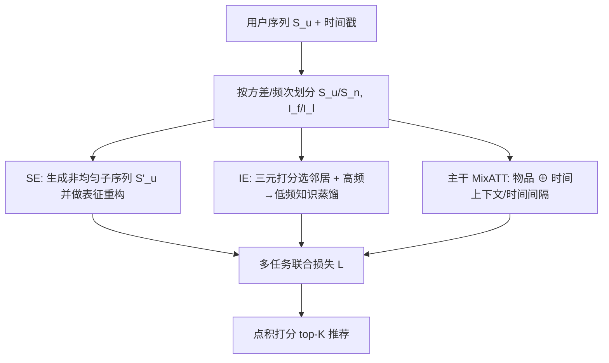
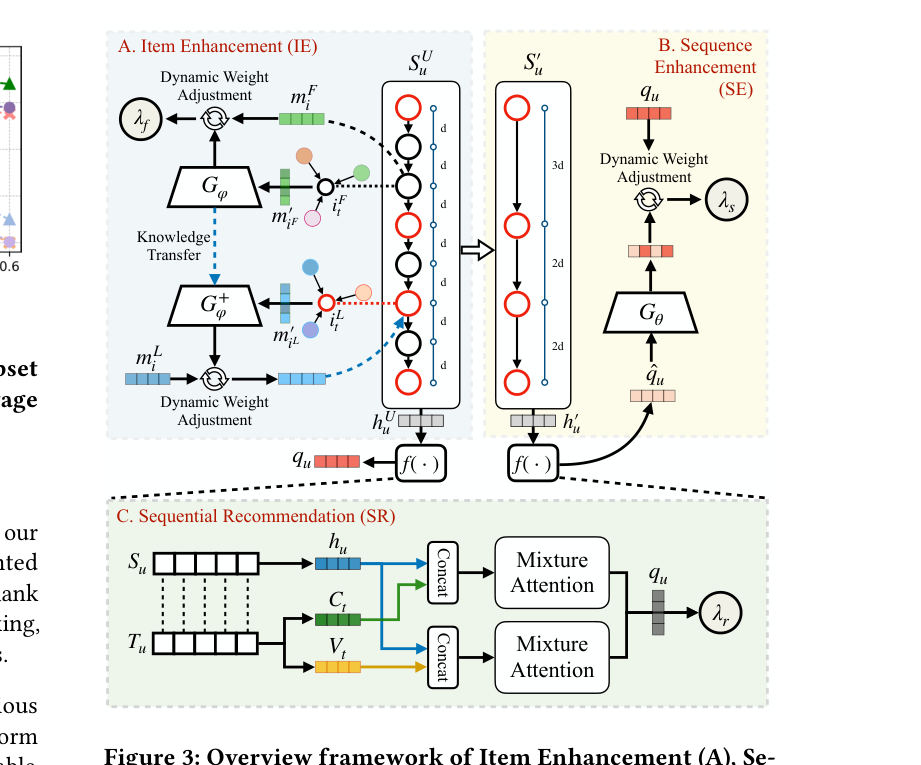
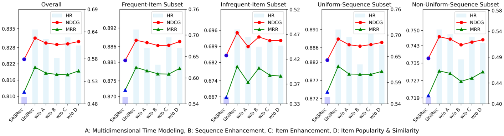

# UniRec: A Dual Enhancement of Uniformity and Frequency in Sequential Recommendations (序列推荐中均匀性与频次的双向增强)

- **会议/期刊**: CIKM 2024
- **作者与机构**: Yang Liu, Yitong Wang, Chenyue Feng（复旦大学计算机学院）
- **推荐链路定位**: 召回（下一物品预测 / 序列编码）
- **研究方向**: 序列与会话推荐 / 冷启动与长尾推荐
- **论文原文**: [论文原文链接](https://arxiv.org/abs/2406.18470v3)
- **开源代码**: [开源代码仓库链接](https://github.com/Linxi000/UniRec)

## TL;DR (1分钟核心速览)

现有序列推荐只看 item-to-item 转移，忽略"时间间隔是否均匀"与"物品是否高频"这两个决定可学性的数据属性：非均匀序列（兴趣漂移剧烈）与低频物品（采样稀疏）系统性预测更差。UniRec 提出双向增强——序列侧把均匀序列"退化"成非均匀子序列做生成式重构辅助任务，物品侧用时间-热度-相似度三元打分选邻居并把高频物品上学到的聚合算子蒸馏给低频物品，再用多维时间混合注意力按序列均匀性自适应选时间信息。在 ML-1M/Beauty/Books/Toys 四数据集、Leave-One-Out + 1:100 采样排序协议下，NDCG@10 相对最强基线提升 2.2%–8.9%，MRR@10 提升 3.2%–11.8%。

## Background & Motivation (背景与核心矛盾)

- **主流范式**: SASRec/BERT4Rec/LightSANs 用自注意力建模物品转移；TiSASRec、MEANTIME、TiCoSeRec、FEARec、MOJITO 等时间感知模型进一步引入绝对时间戳、周期模式或频域信息。
- **前人局限**: 其一，TiCoSeRec 只在**数据增广**层面把序列"改造成更均匀"，没有把均匀性纳入模型结构，非均匀序列的兴趣漂移仍无专门监督；其二，低频物品因交互稀疏难以学到可靠嵌入，现有长尾工作多靠重加权/重采样，未利用**邻居信息与高频物品的知识迁移**。
- **核心洞察 (Key Insight)**: 作者在 ML-1M、Gowalla 上做分层验证（表 1）：同一模型在均匀子集 $S_u$与高频物品子集$I_f$上的表现远优于$S_n$、$I_l$——LightSANs 在 ML-1M 上$S_u$相对$S_n$的 NDCG@20 提升 94.27%，BERT4Rec 在 Gowalla 上$I_f$相对$I_l$ 提升 146.33%；且该结论在 0.3–0.9 各种划分阈值下稳定成立。
- **本文切入点**: 既然"均匀/高频"是性能的充分标注，就把均匀序列与高频物品当作**教师信号**，反向增强非均匀序列与低频物品的表征。

## Method (核心方法设计)

### 1. 整体框架 (Overall Architecture)

输入用户序列 $S_u$（长度固定$N=50$，补齐/截断），先按时间间隔方差将其划分为均匀$S^U_u$与非均匀$S^N_u$，按全库出现频次把物品划分为$I_f$/$I_l$。三条支路并行：**SE** 以均匀序列为源生成"伪非均匀子序列"并做表征对齐（生成式重构损失 + 课程权重）；**IE** 先以时间间隔、热度、相似度三元打分构造候选邻居，注意力聚合后用高频物品训练的算子向低频物品蒸馏；**主干**$f(\cdot)$用混合注意力 MixATT 分别把物品序列与"时间上下文$C_t$"、"时间间隔$V_t$"两路融合，多任务互监督。推理时依据$S_u$ 的均匀性选择对应时间分支，序列嵌入与候选物品嵌入点积取 top-10。

<figure class="paper-figure" markdown="span">
  <figcaption>图3：以一条均匀序列为例，Item Enhancement (A)、Sequence Enhancement (B) 及 Sequential Recommendation 中 Multidimensional Time Modeling (C) 的总体框架。</figcaption>
</figure>

### 2. 关键设计拆解 (Key Designs)

1. **序列增强 SE（把均匀序列退化成非均匀，做辅助对齐）**：对每条均匀序列 $S^U_u$保留其中全部低频物品，若数量不足$M=3$则从序列内随机补采高频物品，得到$S'_u$——其时间间隔方差变大、低频物品占比显著升高，正是真实$S^N_u$的"人造副本"。编码后令$q_u=f(h^U_u)$、$\hat{q}_u=f(h'_u)$，用前馈生成器$G_\theta$重构对齐：$\tilde{x}=q_u-G_\theta(\hat{q}_u),\ \lambda_s=w_s\|\tilde{x}\|^2$。课程权重

$$w_s=\sin\!\left(\frac{\pi}{2}\cdot\frac{e-e_b}{e_{all}}+\frac{\pi}{2}\cdot\frac{V_{max}-V_u}{V_{max}-V_{min}}\right)$$

使训练早期、低方差序列权重更大，后期逐步加压到高方差序列——等价于给稀疏漂移样本"造监督"，而非只在数据层做增广。

2. **物品增强 IE（三元邻居打分 + 高频→低频蒸馏）**：低频物品的邻居不能只按共现挑。打分 $s(i_c,j)=g(T)+\phi(T,H)+\phi(T,S)$，其中$g(T)=\frac{1}{1+\log(1+T)}$，$\phi(T,x)=\frac{T+\Theta}{e^{(T+\Theta)/\Gamma x}}$：间隔$T$越大权重衰减（近期邻居更可信），热度$H$与相似度$S$越大权重越大。聚合用单头注意力$\boldsymbol{m}_n=\sum_{k=1}^{K}\text{softmax}(\boldsymbol{m}_c^\top\boldsymbol{m}_k)\boldsymbol{m}_k$，$\boldsymbol{m}'_c=[\boldsymbol{m}_c\|\boldsymbol{m}_n]$。蒸馏分两段：$\lambda_f=w_i\|\boldsymbol{m}^F_i-G_\varphi(\boldsymbol{m}'^F_i)\|^2$先在高频物品上把"聚合算子"训好（$w_i$同样带频次与 epoch 的课程项），随后用**冻结**的$G^+_\varphi$更新低频物品：$\lambda_l=\eta\|\boldsymbol{m}^L_i-G^+_\varphi(\boldsymbol{m}'^L_i)\|^2$，$\eta=\sin(\frac{\pi}{2}\frac{e-e_t}{e_{all}})$。直觉：低频物品缺的是"如何利用邻居"的归纳偏置，而这一偏置可以由高频物品免费提供。

3. **多维时间建模与训练目标**：均匀序列依赖"间隔"、非均匀序列依赖"细粒度上下文"（图 7 的时间敏感性实验证实：$S_u$上粗粒度更优，$S_n$上细粒度更优）。MixATT 用高斯混合注意力把两路先验融合：$A_j=\sum_{k\in\{m,c\}}p_{kj}\,\mathcal{N}(A;Q_k^\top,\sigma^2 I)$，$p_{kj}$为可学习混合权重，再经 softmax 与 FFN 输出。总损失为主任务$\lambda_r=\boldsymbol{q}_u^\top \boldsymbol{n}_i$（$n_i=[m_i\|c_i]$）加上三个辅助项$\lambda_s,\lambda_f,\lambda_l$的多任务加权和。主干训练用**逐样本采样负例**（正负比 1:1 式批内 BPR 风格），推理阶段对全候选打分取 top-10，主要开销来自 IE 的候选邻居打分$O(|I|^2)$ 与四个辅助前向。

## Experimental Setup & Evaluation Protocol (实验设置与评估协议)

- **数据集与预处理**（$k$-core 迭代过滤）：

| 数据集 | #Users | #Items | #Interactions | 稀疏度/密度 | 特征/场景说明 |
| :--- | :---: | :---: | :---: | :---: | :--- |
| ML-1M | 6,040 | 3,416 | 999,611 | 密度 0.0484 | $k_{item}=5,k_{user}=10$；稠密电影评分 |
| Beauty | 22,363 | 12,101 | 198,502 | 密度 0.00073 | Amazon 美妆，$k=5/5$ |
| Books | 79,713 | 91,465 | 6,275,735 | 密度 0.00086 | $k_{user}=30,k_{item}=20$；物品规模最大 |
| Toys | 19,412 | 11,924 | 167,597 | 密度 0.00072 | Amazon 玩具，$k=5/5$ |

- **数据划分与防穿越**: `Leave-One-Out`——按时间排序，倒数第二个交互为 test、最后一个为 validation，其余为 train。
- **排名评测协议**: `Sampled Ranking`，每个正例配 **100 个均匀采样负例**（1:100），报告 NDCG@10 / HR@10 / MRR@10；初步研究（表 1/图 2）在 ML-1M、Gowalla 上另用 **Full-Ranking**（全库排序）验证均匀性/频次结论。
- **对比基线与超参**: 11 个基线，含 6 个非时间感知（GRU4Rec、Caser、STAMP、SASRec、BERT4Rec、LightSANs）与 5 个时间感知（TiSASRec、MEANTIME、TiCoSeRec、FEARec、MOJITO）；$d=64$、batch 512、lr 0.01、序列长 50、$M=K=3$、MixATT 2 头、最多 200 epoch、early stopping patience 20；划分阈值在 0.3–0.8（序列）/0.4–0.9（物品）网格搜索。

## Key Experimental Results (实验关键数据)

### 1. 主实验对比 (Main Results)

| Dataset | Metric | SASRec | BERT4Rec | LightSANs | TiSASRec | MEANTIME | TiCoSeRec | FEARec | MOJITO | **UniRec** | Improv. |
| :--- | :--- | :---: | :---: | :---: | :---: | :---: | :---: | :---: | :---: | :---: | :---: |
| ML-1M | NDCG@10 | 0.5801 | 0.5658 | 0.5671 | 0.5849 | 0.5804 | 0.5732 | 0.5515 | 0.5929 | **0.6261** | +5.60% |
| ML-1M | HR@10 | 0.8098 | 0.7780 | 0.7719 | 0.7893 | 0.8098 | 0.7904 | 0.7594 | 0.8197 | **0.8347** | +1.83% |
| ML-1M | MRR@10 | 0.5149 | 0.4987 | 0.5021 | 0.5205 | 0.5079 | 0.4967 | 0.4856 | 0.5157 | **0.5613** | +8.84% |
| Beauty | NDCG@10 | 0.2944 | 0.3140 | 0.3349 | 0.2908 | 0.3201 | 0.3188 | 0.3382 | 0.3392 | **0.3693** | +8.87% |
| Beauty | MRR@10 | 0.2490 | 0.2682 | 0.2986 | 0.2471 | 0.2753 | 0.2841 | 0.2922 | 0.2865 | **0.3201** | +11.73% |
| Books | NDCG@10 | 0.6072 | 0.5616 | 0.6049 | 0.6045 | 0.6073 | 0.5875 | 0.5745 | 0.6171 | **0.6309** | +2.24% |
| Books | HR@10 | 0.8216 | 0.7868 | 0.8176 | 0.8218 | 0.8169 | 0.8023 | 0.7994 | 0.8513 | **0.8617** | +1.22% |
| Toys | NDCG@10 | 0.3118 | 0.2327 | 0.3364 | 0.3224 | 0.3187 | 0.2754 | 0.3121 | 0.3323 | **0.3609** | +8.60% |
| Toys | MRR@10 | 0.2652 | 0.1848 | 0.2877 | 0.2747 | 0.2711 | 0.2421 | 0.2647 | 0.2775 | **0.3103** | +11.82% |

### 2. 消融实验 (Ablation Study)

原文消融以 ML-1M 各子集柱状图（图 5）呈现，此处给出可核验的定量关系与受损子集定位：

| 变体 / 对照 | 全库 | $I_f$|$I_l$|$S_u$|$S_n$ | 关键观察 |
| :--- | :---: | :---: | :---: | :---: | :---: | :--- |
| UniRec vs SASRec (MRR@10) | — | +9.2% | **+18.0%** | — | — | 增益集中在低频物品 |
| UniRec vs SASRec (HR@10) | — | — | — | +2.1% | **+4.3%** | 增益集中在非均匀序列 |
| w/o A（退化为仅时间间隔建模） | ↓ | 轻微↓ | **显著↓** | 轻微↓ | ↓ | 低频物品高度依赖周期性上下文 |
| w/o B（去掉 SE） | ↓↓ | ↓ | ↓ | ↓ | **最大跌幅** | SE 同时提纯非均匀序列与低频占比 |
| w/o C（去掉 IE） | ↓ | ↓ | 显著↓(NDCG/MRR) | ↓ | ↓ | 邻域聚合对稀疏物品才显效 |
| w/o D（邻居只按时间间隔选） | ↓ | ↓ | 显著↓ | ↓ | ↓ | 热度/相似度是不可省的候选约束 |
| 案例 (user 2481 预测分) | SASRec −1.16 → SR 2.65 → +IE 4.41 → +SE **6.09** | | | | | 三模块逐级纠偏 |

### 3. 关键实验发现 (Key Findings)

1. **增益集中在"困难子集"而非整体水涨船高**：$I_l$上 MRR@10 领先 SASRec 18.0%，约为$I_f$上 9.2% 的两倍；$S_n$上 HR@10 提升 4.3%、$S_u$ 仅 2.1%——证明双向增强确实作用于作者诊断的两个瓶颈，而不是单纯靠更强主干吃数据。
2. **时间建模必须"分而治之"**：图 7 的时间敏感性符号检验显示 $S_u$上粗粒度（间隔）更优、$S_n$上细粒度（上下文）更优；对应地去掉多维时间（w/o A）在全库仅轻微下降，但在$I_l$ 子集上的 NDCG/MRR 跌幅明显，说明低频物品的交互本就集中在特定时段。
3. **主干越强、增强越必要**：UniRec 相对同为时间感知的最强基线 MOJITO 仍提升 NDCG@10 5.60%（ML-1M）与 8.87%（Beauty），而相对无增强的 SASRec 提升达 8%–16%；Books 上仅 +2.24% 说明物品规模近 10 万时邻居候选质量与阈值搜索成为新瓶颈。

## Highlights & Limitations (亮点、对比与审稿批判)

- **与代表作对比 (vs. Prior Work)**: 与 **TiCoSeRec** 的本质差别是先验方向相反——后者在数据层把非均匀序列"增广成均匀"，本文在模型层用均匀序列"生成非均匀"做辅助监督；与 **FEARec/MOJITO** 的差别是后者只重排时间信号（频域/多头混合），本文把时间当作"按序列均匀性可切换的先验"；与 **长尾重加权类方法** 的差别是不改采样分布，而改"邻居归纳偏置的迁移路径"。
- **可迁移亮点**: ①"用高质量样本生成低质量副本、再做表征重构"的辅助任务范式可直接迁移到冷启动/跨域序列建模；②"高频物品上训聚合算子、冻结后蒸馏给低频物品"的两阶段算子蒸馏，比逐物品重加权更省参数。
- **审稿级局限批判**: ①IE 的候选邻居需对每个中心物品与全库物品打分，$|I|\approx 9\times10^4$（Books）时构图开销远超主干，论文未报告训练/推理时延与内存；②评估仅用 1:100 采样排序，未在 Amazon 三集上做 Full-Ranking 复核，且均匀性/频次划分阈值需逐数据集网格搜索（Beauty 最优为 70%/60%，其他数据集不同），超参敏感度与"增益是否来自阈值调优"缺乏控制实验；③案例研究仅单条序列，缺少统计显著性与多随机种子方差报告。

## Rating (四维评分)

- **方法创新性 (Novelty)**: ⭐⭐⭐⭐ （把"数据均匀性/频次"从观测现象升级为可训练教师信号，SE 的退化生成与 IE 的算子蒸馏组合新颖，但单点算子较朴素）
- **评估协议与实验扎实度 (Protocol & Experiments)**: ⭐⭐⭐（4 数据集 × 11 基线 + 4 组子集消融较完整，但主表仅 1:100 采样排序、缺显著性检验与方差、消融以图代数值）
- **写作与数学规范度 (Clarity & Rigor)**: ⭐⭐⭐（三条支路公式与课程权重定义清楚，但损失权重 $\lambda$ 的具体取值、MixATT 混合先验的推导细节略含糊）
- **工业落地与复现价值 (Industrial & Practical Value)**: ⭐⭐⭐（代码已开源、模块可插拔，但 $O(|I|^2)$ 邻居打分与四路辅助损失使训练成本偏高，需工程近似才能上线）

<figure class="paper-figure" markdown="span">
  <figcaption>图5：在 ML-1M 不同子集上各项增强的消融性能。</figcaption>
</figure>

