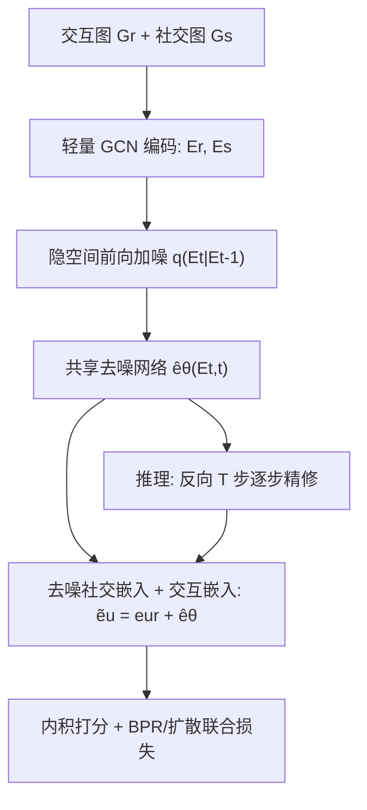
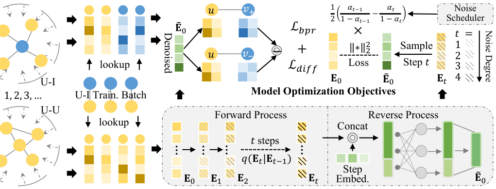
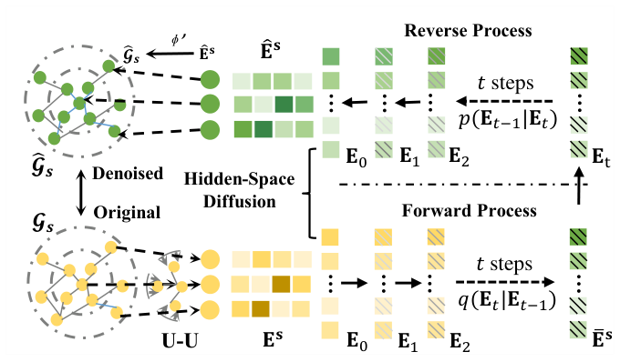

# RecDiff: Diffusion Model for Social Recommendation (面向社交推荐的扩散去噪模型)

- **会议/期刊**: CIKM 2024
- **作者与机构**: Zongwei Li, Lianghao Xia, Chao Huang（香港大学 HKUDS）
- **推荐链路定位**: 召回（图嵌入召回阶段的社交关系去噪）
- **研究方向**: 社交与群组推荐 / 自监督对比学习与交互去噪
- **论文原文**: [https://arxiv.org/abs/2406.01629v1](https://arxiv.org/abs/2406.01629v1)
- **开源代码**: [https://github.com/HKUDS/RecDiff](https://github.com/HKUDS/RecDiff)

## TL;DR (1分钟核心速览)

社交推荐的同质性假设在"同事/同学式"虚假社交边下失效，GNN 信息传播会把噪声放大进用户向量。RecDiff 不在图域、而在 $d$维隐空间对社交图嵌入做多步高斯加噪与反向去噪，以 BPR 下游任务梯度直接监督去噪器，使不同噪声强度的边被自适应重校准。在 Ciao/Yelp/Epinions 三数据集、$7{:}1{:}2$ 划分 + Full-Ranking 协议下，Recall@20 相对最强基线的提升为 14.65% / 5.29% / 5.02%，且训练单 epoch 耗时仅为 MHCN 的 1/7 量级（Yelp：4.23s vs 28.51s）。

## Background & Motivation (背景与核心矛盾)

- **主流范式**: 以 DiffNet/GraphRec/KCGN 为代表的 GNN 社交推荐在用户-物品二部图与用户社交图上分别传播嵌入，再做双视图聚合后内积打分。
- **前人局限 1**: GNN 传播对社交边"一视同仁"，真实社交网里的 acquaintance 关系与兴趣无关，噪声边会被高阶传播放大，导致 DGRec/DiffNet/GraphRec 甚至不如不用社交信息的 NGCF。
- **前人局限 2**: 现有去噪方案（MHCN/KCGN 的 local-global infomax、SMIN 元路径互信息、DSL 自判别）依赖**手工构造的自监督目标**：全局社交上下文本身可能发生语义漂移，对比学习的随机扰动又引入新噪声，且只针对单一噪声模式，无法区分噪声强度差异。
- **核心洞察 (Key Insight)**: 图域扩散需要 $O(|\mathcal{U}|\times d)$参数且稀疏图上的"加噪-去噪"难优化；而 GCN 编码器与内积预测器互为可逆投影$\phi/\phi'$，因此**在隐空间去噪等价于图域去噪**，但解空间更紧、更易训练。
- **本文切入点**: 把社交嵌入当作"含噪观测 $E^s$"，用扩散模型的多步前向噪声覆盖不同噪声尺度、用可学习的反向过程一次性剥离噪声。

## Method (核心方法设计)

### 1. 整体框架 (Overall Architecture)

模型分三段闭环：(1) 轻量 GCN 分别在用户-物品交互图和社交图上做 $L$层拉普拉斯归一化传播并逐层求和，得到$E^r$与$E^s$；(2) 把$E^s$送入隐空间扩散模块——训练时按随机步$t$前向加噪、再由共享去噪网络预测$\hat{e}_\theta$还原$e_0$；推理时跳过前向加噪，直接把$E^s$当作$t=T$的含噪量迭代反向去噪$T$ 步；(3) 去噪后的社交嵌入与交互嵌入相加得到最终用户向量，与物品向量内积打分，BPR 损失与扩散损失联合反传。

<figure class="paper-figure" markdown="span">
  <figcaption>图 1：所提出 RecDiff 框架的整体架构。</figcaption>
</figure>

### 2. 关键设计拆解 (Key Designs)

1. **隐空间社交扩散 (Hidden-Space Social Diffusion)**：痛点是从图结构直接扩散时参数量与稀疏性双重爆炸。本文用线性噪声调度 $\beta_t = 1 - s_t/s_{t-1}$，借高斯可加性把前向过程写成一步式闭式采样，使任意步$t$可 O(1) 随机取到、覆盖从轻噪到纯高斯噪声的整个噪声谱：$E_t = \sqrt{\bar{\alpha}_t}E_0 + \sqrt{1-\bar{\alpha}_t}\,\mathcal{N}(0, \mathbf{I})$，其中$\alpha_t = 1-\beta_t$、$\bar{\alpha}_t = \prod_{t'=1}^{t}\alpha_{t'}$。物理直觉：不同噪声强度对应不同"虚假边比例"，多步采样等价于给去噪器做强度课程学习。

<figure class="paper-figure" markdown="span">
  <figcaption>图 2：隐藏空间社交扩散示意图。</figcaption>
</figure>

2. **任务感知的反向去噪目标 (Task-Aware Denoising Matching)**：反向过程用"步嵌入 + 两层 FC"预测 $e_0$，即$\hat{e}_\theta(e_t,t) = \mathrm{FC}_2(e_t \,\|\, h_t)$，$h_t$为第$t$步时间嵌入。从 ELBO 中丢掉常数项 prior matching、固定方差$\Sigma_\theta = \sigma^2(t)\mathbf{I}$ 后，去噪匹配项化为带权重的最小二乘：

$$\mathcal{L}_t = \mathbb{E}_{q(e_t|e_0)}\Big[\tfrac{1}{2}\Big(\tfrac{\bar{\alpha}_{t-1}}{1-\bar{\alpha}_{t-1}} - \tfrac{\bar{\alpha}_t}{1-\bar{\alpha}_t}\Big)\big\|\hat{e}_\theta(e_t,t) - e_0\big\|_2^2\Big]$$

直觉：权重项在中间步最大，自动把学习重心放在"最难判别真假边"的噪声区间，而非两端。

3. **训练目标、负采样与推理效率**：总损失为 pairwise BPR 加扩散重建正则，$\mathcal{L} = \sum_{u,v^+,v^-} -\log\sigma(\hat{r}_{u,v^+}-\hat{r}_{u,v^-}) + \lambda_1\sum_t \mathcal{L}'_t + \lambda_2\|\Theta\|_2^2$，负采样采用**每正样本 1 个随机负样本**；关键是扩散损失梯度与推荐损失共享同一批用户，故去噪器直接为排序目标服务。推理用 DDIM 式均值更新$\hat{\mu}_\theta(\hat{e}_t,t) = \frac{\sqrt{\alpha_t}(1-\bar{\alpha}_{t-1})}{1-\bar{\alpha}_t}\hat{e}_t + \frac{\sqrt{\bar{\alpha}_{t-1}}(1-\alpha_t)}{1-\bar{\alpha}_t}\hat{e}_\theta(\hat{e}_t,t)$，仅作用于当前 batch，单步$O(d^2+dd')$，总开销与常规 GNN 社交推荐同阶。

## Experimental Setup & Evaluation Protocol (实验设置与评估协议)

- **数据集与预处理**: 三个公开评论平台，交互定义为"用户评论过物品"，社交边取 trust 列表；无 5-core 过滤，按原图使用。

| 数据集 | #Users | #Items | #Interactions | 密度 | 社交边数 |
| :--- | :---: | :---: | :---: | :---: | :---: |
| Ciao | 1,925 | 15,053 | 23,223 | 0.08% | 65,084 |
| Yelp | 99,262 | 105,142 | 672,513 | 0.006% | 1,298,522 |
| Epinions | 14,680 | 233,261 | 447,312 | 0.013% | 632,144 |

- **数据划分与防穿越 (Splitting Strategy)**: 按 **7:1:2 比例划分**训练/验证/测试（非时间戳切分），遵循图推荐常规设定。
- **排名评测协议 (Ranking Protocol)**: **Full-Ranking（全库未交互物品排序）**，Recall@N 与 NDCG@N，主表 N=20，另报告 N=10/40 的稳健性。
- **对比基线与超参设置**: 11 个基线覆盖矩阵分解/注意力（TrustMF, SAMN）、图 CF（NGCF）、GNN 社交推荐（GraphRec, DiffNet）、时序（DGRec）、知识增强（KCGN）、SSL（MHCN, SMIN, DSL）与去噪（GDMSR）。嵌入维度网格搜索于 $\{8,16,32,64\}$（基线统一 64），学习率$\{0.001,0.005,0.01\}$，batch 2048（Ciao）/4096（Yelp, Epinions），扩散步$T\in[10,200]$，配对 t 检验报告$p$ 值。

## Key Experimental Results (实验关键数据)

### 1. 主实验对比 (Main Results)

| Dataset | Metric@20 | NGCF | DiffNet | GraphRec | KCGN | SMIN | MHCN | GDMSR | DSL | **RecDiff** | Improv. |
| :--- | :--- | :---: | :---: | :---: | :---: | :---: | :---: | :---: | :---: | :---: | :---: |
| Ciao | Recall | 0.0559 | 0.0528 | 0.0540 | 0.0602 | 0.0588 | 0.0621 | 0.0560 | 0.0606 | **0.0712** | +14.65% |
| Ciao | NDCG | 0.0363 | 0.0328 | 0.0335 | 0.0350 | 0.0354 | 0.0378 | 0.0355 | 0.0389 | **0.0419** | +7.71% |
| Yelp | Recall | 0.0450 | 0.0557 | 0.0419 | 0.0460 | 0.0485 | 0.0567 | 0.0513 | 0.0504 | **0.0597** | +5.29% |
| Yelp | NDCG | 0.0230 | 0.0292 | 0.0201 | 0.0234 | 0.0251 | 0.0292 | 0.0246 | 0.0259 | **0.0308** | +5.48% |
| Epinions | Recall | 0.0353 | 0.0384 | 0.0334 | 0.0370 | 0.0333 | 0.0438 | 0.0368 | 0.0365 | **0.0460** | +5.02% |
| Epinions | NDCG | 0.0243 | 0.0273 | 0.0246 | 0.0264 | 0.0228 | 0.0321 | 0.0241 | 0.0267 | **0.0336** | +4.67% |

（$p$-value 分别为 4.05e-12 / 4.29e-10 / 1.12e-08，均显著。）

### 2. 消融实验 (Ablation Study)

原文仅以柱状图（图 4）给出 Ciao/Yelp/Epinions 三个数据集上的 Recall@20 与 NDCG@20，未列表数值，下表为相对完整模型的定性结论：

| 变体 | 含义 | Ciao | Yelp | Epinions | 归因 |
| :--- | :--- | :---: | :---: | :---: | :--- |
| **Ours** | 完整 RecDiff | 最优 | 最优 | 最优 | — |
| w/o **-D** | 去掉扩散去噪模块 | ↓ 显著 | ↓ 显著 | ↓ | 隐空间去噪是主收益来源 |
| w/o **-S** | 完全不用社交图 | ↓ | ↓ | ↓（但可能优于 -D） | Epinions 社交噪声过重时"用噪"不如"不用" |
| **DAE** | 掩码重建自编码器替换扩散 | ↓ | ↓ | ↓ | 单步重建不如逐步 $t\to t-1$ 建模分布 |

### 3. 关键实验发现 (Key Findings)

1. **噪声边确实在拖后腿**：DiffNet/GraphRec/DGRec 在 Ciao 上 Recall 仅 0.052–0.054，低于无社交的 NGCF（0.0559）；而 RecDiff 提升到 0.0712，说明收益不是"多用了社交信息"，而是"把社交信息里的假边筛掉了"。
2. **抗噪重训练实验**：随机用伪边替换 0%/20%/50% 真实社交边后重训，RecDiff 的 NDCG@20 相对跌幅小于 MHCN 与 DiffNet（图 9c），验证多步噪声谱训练带来的强度鲁棒性；Ciao 跌幅最大，反映其原有噪声比例本就更高。
3. **效率与精度不矛盾**：单 epoch 训练耗时 Yelp 上 RecDiff 4.23s vs MHCN 28.51s / KCGN 75.84s / SMIN 60.86s（约 7–18×），因为去噪器只有 $O(d^2+dd')$ 参数且无超图/元路径构造，收敛曲线在 25 epoch 内即达 MHCN 100 epoch 的水平。

## Highlights & Limitations (亮点、对比与审稿批判)

- **与代表作对比 (vs. Prior Work)**: 与 MHCN/SMIN 的 infomax 式 SSL 相比，RecDiff 不依赖任何手工构造的自监督目标，而是让**推荐损失直接定义去噪方向**，避免"手工目标本身含噪"；与 GDMSR 的图域偏好引导去噪相比，它在隐空间操作，参数量从 $O(|\mathcal{U}|d)$降到$O(d^2+dd')$；与 DiffRec/DiffKG 在原始交互/知识图谱上加噪不同，它只精修用户侧社交嵌入，粒度更细、开销更低。
- **可迁移亮点**: (i) "编码-去噪-相加"的即插即用结构可直接挂在任意 GNN 社交推荐器上；(ii) 以 BPR 梯度驱动扩散损失权重、无需负样本构造的隐空间扩散范式，可迁移到跨域/多行为图的关系去噪。
- **审稿级局限批判**: (i) 随机比例划分（7:1:2）而非全局时间切分，测试集含"未来"交互，线上时序泛化性存疑；(ii) 推理需 $T$步迭代去噪，$T$与噪声尺度$\tau$需按数据集调参（Yelp/Epinions 过大会掉点），且论文只给$T\leq200$ 的网格，缺少与"单步蒸馏/早停去噪"的效率对照；(iii) 消融仅给出柱状图未报数值与方差，`-S` 在 Epinions 上反超 `-D` 这一反常现象缺乏进一步解释。

## Rating (四维评分)

- **方法创新性 (Novelty)**: ⭐⭐⭐⭐ （首次把扩散去噪从图域搬到社交嵌入隐空间，并用编码器/预测器互为逆投影给出合理性论证）
- **评估协议与实验扎实度 (Protocol & Experiments)**: ⭐⭐⭐⭐ （三数据集 + Full-Ranking + t 检验 + 抗噪重训与效率对比齐全，但划分方式非时序、消融无具体数值）
- **写作与数学规范度 (Clarity & Rigor)**: ⭐⭐⭐⭐ （ELBO 分解到带权最小二乘的推导完整，复杂度分析清晰；符号在正文与公式间偶有 $E^s$/$\tilde{E}^s$ 混用）
- **工业落地与复现价值 (Industrial & Practical Value)**: ⭐⭐⭐⭐⭐ （代码开源、去噪器纯 MLP 不增图构造成本、训练比 MHCN 快近 7 倍，可直接嵌入现有社交召回链路）

