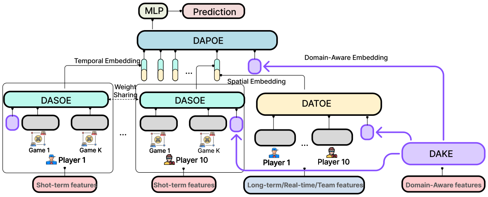
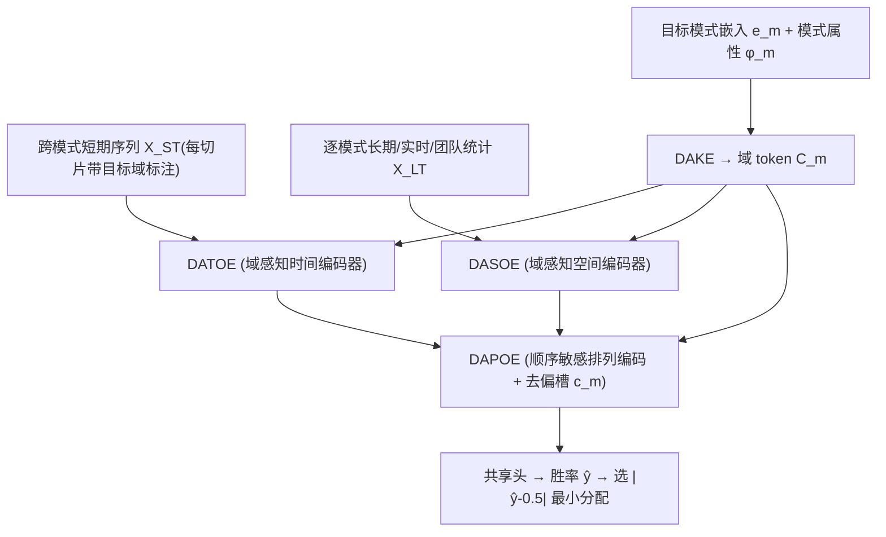

# CHAMP: Cross-domain Hybrid Architecture for Matchmaking and Prediction in Online Multi-Player Games (面向在线多人游戏的跨域混合匹配与预测架构)

- **会议/期刊**: CIKM 2026 (Applied Research Track)
- **作者与机构**: Kai Wang, Ge Fan, Chaoyun Zhang (Independent Researcher)；Yuyang Jiang (HKUST)；Yuze Liu (Swinburne University of Technology)
- **推荐链路定位**: 重排（组队后的队内位置-阵营排列再优化 / re-matchmaking）
- **研究方向**: 跨域与多场景推荐 / 多任务学习与列表级重排
- **论文原文**: [https://arxiv.org/abs/2609.04870v1](https://arxiv.org/abs/2609.04870v1)
- **开源代码**: 暂未开源

## TL;DR (1分钟核心速览)

MOBA 匹配在工业落地时被三件事卡住：目标模式历史稀薄（冷启动）、跨模式行为分布不一致、极端段位（Elite 仅 0.1M 对局）严重缺数据。CHAMP 把每个游戏模式视作一个"域"：用跨模式时序序列 + 逐模式统计构造混合特征，再用 DAKE 把目标模式属性编译成可学习域 token 注入 DATOE/DASOE/DAPOE 三个 OmniNet 编码器，实现"一个共享网络、N 个模式"服务。按时序切分、ACC/RMSE 评估，Elite 上 ACC 达 67.73%（较 OwO 基线 +3.26%）；线上 A/B 使新手层 5 分钟击杀崩盘率下降 20.73%。

## Background & Motivation (背景与核心矛盾)

- **主流范式**: 工业匹配仍以标量 MMR（ELO / TrueSkill2）窗口聚人成局；CUPID 在此之上加"重匹配（re-matchmaking）"阶段，用深度胜率预测器对 10 人队内位置排列打分，选预测胜率最接近 50% 的分配 $\arg\min_A |\hat{y}(A)-0.5|$。
- **前人局限 1（冷启动）**: CUPID 的预测器只用**目标模式内**特征训练，大量排队玩家在目标模式只有个位数对局（休闲数百局、赛季排位寥寥数局），胜率估计方差极大、分配抖动。
- **前人局限 2（分布不一致 + 数据稀疏）**: 5v5 排位奖励宏观转线、3v3 强调对拼、ARAM 压缩经济曲线；无显式模式条件化的多模式混训会在单模式上系统性失准。更极端的 Elite 段位玩家池极小、单模式训练直接过拟合，而 mode-agnostic 模型又被数据富集的主体分布拖走。
- **核心洞察 (Key Insight)**: 玩家天然跨模式流动（新英雄先在休闲/乱斗热身，再带进排位），跨模式行为信号对目标模式表现有强信息量；但"混数据"不是免费的——**缺少条件化通道时，跨模式监督是负债而非资产**（后文消融证实）。
- **本文切入点**: 特征层做混合域采集、模型层做域条件化注入、部署层把 N 个模式坍缩成 1 个模型 + 1 个标量阈值。

## Method (核心方法设计)

### 1. 整体框架 (Overall Architecture)

保留 CUPID 的"位置偏好候选生成 + 胜率重排"骨架：位置偏好程序枚举队内分配 $A$，按满意度乘积$P_A=\prod_{n=1}^{N}p^{n}_{i_n}$剪枝；剩余候选送入 DAWN 预测胜率$\hat{y}(A)$，取$s_A=1-2|\hat{y}_A-0.5|$最大者。DAWN 内部：混合域特征（跨模式短期序列 + 逐模式长期/实时/团队统计）分两路进入 DATOE / DASOE，DAKE 生成的域 token$\mathbf{C}_m$同时作为两路编码器的额外输入槽；DAPOE 聚合 10 名玩家两路表征与池化域摘要$\mathbf{c}_m$，经共享头输出胜率。在线单模型覆盖所有模式，模式差异仅体现在注册的属性向量$\boldsymbol{\phi}_m$与满意度阈值$\tau_m$。

<figure class="paper-figure" markdown="span">
  <figcaption>图1：CHAMP的整体架构，在Cupid基础上扩展了Hybrid Domain Feature Collection、Dawn（DAKE + DATOE/DASOE/DAPOE）</figcaption>
</figure>

### 2. 关键设计拆解 (Key Designs)

1. **混合域特征采集（Hybrid Domain Feature Collection）**：痛点是用目标模式特征做画像在冷启动下高方差。做法是把**全模式**最近 $K$局按时间戳排成单一序列，每个切片额外拼接"与该局相对于目标模式$d_m$的关系"补充特征$f^d_{n,k}$（角色/位置是否与请求槽位一致、模式亲和度、在$d_m$下的新鲜度）：$\mathbf{X}^{ST}_n=[(f^{(1)}_n,f^d_{n,1},m_1),\dots,(f^{(K)}_n,f^d_{n,K},m_K)]$。长期侧则拼接逐模式向量与全局摘要$\mathbf{X}^{LT}_n=[\mathbf{x}^{LT}_{n,d_1};\dots;\mathbf{x}^{LT}_{n,d_M};\mathbf{x}^{LT}_{n,*}]$。直觉：混合时序保留真实行为交错，逐切片域标注告诉模型"这一局休闲局该如何折算成排位局"。
2. **DAKE 域条件化 + 三域感知编码器**：痛点是朴素混训让异构分布变成噪声。DAKE 把模式嵌入 $\mathbf{e}_m$与模式属性$\boldsymbol{\phi}_m$（地图类型、队伍规模、位置布局、模式级统计）编译为固定形状的域 token$\mathbf{C}_m=\mathrm{DAKE}(\mathbf{e}_m,\boldsymbol{\phi}_m)\in\mathbb{R}^{T\times d}$，然后**在编码器内部**与玩家输入拼接：$\tilde{\mathbf{h}}^T_n=\mathrm{DATOE}([\mathbf{X}^{ST}_n;\mathbf{C}_m])$。编码器本身是 OmniNet（Transformer + 全向残差注意力）：$\mathrm{OmniNet}(\mathbf{X})=\mathrm{Transformer}(\mathbf{X})_L+\mathrm{MLP}(O_{att}(\mathbf{X}))$。DAPOE 额外接入池化域摘要$\mathbf{c}_m=\mathrm{Pool}(\mathbf{C}_m)$，$\mathbf{z}=\mathrm{DAPOE}([\tilde{\mathbf{h}}^T_1;\tilde{\mathbf{h}}^S_1;\dots;\tilde{\mathbf{h}}^T_{10};\tilde{\mathbf{h}}^S_{10};\mathbf{c}_m])$——该专用槽同时充当**网内去偏通道**，让梯度走模式专线而非把模式偏移烘进共享玩家表征。
3. **训练目标与推理开销**：沿用 CUPID 的 NED 损失，用队伍经济差归一化系数重加权 BCE：$\mathcal{L}_{NED}=-[\alpha y\log\hat{y}+(1-\alpha)(1-y)\log(1-\hat{y})]$，$\alpha=(TE_1-TE_2)/\max(TE_1,TE_2)$，使悬殊对局与接近对局的梯度贡献被重新标定。因模式信息已由 DAKE/DAPOE 注入，**不需要任何按模式分开的预测头或后置校准**；在线仅新增域 token 通路，负载测试显示 P50/P99 延迟与 CUPID 无显著差异。

## Experimental Setup & Evaluation Protocol (实验设置与评估协议)

- **数据集与预处理**: 某大型 MOBA 工业对局日志，按生产匹配服务的三个模式构建；论文未披露用户/物品级统计，规模信息如下（长尾极端）：

| 数据集(模式) | 对局样本 | 玩家池 | 相对规模 | 场景/特点 |
| :--- | :---: | :---: | :---: | :--- |
| Casual | ~40M | 最大 | 1.0× | 练英雄/热身，噪声大 |
| League | ~30M | 大 | 0.75× | 主排位模式，宏观运营导向 |
| Elite | ~0.1M | 极小(顶级专家) | 0.0025× | 稀疏压力测试，最易过拟合 |

- **数据划分与防穿越**: **按时间戳全局时序切分**（非随机抽样）——最早对局作训练、最近对局作测试，且训练集末端的 5% 划为验证集用于调参与早停，严格早于测试时间窗。
- **排名评测协议**: 本质为二分类胜率预测而非 Top-N 排序，故采用类平衡下的 **ACC（判别质量）+ RMSE（概率校准）** 双指标；无负采样环节（每局天然一胜一负，类别平衡）。线上则以大盘崩盘率（Economy/Kill Crushing Rate @5/10/15min）为业务指标，双比例 $z$检验，$p<0.01$。
- **对比基线与超参**: LR、3 层 MLP、LSTM、Transformer、OwO（CUPID 的 OmniNet 骨干）共 5 个基线，外加 **DAWN-single**（同架构但仅用单模式数据，隔离"跨模式联合训练"与"架构增益"）。DAWN 的 OwO 骨干深度/隐维/注意力头数与原始 OwO 完全对齐以保证受控比较，Adam + TensorFlow 实现。

## Key Experimental Results (实验关键数据)

### 1. 主实验对比 (Main Results)

| Model | Casual ACC | Casual RMSE | League ACC | League RMSE | Elite ACC | Elite RMSE |
| :--- | :---: | :---: | :---: | :---: | :---: | :---: |
| LR | 0.5657 | 0.4976 | 0.5040 | 0.5069 | 0.5912 | 0.4938 |
| MLP | 0.5753 | 0.4771 | 0.5153 | 0.4866 | 0.6041 | 0.4725 |
| LSTM | 0.5931 | 0.4582 | 0.5231 | 0.4701 | 0.6336 | 0.4514 |
| Transformer | 0.6012 | 0.4412 | 0.5429 | 0.4518 | 0.6528 | 0.4316 |
| OwO (CUPID) | 0.6321 | 0.4203 | 0.5565 | 0.4349 | 0.6559 | 0.4160 |
| DAWN-single | 0.6534 | 0.4109 | 0.5622 | 0.4291 | 0.6580 | 0.4098 |
| **DAWN (CHAMP)** | **0.6612** | **0.4022** | **0.5685** | **0.4216** | **0.6773** | **0.3987** |
| Improv. vs 最优基线 | +4.60% | −4.31% | +2.16% | −3.06% | +3.26% | −4.16% |

### 2. 消融实验 (Ablation Study)

Elite 数据集（最稀疏，组件归因最敏感；Casual/League 呈同序单调趋势）：

| 变体 | ACC | RMSE | ΔACC vs DAWN |
| :--- | :---: | :---: | :---: |
| w/o HF（退回单模式序列+统计） | 0.6512 | 0.4255 | −2.61 pt |
| w/o DAKE（= 全模式并集上训 vanilla OwO） | 0.6039 | 0.4398 | **−7.34 pt** |
| w/o DATOE | 0.6593 | 0.4164 | −1.80 pt |
| w/o DASOE | 0.6712 | 0.4061 | −0.61 pt |
| w/o DAPOE | 0.6630 | 0.4128 | −1.43 pt |
| **DAWN 全量** | **0.6773** | **0.3987** | — |

### 3. 关键实验发现 (Key Findings)

1. **DAKE 是"承重墙"，而非锦上添花**：去掉 DAKE 后 Elite ACC 崩至 0.6039，不仅远低于 DAWN 的 0.6773，**甚至低于只用 Elite 单模式训练的 vanilla OwO（0.6559）**。说明无显式模式条件化时，跨模式数据对共享编码器表现为噪声，联合监督是净损失——多域系统的条件化通道必须先于语料扩张设计。
2. **跨模式联合训练的红利与稀疏度成正比**：Elite 上 DAWN-single 仅比 OwO 高 0.32%（0.6580 vs 0.6559，单模式已近天花板），而 DAWN 相对 DAWN-single 提升 2.93%，为三个模式中最大的模式内增益；数据富集的 Casual 增益最小。跨域迁移真正在"单模式拟合不动"的地方兑现。
3. **线上收益集中在冷启动人群，与"数据富集层收益最大"的常识相反**：League 分层 A/B 显示 5 分钟击杀崩盘率下降单调随段位递减——新手 **−20.73%**、初级 −12.74%、高级 −8.73%、专家 −6.30%，新手层约为 League 全均值（−9.00%）的 2 倍、专家层的 3 倍以上。同时最稀疏的 Elite 模式线上反而优于 League（5min 经济崩盘 −3.32% vs −2.14%，早期击杀 −9.62% vs −9.00%），作者归因于 DAPOE 网内去偏在胜率残差已集中于 0.5 附近的窄技能带中最有效——**用户分布两端由同一架构的不同部件分别拯救**。

## Highlights & Limitations (亮点、对比与审稿批判)

- **与代表作对比 (vs. Prior Work)**: 相对 ELO/TrueSkill2 类标量 MMR，本文不改进技能估计而是改进"成局后还能否修"的分配空间；相对 CUPID，核心差异是从"单模式特征 + 单模式训练"变为"跨模式混合特征 + 域条件化共享骨干 + 单实例多模式部署"；相对 STAR/MMoE 类多域架构，本文不设域专属子网络/门控，而是把域知识编译为 token 注入编码器内部，兼作去偏通道——比后置重加权更早介入表征学习。
- **可迁移亮点**: ①"逐切片域标注"——把异构域样本排进同一时间序列并显式标注其相对目标域的语义，可直接搬到跨场景电商/短视频行为序列；②"域摘要专用槽作网内去偏通道"，用一条梯度旁路吸收域偏移，保持共享玩家/物品表征干净可迁移；③把 N 个模式专属配置坍缩为 1 个标量阈值 $\tau_m$，是极佳的多场景工程范式。
- **审稿级局限批判**: ①**评估不可复现**——仅用单一厂商私有日志，无公开基准、无数据统计、无代码，跨域结论的外部效度弱；消融也只报 Elite 一组的绝对值，缺方差/多次运行。②**代理目标与真实公平性有缝**——线上以"经济/击杀崩盘率"为代理，胜率校准改善与玩家主观体验（满意度、留存、排队时长）之间无因果验证，且 $\tau_m$ 阈值、位置满意度乘积等超参敏感性完全未讨论。③概念层面把"游戏模式"与"段位分层"都称作 domain，但离线只按模式聚合、线上只按段位分层，两种域语义的迁移机制未加区分，DAKE 在段位维度是否同样必要尚无证据。

## Rating (四维评分)

- **方法创新性 (Novelty)**: ⭐⭐⭐⭐ （域 token 注入编码器内部 + 专用去偏槽的设计虽属多域条件化范式延伸，但"无 DAKE 则跨域监督为负"的反直觉实证极具洞察价值）
- **评估协议与实验扎实度 (Protocol & Experiments)**: ⭐⭐⭐⭐ （时序切分防穿越、DAWN-single 隔离架构与数据增益、30 天十亿级参与度的线上 A/B + 分层分析很硬；扣分在私有数据不可复现与缺方差报告）
- **写作与数学规范度 (Clarity & Rigor)**: ⭐⭐⭐⭐ （公式精简、模块职责清晰、线上四步流程可落地；但 OmniNet/DAKE 内部结构一笔带过，NED 损失仅沿用未给推导）
- **工业落地与复现价值 (Industrial & Practical Value)**: ⭐⭐⭐⭐ （单模型服务全模式、新增模式仅注册 $\boldsymbol{\phi}_m$与$\tau_m$、延迟与 CUPID 无显著差异，工程价值极高；但无开源代码，复现门槛高）

