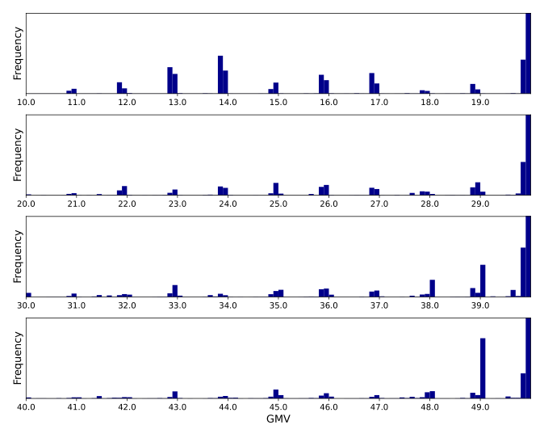
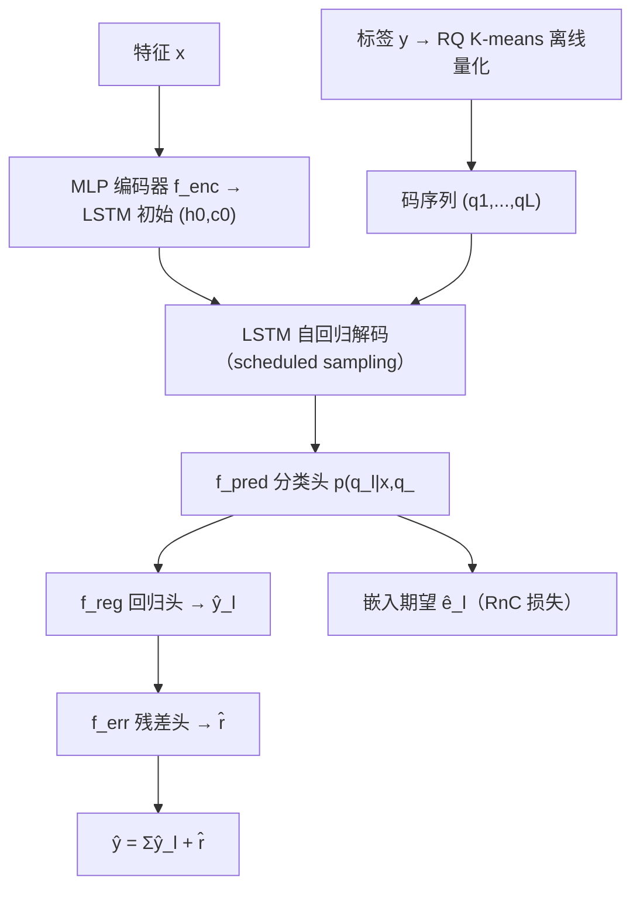

# RQ-Reg: A Residual-Quantization-Based Framework for Continuous Value Prediction in Recommender Systems (基于残差量化的推荐系统连续值预测框架)

- **会议/期刊**: CIKM 2026
- **作者与机构**: Runpeng Cui, Zhipeng Sun, Chi Lu, Peng Jiang（快手科技）
- **推荐链路定位**: 精排（GMV/观看时长/LTV 等连续目标预估）
- **研究方向**: CTR/CVR 预估与特征交叉 / 生成式推荐与离散语义 ID
- **论文原文**: [https://arxiv.org/abs/2602.23012v2](https://arxiv.org/abs/2602.23012v2)
- **开源代码**: [https://github.com/rpcui/RQ-Reg](https://github.com/rpcui/RQ-Reg)

## TL;DR (1分钟核心速览)

观看时长、LTV、GMV 等连续目标分布长尾、多峰且严重偏斜，$\ell_1$/MSE 回归在尾部失真，固定参数化分布（如零膨胀对数正态）又受限于假设是否贴合。RQ-Reg 用分层 K-means 残差量化把标量标签拆成"由粗到细"的离散码序列，以 LSTM 自回归逐级预测码值并额外回归量化残差，同时用 Rank-N-Contrast 把码嵌入空间对齐到标签序。在 KuaiRec/CIKM16 观看时长任务上 MAE 降至 3.189/0.811，线上快手 GMV 场景 ADVV +4.19%（长尾桶 +4.76%）。

## Background & Motivation (背景与核心矛盾)

- **主流范式**: 连续值预测被形式化为回归，两条路线分别是：(i) regression-by-classification（TPM/CREAD 把连续值分桶后做序回归）；(ii) regression-by-generation（WLR、ZILN、OptDist 假设某个参数化分布并做 MLE）。
- **前人局限**: 分类路线被"离散精度 vs 量化误差"死锁——桶宽则重建误差大，桶密则类不平衡、稀疏样本训不动；生成路线则被分布假设锁死——简单假设欠拟合真实长尾，复杂混合分布牺牲可扩展性与泛化。
- **核心洞察 (Key Insight)**: 工业 GMV 分布并非平滑长尾，而是在若干商品价格锚点上出现尖锐多峰（图 1），任何单一全局分桶或单峰/少峰参数族都只能"一刀切"；而残差量化的逐级细化天然能在不同尺度上分别刻画粗量级与局部峰。
- **本文切入点**: 不做分布假设、也不做一次性全局离散，而是把标签表示为有序码之和 $y=\sum_{l}q_l+r_L$，将回归转成"由粗到细"的序列预测问题。

<figure class="paper-figure" markdown="span">
  <figcaption>图1：大规模在线短视频商业场景中的GMV分布。从上到下，各子图分别展示GMV在数值范围10–20、20–30、30–40和40–50上的频率分布。</figcaption>
</figure>

## Method (核心方法设计)

### 1. 整体框架 (Overall Architecture)

输入侧把用户/物品/上下文特征经 MLP $f_{\text{enc}}$编码成 LSTM 的初始隐状态与记忆单元；标签侧离线用 RQ K-means 把训练集标签递归量化为$L$级码序列（共享码本，$L\times K$个标量码）。解码时以 `<start>` 起始，逐步自回归输出第$l$级码的概率分布$p(q_l\mid x,q_{<l})$，再由 MLP 回归头把 logits 映射为该级码的数值估计$\hat{y}_l$；$L$步结束后额外预测残差$\hat{r}$，最终$\hat{y}=\sum_l\hat{y}_l+\hat{r}$。训练端叠加生成 NLL、多级 Huber 回归与序感知对比三项损失，并用 scheduled sampling 消解教师强制与自回归推理的落差。

### 2. 关键设计拆解 (Key Designs)

1. **RQ K-means 分层码本（把"离散精度 vs 量化误差"变成逐级可调）**：单层 K-means 的量化误差不可控，$L=1$时 KuaiRec 重建 MAE 高达$7.51\times10^{-2}$。做法是对残差递归聚类：$\mathcal{C}_l=\text{K-means}(\mathcal{R}_{l-1},K)$，取$q_l=Q(r_{l-1};\mathcal{C}_l)=c_{l,\kappa}$，$\kappa=\arg\min_k (r_{l-1}-c_{l,k})^2$，再令$r_l=r_{l-1}-q_l$。由于 K-means 最小化簇内平方误差，逐级作用于残差可把总误差压到$1.33\times10^{-3}$（比 GR 的动态分位数低约 2.5 倍），物理直觉是"每级只负责上一级剩下的那一段误差"。
2. **双头自回归：分类分布 + 码值回归 + 残差补偿**：若直接用期望 $\hat{y}_l=\mathbb{E}_{p}[q]$作为码值估计，分布形状偏差会直接污染数值。RQ-Reg 保留 NLL 生成监督的同时，用$f_{\text{reg}}:\mathbb{R}^{|\mathcal{V}|}\to\mathbb{R}$把 logits$z_l$映射为$\hat{y}_l$，并用$f_{\text{err}}$从末步嵌入$\hat{e}_L$预测$\hat{r}$，得到$\hat{y}=\sum_{l=1}^{L}\hat{y}_l+\hat{r}$；回归损失对每一级部分和都施加 Huber 监督$\ell_\delta(y,\hat{y})+\sum_l \ell_\delta(y^{(l)},\hat{y}^{(l)})$，使粗级先学会量级、细级只学修正。
3. **序感知表征学习 RnC + 训练/推理一致性**：码嵌入若只由 NLL 驱动则与标签大小无关，相似标签的码序列仍可能散乱。本文将码序列表示为分布期望 $\hat{e}_l=\sum_{c\in\mathcal{V}}p(q=c\mid x,q_{<l})\,e(c)$，$\hat{e}=[\hat{e}_1;\dots;\hat{e}_L]$，并施加
$\ell^{(i)}_{\text{rnc}}=-\frac{1}{|\mathcal{B}|-1}\sum_{j\neq i}\log\frac{\exp(\text{sim}(\hat{e}_i,\hat{e}_j)/\tau)}{\sum_{k\in\mathcal{S}_{i,j}}\exp(\text{sim}(\hat{e}_i,\hat{e}_k)/\tau)}$，其中$\mathcal{S}_{i,j}=\{k: |y_i-y_k|\ge |y_i-y_j|\}$。按"标签距离越远者不应比近者更相似"构造竞争集，等价于把标签的序几何注入嵌入空间。总损失为$\mathcal{L}=\mathcal{L}_{\text{gen}}+\alpha\mathcal{L}_{\text{reg}}+\beta\mathcal{L}_{\text{rnc}}$（$\alpha=1.0,\beta=0.1,\tau=2.0$，sim 取负$\ell_2$ 距离）。
4. **训练与推理开销**：负采样无需额外设计——码表 $|\mathcal{V}|=L\cdot K+1$本身即"类别全集"，softmax 全类归一化；scheduled sampling 采用逆 sigmoid 衰减$p(t)=\text{sigmoid}(-k(t-t_0))$，$k=0.1,t_0=10$。推理为$L$次串行 LSTM 前向 + 一次$f_{\text{err}}$，复杂度随码长**线性**增长，而 GR 的 Transformer 为二次增长。

## Experimental Setup & Evaluation Protocol (实验设置与评估协议)

- **数据集与预处理**:

| 数据集 | #Users | #Items | #Interactions | 稀疏度/密度 | 特征/场景说明 |
| :--- | :---: | :---: | :---: | :---: | :--- |
| KuaiRec | 7,176 | 10,728 | 12,530,806 | 16.3%（曝光级） | 快手短视频观看时长 |
| CIKM16 | — | 122,991 | 310,302 sessions | — | 电商搜索会话停留时长 |
| Criteo-SSC | — | — | 15,995,633 | 正样本 7.20% | 搜索广告转化/LTV |
| Kaggle | >300,000 | — | 805,753 | 正样本 90.12% | 购物者购买金额 LTV |

- **数据划分与防穿越 (Splitting Strategy)**: 观看时长任务按先前工作 CIKM16 采用 **8:2 比例划分**（沿用 TPM/GR 的特征管线）；LTV 任务按 OptDist 设置 Criteo-SSC / Kaggle 采用 **7:1:2（train:valid:test）比例划分**；KuaiRec 沿用其公开划分。
- **排名评测协议 (Ranking Protocol)**: 非候选集检索式评测，而是测试集上的**逐点回归 + 成对一致性**评测——MAE、XAUC（成对序一致性 $\frac{1}{|\mathcal{P}|}\sum_{(i,j)\in\mathcal{P}}\mathbb{I}[(y_i-y_j)(\hat{y}_i-\hat{y}_j)>0]$，等价全测试集 pair 全排序）、LTV 侧用归一化 Gini 与 SRCC（全样本 + 仅正样本 Gini(+)/SRCC(+)）。无负采样，因为任务是数值估计而非 Top-N 排序。
- **对比基线与超参设置**: 基线覆盖回归类（WLR、D2Q、SWaT）、分类序回归类（TPM、CREAD、MDME）、参数化生成类（ZILN、OptDist、MDAN、MTL-MSE）与同族生成回归 GR。RQ-Reg：LSTM 单层、hidden 512、$L=3$、$K=48$、AdamW、lr$5\times10^{-4}$、50 epoch，结果取 3 次独立运行均值；对 GR 做过单侧单样本$t$检验，$p<0.05$。

## Key Experimental Results (实验关键数据)

### 1. 主实验对比 (Main Results)

**观看时长（KuaiRec / CIKM16）**

| Method | KuaiRec MAE↓ | KuaiRec XAUC↑ | CIKM16 MAE↓ | CIKM16 XAUC↑ |
| :--- | :---: | :---: | :---: | :---: |
| WLR (YouTube 线上基线) | 6.047 | 0.525 | 0.998 | 0.672 |
| D2Q | 5.426 | 0.565 | 0.899 | 0.661 |
| TPM | 4.741 | 0.599 | 0.884 | 0.676 |
| CREAD | 3.215 | 0.601 | 0.865 | 0.678 |
| SWaT | 3.363 | 0.609 | 0.847 | 0.683 |
| GR (生成回归) | 3.196 | 0.614 | 0.815 | 0.691 |
| **RQ-Reg** | **3.189** | **0.616** | **0.811** | **0.695** |
| Improv. vs GR | −0.22% | +0.33% | −0.49% | +0.58% |

**LTV（Criteo-SSC / Kaggle，MAE / Gini(+) / SRCC(+)）**

| Method | Criteo MAE↓ | Criteo Gini(+)↑ | Criteo SRCC(+)↑ | Kaggle MAE↓ | Kaggle Gini(+)↑ | Kaggle SRCC(+)↑ |
| :--- | :---: | :---: | :---: | :---: | :---: | :---: |
| ZILN | 20.880 | 0.4426 | 0.3874 | 72.528 | 0.6627 | 0.5303 |
| MDME | 16.598 | 0.2297 | 0.2952 | 72.900 | 0.6213 | 0.5289 |
| MDAN | 20.030 | 0.4128 | 0.3521 | 73.940 | 0.6680 | 0.4567 |
| OptDist (SOTA) | **15.784** | 0.4428 | 0.3903 | 70.929 | 0.6715 | 0.5346 |
| **RQ-Reg** | 16.329 | **0.4468** | **0.4166** | **59.340** | **0.7201** | **0.5318** |
| Improv. vs OptDist | +3.45% | +0.90% | +6.74% | −16.34% | +7.24% | — |

**线上 A/B（快手短视频广告，各 10% 流量 ≈ 4000 万用户，连续 7 天）**

| Setting | AUC↑ | ADVV↑ |
| :--- | :---: | :---: |
| Overall | +0.12% | +4.19% |
| Long-tail（长尾商品价格曝光） | **+0.23%** | **+4.76%** |

### 2. 消融实验 (Ablation Study)

| Variant | KuaiRec MAE↓ | KuaiRec XAUC↑ | CIKM16 MAE↓ | CIKM16 XAUC↑ |
| :--- | :---: | :---: | :---: | :---: |
| RQ-Reg 完整 | **3.189** | **0.616** | **0.811** | **0.695** |
| w/o $\mathcal{L}_{\text{gen}}$ | 3.199 | 0.613 | 0.821 | 0.691 |
| w/o $\mathcal{L}_{\text{rnc}}$ | 3.195 | 0.614 | 0.819 | 0.692 |
| w/o $f_{\text{err}}$ | 3.191 | 0.614 | 0.813 | 0.694 |
| w/o $f_{\text{reg}}+f_{\text{err}}$（改用期望估计） | 3.200 | 0.613 | 0.815 | 0.694 |
| w/o SS ($p=1$，纯教师强制) | 3.240 | 0.604 | 0.880 | 0.688 |
| w/o SS ($p=0$，纯自喂) | 3.197 | 0.613 | 0.823 | 0.691 |

*其他对照组*：量化方式替换为单层 K-means 为 3.196/0.611（CIKM16 0.823/0.692），替换为 GR 的动态分位数为 3.242/0.611（0.819/0.693）；骨干网络 RNN 3.210/0.613、Transformer 3.204/0.614（CIKM16 0.829）。重建误差：单层 K-means $7.51\times10^{-2}$(码长 1) → RQ$1.33\times10^{-3}$(码长 3) vs 动态分位数$3.28\times10^{-3}$ (平均码长 3.21)。

### 3. 关键实验发现 (Key Findings)

1. **收益主要来自量化分辨率而非模型容量**：把单层 K-means 换成 3 层 RQ，重建误差从 $7.51\times10^{-2}$降到$1.33\times10^{-3}$（约 56 倍），对应 MAE 3.196→3.189、XAUC 0.611→0.616；而 RQ 用固定 3 码即优于平均码长 3.21 的动态分位数编码，说明"层级化残差"比"启发式变长码"更高效，且$\mathcal{L}$从 1→3 单调下降、$L\ge3$ 后趋于平台。
2. **训练-推理一致性比额外损失项更吃重**：关掉 scheduled sampling 走纯教师强制（$p=1$）时 MAE 恶化到 3.240（+1.6%）、XAUC 掉到 0.604（−1.2%），退化幅度明显大于去掉$\mathcal{L}_{\text{gen}}$（3.199）或$\mathcal{L}_{\text{rnc}}$（3.195）；反过来纯自喂（$p=0$）也退化到 3.197，印证"必须课程式过渡"而非二选一。
3. **序感知表征把增益推到长尾与正样本排序上**：Kaggle 上 MAE 59.340 对 OptDist 70.929（−16.34%）、Gini(+) +7.24%，是所有设置中最大幅度的领先；线上长尾桶 ADVV +4.76% 高于整体 +4.19%，与图 4 的 t-SNE 结果一致——加 $\mathcal{L}_{\text{rnc}}$ 后同量级标签嵌入聚拢成连续色带，去掉后出现明显离群散点。

## Highlights & Limitations (亮点、对比与审稿批判)

- **与代表作对比 (vs. Prior Work)**: ① vs **GR**（同样是"序列生成式回归"）：GR 用带单调约束的启发式算法拆变长码 + Transformer，训练复杂、推理 $O(L^2)$；RQ-Reg 用标准 RQ K-means 固定码长 + LSTM，$O(L)$ 且重构误差低约 2.5 倍。② vs **CREAD/TPM**（分类序回归）：后者受全局固定分桶的精度-误差权衡死锁，本文把离散化变成可逐级细化的层级结构。③ vs **OptDist**（零膨胀对数正态混合 + 分布学习/选择模块）：后者依赖参数族正确性，本文零分布假设，泛化到 GMV/LTV/时长三种形态各异的场景。
- **可迁移亮点**: (i) "RQ 码 + 双回归头 + 残差补偿"这一套可作为任意连续目标的通用输出层，替换精排中的单标量回归头即可；(ii) RnC 序感知对比损失可移植到语义 ID 生成式召回（TIGER 类）中，用标签序约束码本嵌入几何，缓解码本语义漂移。
- **审稿级局限批判**: (i) 码本由离线 RQ K-means 在训练集上一旦构建即冻结，工业 GMV 的价格锚点会随时间漂移，需周期性重建；且 $K=64$在 CIKM16 因数据不足直接聚类失败，稀疏场景对$K$敏感（$L=3,K=48$ 是最优但不是自适应）。(ii) 增益绝对值偏小——离线 MAE 相对提升仅 0.22%–0.49%，线上 AUC +0.12%，且显著性检验只针对 GR 单基线；LTV 的 Criteo 上 MAE 仍逊于 OptDist（16.329 vs 15.784），说明在强参数化假设本已贴合的数据上优势会被抹平；此外全文未做 Top-N 全库排序或端到端链路一致性评估，精排下游收益需进一步验证。

## Rating (四维评分)

- **方法创新性 (Novelty)**: ⭐⭐⭐⭐ （首次把残差量化引入推荐连续值回归，把"离散精度 vs 量化误差"重构为逐级细化序列问题，思路干净；但 RQ、LSTM、RnC 三件组件均为已有技术，创新在组合与问题重述）
- **评估协议与实验扎实度 (Protocol & Experiments)**: ⭐⭐⭐⭐ （4 个公开数据集 + 4000 万用户级线上 A/B + A/A 回切验证 + 单侧 $t$ 检验，消融覆盖损失/回归头/调度/骨干/量化方式；不足是仅对单一基线做显著性检验、未做 Top-N 排序评测）
- **写作与数学规范度 (Clarity & Rigor)**: ⭐⭐⭐⭐ （RQ 分解、双头预测、RnC 竞争集定义推导链条完整，复杂度 $O(L)$vs$O(L^2)$ 的对比明确；缺量化误差上界或泛化性的理论分析，超参敏感性散落在附录）
- **工业落地与复现价值 (Industrial & Practical Value)**: ⭐⭐⭐⭐ （代码已开源，输出层可插拔替换现有回归头，推理仅多 $L-1$ 次串行前向；真实 400M DAU 平台上线且长尾桶增益更大，落地价值明确）

