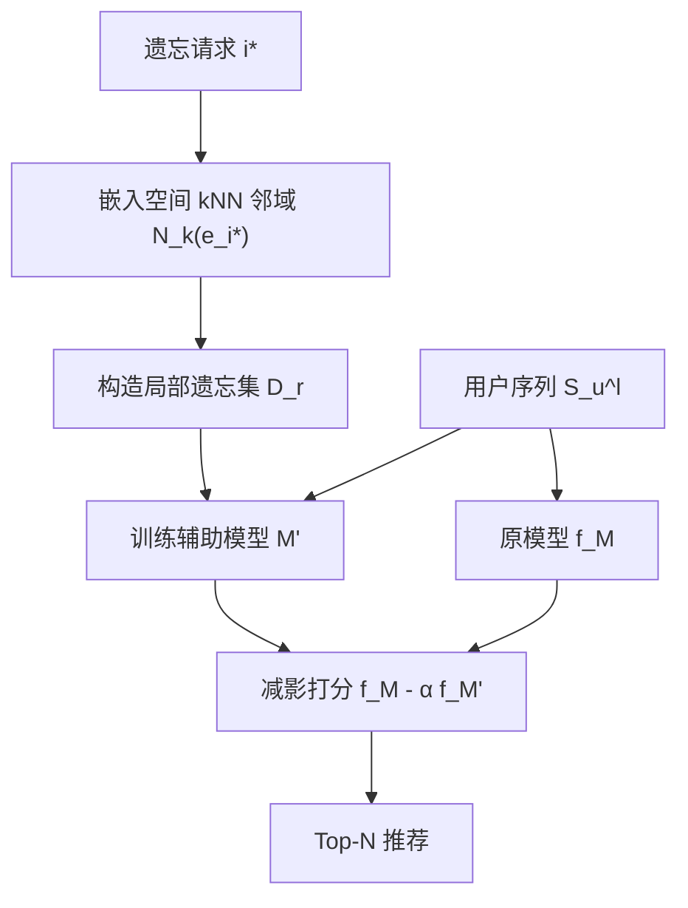
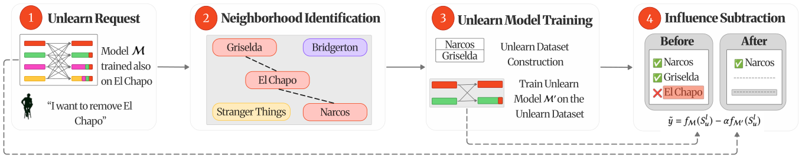

# SURF: Subtractive Updates for Recommender Forgetting (推荐系统遗忘的减影更新)

- **会议/期刊**: CIKM 2026
- **作者与机构**: Filippo Betello, Antonio Purificato, Nicola Tonellotto, Fabrizio Silvestri；Sapienza University of Rome / University of Pisa
- **推荐链路定位**: 精排/推理端（序列推荐遗忘）
- **研究方向**: 去偏公平、可信隐私与工业架构 / 序列与会话推荐
- **论文原文**: [https://arxiv.org/abs/2609.18695v1](https://arxiv.org/abs/2609.18695v1)
- **开源代码**: [https://github.com/FilippoBetello/SURF](https://github.com/FilippoBetello/SURF)

## TL;DR (1分钟核心速览)

针对序列推荐“被遗忘物品”难以低成本移除的问题，SURF 不重训原模型，而是在嵌入空间找目标物品的 kNN 邻域，基于邻域交互训练轻量辅助模型，并在推理时用原模型分数减去辅助模型分数，实现近似遗忘。7 数据集、3 个序列主干上，NDCG@20 最高较 Retrain 提升 32%，训练预算仅约 2%，且遗忘可逆。

## Background & Motivation (背景与核心矛盾)

- **主流范式**: 序列推荐用 GRU4Rec/SASRec/BERT4Rec 建模用户历史序列；推荐遗忘主要走“分片重训”（RecEraser、SRU、UltraRE）或“影响函数近似”（IFRU）两条路线。
- **前人局限**: 分片法在用户-物品高度互联时，目标物品散落在多个 shard，导致重训成本高且推荐精度下降；影响函数依赖二阶 Hessian 近似，内存开销大且假设在实践中易失效。
- **核心洞察 (Key Insight)**: 被遗忘物品的影响集中在嵌入空间的局部邻域；只需在该局部区域学习一个“目标贡献”的近似器，并在推理时减掉它，即可近似实现遗忘，而不必改动原模型参数。
- **本文切入点**: 用 kNN 邻域构造紧凑遗忘数据集，训练辅助模型做“影响减影”，把遗忘从参数编辑转为推理期分数校正。

## Method (核心方法设计)

### 1. 整体框架 (Overall Architecture)

SURF 分三步：给定遗忘请求物品 $i^*$，先在原模型嵌入空间检索其$k$近邻$N_k(e_{i^*})$；再收集包含这些邻域物品的序列构成小数据集$D_r$，用与原模型相同架构和训练目标训练辅助模型$M'$；推理时对任意序列$S_u^l$计算$\tilde{y}=f_M(S_u^l)-\alpha f_{M'}(S_u^l)$，再取$\arg\max_i \tilde{y}_i$。原模型完全保留，因而遗忘可逆；$M'$ 只拟合局部影响，推理开销接近一次额外前向。

<figure class="paper-figure" markdown="span">
  <figcaption>图1：SURF 概览：给定遗忘请求，我们识别待遗忘物品的邻域，在该子集上训练辅助模型，并在推理时减去其影响，从而将目标物品从推荐中移除。</figcaption>
</figure>

### 2. 关键设计拆解 (Key Designs)

1. **邻域识别与局部影响隔离**：仅用遗忘集 $D_f$ 的序列不足以刻画目标物品在表示空间中的局部流形，因此取嵌入最近邻：
$N_k(e_{i^*})=k\text{-}\arg\min_{e'\in E}\|e_{i^*}-e'\|_2$。
无用户嵌入的 SASRec 用 $e_u=\frac{1}{\ell_u}\sum_{j=1}^{\ell_u}e_{i_j}$ 聚合用户表示。邻域越紧，减影越不易误伤全局推荐。
2. **遗忘集构造与辅助模型训练**：构造 $D_r=\{S_u:\exists i\in S_u,\ i\in N_k(e_{i^*})\}$，在$D_r$上以原模型相同 next-item 目标训练$M'$。这样$M'$ 近似目标物品对局部预测的贡献；推理减影：
$\tilde{y}=f_M(S_u^l)-\alpha f_{M'}(S_u^l)$，默认$\alpha=0.7,\ k=1$。与 post-hoc 过滤不同，SURF 改变隐藏表示层面的打分，而非仅删输出项。
3. **理论保障与训练/推理开销**：若 $\Delta_{i_1i_2}>2\alpha\|f_{M'}(S_u^l)\|_\infty$，则减影后相关物品相对排序保持；局部扰动满足$\|\tilde{y}-f_M\|\le\alpha(L\,\mathrm{diam}(N_k)+C)$；影响移除残差满足$|f_{i^*}-\alpha f_{M'}|\le|1-\alpha||f_{i^*}|+\alpha\varepsilon$。训练目标与原模型一致（next-item 交叉熵 + 未交互负采样），无额外二阶优化；推理需$M$与$M'$各一次前向，实测约$1.05$–$1.15\times$。

## Experimental Setup & Evaluation Protocol (实验设置与评估协议)

- **数据集与预处理**: 统一 `5-core` 过滤，评分转隐式反馈；序列长度 MovieLens/Foursquare 为 200，Steam/Amazon/Yelp 为 50。

| 数据集 | #Users | #Items | #Interactions | 密度(%) | 场景说明 |
| :--- | ---: | ---: | ---: | ---: | :--- |
| Beauty | 1,274 | 1,076 | 7,113 | 0.519 | 美妆电商 |
| ML-1M | 6,040 | 3,416 | 999,611 | 4.845 | 电影 |
| ML-100k | 943 | 1,349 | 99,287 | 7.805 | 电影 |
| Steam | 334,536 | 13,046 | 4,212,143 | 0.001 | 游戏 |
| FS-TKY | 2,293 | 15,177 | 494,807 | 1.422 | 东京 POI |
| FS-NYC | 1,083 | 9,989 | 179,468 | 1.659 | 纽约 POI |
| Yelp | 287,116 | 148,523 | 4,392,169 | 0.010 | 本地生活 |

- **数据划分与防穿越**: 采用 `Leave-One-Out`：最后 1 次交互测试，倒数第 2 次验证，其余训练。
- **排名评测协议**: 原文未显式声明 Full-Ranking；训练负例从用户未交互物品采样，评测用 EasyRec 的 @20 排序指标。核心指标：NDCG@20↑、UnlearnMRR@20↓、UnlearnRecall@20↓、FRBO↑。
- **对比基线与超参**: 5 个基线：Retrain、RecEraser、SRU、UltraRE、IFRU；主干 GRU4Rec/SASRec/BERT4Rec；5 个目标物品取平均；Adam、batch=128、500 epochs；显著性用 Wilcoxon $p<0.05$。

## Key Experimental Results (实验关键数据)

### 1. 主实验对比 (Main Results)

下表摘取 SASRec 主干在 Beauty/ML-1M 的代表性结果（完整 7 数据集见表 2），粗体为该数据集该指标最优。

| 数据集 | 方法 | NDCG@20↑ | UL-MRR@20↓ | UL-Recall@20↓ | FRBO↑ |
| :--- | :--- | ---: | ---: | ---: | ---: |
| Beauty | Retrain | **0.6484** | 0.0016 | 0.0147 | **0.7135** |
| Beauty | RecEraser | 0.5268 | 0.0024 | 0.0182 | 0.3311 |
| Beauty | SRU | 0.3908 | 0.0036 | 0.0182 | 0.2936 |
| Beauty | UltraRE | 0.4224 | 0.0016 | 0.0147 | 0.1911 |
| Beauty | IFRU | 0.3167 | 0.0047 | 0.0156 | 0.0956 |
| Beauty | SURF | 0.5640 | **0.0015** | **0.0130** | 0.5128 |
| ML-1M | Retrain | 0.1208 | 0.0018 | 0.0076 | 0.3036 |
| ML-1M | RecEraser | 0.0417 | 0.0020 | 0.0084 | 0.0771 |
| ML-1M | SRU | 0.0259 | 0.0016 | 0.0079 | 0.0422 |
| ML-1M | UltraRE | 0.0279 | 0.0017 | 0.0084 | 0.0407 |
| ML-1M | IFRU | 0.0020 | 0.0011 | 0.0063 | 0.0020 |
| ML-1M | SURF | **0.1595** | **0.0008** | **0.0058** | **0.6080** |

ML-1M/SASRec 上，SURF 的 NDCG 较 Retrain 提升 $31.9\%$，UL-MRR 降低$55.6\%$；Beauty 上 NDCG 较 Retrain 低$13.0\%$，但 UL-MRR 与 UL-Recall 更优，显示“略微牺牲效用换更强遗忘”的折中。

### 2. 消融实验 (Ablation Study)

原文未提供组件移除式消融；下表为图 2 的超参敏感性分析（SURF 关键设计验证）。

| 设置 | NDCG@20 | UL-MRR@20 | 观察 |
| :--- | ---: | ---: | :--- |
| $k=1$ | 0.5492 | 0.0010 | 默认，效用最佳 |
| $k=3$ | 0.1617 | 0.0011 | NDCG 大幅下降 |
| $k=5$ | 0.1002 | 0.0012 | 遗忘略强，效用受损 |
| $\alpha=0.3$ | 0.0007 | 0.0007 | 过度遗忘，推荐崩塌 |
| $\alpha=0.5$ | 0.0388 | 0.0008 | 折中 |
| $\alpha=0.7$ | 0.1595 | 0.0008 | 默认，效用保持 |

### 3. 关键实验发现 (Key Findings)

- **遗忘有效性**：ML-1M/SASRec 上 SURF 将 UL-MRR 从 Retrain 的 0.0018 降至 0.0008、UL-Recall 从 0.0076 降至 0.0058，同时 NDCG 0.1595 高于 Retrain 0.1208；Beauty 上 UL-MRR 0.0015 优于 Retrain 0.0016，说明减影确实移除了目标信号而非仅过滤输出。
- **效率优势**：SURF 训练时间在 Steam/Yelp 仅约 $0.04\times$Retrain，ML-1M 约$0.5\times$；推理仅$1.05$–$1.15\times$。分片类方法训练开销可达$17.99\times$，IFRU 虽训练极快但 NDCG 常崩塌（ML-1M 仅 0.0020），Yelp 上其推理甚至达$4.89\times$。
- **超参规律**：$k$从 1 增至 5，NDCG 由 0.5492 降至 0.1002，而 UL-MRR 仅从 0.0010 升至 0.0012，说明小邻域足够遗忘且更保效用；$\alpha$从 0.3 到 0.7，NDCG 由 0.0007 回升至 0.1595，UL-MRR 稳定在 0.0008，$\alpha=0.7$ 是效用/遗忘的较好折中。

## Highlights & Limitations (亮点、对比与审稿批判)

- **与代表作对比 (vs. Prior Work)**: 相比 RecEraser/SRU/UltraRE 的分片重训，SURF 不做数据分片，避免高度互联导致的 shard 交叉；相比 IFRU 的二阶影响函数，SURF 只训练局部辅助模型并在推理减影，无 Hessian 与参数编辑；相比 post-hoc 过滤，SURF 的隐藏表示距离非零，属于表示级遗忘。
- **可迁移亮点**: 推理期“原模型 − 局部辅助模型”的减影范式可迁移到多业务场景的定向内容下架、可逆推荐干预；kNN 邻域构造也可用于其他需要局部影响隔离的模型维护任务。
- **审稿级局限批判**: (1) 属近似遗忘，理论依赖 Lipschitz、影响有界与可分解假设，缺少严格 unlearning guarantee 与 MIA 隐私攻击评估；(2) 每个遗忘物品需存一个辅助模型并做额外前向，海量并发遗忘请求下存储/调度成本会线性增长；且只验证 3 个较旧序列主干与离线 @20 指标，未覆盖 Mamba/LLM 推荐与线上 A/B。

## Rating (四维评分)

- **方法创新性 (Novelty)**: ⭐⭐⭐⭐ （推理期减影 + 局部邻域辅助模型较新颖，且有排序稳定性/局部扰动/影响移除三条理论分析；但本质仍是近似局部校正。）
- **评估协议与实验扎实度 (Protocol & Experiments)**: ⭐⭐⭐⭐ （7 数据集 × 3 主干 × 5 基线，含 Wilcoxon 检验和 FRBO；但缺组件消融、Full-Ranking 声明与更多目标物品抽样。）
- **写作与数学规范度 (Clarity & Rigor)**: ⭐⭐⭐⭐ （三步流程与三条定理清晰，公式符号统一；部分假设较强，理论界偏 worst-case。）
- **工业落地与复现价值 (Industrial & Practical Value)**: ⭐⭐⭐⭐ （代码开源、原模型可逆、训练约 2% 预算；但辅助模型管理与额外推理开销是生产化关键成本。）

