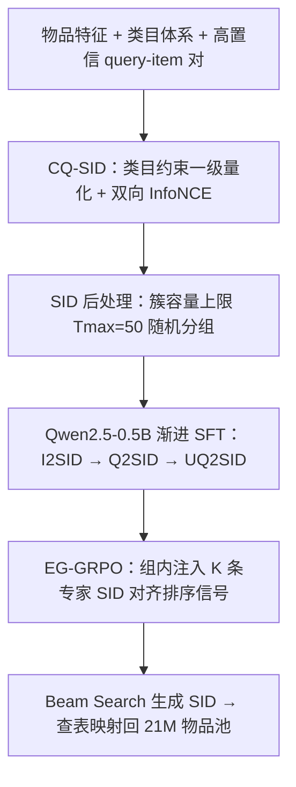
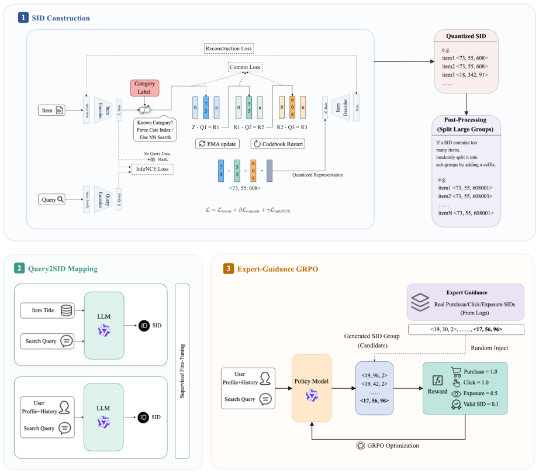

# Efficient Generative Retrieval for E-commerce Search with Semantic Cluster IDs and Expert-Guided RL (基于语义簇 ID 与专家引导强化学习的高效电商搜索生成式召回)

- **会议/期刊**: CIKM 2026 (Proc. 35th ACM Int. Conf. on Information and Knowledge Management, pp. 8801-8808)
- **作者与机构**: Jianbo Zhu, Xing Fang, Jing Wang, Mingmin Jin, Bokang Wang, Guangxin Song, Zhenyu Xie, Junjie Bai（阿里巴巴 淘天集团）
- **推荐链路定位**: 召回（生成式召回通道，与稀疏/稠密召回并行，非端到端替代）
- **研究方向**: 生成式推荐与离散语义 ID / 强化学习与动态探索推荐
- **论文原文**: [https://arxiv.org/abs/2605.14434v2](https://arxiv.org/abs/2605.14434v2)
- **开源代码**: 暂未开源

## TL;DR (1分钟核心速览)

本文针对工业电商搜索中"语义 ID 过细导致 beam search 爆炸、召回与精排目标错位"两大痛点，提出 CQ-SID（类目硬约束一级残差量化 + Query-Item 双向对比学习）把 item ID 从"唯一标签"放宽为"语义簇标识"，并设计 EG-GRPO 在稀疏奖励下向策略组注入真实样本以对齐下游排序。在天猫搜索日志（Query2SID 测试集 201k、UQ2SID 170k）上，同 beam 下语义/个性化点击 hitrate 相对 RQ-VAE 提升最高 26.76% / 11.11%，top-1K 截断下用不到一半 beam（30 vs 65）反超 3.44%；线上两周 A/B 的 GMV +1.15%、UCTCVR +0.40%。

## Background & Motivation (背景与核心矛盾)

- **主流范式**: DSI/TIGER 系列用 seq2seq 模型直接生成文档/物品标识，将"建索引 + ANN 检索"折叠为单一可微模型；工业侧快手 OneModel 系列更主张端到端替代多级漏斗。
- **前人局限**: ① 电商搜索要求高精度，端到端直接生成百万级商品存在覆盖、延迟与"马太效应"风险；② 主流追求 one-item-one-ID 以压低碰撞率，但 ID 过细需海量训练数据、收敛慢，且推理端必须用大 beam 才能保证召回广度，与 40ms 级时延预算冲突。
- **核心洞察 (Key Insight)**: 召回阶段并不需要"唯一 ID"，只需要"高纯度语义簇"——适度允许碰撞（平均 4.2 items/SID）可换取 beam 数量减半而 hitrate 不降反升；同时发现标准 GRPO 在稀疏奖励下会陷入"模式集中"，提高 beam@1 却牺牲 beam@10 的探索广度。
- **本文切入点**: 把生成式召回定位为**召回通道补充**而非漏斗替代，用类目结构做 ID 前缀先验、用真实样本做 RL 的方差稳定器。

## Method (核心方法设计)

### 1. 整体框架 (Overall Architecture)

系统分为三段闭环：先以 CQ-SID 把物品编码为三级语义簇 ID（一级类目硬约束、二三级最近邻量化，码本 2048×1024×1024，EMA 更新 + 死码本重启），再经后处理限制单簇容量；随后用 Qwen2.5-0.5B 做四阶段渐进 SFT（item 标题→SID、query→SID、（用户+query）→SID、EG-GRPO 对齐）；线上以动态 beam∈[20,50,100] 生成 top-K SID，经 SID→Items 查表映射回 2100 万规模的高效物品池（日均增量更新），再做效率分截断进入粗排。

<figure class="paper-figure" markdown="span">
  <figcaption>图1：我们的生成式召回框架架构概览，展示流程：(1) CQ-SID物品编码，(2) 渐进式查询到SID学习，(3) EG-GRPO排序对齐。</figcaption>
</figure>

### 2. 关键设计拆解 (Key Designs)

1. **类目引导的一级残差量化（Category-Guided RQ）**：痛点在于标准 RQ-VAE 的首级码本纯由重建误差驱动，前缀语义飘忽、剪枝效率低。本文对已知类目的物品**强制**用类目 ID 作为一级码字索引（1711 个有效类目），未知类目才退回最近邻：$k_i^{(1)}=\mathrm{CategoryID}(i)$if$i\in\mathcal{I}_{\text{known}}$，else$\arg\min_{j}\|\boldsymbol{r}_i^{(0)}-\boldsymbol{e}_j^{(1)}\|_2^2$；二、三级仍走标准量化，码本以$\boldsymbol{e}_j^{(l)}\leftarrow\lambda\boldsymbol{e}_j^{(l)}+(1-\lambda)\boldsymbol{m}_j^{(l)}$ 做 EMA 更新。直觉：类目树天然对应"粗到细"的语义分区，把业务先验写进前缀，等价于免费获得一棵可剪枝的语义树，beam 前缀共享率大幅提升。
2. **双向 InfoNCE 与簇容量后处理**：仅用重建损失时，物品向量只编码外观，与搜索意图不对齐。本文对高置信 query-item 对（搜索-点击-购买链路）施加对称 InfoNCE：$\mathcal{L}_{\text{Bi-InfoNCE}}=\frac{1}{2}[-\log\frac{\exp(\mathrm{sim}(\boldsymbol{e}_i,\boldsymbol{e}_q)/\tau)}{\sum_{q'}\exp(\mathrm{sim}(\boldsymbol{e}_i,\boldsymbol{e}_{q'})/\tau)}-\log\frac{\exp(\mathrm{sim}(\boldsymbol{e}_q,\boldsymbol{e}_i)/\tau)}{\sum_{i'}\exp(\mathrm{sim}(\boldsymbol{e}_q,\boldsymbol{e}_{i'})/\tau)}]$，无 query 的物品做 mask 以稳定训练。随后若某 SID 下物品数$c>T_{\max}=50$，则取$G=\min(\lceil c/T_{\max}\rceil,G_{\max}=100)$ 随机分组并在三级码后拼接 3 位组号。因同簇物品语义已高度相似，随机切分几乎不破坏语义一致性，却能防止热门簇在 beam 中"霸屏"、抑制马太效应。
3. **EG-GRPO：稀疏奖励下的专家注入**：奖励按购买/点击/曝光/合法 SID 分级赋 $1.0/1.0/0.5/0.1$，否则为 0；优势用组内标准化$A(o_i)=\frac{R(o_i)-\mathrm{mean}(\{R(o_j)\}_{j=1}^{G})}{\mathrm{std}(\{R(o_j)\})+\epsilon}$。关键改动是每步从真实点击/曝光集合采样$K$条 SID 作为"伪生成"输出注入策略组，$\mathcal{G}=\mathcal{G}_{\text{sampled}}\cup\mathcal{G}_{\text{expert}}$共同参与奖励与梯度更新，相当于隐式课程学习，保证即便自采样全错也有正例提供梯度方向。总训练目标为$\mathcal{L}=\mathcal{L}_{\text{recon}}+\beta\mathcal{L}_{\text{commit}}+\gamma\mathcal{L}_{\text{InfoNCE}}$（$\beta=1.0,\gamma=0.001,\tau=0.1$），RL 阶段 KL 权重 1.0、组大小 8、LR$10^{-6}$、1k 步；全流程**免负采样**，推理仅需 0.5B 模型 beam search + 查表，8 GPU 支撑 200 QPS、端到端约 40ms。

## Experimental Setup & Evaluation Protocol (实验设置与评估协议)

- **数据集与预处理**: 全部来自天猫 APP 真实搜索日志（未公开，无 5-core 过滤，物品侧先筛至约 2100 万高效物品池）：

| 数据/阶段 | 规模 | 说明 |
| :--- | :---: | :--- |
| CQ-SID 训练样本 | 37.5M | 21.1M 含 query-item 对，16.4M 纯 item |
| Item2SID SFT | 21.0M | (item 标题, SID) 对 |
| Query2SID SFT | 90.3M | 每 query 采样 $N=3$ 个点击/购买 SID 作目标 |
| UQ2SID SFT | 73.7M | query + 性别/年龄段 + 同类目近期点击 SID 序列 |
| 测试集 | 201k / 170k | 分别对应 Query2SID / UQ2SID |
| SID 映射密度 | 4.2 items/SID | 三级码本 2048×1024×1024，1711 个一级类目 |

- **数据划分与防穿越 (Splitting Strategy)**: 按真实日志的离线留出测试集（Query2SID 201k、UQ2SID 170k 条），线上部分为两周 A/B 对照；物品池按日增量更新以避免新物品穿越。
- **排名评测协议 (Ranking Protocol)**: 非全库 Full-Ranking，而是**生成式 Beam 命中率**双口径对照：① 同等 beam size 下的 hitrate（衡量单位算力质量）；② 各 query 生成不同数量 beam 后按商品效率分截断、统一保留 top-1K 物品再算 hitrate（模拟线上粗排截断，消除"SID 粒度不同导致候选池大小不同"的混淆）。
- **对比基线与超参设置**: 基线以 TIGER 所用 RQ-VAE 为主，另设两组消融（去类目约束、去 Query-Item 对比）；所有 LLM 映射模型统一用 Qwen2.5-0.5B，I2SID LR $10^{-4}$/2k 步、Q2SID LR$4\times10^{-5}$/2.5k 步、UQ2SID LR$4\times10^{-5}$/5k 步；论文未报告显著性检验。

## Key Experimental Results (实验关键数据)

### 1. 主实验对比 (Main Results)

| 方法 | 语义 beam@1 | beam@10 | beam@100 | 个性化 beam@1 | beam@10 | beam@100 |
| :--- | :---: | :---: | :---: | :---: | :---: | :---: |
| RQ-VAE (TIGER) | 0.0598 | 0.2579 | 0.5199 | 0.1359 | 0.4787 | 0.7513 |
| CQ-SID (w/o Cate) | 0.0680 | 0.2870 | 0.5578 | — | — | — |
| CQ-SID (w/o QI) | 0.0596 | 0.2691 | 0.5652 | — | — | — |
| **CQ-SID** | **0.0758** | **0.3161** | **0.6181** | **0.1510** | **0.5206** | **0.8062** |
| Improv.% | +26.76% | +22.57% | +18.89% | +11.11% | +8.75% | +7.31% |

Top-1K 截断口径：语义场景 CQ-SID 在 beam@30 达 0.4422，RQ-VAE 需 beam@65 才到 0.4275（+3.44%，beam 少 53.85%）；个性化场景 CQ-SID 在 beam@160 达 0.7984，RQ-VAE 在 beam@195 才 0.7607（+4.96%，beam 少 17.95%）。

### 2. 消融实验 (Ablation Study)

| 配置 | clk@1 | clk@10 | exp@1 | exp@10 | pvr@10 |
| :--- | :---: | :---: | :---: | :---: | :---: |
| CQ-SID (SFT 基线) | 0.1510 | 0.5206 | 0.5056 | 0.8693 | 0.4371 |
| + GRPO ($K=0$) | 0.1519 | 0.5196 | 0.5077 | 0.8702 | 0.4360 |
| + EG-GRPO ($K=2$) | **0.1524** | **0.5221** | **0.5091** | 0.8703 | 0.4377 |
| + EG-GRPO ($K=4$) | 0.1523 | 0.5219 | 0.5087 | **0.8711** | **0.4378** |

### 3. 关键实验发现 (Key Findings)

1. **两个 ID 设计互补而非冗余**：去类目约束仍有 +13.71%（beam@1），说明对比学习单独即可带来语义对齐；去对比学习在 beam@100 仍 +8.71%，说明类目前缀单独即可提升深度 beam 的簇覆盖——只有二者叠加才拿到 +26.76% 的满额增益。
2. **簇化 ID 的真正收益是"单位算力质量"**：同 beam 下相对提升随 beam 增大而衰减（26.76%→18.89%），但在 top-1K 截断下反而以 30 vs 65 的 beam 反超 3.44%，证明碰撞换来的簇聚合直接转化为延迟预算。
3. **标准 GRPO 会"窄化"召回**：$K=0$时 clk@1、exp@1 微升但 clk@10 掉 0.0010、pvr 掉 0.0011，是典型的利用式坍缩；注入$K=2$后五项指标全面不劣于基线（clk@10 +0.0015、pvr +0.0006），验证专家注入确实充当方差稳定器，但$K$ 从 2 增至 4 基本饱和，说明该机制是"稳住方向"而非"持续加码"。

## Highlights & Limitations (亮点、对比与审稿批判)

- **与代表作对比 (vs. Prior Work)**: 相比 TIGER/RQ-VAE 的 one-item-one-ID 与纯重建目标，本文显式把 ID 粒度当作可调的资源-召回权衡旋钮，并引入 query 侧对比信号；相比 GSID、CAT-ID2 等同样利用类目树的工作，本文更进一步把类目做成硬量化约束而非软先验；相比快手 OneModel 的端到端替代路线，本文坚持漏斗内"召回通道补充"的工程务实定位，这恰是线上能落地的关键。
- **可迁移亮点**: ① 用业务类目体系硬绑定一级码本，任何带层级标签的域（视频分区、本地生活类目）都可零成本复用；② 簇容量上限 + 随机二次分组，是一个极轻量的"防热门簇霸榜"正则手段；③ 把真实样本注入策略组以稳定稀疏奖励 RL，可迁移到任意生成式列表/序列的偏好对齐。
- **审稿级局限批判**: ① 实验只有一个基线（RQ-VAE）且数据全部闭源，缺少与 GSID/CAT-ID2/FORGE 等同类 SID 方案的对比，外部可复现性弱；② EG-GRPO 的绝对增益很小（clk@10 仅 +0.0015），且论文自认 SFT 已接近局部最优、hitrate 为二值指标导致天花板低，RL 模块的独立价值待更强证据；③ 后处理对超容簇做**随机**切分，虽然论证了语义一致性，但对超热门类目仍是结构性破坏，且效率分截断与线上粗排截断存在分布差异，离线 top-1K 口径可能高估收益。

## Rating (四维评分)

- **方法创新性 (Novelty)**: ⭐⭐⭐⭐ （"ID 即语义簇"的粒度观 + 类目硬约束量化 + 专家注入 GRPO，三点均为工程可解释的实质增量，但单点技术新颖度有限）
- **评估协议与实验扎实度 (Protocol & Experiments)**: ⭐⭐⭐ （双口径 beam/top-1K 设计与线上 A/B 很扎实，但基线单一、数据闭源、无显著性检验）
- **写作与数学规范度 (Clarity & Rigor)**: ⭐⭐⭐⭐ （三阶段框架与公式交代清楚、动机-设计-验证链条完整，但部分公式变量定义略密，随机分组缺乏理论保证）
- **工业落地与复现价值 (Industrial & Practical Value)**: ⭐⭐⭐⭐⭐ （0.5B 模型、8 GPU/200 QPS/40ms、召回通道贡献 50.25% 曝光与 72.63% 购买的线上实证，是极高参考价值的落地范本）

