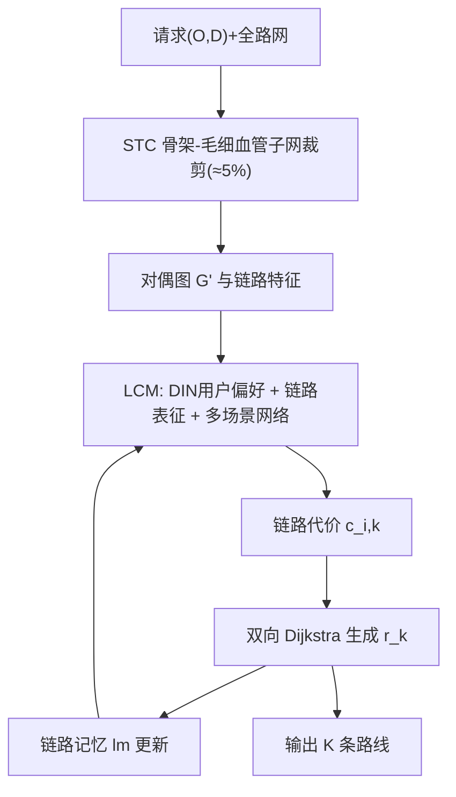
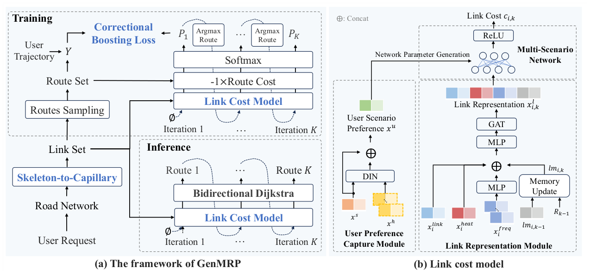

# GenMRP: A Generative Multi-Route Planning Framework for Efficient and Personalized Real-Time Industrial Navigation (面向高效个性化实时工业导航的生成式多路线规划框架)

- **会议/期刊**: CIKM 2026 (Proceedings of the 35th ACM CIKM, pp. 8671-8678)
- **作者与机构**: Chengzhang Wang, Chao Chen, Jun Tao, Tengfei Liu, He Bai, Song Wang, Longfei Xu, Kaikui Liu, Xiangxiang Chu（高德/阿里巴巴，南方科技大学）
- **推荐链路定位**: 端到端生成式（请求级路线生成，替代召回+规则重排）
- **研究方向**: 时空轨迹与 POI 本地生活推荐 / 生成式推荐
- **论文原文**: [https://arxiv.org/abs/2602.04174v1](https://arxiv.org/abs/2602.04174v1)
- **开源代码**: 暂未开源（PRN 数据集已随论文公开）

## TL;DR (1分钟核心速览)

导航路线规划长期被"最短时间/最短距离 + 手工惩罚项"的启发式范式统治，导致结果无法个性化、备选路线高度同质、且难以在大规模路网上实时生成。GenMRP 把路线规划重写为"链路代价可学习的迭代生成"问题：先用 Skeleton-to-Capillary 把全网压缩到约 5% 的请求级子网，再用 DIN+GAT+多场景网络构成的链路代价模型（LCM）配合双向 Dijkstra 逐轮出图，并用矫正提升损失驱动后续轮次主动避开已选链路。在自建 PRN 数据集（50 万训练/5 万测试）上，单路线 $Cov_1$达 79.0%（ST 为 73.5%），三轮$Cov_K$ 达 84.0%（KST 为 79.4%，相对 +5.8%），线上 A/B 覆盖再提 0.54 pt。

## Background & Motivation (背景与核心矛盾)

- **主流范式**: 工业导航以预计算静态代价（时间/距离/收费）跑最短路，再用 k-最短路或链路惩罚（penalty addition）衍生备选路线；学术侧则多用 Pareto 多目标或"熟悉路段占比"等先验权重刻画个性化。
- **前人局限**: ①代价函数由人工超参和加权函数写死，无法适配"早高峰要快、长途要稳"的场景漂移；②备选路线仅以几何差异为目标，缺乏"差异但有用"的多样性建模，KMT 相似度最低却覆盖率崩到 72.1%；③生成式方法（逐链路自回归）在 5000 链路规模下延迟达 1765.8 ms，无法实时。
- **核心洞察 (Key Insight)**: 用户真实轨迹 $r_u$ 本身就是"好路线"的黄金标注——作者用轨迹覆盖率替代人工指标作为唯一优化目标，并发现若按覆盖率边际增益加权，则模型在追求个性化的同时天然获得多样性（相似路线无法提升并集覆盖率）。
- **本文切入点**: 把"多样性"从后处理惩罚项改造为训练目标中的边际增益权重 $Cov^*-Cov_{k-1}$，并用子网裁剪 + 增量推理把代价压到工业可用。

## Method (核心方法设计)

### 1. 整体框架 (Overall Architecture)

输入是一次请求 $(O,D)$及对应子网$G'$、上下文特征$x_s$、用户历史序列$x_h$、链路动静特征$x_{link}$、熟悉度$x_{freq}$、热度$x_{heat}$。STC 先离线/在线裁剪出请求级子网，随后进入$K$轮迭代：LCM 依据用户偏好与链路表征为每条链路打代价$c_{i,k}$，双向 Dijkstra 求出当轮最优路线$r_k$，再把$r_k$写入链路记忆$lm$ 作为下一轮条件，使已被选中的链路代价被推高，从而生成"差异且有用"的备选路线。训练时 Dijkstra 不可导，改用预采样路线集上的 softmax 分类近似；线上推理则去掉 GAT 并仅重算记忆变更链路。

<figure class="paper-figure" markdown="span">
  <figcaption>图3：GenMRP 与 Link Cost Model（LCM）的框架。路段集合基于用户请求与 skeleton-to-capillary 方法生成。训练包括路线采样，每次迭代输入路段集合与先前生成的路线。推理时，训练好的 LCM 在每次迭代中计算路段代价，并采用双向 Dijkstra 进行路径规划。LCM 通过其用户偏好捕获模块、路段表示模块和多场景网络计算路段代价。输入特征的详细描述见</figcaption>
</figure>

### 2. 关键设计拆解 (Key Designs)

1. **矫正提升与链路记忆（Correctional Boosting）**：痛点在于"多样"若无监督信号就退化为随机绕路。作者定义第 $k$轮目标$\max\sum_{\Omega}(Cov^*-Cov_{k-1})P(r^*|O,D,G',R_{k-1})$，并构造$K$维链路记忆$lm_{i,k}=lm_{i,k-1}+e_k\cdot\mathbb{I}[l_i\in r_k]$作为 LCM 的条件输入。直觉是：只有"尚未被覆盖、且能带来正边际增益"的样本才被加权，模型被迫探索与$R_{k-1}$ 不相似的方向，而一旦某链路重复出现，其记忆维度升高即推高代价（图 5(a) 实证），实现质量-多样性自动折中。

2. **链路代价模型 LCM（DIN + GAT + 多场景网络）**：链路代价不可用固定权重表达。用户侧用 DIN 对 $x_s$与$x_h$做场景感知注意力得到$x_u$；链路侧拼接$x_{link}$、$x_{heat}$、MLP 处理后的$x_{freq}$与$lm_{i,k}$，经 GAT 聚合邻接链路（关键在于把交叉口转向代价转移到对偶图边特征上，避免顶点代价随上下游链路漂移），最后用 DSFNet 按场景分解参数输出代价：
$c_{i,k}=\mathrm{ReLU}\big(\mathrm{DFSNet}(x_u,\,x_{l_{i,k}})\big)$，ReLU 保证代价为正以满足 Dijkstra 单调性。

3. **训练目标、负采样与推理效率**：路线概率由路线内链路代价求和后取负 softmax 得到 $P_k=\mathrm{Softmax}\big([-\sum_{l_i\in r_j}c_{i,k}]_{r_j\in R}\big)$，总损失为按边际增益加权的交叉熵：
$\mathcal{L}=\sum_{k=1}^{K}-\sum_{d\in\Omega}(Cov^*_{d}-Cov_{k-1,d})\,Y_d\log P_{k,d}$。
负采样即"同请求内其余路线全部为负"，无需额外采样器；候选集 $R$由 6 维（时间/距离/费用/熟悉路占比/红绿灯数/颠簸路长）Pareto 面筛出（10 条高质量 + 6 条单维最优 + 10 条随机）。线上去掉 GAT 后链路代价计算彼此独立，每轮只重算$lm$变化链路，复杂度从$O(N\times K)$降至$O(N+|r|\times(K-1))$。

## Experimental Setup & Evaluation Protocol (实验设置与评估协议)

- **数据集与预处理**: 自建 PRN（PersonaRoadNet），首个 request-level 路网数据集，单样本平均约 1300 条链路、近 200 维动静特征。

| 数据集 | #Users | #Items(链路/样本) | #Interactions(请求) | 密度/稀疏度 | 特征/场景说明 |
| :--- | :---: | :---: | :---: | :---: | :--- |
| PRN-train | ~590K | ~1300 | 500K | 请求级稀疏 | $x_s$(10)、$x_h$(100×32)、$x_{link}$(N×50)、$x_{freq}$(N×20×7)、$x_{heat}$(N×2) |
| PRN-test | — | ~1300 | 50K | — | 拆为 $Set_1$全集、$Set_2$熟悉度非空、$Set_3$历史序列非空、$Set_4$ 两者并集 |

- **数据划分与防穿越 (Splitting Strategy)**: 按请求随机采样划分（500K 训练 / 50K 测试），熟悉度与热度特征仅取过去三个月轨迹统计，测试请求不进入训练。
- **排名评测协议 (Ranking Protocol)**: 非采样排序，直接在请求级子网内与用户真实轨迹 $r_u$做链路级 IoU 覆盖比对$Cov_i=|r_u\cap r_i|\,/\,|r_u\cup r_i|$；多路线取集合最大覆盖$Cov_K$，另用平均集合相似度$Sim$ 与响应时间 RT(ms) 衡量多样性与效率。
- **对比基线与超参设置**: 单路线对比 ST/SD/MT/HF/GA；多路线对比 KST/KSD/KMT/KHF/2DP（$K=3$）。MLP 结构 128×64×32 与 128×64×32×1，ELU 激活，GAT 单层单头；训练用 TensorFlow + Tesla H20，约 24 小时收敛，推理在 Intel Xeon Platinum 8575 CPU 上计时。

## Key Experimental Results (实验关键数据)

### 1. 主实验对比 (Main Results)

单路线（$Cov_1$，%）：

| 方法 | $Set_1$|$Set_2$|$Set_3$|$Set_4$ | RT(ms) |
| :--- | :---: | :---: | :---: | :---: | :---: |
| ST | 73.5 | 70.8 | 72.0 | 69.5 | 15.82 |
| SD | 70.2 | 66.6 | 68.4 | 65.2 | 17.73 |
| MT | 67.8 | 63.6 | 66.5 | 62.9 | 17.32 |
| HF | 33.8 | 77.1 | 40.0 | 76.5 | 17.85 |
| GA | 66.0 | 61.8 | 67.7 | 62.5 | 1765.8 |
| **GenMRP** | **79.0** | **81.4** | **78.7** | **80.2** | 57.85 |
| Improv. | +7.5% | +5.6% | +9.3% | +4.8% | — |

多路线（$Cov_K$，$K=3$）：

| 方法 | $Set_1$|$Set_2$|$Set_3$|$Set_4$ | RT(ms) |
| :--- | :---: | :---: | :---: | :---: | :---: |
| KST | 79.4 | 76.8 | 78.5 | 76.1 | 18.5 |
| KSD | 76.5 | 73.1 | 75.2 | 72.0 | 22.6 |
| KMT | 72.1 | 67.9 | 71.1 | 67.7 | 22.1 |
| KHF | 35.0 | 80.0 | 41.7 | 79.7 | 21.0 |
| 2DP | 75.6 | 74.6 | 74.4 | 73.8 | 49.7 |
| **GenMRP** | **84.0** | **85.9** | **84.6** | **85.6** | 173.5 |
| Improv. | +5.8% | +7.4% | +7.8% | +7.4% | — |

线上 A/B（各 3000 万用户，一周）：

| 方法 | $Cov_K$| DR$\downarrow$|$N_p$|$Cov_{net}$ |
| :--- | :---: | :---: | :---: | :---: |
| Base（KST+KSD+KMT+KHF+人工规则） | 91.10% | 15.33% | 2.91 | 93.25% |
| **GenMRP** | **91.64%** | **15.15%** | **3.10** | **93.92%** |

### 2. 消融实验 (Ablation Study)

| 变体 | $Set_1$|$Set_2$|$Set_3$|$Set_4$ | RT(ms) |
| :--- | :---: | :---: | :---: | :---: | :---: |
| w/o w（去边际增益权重） | 83.9 | 85.3 | 84.3 | 84.7 | 173.5 |
| w/o u（去用户偏好捕获） | 82.8 | 85.1 | 82.3 | 84.3 | 173.5 |
| w/o GAT（+增量推理） | 83.7 | 85.0 | 83.7 | 84.7 | **37.8** |
| GenMRP 全量 | **84.0** | **85.9** | **84.6** | **85.6** | 173.5 |

### 3. 关键实验发现 (Key Findings)

- **个性化信号的增益集中在"有历史"人群**：HF 在全集上只有 33.8%，但在 $Set_2$上跳到 77.1%，说明纯熟悉度先验是"局部有效、全局崩坏"；GenMRP 在$Set_1$到$Set_4$ 上稳定 79–86%，证明 LCM 能按场景自适应地在熟悉度与时间/距离之间调权，而非硬编码。
- **多样性必须与质量联合约束**：KMT 的集合相似度最低，但 $Cov_K$仅 72.1%；GenMRP 在中等相似度区间取得最高$Cov_K$（图 5(b)），且图 5(a) 显示首轮出现的链路在后续轮次代价被抬高，验证矫正提升的"边际增益即多样性"设计成立。
- **工程折中是去掉 GAT**：w/o GAT 仅损失 0.3–0.9 pt（$Set_1$84.0→83.7），但 RT 从 173.5 ms 降至 37.8 ms（4.6×），配合增量推理才使线上替换 KHF 成为可能；线上$Cov_K$ 提升 0.54 pt、偏离率下降 0.18 pt，是近一年最大增幅。

## Highlights & Limitations (亮点、对比与审稿批判)

- **与代表作对比 (vs. Prior Work)**: 相比 HF [20] 的"熟悉链路占比 + Pareto 前沿"先验加权，GenMRP 让权重本身可学；相比 GA [11,28] 的逐链路自回归生成（RT 1765.8 ms），本文用"学习代价 + 经典 Dijkstra"解耦了表达力与搜索效率，延迟降低约 30 倍；相比 2DP 多目标优化，本文将多样性从目标空间搬到训练损失的边际增益权重上，避免了 Pareto 面离散化带来的质量损失。
- **可迁移亮点**: ①"链路记忆 + 边际增益加权交叉熵"是一套通用的列表去重式生成范式，可迁移到多兴趣召回与列表重排的多样性控制；②STC 的骨架扩展策略（热度/熟悉/高速三类 capillary）可直接用于 POI 推荐的候选集裁剪。
- **审稿级局限批判**: ①评测强依赖单一商业 App 的轨迹数据，PRN 虽开源但缺少跨城市/跨国家的公开对照，覆盖率指标的可比性存疑；②损失权重 $Cov^*-Cov_{k-1}$依赖路线集$R$ 的 Pareto 采样质量，若采样偏差大将直接扭曲梯度；③线上 173.5→37.8 ms 的降幅来自去 GAT，但文中未给出 GAT 版本在峰值 QPS 下的稳定性与降级策略，工业复现门槛较高。

## Rating (四维评分)

- **方法创新性 (Novelty)**: ⭐⭐⭐⭐ （把"多样性"重构为覆盖率边际增益权重，配合链路记忆形成免采样的迭代生成机制，思路干净且可解释）
- **评估协议与实验扎实度 (Protocol & Experiments)**: ⭐⭐⭐⭐ （离线四类测试集 + 消融 + 3000 万用户线上 A/B 三层验证完整，但缺少跨域公开数据集与显著性检验）
- **写作与数学规范度 (Clarity & Rigor)**: ⭐⭐⭐⭐ （对偶图动机与公式链条清晰，$Cov$与 STC 步骤定义完整；复杂度分析略简，$K$ 轮收敛性未给理论保证）
- **工业落地与复现价值 (Industrial & Practical Value)**: ⭐⭐⭐⭐⭐ （已在高德全量上线并有线上指标，数据集开源、STC+增量推理给出可复用工程配方，唯一门槛是无开源代码）

