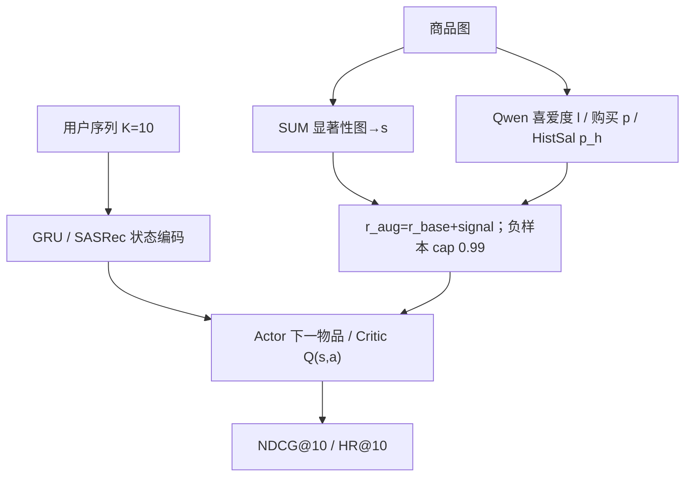
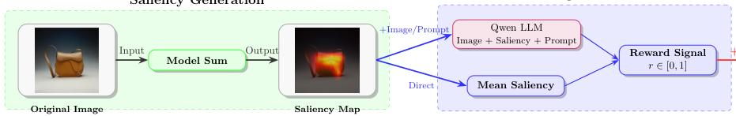

# ViSalRec: Visual and Saliency-Informed Reward Augmentation for Sequential Recommender Systems (视觉与显著性引导的序列推荐奖励增强)

- **会议/期刊**: CIKM 2026
- **作者与机构**: Georgios Koutroumpas, Jie Wang, Sergi Abadal, Joemon M. Jose, Ioannis Arapakis；Telefónica Scientific Research、UPC、University of Glasgow
- **推荐链路定位**: 精排/序列决策（Next-Item）
- **研究方向**: 强化学习与动态探索推荐 / 多模态推荐
- **论文原文**: [论文原文链接](https://eprints.gla.ac.uk/392722/2/392722.pdf)
- **开源代码**: [论文声明开源](https://tinyurl.com/ms27tuxw)

## TL;DR (1分钟核心速览)

针对离线 RL 序列推荐仅用稀疏二元奖励、信用分配弱的问题，ViSalRec 将商品图、合成显著性图与 Qwen 多模态判断转成稠密奖励注入 SA2C。Amazon Inclusive+MaxLimit 上 GRU+HistSal-1 的 NDCG@10/HR@10 相对提升 27.0%/30.4%，但收益依赖数据密度与 Q 值式训练。

## Background & Motivation (背景与核心矛盾)

- **主流范式**: 离线 RL 序列推荐把点击/购买日志转成二元奖励，在 SA2C 类 actor–critic 中联合下一物品监督与 Q-learning 优化长期回报。
- **前人局限**: 二元奖励只说明“是否交互”，无法解释“为何偏好”；视觉推荐虽用图像/显著性做特征，却很少把它变成奖励监督。
- **核心洞察**: 商品视觉注意力与语义印象是比点击更稠密的偏好代理，但纯显著性只是“平均注意力”，不等于个性化偏好，需与 LLM 语义判断和历史上下文结合。
- **本文切入点**: 不改主干架构，只做奖励塑形：用显著性、LLM 喜爱度、购买概率与历史显著性构造可插拔奖励层。

## Method (核心方法设计)

### 1. 整体框架 (Overall Architecture)

输入用户最近 $K=10$个交互，GRU 或 SASRec 编码状态$s_t$；actor 预测下一物品，critic 估计$Q(s_t,a_t)$。离线阶段用 SUM 为商品图生成显著性图并取均值$s$，用 Qwen 生成喜爱度$l$、购买概率$p$、历史显著性购买概率$p_h$，按$r_{\text{aug}}=r_{\text{base}}+\text{signal}$生成奖励，负样本封顶$0.99$。随后在 SA2C 的监督+Double DQN 目标中训练，推理仍只走原推荐网络。

<figure class="paper-figure" markdown="span">
  <figcaption>图1：增强奖励生成流程</figcaption>
</figure>
图1：ViSalRec 的视觉奖励生成与 SA2C 注入流程。

### 2. 关键设计拆解 (Key Designs)

1. **显著性均值奖励（Saliency）**：痛点是二元奖励无视觉密度；SUM 输出像素注意力图 $M$，取$s=\frac{1}{HW}\sum_{i=1}^{H}\sum_{j=1}^{W}M_{i,j}$，令$r=r_{\text{base}}+s$。直觉是给视觉显著物品更高奖励质量，但实验显示单独使用在 SASRec 上会反噬。
2. **LLM 语义奖励（Likeability / Purchase / HistSal）**：痛点是显著性不懂语义与用户历史；Qwen 以图、标题、显著性图（及历史）为输入输出 $l,p,p_h\in[0,1]$，奖励为$r=r_{\text{base}}+l$或$r_{\text{base}}+p_h$。HistSal 额外拼接前序物品显著性，捕捉注意力时序变化，因而比原始 saliency 更稳。
3. **奖励整合与训练目标**：负样本若 $r_{\text{base}}=0$，增强后封顶$0.99$，避免被优势函数误判为正样本。Base 用$A(s,a)=Q(s,a)-\bar{Q}$；ZeroNeg 强制$r_{\text{neg}}=0$；DirectReward/GRPO-Like 直接用$r$或$r-\bar{r}$做优势。总损失为$\mathcal{L}_{\text{SA2C}}=\mathcal{L}_{s}\cdot A(s,a)+L_q$，LLM 奖励离线逐 tuple 预计算，在线无额外推理。

## Experimental Setup & Evaluation Protocol (实验设置与评估协议)

- **数据集与预处理**: Amazon Review 构造四个变体；过滤交互少于 5 的用户，保持时间顺序；Strict 仅保留有图物品，Inclusive 无图物品信号置 0。

| 数据集 | #Users | #Items | #Interactions | 稀疏度/密度 | 特征/场景说明 |
| :--- | :---: | :---: | :---: | :---: | :--- |
| Strict Max Limit | 12,658 | 26,745 | 106,881 | 0.9996 / 0.0004 | 保留有图物品，每用户最近 5–10 交互 |
| Inclusive Max Limit | 14,652 | 33,326 | 124,772 | 0.9997 / 0.0003 | 无图物品信号为 0，主实验设置 |
| Strict Item Percent | 6,076 | 1,439 | 30,380 | 0.9965 / 0.0035 | 热门 10% 物品，每用户最后 5 交互 |
| Inclusive Item Percent | 6,388 | 1,648 | 31,940 | 0.9969 / 0.0031 | 热门子集，密度更高但基线更弱 |

- **数据划分与防穿越**: 按用户时间序 `Leave-Last-Two-Out`：倒数第二交互作验证，最后交互作测试，训练仅用更早序列。
- **排名评测协议**: 原文未显式说明候选集是 `Full-Ranking` 还是采样排序，按 SA2C 标准 next-item 协议报告 Acc/NDCG@10/HR@10；训练时每个正样本均匀采 1 个未交互负样本，正负 1:1；评估取两个随机种子模型预测平均。
- **对比基线与超参设置**: 无外部 SOTA，基线为 SA2C 二元奖励；$d=64$、dropout 0.2、$\gamma=0.5$、lr$2\times10^{-3}$、batch 128、60 epochs；配对 t 检验 + Bonferroni 校正，$\alpha=0.05/3$。

## Key Experimental Results (实验关键数据)

### 1. 主实验对比 (Main Results)

表为原文主表（Inclusive+MaxLimit）。**加粗为同列最优**；`Δ%` 为相对同架构 Binary 的最佳提升。

| 奖励类型 | GRU NDCG@10 | GRU HR@10 | SASREC NDCG@10 | SASREC HR@10 | 相对 Binary 最佳 Δ% |
| :--- | :---: | :---: | :---: | :---: | :--- |
| Binary | 0.2417 | 0.2889 | 0.2884 | 0.3539 | — |
| Saliency | 0.2723 | 0.3241 | 0.2339 | 0.2982 | GRU +12.6/+12.2；SAS -18.9/-15.7 |
| LLM Likeability | **0.3040** | **0.3678** | 0.3067 | 0.3685 | GRU +25.8/+27.3；SAS +6.4/+4.1 |
| Purchase | 0.2875 | 0.3612 | **0.3270** | 0.3652 | GRU +18.9/+25.0；SAS +13.4/+3.2 |
| HistSal-1 | **0.3070** | **0.3768** | 0.2927 | 0.3465 | GRU +27.0/+30.4；SAS +1.5/-2.1 |
| HistSal-2 | 0.3021 | 0.3705 | 0.3264 | 0.3676 | GRU +25.0/+28.2；SAS +13.2/+3.9 |
| HistSal-3 | 0.2957 | 0.3712 | 0.3254 | **0.3729** | GRU +22.3/+28.5；SAS +12.8/+5.4 |

注：论文没有与外部 SOTA 推荐模型对比，主表本质是“Binary vs. 7 种奖励变体”的受控实验；Acc 上 GRU 最佳为 HistSal-1 0.2379，SASREC 最佳为 HistSal-2 0.2837。

### 2. 消融实验 (Ablation Study)

训练变体消融（各类取最佳增强奖励；`Δ%` 相对同变体 Binary）：

| 训练变体 | SASREC 最佳 NDCG@10 (Δ%) | SASREC 最佳 HR@10 (Δ%) | GRU 最佳 NDCG@10 (Δ%) | GRU 最佳 HR@10 (Δ%) |
| :--- | :---: | :---: | :---: | :---: |
| Base | 0.3270 (+13.38) | 0.3729 (+5.38) | 0.3070 (+27.02) | 0.3768 (+30.43) |
| ZeroNeg | 0.3260 (+13.02) | 0.3765 (+6.39) | 0.3070 (+27.01) | 0.3815 (+32.04) |
| DirectReward | 0.3516 (+0.83) | 0.3983 (+0.55) | 0.3401 (-3.20) | 0.3937 (+1.51) |
| GRPO-Like | **0.3545 (+0.71)** | **0.3998 (+0.18)** | **0.3608 (+2.89)** | **0.3997 (+2.97)** |

### 3. 关键实验发现 (Key Findings)

1. **奖励类型比“有没有视觉”更关键**：GRU 上 HistSal-1 达 NDCG +27.0%/HR +30.4%，LLM Likeability 也稳定 +25.8%/+27.3%；而 SASREC 上纯 Saliency 反而 -18.9%/-15.7%，说明原始显著性噪声大，LLM 语义中介更可靠。
2. **密度与物品复现率决定收益**：Inclusive+MaxLimit 密度仅 0.0003，平均提升约 13.9%/13.7%；Item Percent 密度 0.0031–0.0035，NDCG 提升 68.98%–171.89%，但基线极弱导致百分比失真；Inclusive+MaxLimit 的成功率 87.5%，高于 Strict+MaxLimit 的 50%。
3. **Q 值式整合优于奖励直连**：GRU 上 ZeroNeg+HistSal-3 将 NDCG 从 0.2417 提至 0.3070（+27.0%）、HR 从 0.2889 提至 0.3815（+32.0%）；DirectReward/GRPO-Like 虽绝对分数高，但相对增益仅 0.2%–2.9%，且对奖励尺度更敏感。

## Highlights & Limitations (亮点、对比与审稿批判)

- **与代表作对比 (vs. Prior Work)**: 相比 SA2C 只改奖励，不改 actor–critic 主干；相比图像推荐把视觉当特征，本文将视觉/显著性当“奖励监督”；相比眼动研究依赖硬件，本文用 SUM 合成显著性实现可扩展代理。
- **可迁移亮点**: 负样本奖励封顶 $0.99$ 的“防假阳性”技巧；LLM 奖励离线预计算、在线零开销的工程拆分；按密度/物品复现率分层报告成功率，比单看均值更可信。
- **审稿级局限批判**: 缺少外部 SOTA 与线上 A/B；候选排序协议未明确全库/采样；HistSal 需至少 3 条历史且逐 tuple LLM 推理成本高；显著性与 LLM 判断均为域相关代理，跨域有效性仍需验证。

## Rating (四维评分)

- **方法创新性 (Novelty)**: ⭐⭐⭐ （将视觉显著性与 LLM 判断做奖励塑形有新意，但本质是信号工程，理论支撑有限）
- **评估协议与实验扎实度 (Protocol & Experiments)**: ⭐⭐⭐ （四种数据变体、配对 t 检验与 Bonferroni 校正较扎实，但缺外部基线与明确候选协议）
- **写作与数学规范度 (Clarity & Rigor)**: ⭐⭐⭐ （流程与公式简洁清晰，但训练变体过多、表格密集，阅读负担偏重）
- **工业落地与复现价值 (Industrial & Practical Value)**: ⭐⭐ （离线预计算思路可落地，但逐 tuple LLM 成本与历史显著性开销限制大规模部署）

