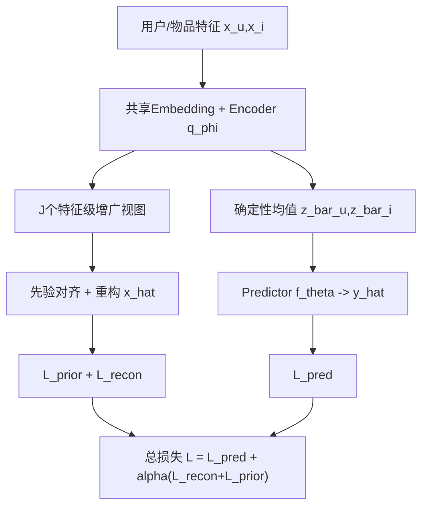
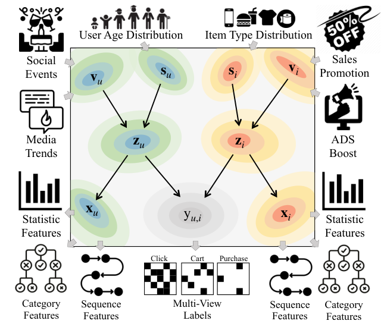

# A Probabilistic Framework for Temporal Distribution Generalization in Industry-Scale Recommender Systems (工业级推荐系统中时间分布泛化的概率框架)

- **会议/期刊**: CIKM 2026
- **作者与机构**: Yuxuan Zhu, Cong Fu, Yabo Ni, Anxiang Zeng, Yuan Fang；Shopee / NTU / SMU
- **推荐链路定位**: 粗排 / 精排
- **研究方向**: 自监督对比学习与交互去噪 / CTR/CVR 预估与特征交叉
- **论文原文**: [https://arxiv.org/abs/2511.21032v1](https://arxiv.org/abs/2511.21032v1)
- **开源代码**: [https://github.com/FuCongResearchSquad/ELBO4TDS](https://github.com/FuCongResearchSquad/ELBO4TDS)

## TL;DR (1分钟核心速览)

针对工业推荐周期性增量训练难以兼顾稳定偏好与短期漂移，本文提出 ELBO_TDS：用因果图分离稳定因子 $s$与时变因子$v$，以特征级增广扩展时变支撑，并推导含重构/先验/预测项的自监督变分目标，避免 InfoNCE 表征坍缩。Shopee-Small/KuaiRand-1K 时序切分上 AUC/GAUC 全面领先，线上 GMV/User +2.33%。

## Background & Motivation (背景与核心矛盾)

- **主流范式**: 工业系统以 ERM + 按小时/天增量训练适配新数据，隐式假设历史与未来同分布。
- **前人局限**: 不变学习需人为划分时间环境并反复回灌历史数据，存储/训练开销大，且在 Shopee-Small 上反而低于 ERM；InfoNCE 类 SSL 虽能扩增训练分布，却把同语义样本强行拉近，易压制用户/物品的个性化细节。
- **核心洞察 (Key Insight)**: 对 Shopee 统计、序列、类别特征的 CV/JSD 分析发现，短期波动显著但有界，且不随时间持续累积，作者据此提出“稳定-漂移分布假设”：$s$稳定、$v$ 短时波动。
- **本文切入点**: 用因果图显式建模 $s,v\to z\to x,y$，以增广近似$v$的反事实取值，再用 ELBO 保留$s$ 与个体信息。

## Method (核心方法设计)

### 1. 整体框架 (Overall Architecture)

模型在共享 Embedding 后分别接用户/物品 Encoder，输出高斯后验 $q_\phi(z_u\mid x_u)$、$q_\phi(z_i\mid x_i)$；每个样本在线生成$J$个特征级增广视图。先验项把各视图隐变量拉向均值表征，重构项由 Decoder 还原$x_u,x_i$，预测项仅用真实样本的确定性均值$\bar{z}_u,\bar{z}_i$ 做多任务排序。训练时联合优化预测、重构与先验损失，推理时只走确定性均值路径，不增加线上延迟。

<figure class="paper-figure" markdown="span">
  <figcaption>图1：时间分布偏移视角下表示数据生成过程的因果图。下标 𝑢 和 𝑖 分别表示用户特定变量和物品特定变量。v 表示随时间变化的因素，s 表示相对稳定的因素，z 表示潜变量（表示），x 表示观测样本，y 表示标签。黑色箭头表示因果依赖方向。</figcaption>
</figure>

### 2. 关键设计拆解 (Key Designs)

1. **因果图与 ELBO_TDS 目标**：针对 ERM 把 $v\to z\to x$的时变噪声也拟合进模型，本文从$p_\theta(x_u,x_i,y_{u,i}\mid s_u,s_i)$ 推导下界：
   $\mathcal{L}_{ELBO}=\mathbb{E}_{q_\phi}[\log p_\theta(x_u\mid z_u)+\log p_\theta(x_i\mid z_i)+\log p_\theta(y_{u,i}\mid z_u,z_i)+\log p(z_u\mid s_u)+\log p(z_i\mid s_i)-\log q_\phi(z_u\mid x_u)-\log q_\phi(z_i\mid x_i)]$。
   其中重构项保留个体细节，先验项对齐增广视图，预测项对齐标签；固定单位方差后熵项为常数可消去。这样比 InfoNCE 多了一个显式的“保个体”约束，避免只保留簇级语义。
2. **特征类型定制增广**：统计特征先分桶，再在桶索引上加有界扰动 $B_i'=\min(\max(B_i+\epsilon,0),B_{\max}),\epsilon\sim U\{-r,r\}$；序列特征做$m\sim \mathrm{Bern}(p_{seq})$随机掩码；类别特征做 embedding dropout$p_{cate}$；并对每个样本只扰动随机子集，防止增广越出真实时序支撑。该设计对应第 3.1 节观察到的“有界波动”。
3. **训练目标、负采样与推理效率**：总损失为 $\min \mathbb{E}_{p_{train}}[\mathcal{L}_{pred}]+\alpha\mathbb{E}_{p_{\mathcal{T}\mid s,v}}[\mathcal{L}_{recon}+\mathcal{L}_{prior}]$，其中$\mathcal{L}_{prior}=\mathrm{MSE}(z_u,\bar{z}_u)+\mathrm{MSE}(z_i,\bar{z}_i)$，$\mathcal{L}_{recon}=\mathrm{MSE}(\hat{x}_u,x_u)+\mathrm{MSE}(\hat{x}_i,x_i)$。本任务为 CTR 多任务排序，不做负采样；$J$ 个视图在 batch 内在线生成，无需缓存历史多时间窗，推理仍用双塔/单塔确定性前向。

## Experimental Setup & Evaluation Protocol (实验设置与评估协议)

- **数据集与预处理**:

| 数据集 | #Users | #Items | #Interactions | 稀疏度/密度 | 特征/场景说明 |
| :--- | :---: | :---: | :---: | :---: | :--- |
| KuaiRand-1K | 1K | 2.4M | 6.7M | ≈0.28% | 30 类别用户特征；63 物品特征；短视频 is_like/is_follow |
| Shopee-Small | 6.1M | 56M | 0.82B | 极稀疏 | 101 用户/105 物品特征；点击/加购/购买；电商搜索 |
| Shopee-Main | / | / | 29.8B | 极稀疏 | 40 天东南亚多区域；工业级私有集 |

- **数据划分与防穿越 (Splitting Strategy)**: Shopee 用最后一天测试、倒数第二天验证、其余训练；KuaiRand-1K 按时间等分 10 段，最后一段测试、倒数第二段验证。未来 $T+1$ 数据在训练时不可见，属于严格时序切分。
- **排名评测协议 (Ranking Protocol)**: 全量曝光样本评估，非采样负例；离线用 pointwise AUC 与 listwise GAUC，线上用 GMV/User 与人工评估。
- **对比基线与超参设置**: 双塔 MLP 为统一骨干；对比 ERM、Direct Aug、IRM、V-REx、RVP、DINO4Rec、SSL4Rec、SSL4Rec*。KuaiRand 单任务 $\alpha=5.0$、多任务$\alpha=10.0$；Shopee$\alpha=0.001$；$p=0.2,r=2,p_{seq}=0.2,p_{cate}=0.2,J=4$；lr 为 3e-4/5e-4。

## Key Experimental Results (实验关键数据)

### 1. 主实验对比 (Main Results)

Shopee-Small 多任务 listwise 排序（MLP 骨干，CE+ListNet；ATC=Add to Cart）：

| 模型 | Click AUC | Click GAUC | ATC AUC | ATC GAUC | Purchase AUC | Purchase GAUC |
| :--- | :---: | :---: | :---: | :---: | :---: | :---: |
| ERM | 0.7977 | 0.7910 | 0.8494 | 0.7966 | 0.8920 | 0.8228 |
| Aug | 0.7982 | 0.7905 | 0.8497 | 0.7979 | 0.8917 | 0.8249 |
| IRM | 0.7775 | 0.7715 | 0.8094 | 0.7624 | 0.8421 | 0.7831 |
| V-REx | 0.7827 | 0.7764 | 0.8155 | 0.7708 | 0.8446 | 0.7898 |
| RVP | 0.7821 | 0.7756 | 0.8134 | 0.7676 | 0.8419 | 0.7838 |
| DINO4Rec | 0.7996 | 0.7914 | 0.8475 | 0.7961 | 0.8904 | 0.8218 |
| SSL4Rec* | 0.8012 | 0.7941 | 0.8490 | 0.7985 | 0.8894 | 0.8228 |
| **ELBO_TDS** | **0.8042** | **0.7976** | **0.8528** | **0.8037** | **0.8934** | **0.8297** |
| **Improv. vs ERM** | **+0.82%** | **+0.83%** | **+0.40%** | **+0.89%** | **+0.16%** | **+0.84%** |

### 2. 消融实验 (Ablation Study)

Shopee-Small 上仅保留单一特征类型增广：

| 变体 | Click AUC | Click GAUC | ATC AUC | Purchase GAUC |
| :--- | :---: | :---: | :---: | :---: |
| 完整 ELBO_TDS | **0.8042** | **0.7976** | **0.8528** | **0.8297** |
| 仅统计增广 | 0.8040 | 0.7974 | 0.8511 | 0.8294 |
| 仅序列增广 | 0.8036 | 0.7967 | 0.8520 | 0.8295 |
| 仅类别增广 | 0.8020 | 0.7957 | 0.8510 | 0.8285 |

### 3. 关键实验发现 (Key Findings)

1. **主指标全面领先，且稀疏目标更明显**：ELBO_TDS 相比 ERM，Click AUC +0.65pp、Purchase GAUC +0.69pp；相比最强 SSL4Rec*，Purchase AUC 0.8934 vs 0.8894，说明重构项在稀疏购买样本上保住了稀有正例的个体信号。
2. **InfoNCE 的“密集提升、稀疏受损”被复现**：SSL4Rec* 在 Click AUC 上 0.8012 > ERM 0.7977，但 Purchase AUC 0.8894 < ERM 0.8920；ELBO_TDS 则同时做到 Click 0.8042、Purchase 0.8934，验证第 3.4 节关于表征坍缩的诊断。
3. **增广有效但非简单相加**：仅统计增广 Click AUC 0.8040、仅类别 0.8020，完整 0.8042，统计特征贡献最大；线上部署粗排单独 +0.6% GMV/User、精排单独 +2%，两阶段同时上线略低于直接相加但仍获 +2.33% GMV/User 与 +0.2% 人工评估提升。

## Highlights & Limitations (亮点、对比与审稿批判)

- **与代表作对比 (vs. Prior Work)**: IRM/V-REx/RVP 依赖时间环境划分与历史数据回灌，在 Shopee 上显著低于 ERM；SSL4Rec 仅在物品侧用 InfoNCE，密集目标有效但稀疏目标退化；DINO4Rec 用自蒸馏，长期增量下优势不稳。本文用生成式 ELBO + 重构项替代对比式约束，核心差异是“保个体”而非只“保语义一致”。
- **可迁移亮点**: 特征类型定制增广可直接迁移到任意 CTR/排序模型；重构项可作为防 SSL 表征坍缩的轻量正则；在线生成 $J$ 视图避免历史缓存，适合工业增量管线。
- **审稿级局限批判**: 公开可复现实验仅 KuaiRand-1K，Shopee 数据私有；$\alpha,p$对数据规模敏感（KuaiRand 需大$\alpha$、Shopee 需小$\alpha$）；高斯单位方差与因果图仍是假设，缺少泛化界；训练时$J$ 视图带来额外算力开销。

## Rating (四维评分)

- **方法创新性 (Novelty)**: ⭐⭐⭐⭐ （因果图 + ELBO_TDS 将 TDS 转为稳定/时变因子分解，并给出 InfoNCE 坍缩命题，机制清晰）
- **评估协议与实验扎实度 (Protocol & Experiments)**: ⭐⭐⭐⭐ （离线双数据集 + 在线 A/B，时序切分严格；但公开数据仅一个，统计显著性报告有限）
- **写作与数学规范度 (Clarity & Rigor)**: ⭐⭐⭐⭐ （ELBO 推导完整、假设明确；部分符号与熵项消去细节依赖附录）
- **工业落地与复现价值 (Industrial & Practical Value)**: ⭐⭐⭐⭐⭐ （Shopee 粗排/精排已部署，GMV/User +2.33%，代码与 Shopee-Small 子集开源）

