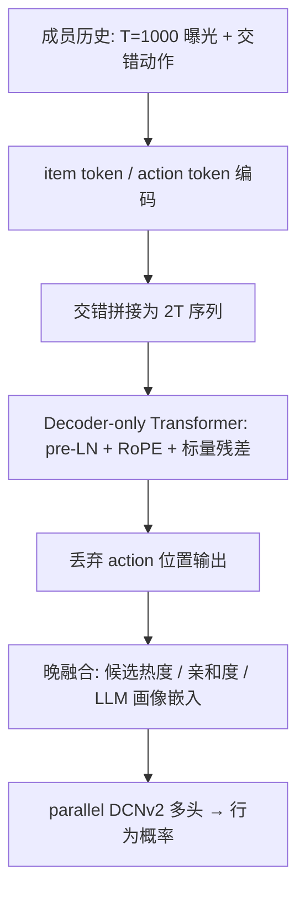
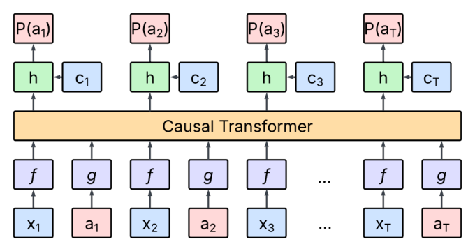

# An Industrial-Scale Sequential Recommender for LinkedIn Feed Ranking (面向 LinkedIn Feed 排序的工业级序列推荐器)

- **会议/期刊**: CIKM 2026
- **作者与机构**: Lars Hertel, Gaurav Srivastava, Syed Ali Naqvi 等，LinkedIn（Mountain View）
- **推荐链路定位**: 精排（Ranking）
- **研究方向**: 序列与会话推荐 / 工业级架构与系统
- **论文原文**: [https://arxiv.org/abs/2602.12354v3](https://arxiv.org/abs/2602.12354v3)
- **开源代码**: 暂未开源

## TL;DR (1分钟核心速览)

LinkedIn Feed 原精排是 DCNv2 + 海量手工特征的纯 pointwise 模型，无法建模成员兴趣的时序演化；而 TransAct/DIN 类历史编码器在 1.2B 成员、数百毫秒延迟、数万 QPS 的约束下延迟不可接受。本文提出 Feed SR：把最近 $T=1000$条曝光与动作交错成$2T$ 长序列，用 decoder-only Transformer 编码，推理时把同一请求的约 512 个候选拼到序列尾部一次前向摊销打分；配合晚融合上下文特征、LLM 成员画像嵌入与 CPU/GPU 分离推理栈。线上 A/B（覆盖多数流量、持续 3 个月）时长 +2.10%、点赞/评论/转发 +3.52%。

## Background & Motivation (背景与核心矛盾)

- **主流范式**: 工业精排仍以 DCNv2/MMoE 类特征交叉网络为主，靠大量数值、ID、类目特征刻画用户—物品匹配；序列信号仅以统计窗口特征的形式间接进入。
- **前人局限**: ① 点式历史编码器（TransAct/BST/DIN）每个候选都要重跑一次历史编码，长序列下训练与推理开销线性膨胀；② LLM-Ranker 把每个 post 文本化成数百 token，1000 条历史即数万 token，且数值特征与"网络关系强度"难以用文本表达，线上始终未能超越生产模型。
- **核心洞察 (Key Insight)**: 若把**序列本身作为建模中心**，每个 post 只需 2 个 token（item + action），历史编码可在数百个候选间**摊销**，边际成本从 $O(N\cdot T)$降到$O(T+N)$；而难以序列化的热度/亲和度特征则不必进 Transformer，放到后面融合即可。
- **本文切入点**: 模型与系统协同设计（system–model co-design），在保留工业特征栈的前提下引入序列建模。

## Method (核心方法设计)

### 1. 整体框架 (Overall Architecture)

输入是成员最近 $T=1000$条曝光及其交错动作：每个 post 经$J$个特征专属变换（embedding lookup / log / identity）压成 1 个 item token，$M$维多热动作向量经线性投影压成 1 个 action token，拼成$2T$长序列送入 decoder-only Transformer（pre-LN、RoPE、可学习标量残差）。输出丢弃 action 位置后得到$T$个 post 表示，与晚融合的上下文特征拼接，经 parallel DCNv2 多头输出 Long Dwell / Contribution 等行为概率。训练在全部序列位置施加 BCE；推理时把同一请求的$N\approx512$ 个候选一次性追加到序列尾，用自定义注意力 mask 单次前向完成打分。

<figure class="paper-figure" markdown="span">
  <figcaption>图1：Feed SR 模型架构。</figcaption>
</figure>

### 2. 关键设计拆解 (Key Designs)

1. **交错序列与候选摊销打分（Amortized Multi-Item Scoring）**：痛点是一次前向只服务一个候选，长历史下 QPS 撑不住。本文把历史与动作交错为
$$X_{in}=[X_1,A_1,X_2,A_2,\dots,X_T,A_T]$$
推理时把 $N$ 个候选 token 追加其后，仅用一条"上下文因果 + 候选只看全上下文与自身"的 mask 完成一次前向。直觉：历史编码与候选无关，天然可复用，故历史越长摊销收益越大（实测 Transformer 部分约 80× 加速）。
2. **晚融合与 LLM 成员画像嵌入**：痛点在于 item 热度、viewer–author 亲和度等数值信号的历史模式很弱，且在线逐条存储代价高。本文将这类特征从 Transformer 输入中移出，改为在输出端拼接 $Z'=[Z_T;X_{ctx}]$。实验显示把 1/3 晚融合特征改回早融合仅 +0.04% AUC，却让单步训练时间 +12%；但热度特征（候选热度贡献 +2.5% AUC）与成员间亲和度（移除 −0.3% AUC）无法被序列替代。另外用微调的 Qwen3-0.6B 聚合成员画像得到稠密向量、每日刷新，对历史 <10 条动作的成员带来 >2% AUC 提升。
3. **训练稳定性、会话内泄漏与目标函数**：缺少 pre-LN 时 AUC 直接崩到 0.5；作者改用 $u+\alpha v$（$\alpha$ 可学习、初始化为 1）的标量残差，兼顾稳定与精度。会话内多条曝光的长停留标签高度相关，训练时可"偷看"同会话后续标签，造成 train–serve 偏斜，最终采用**会话内随机打乱**（比同会话 attention mask 更快且效果等价）。损失为全序列位置的多任务 BCE
$$\mathcal{L}=-\sum_{t=1}^{T}\sum_{m=1}^{M}\left[y_{t,m}\log\hat{y}_{t,m}+(1-y_{t,m})\log(1-\hat{y}_{t,m})\right]$$
负采样策略为"无点击曝光以 0.1 概率保留"；冷启动用 3 周数据在全历史上算 loss，之后每日增量训练只在新到达交互上算 loss，但输入仍是完整历史。推理无负采样开销，成本主要来自长度 1000 的 KV 与 512 候选的批量前向。

## Experimental Setup & Evaluation Protocol (实验设置与评估协议)

- **数据集与预处理**: 全部为 LinkedIn 内部生产日志，无公开基准。

| 数据/场景 | 规模 | 序列构造 | 训练/评估 |
| :--- | :---: | :--- | :--- |
| LinkedIn Feed 曝光日志 | 1.2B+ 成员、约 1 年数据 | 最近 $T=1000$ 条曝光，post/action 交错 | 冷启 3 周 + 每日增量 |
| 稀疏成员分桶 | 历史动作 <10 条 | 同上（多为空/极短序列） | 单独报告 AUC 增益 |

- **数据划分与防穿越 (Splitting Strategy)**: 全局时间戳切分——按天生成历史、次日交互作为增量训练与评估样本；训练序列构造时对会话内 item 随机打乱以消除标签穿越。
- **排名评测协议 (Ranking Protocol)**: 生产曝光级 pointwise 多目标 AUC（Long Dwell AUC、Contributions AUC），**非**全库 Full-Ranking；作者特别强调训练时负样本下采样、**离线评估必须用全量评估集**，否则 AUC 被虚高且与线上指标脱钩。最终以线上 A/B 为准。
- **对比基线与超参设置**: 基线含生产 DCNv2、TransAct/BST/DIN 增强版、LLM-Ranker、HSTU block 替换及各类 head/位置编码变体；全局 batch size 1024，AdamW，冷启用 OneCycleLR（16×H200），增量用 8×H200；序列长度扫描 $\{32,\dots,1024\}$、层数$\{1,4,8,12\}$、ID embedding 维$\{16,32,64\}$。

## Key Experimental Results (实验关键数据)

### 1. 主实验对比 (Main Results)

线上 A/B（相对生产 DCNv2，未含增量训练）：

| 模型 / 人群 | Time spent | Like/Comment/Share |
| :--- | :---: | :---: |
| Production DCNv2 (baseline) | – | – |
| **Feed SR（整体）** | **+2.10%** | **+3.52%** |
| Feed SR — DAU | +2.38% | +4.07% |
| Feed SR — WAU | +1.84% | +3.40% |
| Feed SR — MAU | +0.82% | +1.86% |
| Feed SR — 新成员 | NSS | NSS |

替代架构与消融（离线相对 AUC 变化，$\Delta\%$）：

| 变体 | Long Dwell AUC | Contributions AUC | 结论 |
| :--- | :---: | :---: | :--- |
| **Feed SR（完整）** | **baseline** | **baseline** | 线上显著为正 |
| 替换为 HSTU block | −0.23% | −0.28% | 同算力下更差 |
| TransAct / BST / DIN 增强 | 离线↑ | 离线↑ | 训练与推理延迟大增 |
| LLM-Ranker（文本化） | 早期离线尚可 | – | 线上未超越生产 |
| Head → Linear | −1.20% | −0.48% | 必须有非线性组合 |
| RoPE → 无可学习位置编码 | −0.91% | −0.48% | 位置信息关键 |

### 2. 消融实验 (Ablation Study)

| 组件替换 | Long Dwell AUC | Contributions AUC |
| :--- | :---: | :---: |
| RoPE → learned absolute PE | −0.19% | −0.16% |
| DCNv2-parallel → MLP | −0.13% | −0.08% |
| DCNv2-parallel → DCNv2-stacked | −0.27% | −0.19% |
| DCNv2-parallel → MMoE | −0.16% | −0.12% |
| Softmax → Sigmoid | −0.15% | −0.12% |
| Softmax → SiLU | −0.09% | −0.05% |
| 标量残差 → ReZero | −0.09% | −0.08% |
| Late fusion → Early fusion | +0.04% | +0.01%（但 step time +12%） |

### 3. 关键实验发现 (Key Findings)

1. **算力应联合扩展，序列长度是主驱动**：训练 FLOPs 从 $10^{17}$到$10^{19}$，每提升一个数量级 Long Dwell AUC 稳定 +0.0093；单独加层数或 embedding 维只增容量不增信息，只有加长序列同时增加样本数与单样本信号。
2. **Softmax 注意力在本场景反超 Sigmoid（−0.15%）与 HSTU block（−0.23%）**，与 HSTU 原文结论相反，说明工业特征栈与注意力算子的匹配比架构本身更决定成败。
3. **序列不能替代全部特征**：特征数削减约 80% 后 AUC 不降，但候选热度（+2.5%）与成员亲和度（−0.3%）必须保留；晚融合几乎无损（+0.04%）却省 12% 训练时间，是"性能—成本"最优折中。

## Highlights & Limitations (亮点、对比与审稿批判)

- **与代表作对比**: 相较 TransAct/BST 的"点式打分 + 历史编码"，Feed SR 以序列为中心，用多候选摊销把长历史从成本项变为可负担项；相较 HSTU/GRM，它不强求端到端生成，而是保留工业特征栈并晚融合，工程可落地性更强；相较 LLM-Ranker，每 post 仅 2 token（vs 数百 token），且 ID embedding 能表达 LLM 难以文本化的网络关系强度。
- **可迁移亮点**: ① 会话内随机打乱消除同会话标签穿越，成本远低于数据依赖 mask；② shared-context batching + 双标量参数（`context_length`/`candidate_length`）编码注意力掩码，避免物化 $O((L+N)^2)$ mask，可复用于任何"一历史多候选"打分场景；③ Arrow 零拷贝 + CPU/GPU 分离推理，历史解析 450ms→2ms（225×）。
- **审稿级局限批判**: ① 无公开数据集、无开源代码，离线指标是生产曝光级 AUC 而非全库排序，结论不可复现；② 新成员线上指标 NSS，LLM 画像嵌入带来的 >2% AUC 冷启收益尚未转化为线上价值；③ LLM-Ranker/TransAct 仅给出定性描述，缺少数值对比，削弱了"架构选型"论证的严谨性；④ 长度 1000 序列 × 512 候选的显存与尾延迟未给出 P99 分布。

## Rating (四维评分)

- **方法创新性 (Novelty)**: ⭐⭐⭐ （架构本身沿用 HSTU 式交错序列与多候选摊销，创新主要在晚融合、会话内打乱等工程化改造）
- **评估协议与实验扎实度 (Protocol & Experiments)**: ⭐⭐⭐⭐ （3 个月多数流量线上 A/B + 分人群拆解 + 完整架构消融，但缺公开基准与替代方案定量对比）
- **写作与数学规范度 (Clarity & Rigor)**: ⭐⭐⭐⭐ （公式精简、每处设计均附 AUC 与耗时代价，系统章节数据详实；理论分析较少）
- **工业落地与复现价值 (Industrial & Practical Value)**: ⭐⭐⭐⭐⭐ （1.2B 成员全量部署、训练能耗 0.2×、推理能耗 0.7×，SRMIS 与零拷贝等经验可直接迁移）

