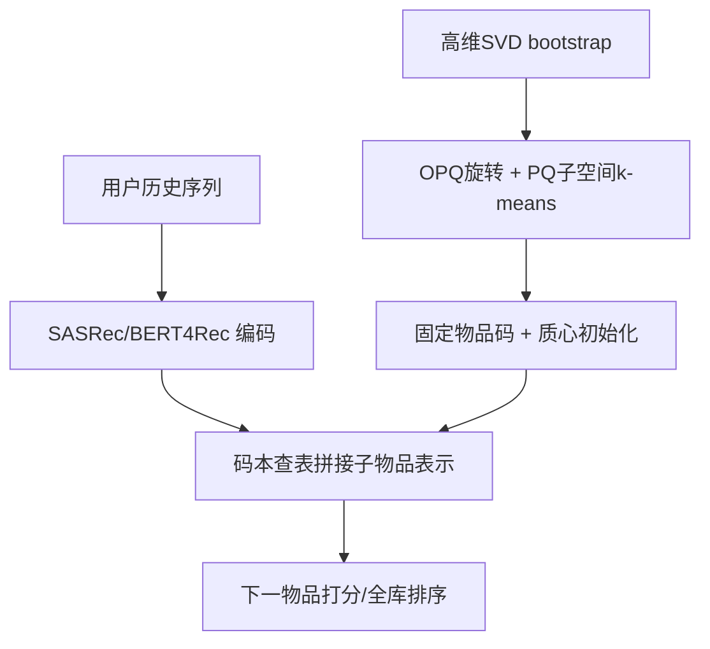
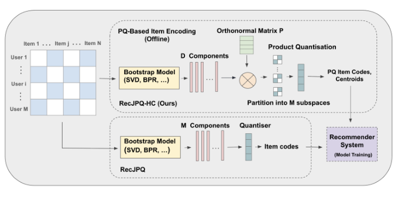

# Higher Capacity Transfer into JPQ Item Codes for Scalable Sequential Recommendation (面向可扩展序列推荐的高容量 JPQ 物品码迁移)

- **会议/期刊**: CIKM 2026
- **作者与机构**: Sharare Zolghadr, Richard Mccreadie, Craig Macdonald；University of Glasgow
- **推荐链路定位**: 召回/排序（序列下一物品预测）
- **研究方向**: 序列与会话推荐 / 协同过滤与嵌入量化
- **论文原文**: [论文原文链接](https://eprints.gla.ac.uk/392429/2/392429.pdf)
- **开源代码**: [开源代码仓库链接](https://github.com/shararezr/RecJPQ-HC)

## TL;DR (1分钟核心速览)

针对 RecJPQ 将 bootstrap 维度强绑为码长 \(M\)、再逐维分桶造成的信息瓶颈，本文提出 RecJPQ-HC：先用 \(d=M\cdot d_{\text{sub}}\) 高维 SVD 保留协同结构，再用 PQ 压缩为固定 \(M\) 个码并初始化 JPQ 码本。在四个数据集、SASRec/BERT4Rec 的 leave-last-out 全库 nDCG@10 上较 RecJPQ 显著提升，原文报告平均相对提升约 30%，且仅用协同信号。

## Background & Motivation (背景与核心矛盾)

- **主流范式**: SASRec/BERT4Rec 等 Transformer 序列推荐依赖 \(N\times d\) 物品嵌入表；大规模目录下内存与梯度开销高。RecJPQ 用低秩 SVD + 离散码替代大表，显著压缩内存。
- **前人局限**: 原 RecJPQ 将 bootstrap 维度 \(r\) 固定为码长 \(M\)，高维协同结构在建码前已被截断；随后对每个维度独立做分位数分桶，量化误差大且未利用子空间几何。
- **核心洞察 (Key Insight)**: 物品码质量取决于“连续 bootstrap 表示 → 固定预算离散码”的容量传递效率；更高维 bootstrap + 子空间 PQ 可在相同码预算下保留更多邻域结构。
- **本文切入点**: 将码构造重述为容量传递问题，用高维 SVD 表征与 PQ \(k\)-means 质心同时完成物品码分配和 JPQ 码本初始化。

## Method (核心方法设计)

### 1. 整体框架 (Overall Architecture)

输入用户历史序列，经 SASRec/BERT4Rec 编码为 \(\boldsymbol{h}_u\)；物品侧不再使用大嵌入表，而由 \(M\) 个子空间码本查表并拼接为子物品表示，再与 \(\boldsymbol{h}_u\) 打分。离线阶段先对交互矩阵做高维截断 SVD 得 \(\boldsymbol{q}_i\)，经 OPQ 旋转后按 PQ 分为 \(M\) 个子向量，每个子空间 \(k\)-means 学习 \(K\) 个质心并分配离散码；这些码在训练中固定，质心与 Transformer 参数联合优化。推理时仅做码本查表与内积，开销与 RecJPQ 同阶。

<figure class="paper-figure" markdown="span">
  <figcaption>图1：RecJPQ-HC 概览。将高维 bootstrap 表示（例如通过截断 SVD 获得）使用乘积量化（PQ）压缩为紧凑的离散物品编码，从而在保持相同编码预算的同时实现协同信息迁移。</figcaption>
</figure>

### 2. 关键设计拆解 (Key Designs)

1. **高维 bootstrap 解耦码长约束**：痛点在于 RecJPQ 令 \(d=M\)，SVD 截断过早丢失协同结构。本文取 \(R\approx U_d\Sigma_d V_d^\top\)，物品表示为 \(\boldsymbol{q}_i=\Sigma_d V_{d,i}^\top\in\mathbb{R}^d\)，并令 \(d=M\cdot d_{\text{sub}}\)。这样每个 PQ 子空间仍有 \(d_{\text{sub}}\) 维局部结构，量化前信息更丰富，而最终码长仍为 \(M\)。
2. **OPQ + PQ 码构造与几何感知初始化**：对 \(\boldsymbol{q}_i\) 施加正交旋转 \(P\) 得 \(\boldsymbol{q}'_i=P\boldsymbol{q}_i\)，再分子空间并取最近质心：\(z_i^{(m)}=\arg\min_k\|\boldsymbol{q}_i'^{(m)}-\boldsymbol{C}_k^{(m)}\|_2^2\)。相比逐维分位数分桶，PQ 在子空间内联合量化，能更好保持物品邻域几何；\(k\)-means 质心直接初始化 JPQ 码本，使优化从更合理的离散分区起步。
3. **训练目标、负采样与推理效率**：训练沿用 backbone 的下一物品推荐损失，可写为 \(\mathcal{L}=\mathcal{L}_{\text{rec}}(\hat{s}_{u,i^+},\{\hat{s}_{u,j^-}\})+\lambda\|\Theta\|_2^2\)；物品码 \(z_i\) 固定，码本 \(\boldsymbol{C}^{(m)}\) 与序列模型参数可训练，未引入额外负采样策略。存储由 \(O(Nd)\) 降至 \(O(NM+KMd_{\text{sub}})\)；实测训练时间接近 RecJPQ，峰值内存仅增 6.9%。

## Experimental Setup & Evaluation Protocol (实验设置与评估协议)

- **数据集与预处理**:

| 数据集 | #Users | #Items | #Interactions | 平均长度 | 稀疏度 |
| :--- | :---: | :---: | :---: | :---: | :---: |
| Beauty | 22,363 | 12,101 | 198,502 | 8.53 | 99.93% |
| Sports | 35,598 | 18,357 | 297,183 | 8.32 | 99.95% |
| Toys | 19,412 | 11,924 | 167,597 | 8.63 | 99.93% |
| ML-1M | 6,040 | 3,416 | 999,611 | 165.50 | 95.16% |

- **数据划分与防穿越**: 按时间序列构造交互序列，采用 `Leave-Last-Out`：最后一项测试、倒数第二项验证。
- **排名评测协议**: 遵循序列推荐常用 `Full-Ranking` 全库未交互物品排序，报告 nDCG@10；原文未注明采样负例比例。
- **对比基线与超参**: 对比无 JPQ 全嵌入、RecJPQ（Random/BPR/SVD bootstrap）及 VQ-Rec、TIGER、HSTU、RPG 等语义 ID 方法；SASRec 2 层 1 头、BERT4Rec 2 层 2 头；Amazon 最大序列 50、ML-1M 为 200；\(K=256\)，SASRec 默认 \(M=32,d=256\)，BERT4Rec 默认 \(M=8,d=64\)，\(d_{\text{sub}}\in\{8,16\}\)；Adam，配对 \(t\)-检验 \(p<0.05\)。

## Key Experimental Results (实验关键数据)

### 1. 主实验对比 (Main Results)

| 方法 | ML-1M | Toys | Beauty | Sports |
| :--- | :---: | :---: | :---: | :---: |
| SASRec No JPQ | .131 | .037 | .031 | .019 |
| SASRec RecJPQ-Random | .120 | .011 | .013 | .004 |
| SASRec RecJPQ-BPR | .134 | .016 | .018 | .007 |
| SASRec RecJPQ-SVD | .131 | .018 | .021 | .011 |
| SASRec RecJPQ-HC-SVD | .138 | .028 | .031 | .015 |
| BERT4Rec No JPQ | .152 | .030 | .034 | .018 |
| BERT4Rec RecJPQ-SVD | .152 | .020 | .026 | .017 |
| BERT4Rec RecJPQ-HC-SVD | **.164** | **.037** | **.039** | **.029** |

加粗为全表最优。SASRec 的 HC-SVD 相对 RecJPQ-SVD 提升（ML/Toys/Beauty/Sports）为 +5.3%/+55.6%/+47.6%/+36.4%；BERT4Rec 为 +7.9%/+85.0%/+50.0%/+70.6%。

与语义 ID SOTA 对比（nDCG@10）：Sports 上 RecJPQ-HC 达 **.0294**，高于 RPG .0263、TIGER .0225、HSTU .0215、VQ-Rec .0173；Beauty 为 .0394，低于 RPG .0464 但高于 TIGER/HSTU；Toys 为 .0371，低于 RPG/TIGER/VQ-Rec。仅用协同信号已具竞争力。

### 2. 消融实验 (Ablation Study)

SASRec 下 bootstrap 初始化与高维 PQ 消融：

| 编码/初始化 | ML-1M | Toys | Beauty | Sports |
| :--- | :---: | :---: | :---: | :---: |
| RecJPQ-Random | .120 | .011 | .013 | .004 |
| RecJPQ-BPR | .134 | .016 | .018 | .007 |
| RecJPQ-SVD | .131 | .018 | .021 | .011 |
| HC-Random | .128 | .010 | .015 | .004 |
| HC-BPR | .139 | .022 | .021 | .013 |
| HC-SVD | .138 | .028 | .031 | .015 |

### 3. 关键实验发现 (Key Findings)

1. **高维+PQ 只有在 bootstrap 有信息时才有效**：HC-Random 与 RecJPQ 接近甚至更低，而 HC-SVD 在 Toys 的 SASRec 上从 .018 升至 .028（+55.6%），说明提升来自协同结构传递而非单纯增加预处理。
2. **稀疏 Amazon 数据收益远大于稠密 ML-1M**：ML-1M 的 SASRec 仅 +5.3%，但 Toys +55.6%、Sports BERT4Rec +70.6%；BERT4Rec 在所有数据集上超过全嵌入基线，双向掩码训练可能更利于精炼共享质心。
3. **IA 不是普适性能预测器**：稀疏集上 IA 与 nDCG 同升；ML-1M 上 HC 的 IA 更低但 nDCG 更高，作者归因于强流行度偏置下主导奇异方向本身有利于推荐。

## Highlights & Limitations (亮点、对比与审稿批判)

- **与代表作对比**: 相较 RecJPQ，本文解除 \(d=M\) 耦合，并用 PQ 子空间量化替代逐维分桶；相较 TIGER/VQ-Rec，本文不依赖语义/内容特征，仅用协同信号构造离散码，且非自回归生成式检索。
- **可迁移亮点**: “高维协同表征 + PQ 质心初始化”可迁移到冷启动物品码本、ANN 召回量化及语义 ID 初始化；“IA 诊断 + 下游 nDCG”可补足纯排序指标的盲区。
- **审稿级局限批判**: 规模验证仍停留在 3k–18k 物品级，未在百万级目录实测；\(K\) 固定为 256 未做敏感性分析，\(M,d\) 需按 backbone 调参。评测仅 nDCG@10 且固定随机种子，统计显著性与多指标稳健性仍可加强。

## Rating (四维评分)

- **方法创新性 (Novelty)**: ⭐⭐⭐⭐ （容量传递视角清晰，高维 bootstrap + PQ 初始化是对 RecJPQ 的有效增量）
- **评估协议与实验扎实度 (Protocol & Experiments)**: ⭐⭐⭐⭐ （四数据集、双 backbone、显著性检验与语义 ID 对比较完整，但仅单指标/单种子）
- **写作与数学规范度 (Clarity & Rigor)**: ⭐⭐⭐⭐ （PQ/JPQ 公式清楚，容量与内存复杂度交代明确；训练损失细节略简）
- **工业落地与复现价值 (Industrial & Practical Value)**: ⭐⭐⭐⭐ （代码开源、可插拔、内存收益明确；百万级扩展与离线 PQ 预处理成本仍待验证）

