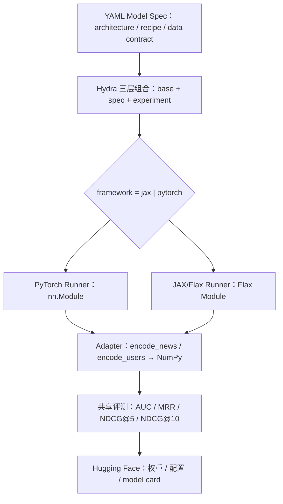
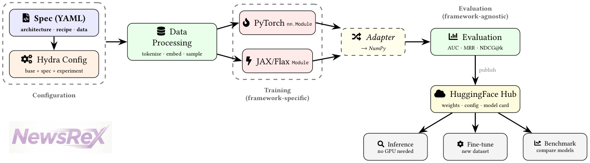

# NewsReX: An Open-Source Multi-Framework for Neural News Recommendation (NewsReX：面向神经新闻推荐的开源多框架)

- **会议/期刊**: CIKM 2026（Resource Track）
- **作者与机构**: Igor L. R. Azevedo（Imperial College London）、Toyotaro Suzumura（The University of Tokyo）、Yuichiro Yasui（Nikkei Inc.）
- **推荐链路定位**: 精排（新闻点击预测）
- **研究方向**: 序列与会话推荐 / 工业系统与评测基准
- **论文原文**: [https://arxiv.org/abs/2508.21572v2](https://arxiv.org/abs/2508.21572v2)
- **开源代码**: [https://github.com/igor17400/NewsReX](https://github.com/igor17400/NewsReX)

## TL;DR (1分钟核心速览)

神经新闻推荐受困于代码碎片化、预处理不一致与框架锁定，复现成本高。NewsReX 以声明式 YAML 统一 9 个模型的架构/训练配方/数据契约，Hydra 一键切换 PyTorch 与 JAX，并用 NumPy 适配器做跨框架奇偶校验与共享评测。MIND-small impression 级排序（random 5% 验证、3 seeds）下，双后端多数差异在 1 个标准差内，JAX 对注意力模型提速 1.1–2.2×，另附日文 Nikkei 迁移与 Hugging Face 权重。

## Background & Motivation (背景与核心矛盾)

- **主流范式**: NNR 以 news encoder + user encoder + 点积点击预测为主，NRMS、NAML、LSTUR 是长期基线；实现却分散在 TensorFlow/Keras 与 PyTorch 两代代码库中。
- **前人局限**: 早期 Keras 代码存在版本失配，新模型各自成库，预处理、切分与负采样口径不一；更严重的是评估协议漂移——部分工作把官方 `dev/` 同时用于选模和测试（`dev_as_val`），早停直接造成信息泄漏。
- **核心洞察**: 训练框架与评测逻辑可以彻底解耦。只要把新闻/用户表示导出为 NumPy，打分与指标就能在共享代码中完成，从而把“框架差异”隔离到编码器与优化器，而非污染评估。
- **本文切入点**: 用 YAML 声明“模型算什么”，用 Hydra 与 runner 决定“怎么执行”，再以 adapter + 共享评测提供跨框架数值一致性证据；图构造只写一次，GNN 仅消息传递层随框架实现。

## Method (核心方法设计)

### 1. 整体框架 (Overall Architecture)

NewsReX 将实验拆成四层：YAML Model Spec 声明架构（encoder 类型、维度、注意力头数、dropout、点击预测器）、训练配方（优化器、学习率、损失、负采样比、早停）与数据契约（输入字段、序列长度、历史长度）；Hydra 以 `base + spec + experiment` 三层组合生成配置；runner 按 `framework=jax|pytorch` 实例化对应 `nn.Module` 或 Flax Module 并训练；训练结束后 adapter 暴露 `encode_news` 与 `encode_users`，统一转 NumPy，所有打分与 AUC/MRR/NDCG@5/10 在 `src/core` 中完成。换框架只改一个 Hydra 参数，模型、数据、超参与评测配置完全不变。

<figure class="paper-figure" markdown="span">
  <figcaption>图1：NewsReX 架构概览。模型通过 YAML 规范定义，经 Hydra 组合，并在 PyTorch 或 JAX/Flax 中训练。一个轻量级适配器将表示转换为 NumPy，以进行与框架无关的评估。</figcaption>
</figure>

图1：NewsReX 架构概览——YAML 规格经 Hydra 组合后进入双后端训练，adapter 将表示转为 NumPy，评测与框架无关。

### 2. 关键设计拆解 (Key Designs)

1. **声明式 Model Spec + Hydra 组合（把模型逻辑从框架代码中抽出）**：痛点在于同一模型在不同仓库的预处理、字段拼接与损失实现各不相同，导致“同名不同果”。NewsReX 将表示契约固定为新闻注意力聚合 $\mathbf{e}_n=\sum_{i=1}^{L}a_i\mathbf{e}_{w_i}$、用户表示$\mathbf{u}$与点积打分$\hat{y}=\mathbf{u}^{\top}\mathbf{e}_c$，而把损失做成可插拔模块；这样新增模型只需写 spec 与各框架 encoder，数据管线、评测与配置自动复用。其有效性来自“契约先行”：跨论文比较时，差异被收敛到模型与优化器，而非隐式预处理。

2. **跨框架 Adapter 与共享评测（用 NumPy 做奇偶校验）**：adapter 封装设备放置、`torch.no_grad()` 或 JAX JIT 等推理约定，只输出 NumPy 数组；随后同一套代码对 impression 内候选做点积打分并计算指标。由于评测不依赖任何后端，PyTorch 与 JAX 的差异可被解释为编码器/优化器差异，而不是指标实现差异。论文进一步把每个 impression 的候选全部打乱，避免位置偏置。

3. **图构造与图计算分离 + 训练目标/负采样/推理**：对 GLORY、CROWN、DIGAT 等 GNN 模型，共现图、用户-主题邻接、语义增强图（SAG）、邻居字典与子图采样全部在共享代码中构造一次，只有消息传递与 scatter 操作随框架实现；因此新增 GNN 只需写前向图层。训练采用同一 impression 内 $K=5$ 个负样本的采样 Softmax：
$$
\mathcal{L}=-\log\frac{\exp(\hat{y}^{+})}{\exp(\hat{y}^{+})+\sum_{i=1}^{N}\exp(\hat{y}_{i}^{-})}
$$
负采样支持 random（默认）、popularity-weighted 与 topic-diverse 三种策略；推理侧仅需 HF 权重与 NumPy adapter，可在无 GPU 环境复现。作者的经验结论是：GNN 优先用 PyTorch，因 PyG 提供成熟图原语，JAX 需手写等价算子，工程成本显著更高。

## Experimental Setup & Evaluation Protocol (实验设置与评估协议)

- **数据集与预处理**: 论文未列表格化统计量，且未提及 5-core 过滤；MIND-small 沿用官方 `train/` 与 `dev/`，Nikkei 为专有日文新闻数据，仅用于多语言迁移验证。

| 数据集 | #Users | #Items | #Interactions | 稀疏度/密度 | 特征/场景说明 |
| :--- | :---: | :---: | :---: | :---: | :--- |
| MIND-small | 未报告 | 未报告 | 未报告 | 未报告 | 英文新闻；官方 train/dev；GloVe 或 BERT 嵌入 |
| Nikkei News（私有） | 未报告 | 未报告 | 未报告 | 未报告 | 日文新闻；BPEmb 嵌入；仅 NRMS/NAML/LSTUR |

- **数据划分与防穿越 (Splitting Strategy)**: 主实验采用 `random`：从训练行为中随机抽 5%（seed 42）作验证，`dev/` 只作测试；另支持 `chronological`（训练集最后一个自然日作验证）与 `dev_as_val`（dev 同时作验证/测试，禁用早停以避免泄漏）。
- **排名评测协议 (Ranking Protocol)**: `Impression-level Full-Ranking`——对每次曝光内的全部候选新闻排序，候选顺序随机打乱；不是全库 Full-Ranking，也不是固定正负比的采样排序。指标为 AUC、MRR、NDCG@5、NDCG@10。
- **对比基线与超参设置**: 以 NRMS、NAML、LSTUR、PP-Rec、CAUM、TCCM 为非 GNN 基线，CROWN、DIGAT、GLORY 为 GNN 基线；训练最多 10 epochs、早停 patience=3，负样本 $K=5$；GloVe 结果报 3 seeds（42/123/456）均值±标准差，GNN 报 2 seeds，BERT 与 `dev_as_val` 为单 seed。论文未统一报告嵌入维度$d$，亦未做显著性检验，仅以多 seed 标准差衡量稳定性。

## Key Experimental Results (实验关键数据)

### 1. 主实验对比 (Main Results)

表1：MIND-small 非 GNN 模型的跨后端复现差异（GloVe，random split，3 seeds；`ΔAUC` 为 JAX−PyTorch，属复现差异而非方法增益）。

| 模型 | PyTorch AUC | PyTorch nDCG@10 | JAX AUC | JAX nDCG@10 | ΔAUC% |
| :--- | :---: | :---: | :---: | :---: | :---: |
| NRMS | 65.44±.37 | 40.37±.46 | 65.85±.28 | 40.78±.21 | +0.63% |
| NAML | **66.67±.33** | **41.59±.18** | 66.03±.56 | 40.70±.42 | −0.96% |
| LSTUR | 66.51±.24 | 41.18±.30 | 66.72±.27 | 41.44±.22 | +0.32% |
| PP-Rec | 66.48±.19 | 41.23±.32 | 67.14±.20 | **42.08±.25** | +0.99% |
| CAUM | **67.02±.30** | **41.75±.29** | 67.11±.45 | 41.55±.40 | +0.13% |
| TCCM | 66.36±.35 | 40.68±.18 | **67.67±.18** | 42.02±.18 | **+1.97%** |

最佳 JAX（TCCM）相对最佳 PyTorch（CAUM）AUC 提升 +0.97%（67.67 vs. 67.02）；PP-Rec 的 nDCG@10 提升 +0.79%（42.08 vs. 41.75），但幅度均在跨 seed 波动量级附近。

### 2. 消融实验 (Ablation Study)

本文为资源型工作，没有传统“去模块”消融；表2 以因子替换方式考察后端、嵌入、切分与语言域的影响，等价于对框架关键设计做敏感性分析。

| 因子 | 对照设定 | AUC | nDCG@10 |
| :--- | :--- | :---: | :---: |
| 后端 | NRMS：PyTorch → JAX | 65.44 → 65.85 | 40.37 → 40.78 |
| 后端 | TCCM：PyTorch → JAX | 66.36 → 67.67 | 40.68 → 42.02 |
| 嵌入 | NRMS：GloVe → BERT（JAX） | 65.85 → 66.14 | 40.78 → 40.96 |
| 嵌入 | TCCM：GloVe → BERT（JAX） | 67.67 → 67.73 | 42.02 → 43.05 |
| 切分 | NRMS：random → dev_as_val（PyTorch） | 65.44 → 65.51 | 40.37 → 40.73 |
| 语言/域 | NRMS：MIND → Nikkei（JAX） | 65.85 → 60.18 | 40.78 → 39.84 |

补充：GNN 在 PyTorch 下 DIGAT 最佳（AUC 67.28、MRR 32.22、nDCG@10 41.91），CROWN 为 67.05/31.87/41.55，GLORY 为 65.35/30.86/40.48；BERT-JAX 下 CAUM AUC 达 68.25，TCCM 的 MRR/nDCG@5/nDCG@10 达 33.28/37.06/43.05，为全文最高 nDCG@10。

### 3. 关键实验发现 (Key Findings)

1. **跨框架奇偶校验基本成立，但并非逐位一致**：6 个非 GNN 模型中 5 个的 AUC 差 ≤0.66，TCCM 的 +1.31（+1.97%）是最大偏差；nDCG@10 最大差为 0.97。多数差异落在 seed 标准差内，说明 YAML 契约 + NumPy 评测能消除大部分实现漂移，但优化器与算子细节仍会造成可观测偏移。
2. **JAX 的收益高度依赖模型族与曝光形状**：JAX 端到端训练提速 1.1–2.2×；稳态单 epoch 上 TCCM 达 2.8×（130s vs. 359s）、NRMS 达 2.6×（66s vs. 170s），JIT 一次性成本仅 0.6–2.4 分钟。但 CAUM/LSTUR 仅 1.1×，原因是 XLA 需针对变化的 impression 形状反复重编译，抵消了训练步加速；GNN 则因 PyG 生态在 PyTorch 更划算。
3. **语义嵌入与语言域迁移的收益/代价不对称**：BERT 将 TCCM 的 nDCG@10 从 42.02 提到 43.05（+1.03），CAUM AUC 达 68.25；但 GNN 最佳 DIGAT 的 41.91 仍低于 BERT-TCCM 的 43.05。日文 Nikkei 上 NRMS 的 AUC 从 65.85 降至 60.18、MRR 从 31.28 降至 23.96，说明跨语言迁移并非“换嵌入即可”，且专有数据使该结果不可复现。

## Highlights & Limitations (亮点、对比与审稿批判)

- **与代表作对比 (vs. Prior Work)**: 相比 NewsRecLib（PyTorch-only、配置驱动），NewsReX 增加了 JAX 后端、共享图构造、跨框架 parity test 与 HF 权重；相比 RecBole / Legommenders，它不把 NNR 当作通用推荐的一个子类，而是直接内建 impression 切分、负采样与曝光级评测；相比各模型原始仓库，它用统一预处理与多 seed 报告换取了可比性，但模型是重实现而非原代码。
- **可迁移亮点**: ①“表示导出为 NumPy + 共享评测”可作为任何跨框架复现工作的最小协议；②图构造与图计算分离，新增 GNN 只写前向层；③把 `validation_split_strategy` 做成配置项，便于系统审计 `dev_as_val` 类信息泄漏。
- **审稿级局限批判**: ①仅 MIND-small + 私有 Nikkei，缺 MIND-large/Adressa 与公开多语言基准，Nikkei 结果不可复现；②无显著性检验，BERT 与 `dev_as_val` 仅单 seed，10 epochs 早停也可能压低绝对性能；③曝光级排序不等价于全库排序，绝对指标不能与全库 Full-Ranking 论文直接比较；④JAX 的 JIT/XLA 重编译会侵蚀加速，GNN 的 JAX 实现成本高，框架版本漂移亦可能改变指标。

## Rating (四维评分)

- **方法创新性 (Novelty)**: ⭐⭐⭐ （资源/工程型贡献，未提出新的推荐算法；声明式双后端规格与跨框架 parity 在 NNR 工具链中较新颖）
- **评估协议与实验扎实度 (Protocol & Experiments)**: ⭐⭐⭐⭐ （多 seed、三种切分策略、曝光级全候选评测较规范；但仅 MIND-small、无显著性检验，BERT/dev_as_val 单 seed）
- **写作与数学规范度 (Clarity & Rigor)**: ⭐⭐⭐⭐ （“模型算什么/怎么执行”分层清晰，公式仅保留必要表示契约；复杂度与图算子细节展开较少）
- **工业落地与复现价值 (Industrial & Practical Value)**: ⭐⭐⭐⭐ （MIT 开源、HF 预训练权重、单命令切换后端，工程复用价值高；JAX GNN 与 JIT 开销限制其“全模型双后端”承诺）

