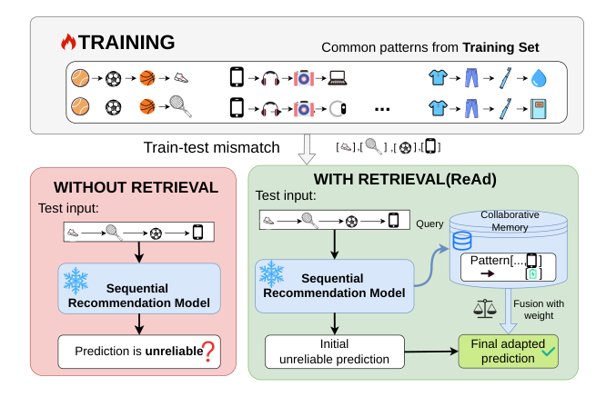
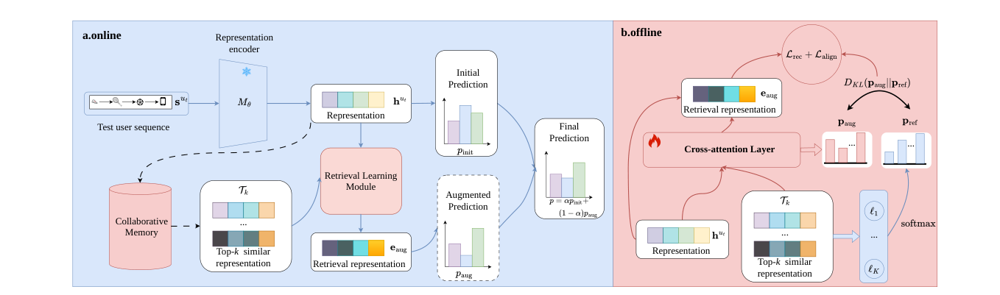
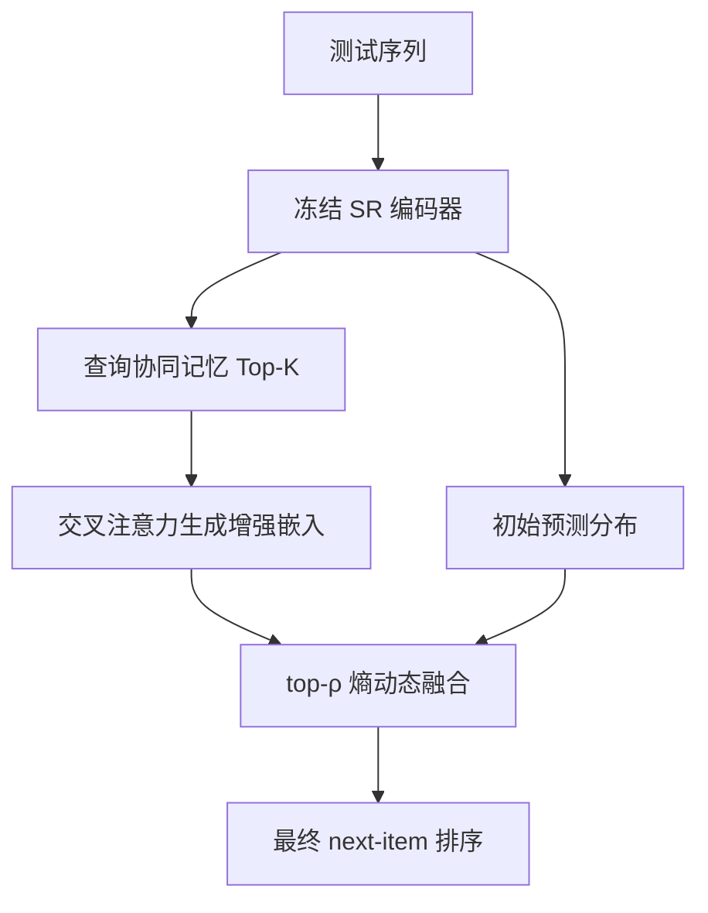

# Retrieve-then-Adapt: Retrieval-Augmented Test-Time Adaptation for Sequential Recommendation（先检索后适配：面向序列推荐的检索增强测试时自适应）

- **会议/期刊**: CIKM 2026
- **作者与机构**: Xing Tang, Ziqiang Cui, Jingyang Bin, Xiaokun Zhang, Fuyuan Lyu, Jingyan Jiang, Dugang Liu, Chen Ma, Ruiming Tang, Xiuqiang He；深圳技术大学、香港城市大学、McGill、深圳大学、快手。
- **推荐链路定位**: 精排/重排（作为冻结 SR 模型后的测试时打分修正）
- **研究方向**: 序列与会话推荐
- **论文原文**: [论文原文链接](https://arxiv.org/abs/2604.05379v2)
- **开源代码**: [开源代码仓库链接](https://github.com/xingt-tang/ReAd)

## TL;DR (1分钟核心速览)

针对序列推荐模型部署后参数冻结、测试序列含长尾或罕见组合时训练-测试失配的问题，ReAd 用离线协同记忆检索相似历史模式，经交叉注意力生成增强嵌入，并以 top-ρ 熵动态融合初始与增强预测；在 5 个 Amazon/ML-1M 数据集、Leave-One-Out + Full-Ranking 下稳定优于 7 类基线，稀疏 Home 的 ND@10 相对最佳基线提升约 7.2%。

## Background & Motivation (背景与核心矛盾)

- **主流范式**: SR 以 SASRec、BERT4Rec、GRU4Rec 等序列编码器为主，辅以 CL4SRec、DuoRec 等对比学习增强表征；部署后参数冻结，测试时通常靠 TTT 更新、TTA 随机增广或 RaSeRec 两阶段检索微调。
- **前人局限**: TTT 需在线反传或专用结构，延迟高；TTA 依赖随机裁剪/掩码并简单平均，噪声大且与架构耦合；RaSeRec 需预训练+微调两阶段，无法推理时动态适配。
- **核心矛盾**: 训练集被热门物品与高频模式主导，测试序列出现长尾物品或罕见组合时，冻结参数中编码的协同信号不足，初始预测不可靠。
- **核心洞察 (Key Insight)**: 作者将协同信号外化为“序列表示→下一物品”的记忆，检索历史上相似序列的下一项作为测试时补充证据；效果随交互密度与物品流行度呈倒 U 形，长尾与中等流行物品受益最大。
- **本文切入点**: 冻结骨干，只训练轻量检索融合器，在推理前向中完成检索-校正，不反传、不重训。

<figure class="paper-figure" markdown="span">
  <figcaption>图 1：序列推荐中训练-测试不匹配的示意图。训练集包含常见模式（例如运动或电子产品序列）。然而，测试输入可能包含训练数据中稀有的物品或组合。无检索（左）时，冻结模型产生不可靠预测。使用 ReAd（右）时，测试序列查询协同记忆，检索相关模式，并将其与初始预测融合以产生适配输出。</figcaption>
</figure>
*图 1：训练-测试不匹配与 ReAd 的检索式校正示意。*

## Method (核心方法设计)

### 1. 整体框架 (Overall Architecture)

ReAd 分离线与在线两段。离线用已训练 SR 编码器为每条训练序列生成表示，与下一物品嵌入配对构建协同记忆，并用推荐损失与 KL 对齐损失训练交叉注意力投影；在线给定测试序列，先用同一编码器取查询，按余弦相似度从记忆检索 top-K 物品，交叉注意力聚合成增强嵌入，再按 top-ρ 熵置信度与初始预测融合。骨干全程冻结，测试仅前向，无梯度更新。

<figure class="paper-figure" markdown="span">
  <figcaption>图 2：ReAd 概览。(a) 在线推理检索协同记忆，并将其与初始预测融合。(b) 离线检索学习使用推荐损失和基于 KL 的对齐损失训练交叉注意力。蓝色和红色框分别表示在线和离线组件。</figcaption>
</figure>
*图 2：ReAd 的离线检索学习与在线熵融合流程。*

### 2. 关键设计拆解 (Key Designs)

1. **协同记忆检索（Collaborative Memory）**：SR 无外部知识库，长尾协同信号易被热门物品淹没，故用训练序列表示 $\mathbf{h}_u$索引其下一物品$\mathbf{e}_{v_u^+}$，形成$\mathcal{D}=\{(\mathbf{h}_u,\mathbf{e}_{v_u^+})\}$；推理以$\cos(\mathbf{h}_{u_t},\mathbf{h}_u)$ 取 top-K。直觉是相似历史行为对应相似下一项，记忆显式保存参数中难以泛化的稀有模式。

2. **检索学习与 KL 校准（Retrieval Learning）**：相似不等于有用，故以测试表示作 query、检索项作 key/value 做交叉注意力，$\mathbf{e}_{aug}=\operatorname{softmax}(\frac{\mathbf{Q}\mathbf{K}^{\top}}{\sqrt{d}})\mathbf{V}$；再用每个检索项单独预测目标的损失构造$p_{ref}=\operatorname{softmax}(\{-\ell(\mathbf{e}_k,\mathbf{e}_t)\}_{k=1}^{K})$，并以$\mathcal{L}_{align}=D_{KL}(p_{aug}\|p_{ref})$ 将注意力从“仅相似”校准到“可预测目标”的效用分布。

3. **熵融合、训练与推理**：全局熵被长尾稀释，故只在 top-ρ 候选上算 $H_{top}(p)=-\sum_{v_i\in\tau_{top}(p)}p_{v_i}\log(p_{v_i}+\epsilon)$，低熵高置信者权重大：$\alpha=\frac{\exp(1/(1+H^{init}_{top}))}{\exp(1/(1+H^{init}_{top}))+\exp(1/(1+H^{aug}_{top}))}$，$p=\alpha p_{init}+(1-\alpha)p_{aug}$。总损失$\mathcal{L}=\mathcal{L}_{rec}+\lambda\mathcal{L}_{align}$；训练用全物品 softmax，测试免负采样、免反传。ML-1M 上 ReAd 约 4.76 ms/batch，高于 DuoRec 的 1.06 ms，但低于 RaSeRec 的 6.20 ms。

## Experimental Setup & Evaluation Protocol (实验设置与评估协议)

- **数据集与预处理**: 5 个公开数据集，Amazon 四子集与 ML-1M；按常见 `5-core` 过滤用户和物品。

| 数据集 | #Users | #Items | #Interactions | 稀疏度 | 特征/场景说明 |
| :--- | :---: | :---: | :---: | :---: | :--- |
| Office | 4,906 | 2,421 | 53,258 | 99.55% | Amazon 办公类 |
| Beauty | 22,364 | 12,102 | 198,502 | 99.93% | Amazon 美妆类 |
| Sports | 35,599 | 18,358 | 296,337 | 99.95% | Amazon 运动类 |
| Home | 66,520 | 28,238 | 551,682 | 99.97% | Amazon 家居类，极稀疏 |
| ML-1M | 6,040 | 3,706 | 1,000,209 | 95.53% | 电影域，较稠密 |

- **数据划分与防穿越 (Splitting Strategy)**: 采用 `Leave-One-Out`，每个用户最后一条交互为测试、倒数第二条为验证，其余训练。
- **排名评测协议 (Ranking Protocol)**: 无偏 `Full-Ranking`，对全物品库排序计算 HR@5/10/20 与 NDCG@5/10/20，不做负采样排序。
- **对比基线与超参设置**: 基线含 GRU4Rec、SASRec、BERT4Rec、S3-Rec、CL4SRec、CoSeRec、ICLRec、DuoRec、MCLRec、ICSRec、RaSeRec、TTA；嵌入维度 $d=64$，batch=256，Adam lr=0.001，10 次运行取均值，配对 t 检验$p<0.01$。检索数$K\in\{1,3,5,10,15,20\}$，$\lambda\in\{0,0.5,1,1.5,2\}$，top-ρ$\in\{10\%,5\%,1\%,0.5\%,0.1\%\}$。

## Key Experimental Results (实验关键数据)

### 1. 主实验对比 (Main Results)

下表保留 7 个代表性基线，报告 HR@10 与 NDCG@10；加粗为最优。

| 数据/指标 | SASRec | BERT4Rec | CoSeRec | DuoRec | MCLRec | RaSeRec | TTA | ReAd+SAS | ReAd+Duo |
| :--- | :---: | :---: | :---: | :---: | :---: | :---: | :---: | :---: | :---: |
| Office HR@10 | 0.0899 | 0.0666 | 0.0811 | 0.1011 | 0.1071 | 0.1042 | 0.0896 | 0.0907 | **0.1090** |
| Office ND@10 | 0.0483 | 0.0326 | 0.0500 | 0.0527 | 0.0538 | 0.0549 | 0.0492 | 0.0489 | **0.0582** |
| Beauty HR@10 | 0.0598 | 0.0526 | 0.0726 | 0.0825 | 0.0869 | 0.0865 | 0.0629 | 0.0687 | **0.0874** |
| Beauty ND@10 | 0.0308 | 0.0282 | 0.0410 | 0.0433 | 0.0446 | 0.0461 | 0.0329 | 0.0367 | **0.0481** |
| Sports HR@10 | 0.0326 | 0.0281 | 0.0426 | 0.0471 | 0.0486 | 0.0487 | 0.0398 | 0.0339 | **0.0496** |
| Sports ND@10 | 0.0184 | 0.0144 | 0.0231 | 0.0245 | 0.0260 | 0.0251 | 0.0214 | 0.0197 | **0.0274** |
| Home HR@10 | 0.0131 | 0.0143 | 0.0232 | 0.0278 | 0.0286 | 0.0293 | 0.0175 | 0.0164 | **0.0298** |
| Home ND@10 | 0.0068 | 0.0072 | 0.0133 | 0.0145 | 0.0150 | 0.0152 | 0.0091 | 0.0090 | **0.0163** |
| ML-1M HR@10 | 0.2119 | 0.2156 | 0.1878 | 0.2859 | 0.2832 | 0.2844 | 0.2136 | 0.2382 | **0.2897** |
| ML-1M ND@10 | 0.1135 | 0.1156 | 0.0981 | 0.1603 | 0.1600 | 0.1646 | 0.1105 | 0.1317 | **0.1653** |

相对各数据集最佳基线，ReAd(+DuoRec) 的 HR@10/ND@10 提升约：Office +1.8%/+6.0%，Beauty +0.6%/+4.3%，Sports +1.8%/+5.4%，Home +1.7%/+7.2%，ML-1M +1.3%/+0.4%。

### 2. 消融实验 (Ablation Study)

以 DuoRec 为骨干，报告 HR@10 与 NDCG@10。

| 变体 | Beauty HR | Home HR | Office HR | Sports HR | Beauty ND | Home ND | Office ND | Sports ND |
| :--- | :---: | :---: | :---: | :---: | :---: | :---: | :---: | :---: |
| w/o Att | 0.0786 | 0.0268 | 0.0901 | 0.0436 | 0.0413 | 0.0127 | 0.0484 | 0.0207 |
| w/o KL | 0.0863 | 0.0293 | 0.1074 | 0.0489 | 0.0473 | 0.0159 | 0.0571 | 0.0269 |
| w/o Rec | 0.0643 | 0.0218 | 0.0752 | 0.0345 | 0.0332 | 0.0095 | 0.0381 | 0.0198 |
| w/o α | 0.0845 | 0.0279 | 0.1044 | 0.0479 | 0.0451 | 0.0149 | 0.0536 | 0.0243 |
| ReAd | **0.0874** | **0.0298** | **0.1090** | **0.0496** | **0.0481** | **0.0163** | **0.0582** | **0.0274** |

### 3. 关键实验发现 (Key Findings)

1. **稀疏场景收益最大**：ReAd 在五数据集双指标均最优，Home 的 ND@10 相对最佳基线 +7.2%，说明冻结模型在交互稀疏、模式罕见时更需外部协同证据。
2. **推荐监督是检索学习的核心**：去掉 $\mathcal{L}_{rec}$ 后 Office HR@10 从 0.1090 降至 0.0752（-31.0%），降幅最大；去掉动态 α 也明显下降，说明检索必须由下一项预测目标监督，融合需置信度校准。
3. **不是简单放大热门**：按流行度分桶，Q1 长尾提升显著、Q4 热门提升变小；Random Retrieval 全面退化，Popularity Retrieval 仅在极稀疏 Home 接近 ReAd，Beauty/Office 明显更差；$K=10$ 附近最佳，top-ρ 非 100% 最优。

## Highlights & Limitations (亮点、对比与审稿批判)

- **与代表作对比 (vs. Prior Work)**: TTT4Rec/T2ARec/PCRec 需在线更新参数；TTA 用随机增广并平均；RaSeRec 在训练期做两阶段检索微调。ReAd 是推理期检索、冻结骨干、即插即用，且用熵融合替代人工权重。
- **可迁移亮点**: “序列表示→下一物品”的协同记忆可迁移到会话推荐、CTR 序列建模；top-ρ 熵融合可作为任意双塔/序列模型的后融合置信度校准器。
- **审稿级局限批判**: 记忆大小随训练序列线性增长，需 ANN 检索与定期刷新，分布漂移时易过期；收益依赖可用协同信号，极稀疏 Home 上 Popularity Retrieval 已接近 ReAd，且 $K$、top-ρ 需调参，离线 Leave-One-Out 尚缺在线 A/B 验证。

## Rating (四维评分)

- **方法创新性 (Novelty)**: ⭐⭐⭐⭐ （将测试时检索增强引入冻结 SR，记忆检索+KL 校准+熵融合组合新颖，但组件多为已有范式迁移。）
- **评估协议与实验扎实度 (Protocol & Experiments)**: ⭐⭐⭐⭐ （五数据集、Full-Ranking、多骨干、显著性检验与消融较完整，但仅 Leave-One-Out、缺少在线验证。）
- **写作与数学规范度 (Clarity & Rigor)**: ⭐⭐⭐⭐ （框架与公式清晰，检索、融合、训练目标定义较严谨，复杂度与推理开销有交代。）
- **工业落地与复现价值 (Industrial & Practical Value)**: ⭐⭐⭐⭐ （模型无关、代码开源、测试仅前向，4.76 ms/batch 开销可接受，但记忆维护与 ANN 工程需额外投入。）

