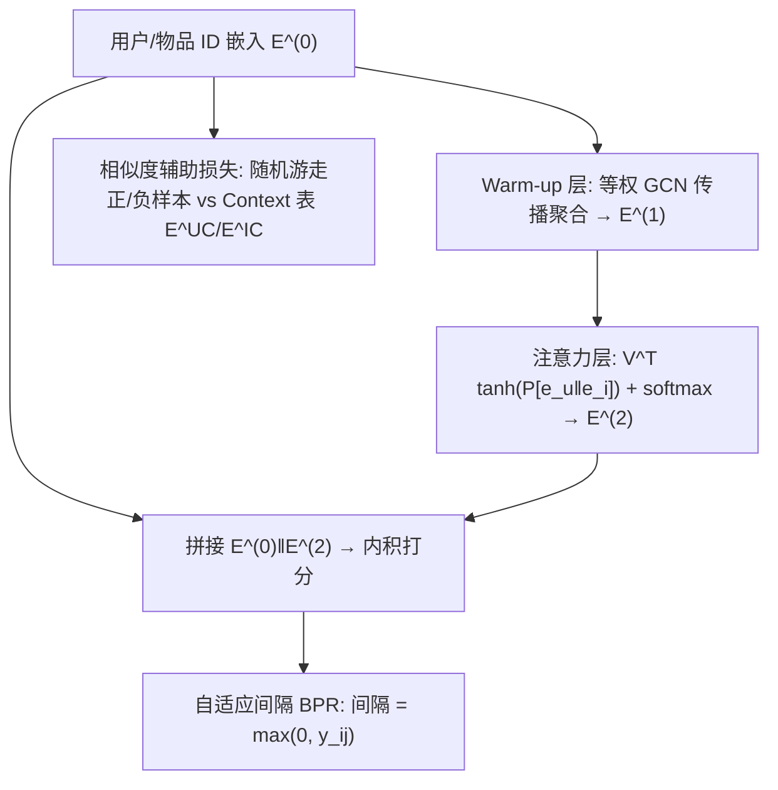
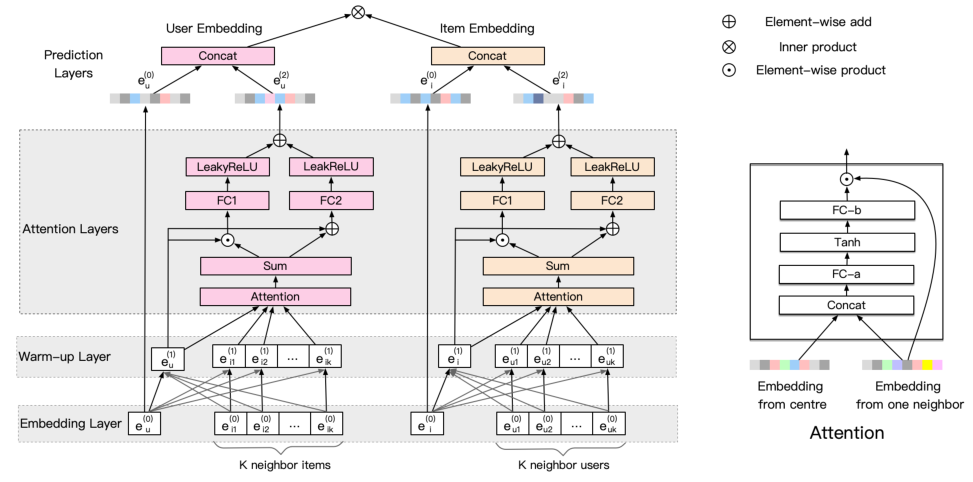

# Graph Attention Collaborative Similarity Embedding for Recommender System (图注意力协同相似度嵌入推荐框架)

- **会议/期刊**: DASFAA 2021
- **作者与机构**: Jinbo Song（中科院计算所）、Chao Chang、Zhenyang Chen、Guoyong Hu、Peng Jiang（快手科技）、Fei Sun（阿里巴巴）
- **推荐链路定位**: 召回（user-item 表示学习与 Top-K 检索）
- **研究方向**: 图神经网络与知识图谱推荐 / 自监督辅助损失与表征学习
- **论文原文**: [https://arxiv.org/abs/2102.03135v1](https://arxiv.org/abs/2102.03135v1)
- **开源代码**: [https://github.com/GACSE/GACSE.git](https://github.com/GACSE/GACSE.git)

## TL;DR (1分钟核心速览)

针对 NGCF 类模型「邻居等权聚合」与「只建模显式 user-item 边、稀疏图上表征不足」两大痛点，GACSE 在 GCN 式 warm-up 传播之后叠加一层注意力聚合（拼接双线性打分 + softmax 邻居加权），并以随机游走构造的二阶 user-user / item-item 相似度辅助损失（独立 context 嵌入表）扩充监督信号；同时把 BPR 的固定间隔替换为「正负样本相似度」驱动的自适应间隔。在 Gowalla / Yelp2018 / Amazon-Book 三套 10-core 数据、全库 Full-Ranking 协议下，Recall@20 相对最优基线分别提升 3.70% / 0.75% / 6.34%，NDCG@20 提升 4.06% / 3.21% / 7.16%。

## Background & Motivation (背景与核心矛盾)

- **主流范式**: 以 MF/NCF 为骨干、以 NGCF/Multi-GCCF 为代表的图协同过滤——在 user-item 二部图上做嵌入传播，用高阶连通性编码协同信号。
- **前人局限**: 其一，NGCF/GCN 类传播权重固定为 $1/\sqrt{|\mathcal{N}_u||\mathcal{N}_i|}$，把「用户对某物品的偏好强度差异」抹平，弱邻居噪声被等权注入；其二，监督信号只来自显式交互边，在密度仅 0.05%–0.08% 的稀疏图上，表征只能覆盖一阶/二阶连通域，长尾节点几乎无梯度。
- **核心洞察 (Key Insight)**: 图中除显式边外还潜藏「隐式协同」——共享二阶邻域的用户/物品对本身是天然的相似监督对；而正负样本若在嵌入空间中本就相似（难区分），固定间隔的 BPR 无法施加足够惩罚。
- **本文切入点**: 用注意力学习邻居的可变权重（显式协同），用相似度辅助损失注入二阶邻域监督（隐式协同），用相似度自适应间隔强化难样本判别。

## Method (核心方法设计)

### 1. 整体框架 (Overall Architecture)

模型输入仅为 user/item one-hot ID，经嵌入表得到 $\boldsymbol{e}_u^{(0)},\boldsymbol{e}_i^{(0)}$；随后两段式传播：warm-up 层以 GCN 等权权重扩张感受野得到$\boldsymbol{e}^{(1)}$，注意力层在$\boldsymbol{e}^{(1)}$上学邻居可变权重并做含元素积交互项的聚合得到$\boldsymbol{e}^{(2)}$；预测层把$\boldsymbol{e}^{(0)}$与$\boldsymbol{e}^{(2)}$拼接成$\boldsymbol{e}^{*}$，内积打分$\hat{y}_{ab}=\boldsymbol{e}_a^{*\top}\boldsymbol{e}_b^{*}$（任意节点对通用）。训练端双损失联合：自适应间隔 BPR 主损失 + 独立 context 嵌入表的相似度辅助损失，Adam 小批量优化，推理时全库内积排序。

<figure class="paper-figure" markdown="span">
  <figcaption>图 1. GACSE 模型架构示意图。嵌入的流向由带箭头的线表示。FC1 和 FC2 是用户嵌入侧和物品嵌入侧共享的参数。左侧展示了注意力聚合示意图。FC-a 将拼接后的向量转换为新向量。FC-b 将向量转换为注意力分数。</figcaption>
</figure>

### 2. 关键设计拆解 (Key Designs)

1. **注意力邻居聚合（显式协同的加权传播）**：等权传播无法表达「哪次交互更能代表偏好」。先按 $\pi^{(0)}(u,i)=1/\sqrt{|\mathcal{N}_u||\mathcal{N}_i|}$ 完成 warm-up 聚合，再计算邻居打分并 softmax 归一化：
$\text{score}(\boldsymbol{e}_u^{(1)},\boldsymbol{e}_i^{(1)})=\boldsymbol{V}^{\top}\tanh\!\big(\boldsymbol{P}[\boldsymbol{e}_u^{(1)}\|\boldsymbol{e}_i^{(1)}]\big),\quad \pi^{(1)}(u,i)=\frac{\exp(\text{score}(\cdot))}{\sum_{j\in\mathcal{S}_u}\exp(\text{score}(\cdot))}$聚合沿用 NGCF 的双通道（加和 + 元素积）形式$\sigma(\boldsymbol{W}_1(\boldsymbol{m}_{u\to u}+\sum_i \boldsymbol{m}_{i\to u}))+\sigma(\boldsymbol{W}_2(\boldsymbol{m}_{u\to u}\odot\sum_i \boldsymbol{m}_{i\to u}))$，元素积让聚合结果编码「中心-邻居交互关系」而非单纯邻域均值。直觉：注意力相当于把二部图软加权成有向加权图，抑制噪声邻居。
2. **二阶相似度辅助损失（隐式协同的数据增广）**：显式边稀疏，故以随机游走采样的 2 阶邻域节点为正样本、随机节点为负样本，目标
$\mathcal{L}_{sim}=-\sum_{u}\big[\log\sigma(\boldsymbol{e}_u^{(0)\top}\boldsymbol{e}_{u^{+}}^{UC})+\log\sigma(-\boldsymbol{e}_u^{(0)\top}\boldsymbol{e}_{u^{-}}^{UC})\big]-\sum_{i}\big[\log\sigma(\boldsymbol{e}_i^{(0)\top}\boldsymbol{e}_{i^{+}}^{IC})+\log\sigma(-\boldsymbol{e}_i^{(0)\top}\boldsymbol{e}_{i^{-}}^{IC})\big]$关键工程细节：相似度只在主嵌入$\boldsymbol{E}$与**独立** context 映射表$\boldsymbol{E}^{UC}/\boldsymbol{E}^{IC}$ 之间计算，反向传播不污染参与传播的嵌入，避免辅助任务与主任务在表示空间互相拉扯。
3. **自适应间隔 BPR 与训练开销**：$\mathcal{L}_{BPR}=\frac{1}{|\mathcal{B}|}\sum_{(u,i,j)\in\mathcal{B}}-\log\sigma\big(\hat{y}_{ui}-\hat{y}_{uj}-\max(0,y_{ij})\big)$，$y_{ij}$为正样本$i$与负样本$j$的嵌入内积；两者越像（难负样本），强制间隔越大，等价于对难例动态加权。总损失$\mathcal{L}=\mathcal{L}_{BPR}+\lambda_1\mathcal{L}_{sim}+\lambda_2\|\Theta\|_2^2$，负采样为 1:1 均匀采样（免 hard-negative 挖掘），每 batch 采 64 个邻居、相似度各 5 正 5 负，训练开销与 NGCF 同量级；推理仅一次内积+ANN 检索。

## Experimental Setup & Evaluation Protocol (实验设置与评估协议)

- **数据集与预处理**: 三套公开基准，统一 `10-core` 过滤（保留交互数 ≥10 的用户与物品）。

| 数据集 | #Users | #Items | #Interactions | 稀疏度/密度 | 特征/场景说明 |
| :--- | :---: | :---: | :---: | :---: | :--- |
| Gowalla | 29,858 | 40,981 | 1.027M | 0.084% | LBS 签到，含地理社交行为 |
| Yelp2018 | 45,919 | 45,538 | 1.185M | 0.056% | 本地生活商户点评 |
| Amazon-Book | 52,643 | 91,599 | 2.984M | 0.062% | 电商图书，物品数最多 |

- **数据划分与防穿越 (Splitting Strategy)**: 每个用户历史交互 **80% 训练 / 20% 测试** 的比例划分，再从训练集随机切 10% 作验证集调参（用户级切分，非全局时间戳切分，存在轻度时间穿越风险）。
- **排名评测协议 (Ranking Protocol)**: 无偏 **Full-Ranking（全库未交互物品排序）**，排除训练集中已观测正例，指标 Recall@20 与 NDCG@20，测试集用户取平均。
- **对比基线与超参设置**: 基线含 MF 类（BPR-MF、NCF）与图类（PinSage、GC-MC、NGCF、Multi-GCCF）；所有模型嵌入维度统一 $d=64$，batch=1024，Adam，学习率 1e-4，$\lambda_1=1\text{e-}4$、$\lambda_2=1\text{e-}5$，基线取各自最优超参；论文声称提升具备统计显著性（未给出具体$p$ 值检验细节）。

## Key Experimental Results (实验关键数据)

### 1. 主实验对比 (Main Results)

| Model | Gowalla R@20 | Gowalla N@20 | Yelp R@20 | Yelp N@20 | Amazon R@20 | Amazon N@20 |
| :--- | :---: | :---: | :---: | :---: | :---: | :---: |
| BPR-MF | 0.1291 | 0.1878 | 0.0494 | 0.0662 | 0.0250 | 0.0518 |
| NCF | 0.1326 | 0.1985 | 0.0513 | 0.0719 | 0.0253 | 0.0535 |
| PinSage | 0.1380 | 0.1947 | 0.0612 | 0.0750 | 0.0283 | 0.0545 |
| GC-MC | 0.1395 | 0.1960 | 0.0597 | 0.0741 | 0.0288 | 0.0551 |
| NGCF | 0.1547 | 0.2237 | 0.0581 | 0.0719 | 0.0344 | 0.0630 |
| Multi-GCCF | 0.1595 | 0.2126 | 0.0667 | 0.0810 | 0.0363 | 0.0656 |
| **GACSE** | **0.1654** | **0.2328** | **0.0672** | **0.0836** | **0.0386** | **0.0703** |
| Improv.% | +3.70% | +4.06% | +0.75% | +3.21% | +6.34% | +7.16% |

### 2. 消融实验 (Ablation Study)

| 变体 | Gowalla R@20 | Gowalla N@20 | Yelp R@20 | Yelp N@20 |
| :--- | :---: | :---: | :---: | :---: |
| GACSE (full) | 0.1654 | 0.2328 | 0.0672 | 0.0836 |
| w/o similarity loss | 0.1632 (-1.33%) | 0.2334 (+0.26%) | 0.0641 (-4.61%) | 0.0805 (-3.71%) |
| w/o adaptive margin | 0.1468 (-11.25%) | 0.2149 (-7.68%) | 0.0571 (-15.03%) | 0.0728 (-12.92%) |

### 3. 关键实验发现 (Key Findings)

1. **自适应间隔是主增益来源，而非注意力本身**：移除自适应间隔后 Gowalla/Yelp 的 Recall 分别下滑 11.25% 与 15.03%，跌幅远超移除相似度损失；说明在 BPR 1:1 均匀负采样下，难负样本占比高，动态间隔对判别力的贡献大于结构侧改进。
2. **相似度损失收益高度依赖数据分布**：Yelp 上去掉该损失掉 4.61% Recall，但在 Gowalla 上 Recall 仅差 1.33% 且 NDCG 反升 0.26%——稠密签到图上随机游走正样本噪声更大，辅助任务带来轻微过平滑/噪声注入，说明该模块并非「无脑增益」。
3. **稀疏度越高、物品侧越丰富，框架优势越明显**：Amazon-Book（91,599 物品、最稀疏）上取得最大相对提升（Recall +6.34%、NDCG +7.16%）；反之 Yelp 上 Recall 仅 +0.75% 但 NDCG +3.21%，表明注意力加权主要改善**排序次序质量**而非召回覆盖面，与「抑制噪声邻居」的设计动机一致。

## Highlights & Limitations (亮点、对比与审稿批判)

- **与代表作对比 (vs. Prior Work)**: 相较 NGCF（等权 GCN 传播 + 单 BPR 损失），GACSE 显式学习邻居权重并引入二阶邻域辅助监督；相较 Multi-GCCF（构建 user-user/item-item 显式图并多图编码），本文不额外构图，用随机游走采样的**损失级**相似度替代图级传播，参数量与构图开销更低；相较 CSE 的协同相似度嵌入，本文额外叠加注意力传播与自适应间隔，二者互补。
- **可迁移亮点**: ①「独立 context 嵌入表 + 辅助相似度损失」这一解耦写法可直接套用到 LightGCN/SGL 类模型，避免辅助梯度污染主嵌入；②「间隔 = 正负样本相似度」的难例自适应策略几乎零成本，可移植到任意 pair-wise 排序损失（含多任务精排的 pairwise 蒸馏）。
- **审稿级局限批判**: ①仅用 ID 特征，未验证 side-information/多模态场景，10-core 过滤已剔除大量长尾节点，冷启动与长尾宣称无从检验；②注意力 softmax 在每 batch 采样的 64 个邻居内归一化，权重依赖 batch 采样集合，训练与全量推理的打分尺度不一致，且论文缺少复杂度/时延与方差分析；③未与同期 LightGCN（2020）对比，而后者恰恰证明「去掉非线性与特征变换的纯线性传播」更强，本文双通道非线性聚合的必要性论证不足。

## Rating (四维评分)

- **方法创新性 (Novelty)**: ⭐⭐⭐ （注意力聚合与相似度辅助损失均为组合式增量，亮点在「自适应间隔 + 解耦 context 表」的损失设计，缺乏理论/谱分析支撑）
- **评估协议与实验扎实度 (Protocol & Experiments)**: ⭐⭐⭐ （采用无偏 Full-Ranking 与三域数据集、消融完整，但为比例切分而非时间切分，无显著性检验细节与稀疏/长尾分桶实验）
- **写作与数学规范度 (Clarity & Rigor)**: ⭐⭐⭐ （传播与损失公式表述清晰，但符号复用混淆：$\sigma$ 同时指代 softplus 与 sigmoid，相似度损失负样本项的符号写法与常规 InfoNCE 不一致）
- **工业落地与复现价值 (Industrial & Practical Value)**: ⭐⭐⭐⭐ （TensorFlow 代码已开源、无需额外构图、训练开销与 NGCF 同级，自适应间隔可直接上线，工程复现门槛低）

