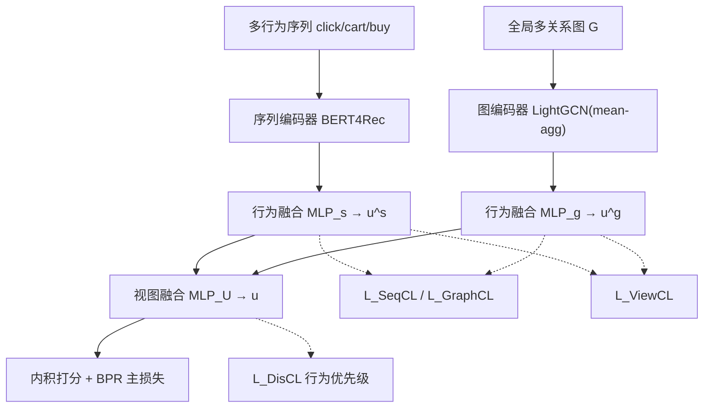
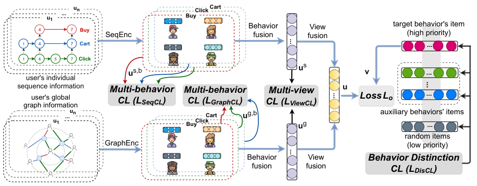
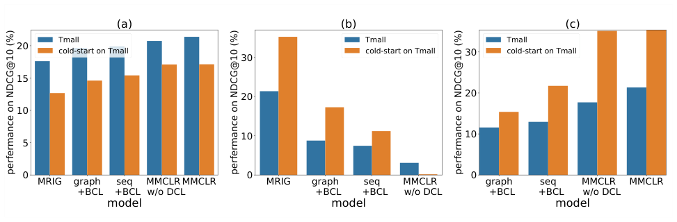

# Multi-view Multi-behavior Contrastive Learning in Recommendation (多视图多行为对比学习推荐)

- **会议/期刊**: DASFAA 2022 (Main Conference Long Paper)
- **作者与机构**: Yiqing Wu, Ruobing Xie, Yongchun Zhu, Xiang Ao, Xin Chen, Xu Zhang, Fuzhen Zhuang, Leyu Lin, Qing He（中科院计算所 / 国科大 / 腾讯微信搜索应用部 / 北航）
- **推荐链路定位**: 召回（用户表征学习与 Top-K 排序）
- **研究方向**: 自监督对比学习与交互去噪 / 图神经网络推荐
- **论文原文**: [论文原文链接](https://arxiv.org/abs/2203.10576v1)
- **开源代码**: [开源代码仓库链接](https://github.com/wyqing20/MMCLR)

## TL;DR (1分钟核心速览)

多行为推荐的两个盲点：直接把多行为表征拼接而不建模行为间关系，且忽视序列（个体）与图（全局）两视图的互补。MMCLR 在 BERT4Rec + LightGCN 双编码器之上设计三个对比任务：对齐同一用户的不同单行为表征、对齐序列/图两视图表征，并以"目标行为 $>$辅助行为$\gg$ 随机负例"的优先级刻画细粒度行为差异。Leave-One-Out + 1:99 采样排序协议下，Tmall/CIKM 的 NDCG@10 相对最优基线提升 7.4% / 6.1%。

## Background & Motivation (背景与核心矛盾)

- **主流范式**: MBR 分两派——序列派（ATRank、MRIG）建模单个用户的行为序列，图派（MBGCN、MBGMN、MGNN）把所有用户交互建成多关系图做传播；两派各自只在单一视图上工作。
- **前人局限**: ① 目标行为（purchase）极稀疏，点击量常为购买量的 7 倍以上，单行为建模难以学到稳定用户表征；② 序列视图与图视图被割裂训练，简单拼接（如 MMR）几乎不带来增益。
- **核心洞察 (Key Insight)**: 同一用户的多个行为天然共享"粗粒度共性"（都反映该用户偏好），而目标行为与辅助行为之间又存在"细粒度优先级差异"；大量"点击未购买"物品恰是排序中最难区分、也最有信息量的硬负例。这两类性质都能被对比学习的目标函数直接编码。
- **本文切入点**: 不发明新编码器，而是把多行为、多视图、行为优先级三件事全部转写为辅助对比损失，插在现有 Seq/Graph 骨干之上。

## Method (核心方法设计)

### 1. 整体框架 (Overall Architecture)

输入为用户的多行为历史序列 $\mathcal{S}_u=\{s_u^{b_1},\dots,s_u^{b_B}\}$与全局多关系用户-物品图$\mathcal{G}=(\mathcal{V},\mathcal{E})$（边带行为类型$b$）。序列分支与图分支各自为每个行为$b$产出单行为表征：$u^{s,b}=\mathrm{SeqEnc}_b(s_u^b)$（BERT4Rec）、$u^{g,b}=\mathrm{GraphEnc}_b(\mathcal{G},u,b)$（LightGCN，聚合器替换为均值聚合）。随后行为融合得到$u^s=\mathrm{MLP}_s(u^{s,b_1}\|\cdots\|u^{s,b_B})$、$u^g=\mathrm{MLP}_g(u_0\|u^{g,b_1}\|\cdots\|u^{g,b_B})$，视图融合得到$u=\mathrm{MLP}_U(u^s\|u^g)$，最终以内积$u^\top v$ 排序。三个对比任务分别挂在行为层、视图层与物品层，离线训练，在线仅用融合表征做内积检索。

<figure class="paper-figure" markdown="span">
  <figcaption>图 1. MMCLR 的整体架构，包含我们提出的对比学习任务。</figcaption>
</figure>

### 2. 关键设计拆解 (Key Designs)

1. **多行为对比学习（L_SeqCL / L_GraphCL）**：痛点是把多行为表征拼接后，目标行为稀疏时各分支互相干扰。做法：把同一用户两个不同行为的单行为表征当作"行为级数据增广"构成正对，batch 内其他用户的表征作负对，投影头 $\mathrm{MLP}_{p_1}$ 统一语义空间：
$\mathcal{L}_{SeqCL}=-\sum_{i=1}^{N}\sum_{u_j\neq u_i} f(u_i^{s,b_1},u_i^{s,b_2},u_j^{s,b_2}),\quad f(x,y,z)=\log\sigma(x^\top y-x^\top z)$直觉：强迫"点击的我"与"购买的我"在嵌入空间靠近，等价于用稠密辅助行为给稀疏目标行为补足监督信号。图视图完全对称（$\mathcal{L}_{GraphCL}$）。

2. **多视图对比学习（L_ViewCL）**：痛点是个体序列视图与全局图视图的信息源不同，简单 concat 无法对齐。做法：把同一用户的 $u_i^s$与$u_i^g$作为视图级增广正对，$u_j^s,u_j^g$作负对，形式同式 (6) 但作用于融合后的$u^s,u^g$。这是比行为级更"难"的任务（两视图编码器结构完全不同），因此能反向提升两个编码器各自的建模质量。

3. **行为区分对比学习（L_DisCL）与总体目标**：痛点是 BCL 把辅助行为当正例，而真实的"点击未购买"物品其实是目标行为排序中的硬负例，直接对齐会抹平优先级。作者定义优先级 $v_i(\text{target})>v_j(\text{aux})\gg v_k(\text{random})$，用带权的三元组约束：
$\mathcal{L}_{DisCL}=-\sum_{u}\sum_{(v_i,v_j)}\sum_{v_k}\big[f(u_{p_4},v_{i,p_4},v_{j,p_4})+\beta f(u_{p_4},v_{j,p_4},v_{k,p_4})\big]$即"先靠近购买物、再靠近加购物车物、最后远离随机物"，以$\beta$ 控制辅助层级的推离强度。
**训练目标、负采样与推理效率**：$\mathcal{L}=\lambda_o\mathcal{L}_o+\lambda_1\mathcal{L}_{SeqCL}+\lambda_2\mathcal{L}_{GraphCL}+\lambda_3\mathcal{L}_{ViewCL}+\lambda_4\mathcal{L}_{DisCL}$，其中主损失为 BPR 式$\mathcal{L}_o=-\log\sigma(u^\top v_i-u^\top v_j)$，负例为均匀随机采样；权重取$1.0/0.2/0.2/0.2/0.05$，无额外难负例挖掘。对比损失仅离线计算，在线服务复杂度与基模型一致（编码复杂度取决于较重的 BERT4Rec 分支，二分支可并行）。

## Experimental Setup & Evaluation Protocol (实验设置与评估协议)

- **数据集与预处理**: 沿用 Xia et al. 的多行为处理流程，仅保留 click / add-to-cart / purchase 三类行为，论文未报告 $k$-core 过滤阈值。

| 数据集 | #Users | #Items | #Interactions | 稀疏度/密度 | 特征/场景说明 |
| :--- | :---: | :---: | :---: | :---: | :--- |
| Tmall | 22,014 | 27,155 | 613,978 (click 485,483 / cart 44,717 / buy 83,778) | 密度 $\approx 0.10\%$ | 阿里电商，三行为，目标=购买 |
| CIKM2019 EComm AI | 23,032 | 25,054 | 415,626 (click 276,750 / cart 38,347 / buy 100,529) | 密度 $\approx 0.07\%$ | 竞赛电商，行为标签粒度相同 |

- **数据划分与防穿越 (Splitting Strategy)**: `Leave-One-Out`（每个用户最后一个目标行为作测试，倒数第二个作验证），沿用 [28,36] 的协议。
- **排名评测协议 (Ranking Protocol)**: `Sampled Ranking`——每个真值配 99 个该用户在目标行为下未交互的随机负例（正负比 1:99），报告 MRR、AUC、HIT@5/10、NDCG@5/10。**注意**：非 Full-Ranking，绝对值偏乐观。
- **对比基线与超参设置**: 基线含序列派 BERT4Rec$_{MB}$、MRIG；图派 LightGCN$_{MB}$、MBGCN、MBGMN、MGNN；以及带单视图 CL 的 BERT4Rec$_{CL}$、LightGCN$_{CL}$与无 CL 的多视图拼接 MMR。所有模型$d=64$、batch 256、Adam、lr$1e^{-3}$、$L_2$系数$1e^{-4}$，LightGCN 深度 2、BERT4Rec 2 层 2 头；显著性用配对$t$检验$p<0.05$。

## Key Experimental Results (实验关键数据)

### 1. 主实验对比 (Main Results)

| 数据集 | 模型 | MRR | AUC | HIT@5 | NDCG@5 | HIT@10 | NDCG@10 |
| :--- | :--- | :---: | :---: | :---: | :---: | :---: | :---: |
| Tmall | BERT4Rec$_{MB}$ | 0.1568 | 0.6671 | 0.2138 | 0.1448 | 0.3133 | 0.1769 |
| Tmall | MrIG | 0.1545 | 0.6823 | 0.2084 | 0.1401 | 0.3207 | 0.1762 |
| Tmall | MBGCN | 0.1534 | 0.6912 | 0.2100 | 0.1396 | 0.3208 | 0.1751 |
| Tmall | MBGMN | 0.1673 | 0.6808 | 0.2273 | 0.1559 | 0.3308 | 0.1892 |
| Tmall | MGNN | 0.1782 | 0.6955 | 0.2332 | 0.1651 | 0.3389 | 0.1991 |
| Tmall | BERT4Rec$_{CL}$ | 0.1754 | 0.6971 | 0.2385 | 0.1641 | 0.3467 | 0.1990 |
| Tmall | MMR (无 CL) | 0.1576 | 0.6606 | 0.2152 | 0.1466 | 0.3108 | 0.1773 |
| Tmall | **MMCLR** | **0.1861** | **0.7237** | **0.2608** | **0.1770** | **0.3751** | **0.2138** |
| Tmall | Improv. | +4.4% | +4.1% | +11.8% | +7.3% | +10.7% | +7.4% |
| CIKM | MBGMN | 0.1887 | 0.7035 | 0.2575 | 0.1795 | 0.3648 | 0.2140 |
| CIKM | MGNN | 0.1973 | 0.7116 | 0.2616 | 0.1866 | 0.3718 | 0.2222 |
| CIKM | BERT4Rec$_{CL}$ | 0.1984 | 0.7282 | 0.2728 | 0.1912 | 0.3929 | 0.2281 |
| CIKM | MMR (无 CL) | 0.1788 | 0.6941 | 0.2506 | 0.1700 | 0.3627 | 0.2061 |
| CIKM | **MMCLR** | **0.2046** | **0.7313** | **0.2878** | **0.1981** | **0.4049** | **0.2358** |
| CIKM | Improv. | +3.7% | +2.9% | +10.0% | +6.2% | +8.9% | +6.1% |

### 2. 消融实验 (Ablation Study)

（Tmall，逐步叠加；BCL=多行为 CL，VCL=多视图 CL，DCL=行为区分 CL）

| 版本 | HIT@5 | NDCG@5 | HIT@10 | NDCG@10 |
| :--- | :---: | :---: | :---: | :---: |
| seq（BERT4Rec$_{MB}$） | 0.2138 | 0.1448 | 0.3133 | 0.1769 |
| graph（LightGCN$_{MB}$） | 0.2108 | 0.1442 | 0.3136 | 0.1773 |
| seq+graph | 0.2152 | 0.1466 | 0.3108 | 0.1773 |
| seq+BCL | 0.2385 | 0.1641 | 0.3467 | 0.1990 |
| graph+BCL | 0.2380 | 0.1620 | 0.3456 | 0.1966 |
| seq+graph+BCL | 0.2418 | 0.1632 | 0.3527 | 0.1988 |
| seq+graph+BCL+VCL | 0.2521 | 0.1722 | 0.3614 | 0.2074 |
| **MMCLR (全量)** | **0.2608** | **0.1770** | **0.3751** | **0.2138** |

### 3. 关键实验发现 (Key Findings)

1. **多视图简单拼接几乎无效，CL 才是对齐的关键**：`seq+graph` 相对 `seq` 的 NDCG@10 仅从 0.1769 升到 0.1773（+0.2%），说明无监督的 concat 融合无法利用互补性；而加入 VCL 后 HIT@5 从 0.2418 升至 0.2521（+4.3%）、NDCG@10 从 0.1988 升至 0.2074（+4.3%），证明视图对齐必须显式施加约束。
2. **BCL 是增益最大来源，DCL 提供最后的细粒度增益**：`seq+graph+BCL` 相对 `seq+graph` 的 NDCG@10 提升 12.1%，是在拼接之上仍能拿到的"净增量"；DCL 再贡献 HIT@5 +3.5%、NDCG@10 +3.1%（0.2521→0.2608 / 0.2074→0.2138）。这也印证 BCL 建模共性、DCL 建模差异的互补分工。
3. **冷启动收益远大于整体收益**：以训练集中目标行为数 $<3$ 的用户为冷启动子集，MMCLR 相对 MRIG 的 NDCG@10 提升接近 35%，远高于整体场景的 7% 量级；从消融曲线看，BCL 在整体数据上贡献更大，而 VCL 在冷启动用户上贡献更突出——全局图视图为历史稀疏用户补充了关键信息。

<figure class="paper-figure" markdown="span">
  <figcaption>图 2. 不同模型与消融版本在整体和冷启动场景下的结果。(a) 整体和冷启动数据集上的 NDCG@10。(b) MMCLR 相对于不同基线的 NDCG@10 相对提升。(c) MMCLR 不同消融版本相对于基线 MRIG 的 NDCG@10 相对提升。</figcaption>
</figure>

## Highlights & Limitations (亮点、对比与审稿批判)

- **与代表作对比 (vs. Prior Work)**: 对比 MRIG（仅序列视图、无跨行为关系约束）与 MBGCN/MBGMN（仅图视图、以元学习或传播建模行为异构性），MMCLR 是首个把"多行为 × 多视图"统一为三个正交对比任务的工作；相比 SGL/SimGCL 这类单行为图增广 CL，它的增广信号来自**行为维度与视图维度**而非边/节点扰动，语义更稳定。
- **可迁移亮点**: ① "行为优先级三元组" $\mathcal{L}_{DisCL}$ 可平移为 CTR 中曝光-点击-转化多目标样本的排序约束，直接处理"点击未转化"硬负例；② 把不同模态/不同业务视图当增广源做 VCL，可复用到跨域、多模态场景的视图对齐。
- **审稿级局限批判**: ① 评测为 1:99 采样排序而非 Full-Ranking，且仅用随机均匀负例训练，未验证全库排序下的绝对增益与热门偏差；② 依赖 BERT4Rec + LightGCN 双编码器并行，训练成本显著高于单一 MRIG/MBGCN，论文虽论证"在线复杂度不变"，但未给出实际时延/显存数据；③ 行为优先级 $>$关系靠人工先验设定（buy > cart > click），$(\lambda,\beta)$的敏感性仅在$\lambda_o$与$d$上做了分析，DCL 权重$0.05$ 的稳健性证据偏弱。

## Rating (四维评分)

- **方法创新性 (Novelty)**: ⭐⭐⭐⭐ （三类对比任务彼此正交且各自对应一条明确的建模动机，"行为级/视图级/优先级"的划分是清晰的概念增量，但单条 CL 损失形式本身较为常规）
- **评估协议与实验扎实度 (Protocol & Experiments)**: ⭐⭐⭐ （两数据集 + 7 个 SOTA + 7 个消融版本 + 冷启动分桶较完整，$p<0.05$ 显著性检验到位；但为 1:99 采样排序、无 Full-Ranking 与多随机种子方差报告）
- **写作与数学规范度 (Clarity & Rigor)**: ⭐⭐⭐⭐ （三任务与三挑战一一对应、公式符号统一，复杂度分析给出 $O(|U|d^2)$与$O(|U|Nd)$；式 (9) 中$\beta$与$v_j$ 的取样规则描述略含糊）
- **工业落地与复现价值 (Industrial & Practical Value)**: ⭐⭐⭐⭐ （代码已开源、CL 损失可插拔且仅离线计算、在线开销与基模型持平，腾讯微信场景背书；代价是需维护双编码器与多行为图）

