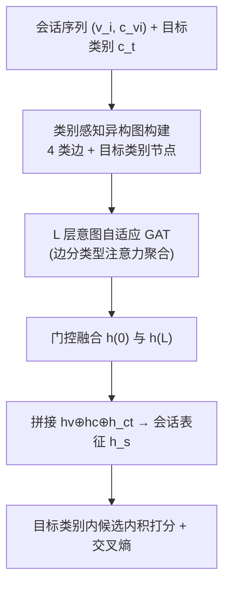

# Intention Adaptive Graph Neural Network for Category-aware Session-based Recommendation (类别感知会话推荐的意图自适应图神经网络)

- **会议/期刊**: DASFAA 2022
- **作者与机构**: Chuan Cui, Qi Shen, Shixuan Zhu, Yitong Pang, Yiming Zhang, Hanning Gao, Zhihua Wei（同济大学）
- **推荐链路定位**: 召回（会话内候选商品排序）
- **研究方向**: 序列与会话推荐 / 图神经网络推荐
- **论文原文**: [arXiv:2112.15352v2](https://arxiv.org/abs/2112.15352v2)
- **开源代码**: [strawhatboy/IAGNN](https://github.com/strawhatboy/IAGNN)

## TL;DR (1分钟核心速览)

真实电商/短视频场景中用户常主动点击某一**目标类别**作为全局筛选（如"只想看电子类"），但传统 SBR 只看物品序列、无视该信号。本文定义 **CSBR 新任务**，并提出 IAGNN：将物品、类别、目标类别节点统一建成异构会话图，用位置感知 GAT 把历史交互信息**迁移到目标类别域**，再以目标类别节点+双末位物品表征做会话意图。在三数据集（均按目标类别过滤候选）上，P@20 相对最强基线 DA-GCN† 提升 2.99%/6.30%/6.24%，Yoochoose 的 mrr@20 提升高达 14.57%。

## Background & Motivation (背景与核心矛盾)

- **主流范式**: SBR 用 RNN（GRU4Rec/NARM）或 GNN（SR-GNN/LESSR/StarGNN）建模匿名会话内的物品转移，输出下一物品概率。
- **前人局限**: ①现有 SBR 完全忽略用户点击类别按钮这一**显式可控反馈**，无法及时纠偏已偏离的兴趣；②即使用类别（跨域/类别感知推荐）也只当作辅助特征或划分子序列，**从未把用户指定的目标类别当作建模目标域**来约束候选集。
- **核心洞察 (Key Insight)**: 用户点击类别筛选即宣示了"想去哪个域"，但跨类别历史仍有价值——如"Mario 印花 T 恤"（Fashion）可提示"Nintendo 游戏机"（Electronics）；同时"S 类泳镜"这类跨类噪声需被**自适应蒸馏**，不能简单全量迁移。
- **本文切入点**: 把目标类别显式建成图中一个特殊节点，直接连到全部历史物品节点，用消息传递天然完成"历史→目标域"的信息蒸馏与长程跳连。

## Method (核心方法设计)

### 1. 整体框架 (Overall Architecture)

输入为 `(物品, 类别)` 对序列及目标类别 $c_t$。先由 Embedding 层初始化物品/类别 id 向量并融合反向位置编码；随后构建**类别感知异构图**（四类边：类内物品转移、类别转移、物品-类别双向连接、目标类别与全部物品的连接）；再用$L$层意图自适应 GAT 在同一套注意力消息机制下按边类型聚合，并通过门控把第 0 层与第$L$层融合以防过平滑；最终拼接 [原序列末位物品, 类内子序列末位物品, 目标类别节点] 三类表征成会话向量$h_s$，与目标类别内候选物品内积打分，交叉熵训练。

### 2. 关键设计拆解 (Key Designs)

1. **类别感知异构图（含目标类别节点）**：痛点是从"只看物品链"升级到"物品↔类别↔目标类别"多关系建模。图构造将原序列拆成各**类内子序列**保留同类物品转移（$v_i\to v_j$），同时按原序建类别链$c_1\to c_2\to\cdots$捕捉跨类兴趣漂移；物品与其类别建双向边，借"物品→类别→物品"两跳实现非相邻物品的长程传播。最关键是新增$c_t$ 节点连到**所有历史物品**，既解决长距离依赖，又形式化为"历史信息向目标域汇聚"的伪节点，作为下一物品的中间桥梁。相比 LESSR 的 shortcut、StarGNN 的 star 节点，本文的枢纽是**语义化的类别而非抽象全局节点**。

2. **位置感知 + 分边类型注意力的意图自适应 GNN**：物品表征先拼接类别与反向位置：$e_{v_i}=W'[e_{v_i}\|e_{c_{v_i}}\|p_{v_i}]$。任一边类型$(s\to t)$采用统一注意力聚合$\alpha_{ij}=\text{softmax}_k(\text{LeakyReLU}(a_l\,Wh_i+a_r\,Wh_k))$，物品节点三层汇总$h^{(l+1)}_{v_i}=h^{(l+1)}_{v_i\leftarrow v}+h^{(l+1)}_{v_i\leftarrow c}+h^{(l+1)}_{v_i\leftarrow c_t}$，类别节点$h^{(l+1)}_{c_i}=h^{(l+1)}_{c_i\leftarrow v}+h^{(l+1)}_{c_i\leftarrow c}$，目标节点仅接收物品消息$h^{(l+1)}_{c_t}=h^{(l+1)}_{c_t\leftarrow v}$。物理直觉：目标节点被**多跳迭代式蒸馏**，注意力天然抑制跨类噪声（如泳镜），强化对目标域有用的语义（如 Mario 关联），无需人工门控。

3. **门控融合、双末位读出与训练目标**：为防过平滑，用门控 $h^{L}=g\odot h^{(0)}+(1-g)\odot h^{(L)},\; g=\sigma(W[h^{(0)}\|h^{(L)}])$。读出同时保留原序列末位$v_l$与类内子序列末位$v_{lc}$（以及对应类别$c_l,c_{lc}$），$h_v=\text{Gated}(h^L_{v_l},h^L_{v_{lc}})$、$h_c=\text{Gated}(h^L_{c_l},h^L_{c_{lc}})$，会话向量$h_s=W_s[h_v\|h_c\|h_{c_t}]$，打分$\hat{y}_i=h_s^\top\tilde{e}_{v_i}$，以交叉熵$\mathcal{L}=-\sum_i y_i\log\hat{y}_i+(1-y_i)\log(1-\hat{y}_i)$训练（论文公式 (15) 第二项实为$\log(1-\hat{y}_i)$ 的常见笔误形式）。**不额外加读出注意力**，因目标节点经多层传播已等价完成注意力加权；推理仅需在目标类别内候选集内积，无需负采样。

## Experimental Setup & Evaluation Protocol (实验设置与评估协议)

- **数据集与预处理**: 三数据集均带类别元数据，做数据增强（第 $i$物品作标签、前$i-1$作输入，标签类别为目标类别），过滤长度$\le 2$的会话及出现$<5$ 次的物品（5-core），并按目标类别过滤候选物品：

| 数据集 | #Items | #Sessions | 平均会话长 | #Categories | 每会话平均类别数 | 场景 |
| :--- | :---: | :---: | :---: | :---: | :---: | :--- |
| Diginetica* | 33,596 | 482,743 | 6.48 | 982 | 2.28 | 电商搜索日志 |
| Yoochoose* (1/4) | 13,317 | 400,613 | 10.27 | 12 | 2.07 | RecSys'15 零售点击 |
| Jdata* | 79,356 | 959,824 | 6.90 | 79 | 2.35 | 京东 1h 会话 |

- **数据划分与防穿越**: 比例划分 **8:1:1**（train/val/test），沿用 SBR 惯用的输入-标签数据增广方式。
- **排名评测协议**: 目标类别过滤后的**类内 Full-Ranking**（候选集仅保留与 $c_t$ 同类的物品），避免跨类候选稀释，衡量类内精确排序能力。
- **对比基线与超参**: RNN（GRU4Rec/NARM）、GNN（SR-GNN/LESSR/StarGNN）及带目标类别加的变体（NARM†/LESSR†/StarGNN†）与跨域 DA-GCN†。嵌入维 $d=128$，Adam，batch 256，学习率网格$[0.001,0.1]$，GNN 层数$L\in[1,5]$；最优差异以 paired t-test$p<0.01$ 检验。

## Key Experimental Results (实验关键数据)

### 1. 主实验对比 (Main Results)

| 模型 | Diginetica* P@20 | mrr@20 | Yoochoose* P@20 | mrr@20 | Jdata* P@20 | mrr@20 |
| :--- | :---: | :---: | :---: | :---: | :---: | :---: |
| GRU4Rec | 36.52 | 15.89 | 13.93 | 4.38 | 43.79 | 14.97 |
| NARM | 37.84 | 17.53 | 15.25 | 6.21 | 45.01 | 16.29 |
| SR-GNN | 41.86 | 17.17 | 15.39 | 5.11 | 46.30 | 16.88 |
| LESSR | 41.42 | 17.27 | 15.67 | 6.24 | 46.92 | 17.71 |
| StarGNN | 40.96 | 16.09 | 17.30 | 5.80 | 48.40 | 17.94 |
| DA-GCN† | 42.53 | 17.62 | 20.15 | 7.41 | 48.30 | 17.29 |
| **IAGNN** | **43.80** | **18.11** | **21.42** | **8.49** | **51.79** | **19.72** |
| Improv. | +2.99% | +2.55% | +6.30% | +14.57% | +6.24% | +7.58% |

### 2. 消融实验 (Ablation Study)

| 配置 | Yoochoose* P@20 | mrr@20 | Jdata* P@20 | mrr@20 |
| :--- | :---: | :---: | :---: | :---: |
| w/o Category nodes | 20.89 | 8.12 | 50.84 | 19.32 |
| w/o Target category info（均值池化替代） | 20.91 | 8.04 | 50.87 | 19.08 |
| w/o Category transition（去 $h_{c_i\leftarrow c}$） | 21.36 | 8.13 | 51.14 | 19.47 |
| Add Original item transition | 21.22 | 8.41 | 51.70 | 19.68 |
| Add Attention mechanism | 20.76 | 7.68 | 50.14 | 18.97 |
| Positive position embedding | 21.80 | 8.04 | 51.49 | 19.62 |
| **IAGNN** | **21.42** | **8.49** | **51.79** | **19.72** |

### 3. 关键实验发现 (Key Findings)

1. **目标类别节点是意图迁移的核心**：改用均值池化替目标嵌入后，Yoochoose 的 mrr@20 从 8.49 掉到 8.04、Jdata 从 19.72 掉到 19.08，P@20 亦下滑约 0.5–0.9，说明把"目标域"建成可接收全历史消息的节点，比简单把类别向量拼进 query 更能蒸馏跨类有用信息。
2. **冗余增强反而掉点**：额外加读出注意力后 P@20 降至 20.76/50.14（Yoochoose/Jdata 最低），加原序列全物品转移链降至 21.22/51.70，验证多层 GNN+门控已隐式完成注意力加权且类内子序列+位置编码已近无损，附加结构引入噪声/过平滑。
3. **GNN 深度呈先升后降**：1→3 层性能持续上升（图 3），约 3–4 层后普遍下滑（过平滑），IAGNN 在 3 层附近最优，与"类别链+目标节点"需要多跳传播但不容过深的设计吻合。

## Highlights & Limitations (亮点、对比与审稿批判)

- **与代表作对比 (vs. Prior Work)**: LESSR 用 shortcut 保留长程依赖、StarGNN 用 star 节点聚合全局，均为**无语义**的抽象枢纽；DA-GCN† 借跨域思想把类别当"域"并加目标类别，但仍以独立域建模为主。IAGNN 的核心增量在于**把目标类别本身做成图节点并与全部物品直连**，使"历史→目标域"的信息蒸馏由消息传递一步完成，且保留原序列+类内子序列双视图。
- **可迁移亮点**: ①"用户指定的筛选条件/约束"建模为图中专属节点，可直接迁移到任意多属性/多场景筛选推荐；②门控融合第 0/L 层 + 双末位读出（原序列与域内子序列）是抑制过平滑、保序的通用技巧。
- **审稿级局限批判**: ①Diginetica 类别多达 982，提升仅 2.99%，类目爆炸下的噪声鲁棒性未做专门设计，也未给出类别数分桶实验；②候选集按目标类别过滤使任务退化为"类内重排"，与非过滤的全库排序不可直接比较，缺线上 A/B 或时延评估；③GNN 层数、正/反向位置编码等超参敏感（正向编码 P@20 反升但 mrr 反降），需针对数据集逐一调参。

## Rating (四维评分)

- **方法创新性 (Novelty)**: ⭐⭐⭐⭐ （首次定义 CSBR 任务，目标类别节点+异构会话图+意图自适应迁移的思路清晰有新意，但注意力/门控组件本身较常规）
- **评估协议与实验扎实度 (Protocol & Experiments)**: ⭐⭐⭐☆ （三数据集+类内 Full-Ranking+显著性与消融完整，但类过滤候选限制可比性、缺用户/长尾分桶与线上验证）
- **写作与数学规范度 (Clarity & Rigor)**: ⭐⭐⭐⭐ （图构造与四类消息聚合定义清楚，公式成体系；公式 (15) 第二项存 $\log(1-\hat{y}_i)$ 书写瑕疵，读出设计动机解释到位）
- **工业落地与复现价值 (Industrial & Practical Value)**: ⭐⭐⭐⭐ （代码开源、纯类内内积推理开销低，直接对应导航栏类别筛选的真实产品交互，落地路径清晰）

