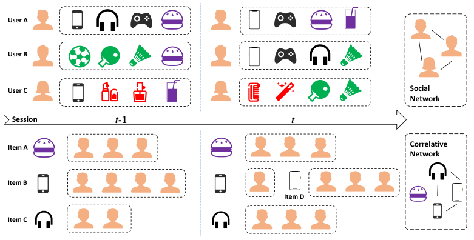
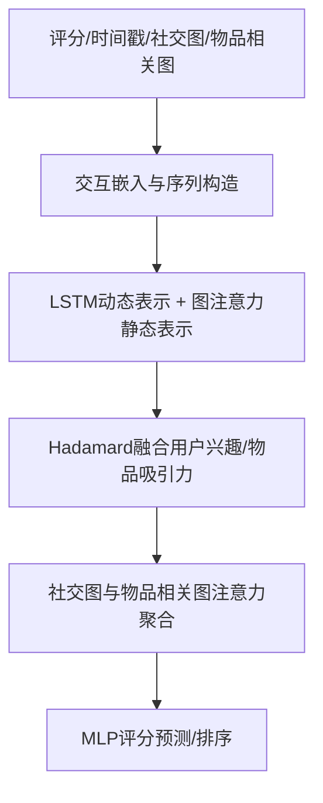
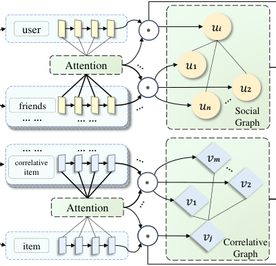

# Graph Neural Networks with Dynamic and Static Representations for Social Recommendation (动态与静态表示的社交推荐图神经网络)

- **会议/期刊**: DASFAA 2022
- **作者与机构**: Junfa Lin, Siyuan Chen, Jiahai Wang；中山大学计算机学院
- **推荐链路定位**: 精排（评分预测 / 物品排序）
- **研究方向**: 社交与群组推荐 / 图神经网络推荐 / 序列推荐
- **论文原文**: [https://arxiv.org/abs/2201.10751v2](https://arxiv.org/abs/2201.10751v2)
- **开源代码**: 暂未开源

## TL;DR (1分钟核心速览)

针对社交推荐中物品侧动态吸引力与相关物品关系被忽视、用户侧动态-静态兴趣割裂的问题，GNN-DSR用LSTM捕获短期动态、图注意力捕获长期静态，并以Hadamard融合；再分别聚合社交图与物品相关图影响。在Ciao/Epinions按80/10/10划分的评分预测中，RMSE较GraphRec+降3.14%/0.45%；Delicious物品排序MRR@20较DGRec升8.37%。

## Background & Motivation (背景与核心矛盾)

- **主流范式**: GNN社交推荐将用户-物品交互图与用户社交图联合建模，GraphRec/GraphRec+等通过图聚合学习用户与物品表示。
- **前人局限**: 现有工作偏重用户侧，物品吸引力随时间变化及物品间相关关系很少建模；序列推荐虽能捕获动态兴趣，却忽略社交关系与物品关联影响。
- **核心洞察 (Key Insight)**: 用户兴趣与物品吸引力都同时具有短期动态和长期静态成分，并分别受朋友与相关物品影响，双边建模可互补。
- **本文切入点**: 在用户、物品两侧统一建模动态/静态交互表示，并用双关系图注意力聚合社交影响与物品关联影响。

<figure class="paper-figure" markdown="span">
  <figcaption>图1. 用户兴趣和物品吸引力随时间可能变化的示例。</figcaption>
</figure>

## Method (核心方法设计)

### 1. 整体框架 (Overall Architecture)

GNN-DSR先由用户-物品评分构造交互嵌入，并按时间戳整理用户/物品序列；对序列用LSTM得到短期动态表示，对历史交互边用图注意力得到长期静态表示，二者Hadamard融合为用户兴趣与物品吸引力。随后在社交图和由评分向量余弦相似度top-k构造的物品相关图上做关系图注意力，得到关系增强表示，并与交互表示拼接，最后经MLP预测评分。训练采用评分回归MSE；物品排序任务改为点击概率交叉熵。

<figure class="paper-figure" markdown="span">
  <figcaption>图2. GNN-DSR概览。从左到右，GNN-DSR可分为五层：1）输入层，处理原始数据并将其输入GNN-DSR。2）嵌入层，将预处理后的数据分别转换为用户向量空间和物品向量空间。3）交互聚合，分别建模用户和物品的动态与静态表示。4）关系图聚合，分别聚合相邻用户或物品的影响。5）输出层，使用MLP进行评分预测。</figcaption>
</figure>

### 2. 关键设计拆解 (Key Designs)

1. **双边动态-静态交互表示**：痛点在于物品吸引力被当作静态ID、用户短期兴趣与长期偏好割裂。交互嵌入为 $x_{i\leftarrow j}=g_{uv}([e_{ij},q_j])$；动态表示$h_i^S=\mathrm{LSTM}(X^{(i)})$；静态表示$h_i^L=\sigma(W_0^{uv}\sum_{j\in N_i^{uv}}\alpha_{ij}x_{i\leftarrow j}+b_0^{uv})$，注意力权重由$[p_i,x_{i\leftarrow j}]$计算；融合为$h_i^I=h_i^S\odot h_i^L$。直觉是动态捕获近期漂移，静态平滑稀疏噪声，Hadamard保留二者共现成分。
2. **用户社交图与物品相关图的关系聚合**：前人通常只聚合用户社交影响，物品仅用交互表示。本文以 $h_i^N=f_{uu}(p_i,\{h_o^I:o\in N_i^{uu}\})$聚合朋友兴趣，以$h_j^N=f_{vv}(q_j,\{h_k^A:k\in N_j^{vv}\})$ 聚合相关物品吸引力；注意力按关系邻域异构强度加权，使强关系/高相关物品贡献更大。
3. **训练目标、负采样与推理效率**：评分任务用 $\mathcal{L}_{MSE}=\frac{1}{2|\mathcal{P}|}\sum_{(i,j)\in\mathcal{P}}(\hat{r}_{ij}-r_{ij})^2$；排序任务将评分置1，用交叉熵预测序列末项点击概率。原文未显式采用负采样，也未详述候选负例构造。总复杂度约$O(n(2n_v+n_s)d^2+m(2m_u+m_c)d^2)$，对用户/物品数线性；序列截断30、邻居采样30控制开销。

## Experimental Setup & Evaluation Protocol (实验设置与评估协议)

- **数据集与预处理**: 移除无社交连接/无交互用户与无交互物品，未处理冷启动；Ciao/Epinions为1–5星评分+社交信任，Delicious为书签/标签+社交关系。

| 数据集 | #Users | #Items | #Interactions | 稀疏度/密度 | 特征/场景说明 |
| :--- | :---: | :---: | :---: | :---: | :--- |
| Ciao | 2,379 | 16,862 | 35,990 | 密度≈0.090% | 消费者评分1–5，社交朋友 |
| Epinions | 22,167 | 296,278 | 920,073 | 密度≈0.014% | 评论评分1–5，信任网络 |
| Delicious | 1,313 | 5,793 | 266,190 | 密度≈3.50% | 书签/标签，物品排序 |

- **数据划分与防穿越 (Splitting Strategy)**: 采用 `比例划分`，80%训练/10%验证/10%测试；序列按交互时间戳升序构建，并非全局时间戳切分评估。
- **排名评测协议 (Ranking Protocol)**: 评分任务在测试集已观测评分上算RMSE/MAE；Delicious排序按序列末项点击概率排序候选物品，报告MRR@10/20与NDCG@10/20。原文未明确是 `Full-Ranking` 还是采样排序，存在协议透明度不足。
- **对比基线与超参设置**: 基线覆盖社交推荐（SoReg/SocialMF/DeepSoR）、序列推荐（NARM/SSRM/STAMP）与GNN推荐（GraphRec/GraphRec+/DGRec）。嵌入维度 $d=128$，batch=256，用户/物品序列截断30，物品相关图$k=100$，关系邻居采样30，RMSprop学习率0.001，LSTM隐藏层约4层，dropout=0.5（评分）/0.4（排序）；显著性$p<0.01$。

## Key Experimental Results (实验关键数据)

### 1. 主实验对比 (Main Results)

表1 评分预测（Ciao/Epinions，↓越低越好；括号为相对最佳基线GraphRec+的降幅）

| 模型 | Ciao RMSE | Ciao MAE | Epinions RMSE | Epinions MAE |
| :--- | :---: | :---: | :---: | :---: |
| SocialMF | 1.0501 | 0.8270 | 1.1328 | 0.8837 |
| DeepSoR | 1.0316 | 0.7739 | 1.0972 | 0.8383 |
| NARM | 1.0540 | 0.8349 | 1.1050 | 0.8648 |
| STAMP | 1.0827 | 0.9558 | 1.0829 | 0.8820 |
| DGRec | 0.9943 | 0.8029 | 1.0684 | 0.8511 |
| GraphRec | 0.9894 | 0.7486 | 1.0673 | 0.8123 |
| GraphRec+ | 0.9750 | 0.7431 | 1.0627 | 0.8113 |
| **GNN-DSR** | **0.9444** (↓3.14%) | **0.6978** (↓6.10%) | **1.0579** (↓0.45%) | **0.8016** (↓1.20%) |

表2 物品排序（Delicious，↑越高越好；括号为相对最佳基线DGRec的提升）

| 模型 | MRR@10 | MRR@20 | NDCG@10 | NDCG@20 |
| :--- | :---: | :---: | :---: | :---: |
| GraphRec | 0.1437 | 0.1527 | 0.1915 | 0.2243 |
| GraphRec+ | 0.1568 | 0.1659 | 0.2058 | 0.2392 |
| NARM | 0.2011 | 0.2074 | 0.2439 | 0.2680 |
| DGRec | 0.2016 | 0.2080 | 0.2669 | 0.2944 |
| **GNN-DSR** | **0.2155** (↑6.89%) | **0.2254** (↑8.37%) | **0.2805** (↑5.10%) | **0.3164** (↑7.47%) |

### 2. 消融实验 (Ablation Study)

表3 消融（Ciao/Epinions评分预测，↓越低越好）

| 模型 | Ciao RMSE | Ciao MAE | Epinions RMSE | Epinions MAE |
| :--- | :---: | :---: | :---: | :---: |
| w/o LSTM | 0.9694 | 0.7456 | 1.0804 | 0.8224 |
| w/o ATT | 1.0242 | 0.8350 | 1.0756 | 0.8116 |
| w/o SN | 0.9568 | 0.7111 | 1.0621 | 0.8087 |
| w/o CN | 0.9496 | 0.7083 | 1.0601 | 0.8069 |
| w/o SC | 0.9682 | 0.7303 | 1.0628 | 0.8130 |
| **GNN-DSR** | **0.9444** | **0.6978** | **1.0579** | **0.8016** |

### 3. 关键实验发现 (Key Findings)

1. **静态注意力在稀疏小数据更关键**：Ciao上去掉ATT使RMSE从0.9444升至1.0242（恶化8.45%），而去掉LSTM仅至0.9694；说明交互较少的Ciao更依赖长期静态聚合来稳定表示。
2. **动态序列在频繁交互场景贡献更明显**：Epinions上w/o ATT为1.0756，反而优于w/o LSTM的1.0804，表明大量交互更替时LSTM捕获的短期漂移比静态注意力更重要。
3. **社交影响强于物品关联、双侧融合最佳**：保留社交去掉物品关联（w/o CN）Ciao RMSE=0.9496，优于保留物品关联去掉社交（w/o SN）的0.9568；而双侧均去掉（w/o SC）最差为0.9682，证明双关系图互补。排序任务MRR@20、NDCG@20分别较DGRec提升8.37%、7.47%，验证动态+静态与关系增强对排序同样有效。

## Highlights & Limitations (亮点、对比与审稿批判)

- **与代表作对比 (vs. Prior Work)**: GraphRec+已用物品相关图，但缺少用户/物品随时间变化的动态表示；DGRec引入动态社交，却未建模物品侧吸引力与静态长期偏好；本文把动态-静态、用户-物品双边及双关系图统一在一个框架中。
- **可迁移亮点**: 用评分向量余弦相似度top-k构图可低成本补充物品关联；动态与静态表示Hadamard融合可迁移到序列推荐、跨域推荐的特征融合。
- **审稿级局限批判**: 排序候选协议未说明全库或采样，削弱MRR/NDCG可比性；模型依赖序列长度、邻居数与top-k相关物品，且未处理冷启动、未开源，工业复现与线上延迟评估不足。

## Rating (四维评分)

- **方法创新性 (Novelty)**: ⭐⭐⭐⭐ （首次将物品动态/静态吸引力与用户双边统一建模，双关系图注意力机制清晰）
- **评估协议与实验扎实度 (Protocol & Experiments)**: ⭐⭐⭐ （三数据集与显著性检验较完整，但排序候选协议未透明、基线偏旧）
- **写作与数学规范度 (Clarity & Rigor)**: ⭐⭐⭐⭐ （核心公式与聚合流程定义清楚，复杂度分析到位；部分实现细节未展开）
- **工业落地与复现价值 (Industrial & Practical Value)**: ⭐⭐⭐ （构图与复杂度可控，但未开源、RNN长序列与邻居采样开销需线上验证）

