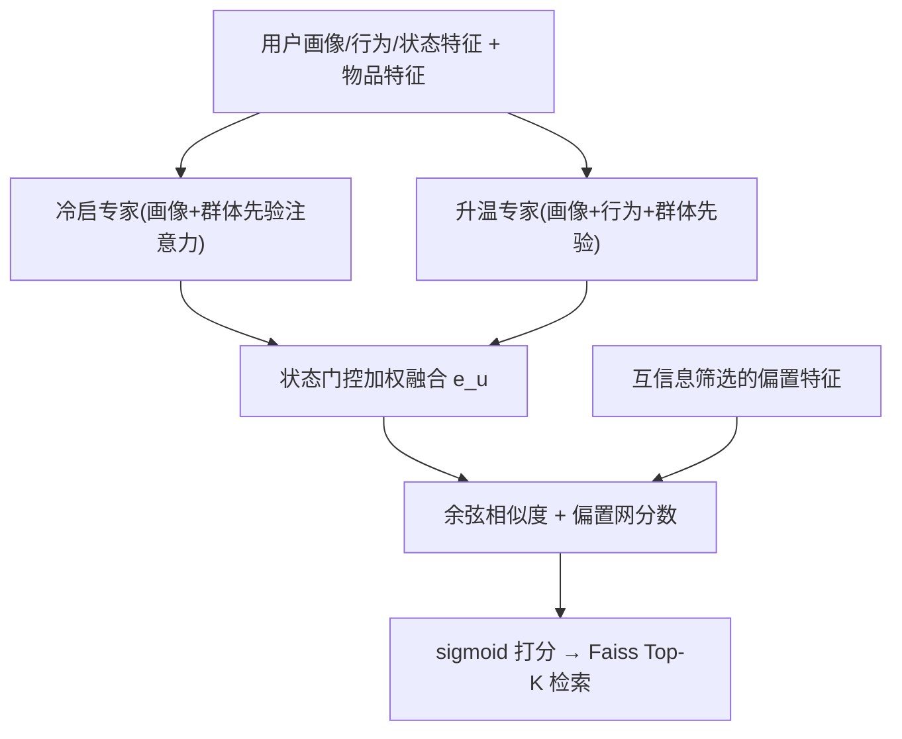
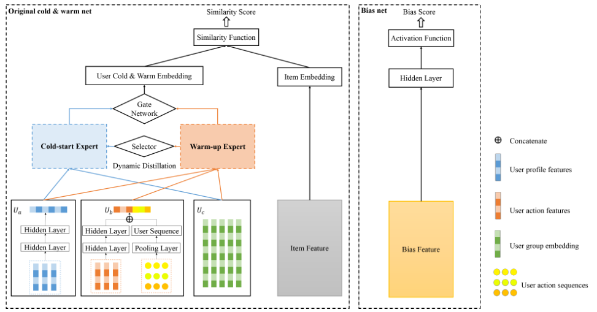
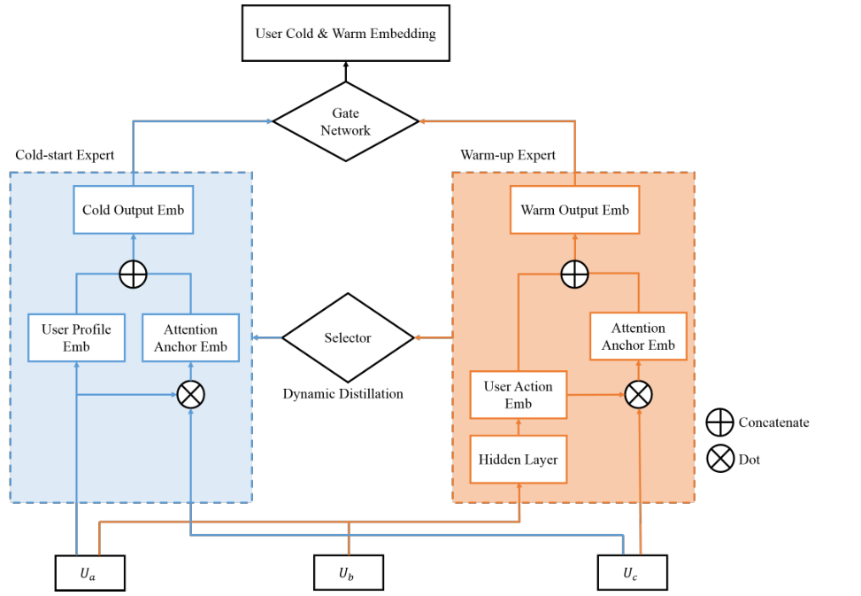

# Cold & Warm Net: Addressing Cold-Start Users in Recommender Systems (冷启与升温网络：召回阶段的用户冷启动建模)

- **会议/期刊**: DASFAA 2023
- **作者与机构**: Xiangyu Zhang, Zongqiang Kuang, Zehao Zhang, Fan Huang (腾讯), Xianfeng Tan (腾讯) ; 清华大学
- **推荐链路定位**: 召回 (Matching / Two-Tower Candidate Generation)
- **研究方向**: 冷启动与长尾推荐 / 协同过滤与双塔召回
- **论文原文**: [论文原文链接](https://arxiv.org/abs/2309.15646v1)
- **开源代码**: 暂未开源

## TL;DR (1分钟核心速览)

针对召回阶段用户冷启动：侧信息法只覆盖部分用户、元学习需二阶梯度不适合十亿级召回。本文提出双塔内的冷启/升温双专家 + 状态门控融合、动态知识蒸馏（按样本挑选教师）与互信息筛选的行为偏置网。在 MovieLens-1M 与工业短视频 Little-World 上用 Faiss 全库 Top-K 检索评估，冷启用户 HR@100 分别提升 9.52% 与 23.94%，线上 APT +3.27%、URR +1.01%。

## Background & Motivation (背景与核心矛盾)

- **主流范式**: 召回阶段以双塔 embedding 模型为主（YouTubeDNN、DSSM、Mind、UMI），靠用户行为序列刻画兴趣，再以内积/余弦近邻检索。
- **前人局限**: ① 多兴趣与序列模型高度依赖稠密行为，冷启用户序列稀疏时表征退化；② 侧信息（社交网络、内容特征）只对具备该特征的子集有效；③ 元学习依赖二阶梯度，无法满足召回阶段的吞吐与可扩展性要求。
- **核心洞察 (Key Insight)**: 用户的"冷启→升温→活跃"是一个随行为累积连续迁移的动态过程，而非静态三类硬划分；用统一策略建模所有用户（或硬路由）都会让冷启样本被活跃样本的梯度淹没。
- **本文切入点**: 用两个专家分别吸收"仅有画像"与"画像+行为"两类分布，让门控按用户状态软融合，并用动态蒸馏把升温专家的知识定向灌给冷启专家，避免其欠拟合。

## Method (核心方法设计)

### 1. 整体框架 (Overall Architecture)

输入分三路：用户画像特征 $X_{up}$、用户行为特征$X_{ua}$、用户状态特征$X_{us}$与物品特征$X_i$。先生成画像嵌入$\boldsymbol{e}_{up}$与行为嵌入$\boldsymbol{e}_{ua}$，并从预训练活跃用户嵌入经 k-means 聚类、均值池化得到群体先验表$\mathbf{E}_{ug}\in\mathbb{R}^{m\times d}$。冷启专家仅用"画像 + 群体先验注意力"，升温专家额外吃行为嵌入；门控由状态特征输出权重做加权和得$\boldsymbol{e}_u$，与物品塔$\boldsymbol{e}_i$ 算余弦相似度，再叠加偏置网分数经 sigmoid 输出。训练端主损失 BCE 加动态蒸馏辅助损失；推理端物品向量离线入 Faiss 建索引，在线仅算用户塔 + ANN 检索。

<figure class="paper-figure" markdown="span">
  <figcaption>图1. Cold &amp; Warm Net。</figcaption>
</figure>

### 2. 关键设计拆解 (Key Designs)

1. **冷/升温双专家 + 群体先验注意力**：痛点是不该用同一套参数处理稀疏与稠密行为样本。冷启专家以画像嵌入为 query，从群体先验表检索最相关簇中心做锚点：$\boldsymbol{e}_{a}^{cold}=\mathrm{softmax}\!\left(\frac{\boldsymbol{e}_{up}\mathbf{E}_{ug}^{\top}}{\sqrt{d}}\right)\mathbf{E}_{ug}$，再与画像拼接过 MLP 得$\boldsymbol{e}_{cold}$；升温专家同理但以画像+行为融合嵌入$\boldsymbol{e}_{ut}$为 query。最后用状态特征（登录态、活跃度）经门控给出$\boldsymbol{e}_{u}=w_{cold}\boldsymbol{e}_{cold}+w_{warm}\boldsymbol{e}_{warm}$。直觉：群体先验给冷启用户一个"同簇老用户"的协同锚点，等价于用聚类中心做隐式协同信息迁移，无需跨用户图传播。

<figure class="paper-figure" markdown="span">
  <figcaption>图2. 用户冷热嵌入层。</figcaption>
</figure>

2. **动态知识蒸馏（Teacher Selector）**：固定蒸馏会让冷启专家永远模仿升温专家、丧失对冷启分布的刻画能力；不蒸馏又会欠拟合。作者改为逐样本判定教师：仅当升温专家比冷启专家错得更狠时才蒸馏，

$$\ell_d=\ell(\hat{y}_c,\hat{y}_w)\cdot\mathbb{I}\left[\ell(\hat{y}_w,y)>\ell(\hat{y}_c,y)\right],\quad \mathcal{L}_o=\mathcal{L}+\alpha\mathcal{L}_d$$

即"冷启专家已经答对就不学"，保证蒸馏只在冷启专家欠拟合处生效，从而既提升又不与升温专家同化。

3. **互信息筛选的行为偏置网 + 训练/推理开销**：冷启与活跃用户的点击率天然差数倍，单一相似度难以吸收此偏差。作者用互信息度量各用户特征与目标行为的关联度，取 Top-$\beta$特征$X_b$输入偏置网得$y_{bias}$，最终$y=\sigma(y_{sim}+y_{bias})$。总损失为冷启/升温专家各自的 BCE（冷启专家叠加$\mathcal{L}_d$）；负样本采用随机采样以对齐训练/测试分布；用户塔仅在线上计算一次，$d=32$ 极轻量，满足召回延迟约束。

## Experimental Setup & Evaluation Protocol (实验设置与评估协议)

- **数据集与预处理**: 论文未显式声明 `5-core` 等过滤规则（记为协议短板），仅给出原始统计：

| 数据集 | #Users | #Items | #Interactions | 稀疏度/密度 | 特征/场景说明 |
| :--- | :---: | :---: | :---: | :---: | :--- |
| MovieLens-1M | 6,040 | 3,706 | 1,000,209 | 4.47% | 公开电影评分，稠密小规模 |
| Little-World | 433,549 | 406,140 | 15,200,286 | 0.0086% | QQ 短视频真实日志，经匿名化脱敏 |

- **数据划分与防穿越 (Splitting Strategy)**: 原文未交代具体划分方式（未标 `Leave-One-Out`/时间戳切分），仅报告按"全用户 / 冷启用户"两组分别评测；此为复现性上的主要不确定点。
- **排名评测协议 (Ranking Protocol)**: 采 Faiss 在**全物品库**上检索 Top-K（近似 `Full-Ranking`，未使用负采样候选集），指标为 HR@50/100 与 NDCG@10/50，NDCG 的相关性取二值 $R_{ur}\in\{0,1\}$。
- **对比基线与超参设置**: FM、YouTubeDNN、DSSM、Mind、UMI 五类工业召回常客；所有模型 $d=32$、batch size 256，TensorFlow 实现；本文$\alpha=5\times10^{-2}$、$\beta=10$；未报告显著性检验（表中 `*` 标注的是次优基线）。

## Key Experimental Results (实验关键数据)

### 1. 主实验对比 (Main Results)

冷启用户组（最具判别力）：

| Model | ML-1M HR@50 | ML-1M HR@100 | ML-1M NDCG@10 | ML-1M NDCG@50 | LW HR@50 | LW HR@100 | LW NDCG@50 |
| :--- | :---: | :---: | :---: | :---: | :---: | :---: | :---: |
| FM | 0.1568 | 0.2953 | 0.0211 | 0.0461 | 0.0710 | 0.1047 | 0.0242 |
| YouTubeDNN | 0.2444 | 0.3849 | 0.0236 | 0.0639 | 0.1088 | 0.1768 | 0.0311 |
| DSSM | 0.3666* | 0.5356* | 0.0657* | 0.1173* | 0.1109* | 0.1775* | 0.0326* |
| Mind | 0.3259 | 0.4807 | 0.0485 | 0.1008 | 0.1074 | 0.1771 | 0.0300 |
| UMI | 0.3360 | 0.4705 | 0.0493 | 0.1002 | 0.1103 | 0.1671 | 0.0281 |
| **Cold & Warm** | **0.4094** | **0.5866** | **0.0678** | **0.1265** | **0.1435** | **0.2200** | **0.0418** |
| Improv.% | +11.67% | +9.52% | +3.19% | +7.84% | +29.39% | +23.94% | +28.22% |

全用户组（相对最优基线 UMI）：ML-1M HR@50 0.2556 vs 0.2348（+8.86%）、NDCG@10 +20.98%；Little-World HR@50 0.1122 vs 0.0920（+21.95%）、NDCG@10 +30.25%。

### 2. 消融实验 (Ablation Study)

| 变体 | ML-1M 全用户 HR@100 | ML-1M 全用户 NDCG@10 | ML-1M 冷启 HR@100 | ML-1M 冷启 NDCG@10 | LW 全用户 HR@100 | LW 冷启 HR@100 | LW 冷启 NDCG@10 |
| :--- | :---: | :---: | :---: | :---: | :---: | :---: | :---: |
| Full | **0.3932** | **0.0369** | **0.5866** | **0.0678** | **0.1792** | **0.2200** | **0.0215** |
| w/o DKD | 0.3869 | 0.0318 | 0.5540 | 0.0581 | 0.1703 | 0.1987 | 0.0190 |
| w/o Bias Net | 0.3930 | 0.0367 | 0.5682 | 0.0632 | 0.1761 | 0.2122 | 0.0203 |

### 3. 关键实验发现 (Key Findings)

1. **DKD 是冷启增益的主引擎，且对 NDCG 的贡献远超 HR**：去掉 DKD 后 ML-1M 冷启 HR@100 掉 5.88%、LW 掉 10.72%，NDCG@10 掉幅更大（0.0678→0.0581、0.0215→0.0190），说明蒸馏带来的不只是"命中更多"，而是把冷启用户真正感兴趣的高分物品往前排。Bias Net 的贡献更温和（HR@100 +3.24%/+3.68%），二者互补而非替代。
2. **蒸馏的作用机制被权重与 AUC 双向验证**：施加 DKD 后门控权重 $w_{cold}$ 从 0.0410 跃升至 0.3140，冷启专家不再被"关掉"；Little-World 上冷启专家 AUC 0.5675→0.7384、整体测试 AUC 0.7281→0.7548（注意升温专家训练 AUC 由 0.9255 降到 0.8993，正说明蒸馏把部分梯度让渡给了冷启专家）。
3. **多兴趣模型在冷启场景会失效**：Mind/UMI 在全用户上优于 YouTubeDNN，却在 ML-1M 冷启组被 DSSM 反超（HR@50 0.3259/0.3360 vs 0.3666），印证"序列依赖越强的模型，行为稀疏时退化越重"；本文相对 UMI 在该组 HR@50 提升约 21.8%。线上 A/B（Little-World 一周）冷启用户 APT +3.27%、URR +1.01%，VPI +23.34%、VSR −14.30%（基线 DSSM），而 Mind 仅 −2.05%/+2.76%，工业侧验证了"结构化先验 > 纯序列兴趣"的结论。

## Highlights & Limitations (亮点、对比与审稿批判)

- **与代表作对比 (vs. Prior Work)**: 相比 UMI/Mind 用多兴趣向量刻画活跃用户，本文显式切分"冷/升温"两条参数路径，解决的是稀疏样本被稠密样本支配的问题；相比侧信息/社交网络法（依赖特征可得性）与元学习法（二阶梯度不可扩展），本文只用一层注意力读取群体聚类先验即可迁移协同信号，训练开销与普通双塔同量级；相比 DSSM 这类统一双塔，差异在于门控软路由 + 样本级蒸馏。
- **可迁移亮点**: ① "逐样本教师选择"的蒸馏准则 $\ell_d=\ell(\hat{y}_c,\hat{y}_w)\mathbb{I}[\ell_w>\ell_c]$ 可直接迁移到新物品塔、跨域双塔、粗精排一致性蒸馏，天然规避同化；② 用活跃用户嵌入聚类均值作群体先验表 + 注意力查询，是无图传播条件下低成本的协同信息注入技巧。
- **审稿级局限批判**: ① 实验协议交代不清——未说明数据集过滤（是否 `5-core`）、划分方式与显著性检验，"全库 Faiss 检索"虽接近 Full-Ranking 但 ANN 近似误差未讨论，冷启用户的具体定义阈值（交互数 < k 的 k 值）缺失，复现性受限；② 超参与结构敏感度未做扫描——门控依赖状态特征 $X_{us}$的质量、聚类数$m$与蒸馏系数$\alpha$、偏置特征数$\beta$ 均无敏感性分析，且 k-means 需离线预训练模型，存在两阶段耦合与更新滞后风险。

## Rating (四维评分)

- **方法创新性 (Novelty)**: ⭐⭐⭐⭐ （双专家软门控 + 样本级教师选择蒸馏的组合在召回冷启场景较新颖，但组件本身多为 MoE/蒸馏的迁移，缺理论刻画）
- **评估协议与实验扎实度 (Protocol & Experiments)**: ⭐⭐⭐ （两个数据集 + 冷/全用户分组 + 线上 A/B 尚可，但划分与过滤细节缺失、无显著性检验、基线仅 5 个）
- **写作与数学规范度 (Clarity & Rigor)**: ⭐⭐⭐⭐ （公式简洁、算法伪代码清晰，问题定义与符号统一；但部分符号下标笔误与"冷启定义"表述含糊）
- **工业落地与复现价值 (Industrial & Practical Value)**: ⭐⭐⭐⭐ （$d=32$、单次用户塔 + Faiss 检索即可上线，已在短视频平台取得留存正收益；可惜未开源，复现需自建聚类先验流程）

