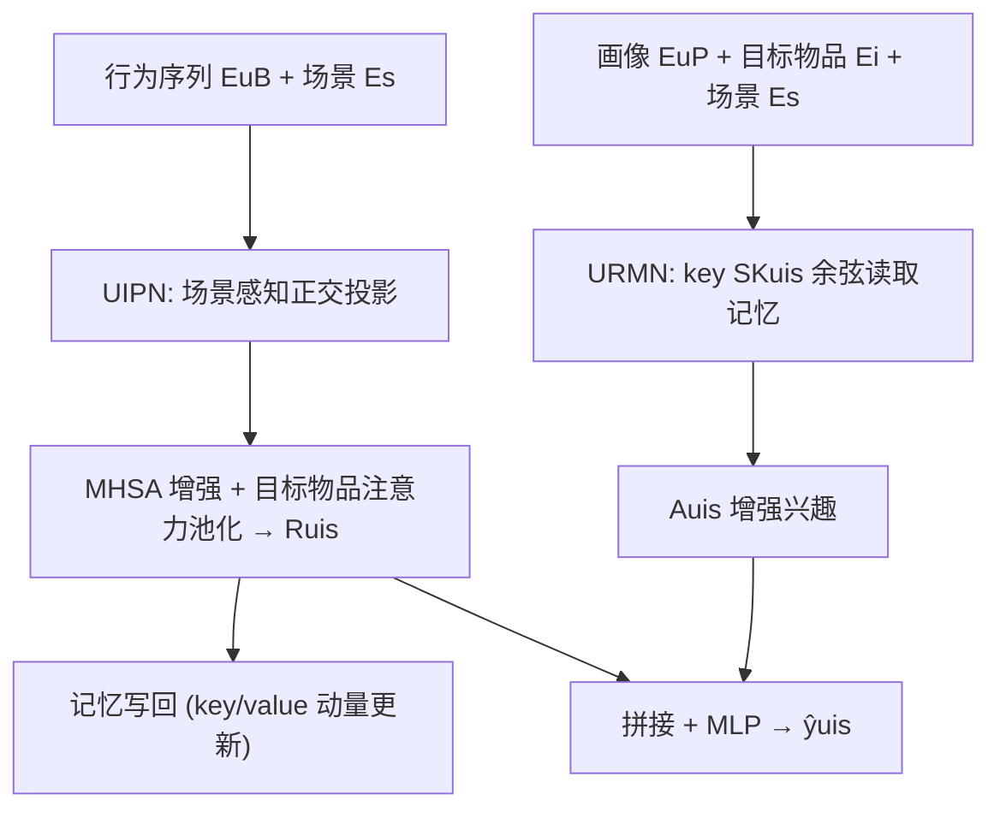
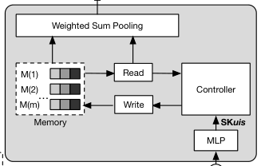

# Cold-Start based Multi-Scenario Ranking Model for Click-Through Rate Prediction（面向冷启动的多场景 CTR 排序模型 CSMN）

- **会议/期刊**: DASFAA 2023（Research Paper）
- **作者与机构**: Peilin Chen, Hong Wen, Fuyu Lv, Qijie Shen, Wanjie Tao 等（阿里巴巴飞猪 / 悉尼大学 / 浙江大学 / 之江实验室）
- **推荐链路定位**: 精排（单模型统一服务 20 个旅游场景的 CTR 预估）
- **研究方向**: 跨域与多场景推荐 / 冷启动与长尾推荐
- **论文原文**: [arXiv:2304.07858](https://arxiv.org/abs/2304.07858v1)
- **开源代码**: 暂未开源

## TL;DR (1分钟核心速览)

在线旅游平台（OTP）用户行为极度稀疏（28%/40% 用户近 180/90 天无行为），而通用多场景 CTR 模型（STAR、SAR-Net、DADNN）只做"共享底座 + 场景特异头"，完全忽略冷启动。本文提出 CSMN：UIPN 把每条历史行为按当前场景做正交投影净化、再用 target attention 聚合出场景特异兴趣；URMN 以 NTM 式外部记忆读写，把"画像相似且行为丰富"用户的兴趣向量迁移给冷启动用户。在 20 场景工业数据集（29M 用户、30 天日志）上 AUC 0.7001，较 SAR-Net 相对提升 2.41%，线上 A/B 全量 CTR +3.85%、冷启动用户 +4.62%。

## Background & Motivation (背景与核心矛盾)

- **主流范式**: 单场景序列模型（DIN/DIEN/DIHN）+ 多场景统一建模（STAR 的中心化共享参数与场景私有参数、SAR-Net 的场景/物品特征调制注意力、DADNN 的 shared-bottom + 场景头）共同刻画"共性（commonality）"与"差异性（discrimination）"。
- **前人局限**: ① 小场景独立建模数据稀疏、维护成本高；② STAR/SAR-Net 仅靠参数共享/注意力调制来区分场景，却在 OTP 的低频旅游需求下对"行为近空"的冷启动用户完全失效——AUC 在冷启动占比 38.5% 的场景 #10 上落后幅度最大。
- **核心洞察 (Key Insight)**: 作者指出**同一条历史行为在不同场景下的表征应当不同**（温泉=休闲、滑雪=冒险），而用户兴趣不仅藏在行为里，也藏在**固有画像**里——画像相似的用户在同一场景/同一目标物品下大概率共享兴趣。
- **本文切入点**: 用正交投影把"行为表征"和"场景表征"解耦，把解耦后的兴趣向量写入外部记忆槽，用画像×物品×场景构成的 key 做聚类检索，实现人群级兴趣迁移。

## Method (核心方法设计)

### 1. 整体框架 (Overall Architecture)

输入分五组特征——目标物品 $E_i$、历史行为序列$E_{u_B}$、用户画像$E_{u_P}$、场景$E_s$、上下文$E_c$，共享底层 embedding 承接共性。UIPN 先对每条行为$e_i\in E_{u_B}$与场景向量做场景感知投影得到净化序列$f_{u_B}$，经 MHSA 增强后被目标物品注意力加权池化为场景特异兴趣$R_{uis}$；URMN 用$SK_{uis}=F(\text{attn}(E_{u_P});E_i;E_s)$作为读 key，余弦权重加权读出增强兴趣$A_{uis}$，同时用同一权重以动量方式写回记忆的 key/value。最终$[E_i;E_{u_P};E_s;E_c;A_{uis};R_{uis}]$ 拼接过 4 层 MLP，logistic 损失端到端训练。

<figure class="paper-figure" markdown="span">
  <figcaption>图1. 所提出CSMN模型的总体架构，由嵌入层、用户表示记忆网络（URMN）和用户兴趣投影网络（UIPN）组成。符号 SKuis、Auis、Ruis 分别表示用户画像、目标物品和当前访问场景的综合表示，用户在特定场景下对目标物品的增强兴趣，以及用户利用目标物品和当前访问场景提纯后的场景特定兴趣。</figcaption>
</figure>

### 2. 关键设计拆解 (Key Designs)

1. **场景感知投影 (UIPN 的净化算子)**：DIN 只在"目标物品"维度做注意力，行为表征与场景无关。CSMN 先把行为 $e_i$与场景$E_s$映射到同一空间（$f_i=W_o e_i,\ f_s=W_s E_s$），再投影到场景方向：
$$f_i^{p}=\text{project}(f_i,f_s)=\frac{f_i^{\top}f_s}{\|f_s\|}\cdot\frac{f_s}{\|f_s\|}$$
直觉是"只保留与当前场景语义对齐的行为分量"，使同一条行为在温泉/滑雪场景下获得不同表征，随后 $\alpha_t=\text{ReLU}(z^{\top}\tanh(W_iE_i+W_f f_t'^{p}+b))$归一化加权求和得$R_{uis}$。
2. **用户表征记忆网络 (URMN 的冷启动迁移)**：冷启动用户行为向量近乎为零，无法聚兴趣。URMN 维护 $q$个槽$\{MemKey_j, MemValue_j\}$，用$w^j_{uis}=\text{softmax}\big(\frac{SK_{uis}^{\top}MemKey_j}{\|SK_{uis}\|\|MemKey_j\|}\big)$检索，$A_{uis}=\sum_j w^j_{uis}MemValue_j$；写回采用动量：$MemKey_j=\alpha_k w^j_{uis}SK_{uis}+(1-\alpha_k)MemKey_j$、$MemValue_j=\alpha_v w^j_{uis}R_{uis}+(1-\alpha_v)MemValue_j$。每个槽即"某场景+某目标物品下画像相似的一簇用户"，冷启动用户因此能"借"同簇富行为用户的净化兴趣。
3. **训练目标与推理开销**:总损失为全场景样本上的负对数似然 $\mathcal{L}=-\frac{1}{Num}\sum\big(y_{uis}\log\hat{y}_{uis}+(1-y_{uis})\log(1-\hat{y}_{uis})\big)$，无负采样（CTR 点式二分类），记忆读写为纯向量余弦检索，线上增量仅$q$次内积（$q=1000$），可忽略。

## Experimental Setup & Evaluation Protocol (实验设置与评估协议)

- **数据集与预处理**: 自建工业日志（2022-05-22 至 2022-06-20，连续 30 天），覆盖 20 个旅游场景、29M 用户、0.61M 物品；无公开多场景 OTP 数据集。代表性场景统计：

| 场景 | #Users | #Items | CTR | 冷启动用户占比 |
| :--- | :---: | :---: | :---: | :---: |
| #1 | 2.3M | 53K | 2.57% | 27.65% |
| #3 | 8.2M | 122K | 1.64% | 11.49% |
| #10 | 0.2M | 63K | 6.51% | 38.52% |
| #15 | 9.1M | 11K | 5.80% | 27.44% |
| #20 | 0.11M | 16K | 1.62% | 34.76% |
| 合计 | 29M | 0.61M | — | 28%(近180天无行为) |

- **数据划分与防穿越 (Splitting Strategy)**: **全局时间戳切分**——前 29 天（05-22 至 06-19）训练，最后 1 天（06-20）测试，严格避免未来行为泄漏。
- **排名评测协议 (Ranking Protocol)**: 工业实际曝光日志上的 **CTR 点估计排序质量**，以 AUC 为主指标、RI 为相对提升，非全库 Full-Ranking、非采样排序；另做线上 A/B（同量级百万用户、连续 7 天）。
- **对比基线与超参**: WDL、DeepFM、DIN、MMoE、PLE、STAR、SAR-Net；MLP 4 层 [512,256,128,32]，batch 1024，lr 0.001，dropout 0.5，Adam + Logistic Loss；记忆槽 $q=1000$，更新率$\alpha_k=\alpha_v=0.3$。

## Key Experimental Results (实验关键数据)

### 1. 主实验对比 (Main Results)

| 场景 | WDL | DeepFM | DIN | MMoE | PLE | STAR | SAR-Net | CSMN | RI |
| :--- | :---: | :---: | :---: | :---: | :---: | :---: | :---: | :---: | :---: |
| #1 | 0.6317 | 0.6342 | 0.6368 | 0.6504 | 0.6506 | 0.6513 | 0.6527 | **0.6546** | 1.24% |
| #3 | 0.7186 | 0.7228 | 0.7231 | 0.7306 | 0.7307 | 0.7328 | 0.7321 | **0.7331** | 0.13% |
| #6 | 0.6257 | 0.6304 | 0.6322 | 0.6482 | 0.6485 | 0.6501 | 0.6496 | **0.6541** | 2.66% |
| #10 | 0.6867 | 0.6921 | 0.6913 | 0.7003 | 0.7001 | 0.7012 | 0.7024 | **0.7087** | 3.11% |
| #15 | 0.7135 | 0.7138 | 0.7131 | 0.7319 | 0.7323 | 0.7342 | 0.7347 | **0.7399** | 2.22% |
| #19 | 0.6193 | 0.6236 | 0.6219 | 0.6465 | 0.6462 | 0.6498 | 0.6505 | **0.6542** | 2.46% |
| #20 | 0.6287 | 0.6271 | 0.6346 | 0.6437 | 0.6434 | 0.6487 | 0.6503 | **0.6547** | 2.93% |
| Overall | 0.6729 | 0.6763 | 0.6788 | 0.6864 | 0.6883 | 0.6922 | 0.6954 | **0.7001** | 2.41% |

### 2. 消融实验 (Ablation Study)

| 模型变体 | AUC | RI | 说明 |
| :--- | :---: | :---: | :--- |
| CSMN（完整） | **0.7001** | 0.00 | — |
| w/o UIPN + T attention | 0.6952 | -2.51% | 退化为纯 DIN 式目标物品注意力 |
| w/o UIPN + TS attention | 0.6979 | -1.11% | 场景+物品双注意力，但未做投影净化 |
| w/o URMN | 0.6969 | -1.63% | 直接损失冷启动迁移能力 |
| $q$=10 / 100 / 1000 / 10000 | 0.6962 / 0.6979 / **0.7001** / 0.6956 | — | 槽过少混簇、过多槽稀疏难更新 |
| $\alpha$=0.0 / 0.3 / 1.0 | 0.6947 / **0.7001** / 0.6950 | — | 不更新或只取最新表征均劣化 |

### 3. 关键实验发现 (Key Findings)

1. **冷启动占比越高，CSMN 增益越大**：冷启动用户占比最高的 #10（38.52%）与 #20（34.76%）上，CSMN 相对 SAR-Net 分别提升 3.11% 与 2.93%，而占比最低的 #3（11.49%）仅 0.13%——提升幅度与 CSU Ratio 呈明显正相关，直接印证 URMN 的价值来源。
2. **"净化"比"多注意力"更关键**：仅用双注意力（TS attention）而不做正交投影只掉 1.11%，但换成纯目标物品注意力掉 2.51%，说明场景信息必须被"投影对齐"而非"简单加权"，否则行为表征仍混入场景无关噪声。
3. **线上收益超过离线，冷启动人群收益再放大**：7 天 A/B 全量 CTR +3.85%，冷启动用户 +4.62%，说明记忆迁移在真实分布偏移下比离线静态 AUC 呈现的更强，模型已全量部署于 20 个场景。

## Highlights & Limitations (亮点、对比与审稿批判)

- **与代表作对比 (vs. Prior Work)**: STAR 靠共享中心参数+场景私有参数、SAR-Net 靠场景/物品双注意力调制、MMoE/PLE 靠专家路由——三者都在**参数层面**做共性与差异建模，行为表征本身仍是场景无关的；CSMN 是首个在**表征层面**做场景正交净化、并叠加**人群级记忆迁移**解决冷启动的多场景 CTR 工作。
- **可迁移亮点**: ① "场景向量做投影基底净化行为序列"可低成本嵌入任何序列精排模型（DIN/SIM 前置一步）；② 用"画像+物品+场景"拼成的 key 做外部记忆聚类，是冷启动场景中比元学习更轻、比跨域迁移更易落地的方案。
- **审稿级局限批判**: ① 论文声称投影到"场景正交空间以消除场景无关信息"，但公式 $\text{project}(f_i,f_s)$实际保留的是**与场景同向的分量**，与文字描述存在方向性矛盾，理论上应显式写成$f_i-f_i^{\top}\hat{f}_s\hat{f}_s$并做对照实验；② 记忆槽写回是**全槽软更新**，$q=1000$时每个 batch 需$O(Bq)$余弦计算与写回，且槽内容随训练样本顺序漂移，缺少收敛性与灾难遗忘分析；③ 评测仅用 AUC 点估计，无 Full-Ranking/校准指标，超参$\alpha$、$q$ 在 0.3/1000 附近呈单峰，鲁棒区间未量化；④ 数据集为单一平台闭源日志，冷启动定义（近 90/180 天无行为）与学界标准 zero-shot 口径不一致，复现性受限。

## Rating (四维评分)

- **方法创新性 (Novelty)**: ⭐⭐⭐⭐ （场景感知投影 + 记忆网络迁移的组合在多场景 CTR 中属首次，但两个组件本身均借鉴 NTM/DIN 经典结构，理论新意中等）
- **评估协议与实验扎实度 (Protocol & Experiments)**: ⭐⭐⭐⭐ （20 个真实场景、时间切分防穿越、离线+7 天线上 A/B 双验证、消融与超参敏感性完整，但缺少公开数据集与显著性检验）
- **写作与数学规范度 (Clarity & Rigor)**: ⭐⭐⭐ （整体框架图与符号表清晰，但投影算子与文字描述方向不一致、记忆写回缺少收敛性讨论，公式记法偏松散）
- **工业落地与复现价值 (Industrial & Practical Value)**: ⭐⭐⭐⭐ （已全量服务 20 场景、百万级用户，增量开销仅为 $q$ 次内积；但代码未开源，冷启动定义与数据集不可复现）

###

