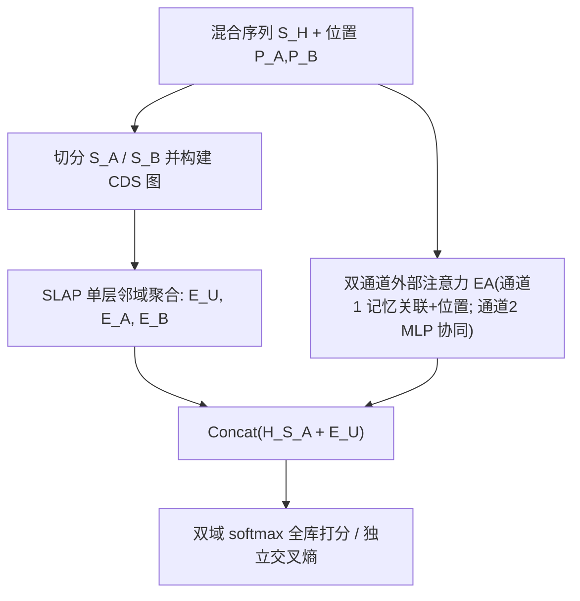
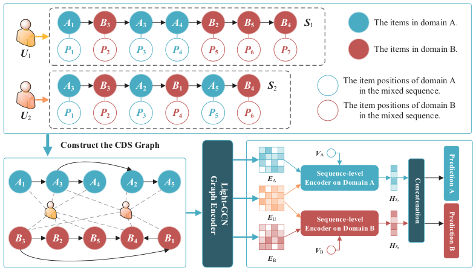

# Towards Lightweight Cross-domain Sequential Recommendation via External Attention-enhanced Graph Convolution Network (面向轻量化跨域序列推荐的外部注意力增强图卷积网络)

- **会议/期刊**: DASFAA 2023
- **作者与机构**: Jinyu Zhang, Huichuan Duan, Lei Guo, Liancheng Xu, Xinhua Wang（山东师范大学信息科学与工程学院）
- **推荐链路定位**: 召回（Next-Item 序列召回）
- **研究方向**: 跨域与多场景推荐 / 序列与会话推荐
- **论文原文**: [https://arxiv.org/abs/2302.03221v1](https://arxiv.org/abs/2302.03221v1)
- **开源代码**: [https://github.com/JinyuZ1996/LEA-GCN](https://github.com/JinyuZ1996/LEA-GCN)

## TL;DR (1分钟核心速览)

跨域序列推荐（CSR）现有方案靠堆叠 GCN 层与自注意力换取精度，参数量与 $O(N^2)$ 计算成为部署瓶颈。LEA-GCN 提出「单层聚合协议 SLAP + 双通道外部注意力 EA」的轻量框架：跨域只做一跳邻域传播，序列编码改用外部记忆单元线性关联并叠加位置编码与 MLP 协同通道。在 DOUBAN / AMAZON 采用 80/20 随机划分、全库 softmax 排序、RC/MRR/NDCG@10 评估下，参数量由 TiDA-GCN 的 72MB/394MB 降至 24MB/172MB，域 B NDCG@10 相对提升 8.78% / 7.01%。

## Background & Motivation (背景与核心矛盾)

- **主流范式**: CSR 以 CDS 图（跨域用户-物品交互 + 域内 item-item 序列转移）为骨架，用多层 GCN（DA-GCN / TiDA-GCN）或双注意力（π-net / PSJNet）桥接两个域，为重叠用户做双域 Next-Item 预测。
- **前人局限**: ① 多层 MLAP 为捕捉高阶连通性而堆叠传播，参数量与显存开销巨大（TiDA-GCN 达 72MB/394MB），却对节点表征增益有限；② 自注意力全局相关性权重的复杂度为 $O(N^2)$，且把双域混合序列视为无序集合，丢弃了物品在原始混合序列中的位置关系；③ 跨域结构使参数量近乎翻倍。
- **核心洞察 (Key Insight)**: 在 CDS 图上，高阶传播会把另一域的「域特定结构噪声」反向灌入本域物品表征——层数越深，域偏差越被放大；而跨域知识真正需要的只是「一跳桥接」。同时，序列模式可由与输入无关的外部记忆单元以线性代价刻画。
- **本文切入点**: 把 GCN 砍到只剩邻域加权求和且只传播一层，再用双通道外部注意力在线性复杂度下重建用户特有序列模式，以「结构极简 + 编码极简」换取精度不降反升。

## Method (核心方法设计)

### 1. 整体框架 (Overall Architecture)

输入为重叠用户在两个域的混合序列 $S_H$，先切分出域内子序列$S_A,S_B$并记录每个物品在原混合序列中的位置$P_A,P_B$（位置向量$\boldsymbol{V}_A,\boldsymbol{V}_B$）。随后按 DA-GCN 规则构建 CDS 图$\mathcal{G}$（用户-物品跨域边 + 域内相邻物品边），用仅保留邻域聚合的 LightGCN 式编码器做单层 SLAP 传播得到$\boldsymbol{E}_U,\boldsymbol{E}_A,\boldsymbol{E}_B$。序列级建模交给双通道 EA 编码器：通道一以外部记忆$M_k,M_v$计算物品-记忆关联并注入位置信息，通道二用 MLP 计算物品间协同亲和以补偿记忆单元与输入无关造成的 CF 信号缺失；两通道求和后与$\boldsymbol{E}_U$拼接得$H_{S_A},H_{S_B}$，最后双域各自 softmax 全库打分、独立交叉熵训练。

<figure class="paper-figure" markdown="span">
  <figcaption>图1. 我们提出的 LEA-GCN 概览，其中 S1 和 S2 分别表示两个不同重叠用户 U1 和 U2 的混合序列。</figcaption>
</figure>

### 2. 关键设计拆解 (Key Designs)

1. **单层聚合协议 SLAP（把 MLAP 砍成一跳）**：痛点在于域 A 物品经 2~3 跳会聚合到大量域 B 专属结构，形成跨域噪声。本文令用户表征吸收双域物品一跳消息、物品表征只吸收用户一跳消息：$\boldsymbol{E}_U=\sum_{k\in\mathcal{U}}\left(\sum_{i\in S_A}\frac{\boldsymbol{e}_{i\to k}}{\sqrt{|N_U|}\sqrt{|N_A|}}+\sum_{j\in S_B}\frac{\boldsymbol{e}_{j\to k}}{\sqrt{|N_U|}\sqrt{|N_B|}}\right)$，$\boldsymbol{E}_A=\sum_{i\in S_A}\sum_{k\in\mathcal{U}}\frac{\boldsymbol{e}_{k\to i}}{\sqrt{|N_U|}\sqrt{|N_A|}}$。直觉：跨域迁移只需一次「用户中转」，深堆叠只会放大域内偏差，故单层即可完成知识桥接并同步压缩参数。
2. **双通道外部注意力序列编码器（线性复杂度下建模用户特有序列模式）**：自注意力同时受 $O(N^2)$与「忽略跨序列共享模式」之困。通道一用两个外部记忆单元$M_k,M_v$作为 key/value，并叠加混合序列位置：$\boldsymbol{a}^{(1)}_{i,j}=\mathrm{Norm}\left[(\boldsymbol{e}_{A_i}\oplus\alpha\,\boldsymbol{v}_{A_i})\,\boldsymbol{m}_{k_j}^{\top}\right]$，$H^{(1)}_{S_A}=\sum_{i=1}^{|S_A|}a^{(1)}_{i,j}\,\boldsymbol{m}_{v_i}$，再以多头$\beta$拼接增强表达；由于输出完全由$M_v$生成、与输入特征解耦，通道二补一条 MLP 亲和路径：$a^{(2)}_{i,j}=\mathrm{Norm}\big(W_3^{\top}\mathrm{ReLU}(W_2[\boldsymbol{e}_{A_i}\oplus\boldsymbol{e}_{A_j}]+b)\big)$，$H^{(2)}_{S_A}=\sum_i a^{(2)}_{i,j}\boldsymbol{e}_{A_i}$。最终$H_{S_A}=\mathrm{Concat}\big((H^{(1)}_{S_A}+H^{(2)}_{S_A}),\boldsymbol{E}_U\big)$。复杂度由$O(N^2)$降到$O(N)$，且位置项显式恢复被混合序列打乱的时序先验。
3. **训练目标、负采样与推理效率**：为规避 π-net / DA-GCN 的跷跷板现象，两域分别用全库 softmax 的交叉熵独立优化：$\mathcal{L}=\mathcal{L}_A+\mathcal{L}_B=-\frac{1}{|S|}\sum\big(\sum_{A_i\in S_A}\log P(A_{i+1}|S_A,S_B)+\sum_{B_j\in S_B}\log P(B_{j+1}|S_B,S_A)\big)$；训练采用全库 softmax 而非负采样，推理即取双域全物品打分 Top-10，无额外近邻检索开销。

## Experimental Setup & Evaluation Protocol (实验设置与评估协议)

- **数据集与预处理**: 过滤交互数 <10 的冷用户与出现 <5 次的冷物品（即近似 user `10-core` / item `5-core`）。

| 数据集 | 域 | #Items | #Interactions | #Users | 序列(训练/测试) |
| :--- | :---: | :---: | :---: | :---: | :---: |
| DOUBAN | A (电影) | 14,636 | 607,523 | 6,582 | 42,062 / 10,431 |
| DOUBAN | B (图书) | 2,940 | 360,798 | 6,582 | — |
| AMAZON | A (图书) | 126,526 | 1,678,006 | 9,204 | 90,574 / 14,463 |
| AMAZON | B (电影) | 61,362 | 978,226 | 9,204 | — |

- **数据划分与防穿越 (Splitting Strategy)**: 混合序列的 80% 随机作训练、20% 作测试（随机划分，非全局时间戳切分，但取序列末端物品为标签，序列内顺序不穿越）。
- **排名评测协议 (Ranking Protocol)**: 取每条混合序列中每个域「最后两个观测物品」为 ground truth，指标为 RC@10、MRR@10、NDCG@10；打分端为 softmax 全库排序（Full-Ranking，无采样负例）。
- **对比基线与超参设置**: 基线覆盖传统（NCF / NGCF / LightGCN）、单域序列（GRU4REC / HRNN）、跨域序列（π-net / PSJNet / DA-GCN / TiDA-GCN）；统一 embedding 维度 $d=16$，Xavier 初始化 + Adam，batch 256、dropout 0.1、学习率域 A 0.002 / 域 B 0.004、正则 1e-7；$\alpha\in[0,1]$步长 0.1、头数$\beta\in\{1,2,4,8,16\}$网格搜索；显著性用配对样本 t 检验$p<0.05$（标 †）。

## Key Experimental Results (实验关键数据)

### 1. 主实验对比 (Main Results)

| Dataset / Domain | 指标@10 | NCF | NGCF | LightGCN | GRU4REC | HRNN | π-net | PSJNet | DA-GCN | TiDA-GCN | **LEA-GCN** | Improv. |
| :--- | :---: | :---: | :---: | :---: | :---: | :---: | :---: | :---: | :---: | :---: | :---: | :---: |
| DOUBAN-A | RC | 69.75 | 79.21 | 78.52 | 80.13 | 81.25 | 83.22 | 83.54 | 83.55 | 83.68 | **83.83†** | +0.18% |
| DOUBAN-A | MRR | 58.05 | 77.82 | 75.35 | 75.41 | 77.90 | 80.71 | 80.96 | 80.84 | 81.27 | **81.22** | −0.06% |
| DOUBAN-A | NDCG | 40.26 | 49.12 | 48.93 | 47.81 | 48.88 | 51.22 | 51.72 | 51.53 | 52.02 | **52.06** | +0.08% |
| DOUBAN-B | RC | 35.24 | 67.37 | 68.32 | 66.66 | 68.32 | 69.54 | 71.59 | 71.91 | 72.56 | **76.14†** | +4.94% |
| DOUBAN-B | MRR | 23.29 | 54.41 | 52.11 | 54.10 | 54.99 | 55.72 | 58.36 | 58.31 | 60.27 | **66.15†** | +9.76% |
| DOUBAN-B | NDCG | 18.28 | 37.26 | 37.79 | 38.03 | 38.93 | 39.18 | 40.71 | 40.67 | 41.38 | **45.01†** | +8.78% |
| AMAZON-A | RC | 15.59 | 21.52 | 21.67 | 21.51 | 21.92 | 24.33 | 25.03 | 24.62 | 25.05 | **25.47†** | +1.68% |
| AMAZON-A | NDCG | 6.12 | 12.08 | 10.13 | 9.66 | 9.87 | 11.80 | 13.54 | 13.18 | 14.68 | **14.93†** | +1.70% |
| AMAZON-B | RC | 17.38 | 26.55 | 26.49 | 24.51 | 25.10 | 27.66 | 31.24 | 31.12 | 32.84 | **33.97†** | +3.44% |
| AMAZON-B | MRR | 13.20 | 25.37 | 24.23 | 22.13 | 22.48 | 25.03 | 28.35 | 28.21 | 29.65 | **30.65†** | +3.37% |
| AMAZON-B | NDCG | 5.29 | 17.45 | 15.09 | 12.94 | 13.44 | 16.20 | 18.93 | 18.85 | 19.12 | **20.46†** | +7.01% |

### 2. 消融实验 (Ablation Study)

DOUBAN 数据集，`LEA-Pos` 去除位置信息、`LEA-EA` 去除外部注意力序列编码器、`LEA-All` 二者全去：

| 变体 | A-RC | A-MRR | A-NDCG | B-RC | B-MRR | B-NDCG |
| :--- | :---: | :---: | :---: | :---: | :---: | :---: |
| LEA-All | 82.12 | 78.10 | 49.64 | 71.28 | 59.43 | 41.28 |
| LEA-Pos (w/o 位置) | 83.67 | 81.16 | 52.00 | 75.10 | 64.35 | 44.38 |
| LEA-EA (w/o EA 编码器) | 82.62 | 79.14 | 50.43 | 72.82 | 61.92 | 42.41 |
| **LEA-GCN (full)** | **83.83** | **81.22** | **52.06** | **76.14** | **66.15** | **45.01** |

另附层数消融（DOUBAN，1/2/3 层 NDCG@10）：LEA-GCN 为 52.06 / 51.35 / 51.05（域 A）、45.01 / 42.91 / 42.11（域 B），单调衰减；DA-GCN 亦衰减（51.53→49.35），而 LightGCN 单调上升（48.24→48.93）。

### 3. 关键实验发现 (Key Findings)

1. **收益几乎全部来自稀疏小域**：DOUBAN 域 B（仅 2,940 物品）NDCG@10 从 41.38 提到 45.01（+8.78%），而物品数 5 倍于它的域 A 仅 +0.08%；AMAZON 同样呈现域 B（+7.01%）> 域 A（+1.70%）的规律，说明单跳跨域桥接对数据稀缺域的知识补充效用最大，密集域已能被单域信号自足解释。
2. **EA 通道是主贡献项、位置编码是次贡献项**：去掉 EA 使域 B NDCG 掉 2.60 点（45.01→42.41，约 −5.8%），去掉位置仅掉 0.63 点；但二者同时移除时跌至 41.28（回到 DA-GCN 水平），证明「记忆单元 + MLP 协同 + 位置先验」三者缺一即失去相对 SOTA 的优势。
3. **轻量化不牺牲精度反而更优，且层数越深越差**：LEA-GCN 参数量在 DOUBAN 为 24MB（PSJNet 148MB、TiDA-GCN 72MB），AMAZON 为 172MB（651MB / 394MB），同时训练时间随数据比例 0.2→1.0 全域低于两基线；而 2、3 层版本性能持续下滑（域 B NDCG 45.01→42.11），定量坐实了「CDS 图上高阶传播 = 跨域噪声放大」的论断。

## Highlights & Limitations (亮点、对比与审稿批判)

- **与代表作对比 (vs. Prior Work)**: 相对 DA-GCN / TiDA-GCN 的多层 CDS 图传播 + 自注意力序列编码，本文把「图」压缩为单层邻域求和、把「注意力」替换为外部记忆 + MLP 双通道，在参数量降 3~6 倍的前提下反超；相对 PSJNet 的 RNN 并行共享结构，本文显式建模 item-item 序列转移与位置信息，域 B 提升更显著。
- **可迁移亮点**: ①「跨域只做一跳」的经验规律可直接用于多域 / 多场景串行堆叠架构的深度裁剪；② 外部记忆 + 输入相关 MLP 协同的双通道设计，可作为 Transformer 序列推荐在端侧 / 低显存场景下的通用轻量替代。
- **审稿级局限批判**: ① 采用 80/20 随机划分而非全局时间戳切分，虽取序列末端作标签，仍存在同用户跨期物品共现的潜在穿越风险，工业时序场景下的结论需重验；② 仅验证「双域 + 重叠用户」设定，对非重叠用户、三域以上及冷启动迁移完全未覆盖，且外部记忆单元规模 $|M_k|$（隐含超参）未做敏感性分析；③ 域 A 上 MRR 反而略低于 TiDA-GCN（81.22 vs 81.27）却未讨论，说明轻量化在密集域的排序头部位置仍有损。

## Rating (四维评分)

- **方法创新性 (Novelty)**: ⭐⭐⭐ （SLAP 与 EA 双通道组合思路清晰但属「组件剪枝 + CV 机制迁移」，缺乏理论层面的收敛或谱分析支撑）
- **评估协议与实验扎实度 (Protocol & Experiments)**: ⭐⭐⭐ （两数据集、10 个基线、显著性检验与层数/超参消融齐备，但随机划分与仅取最后两物品为标签削弱了时序严谨性）
- **写作与数学规范度 (Clarity & Rigor)**: ⭐⭐⭐⭐ （SLAP 与 EA 双通道公式逐项给出并附维度对齐说明，复杂度对比明确，个别符号如 $\boldsymbol{b}_A$ 笔误与记忆单元规模未定义略欠严谨）
- **工业落地与复现价值 (Industrial & Practical Value)**: ⭐⭐⭐⭐⭐ （代码开源，24MB/172MB 参数量与更低训练耗时使其可直接部署于显存受限设备，跨域召回落地成本极低）

