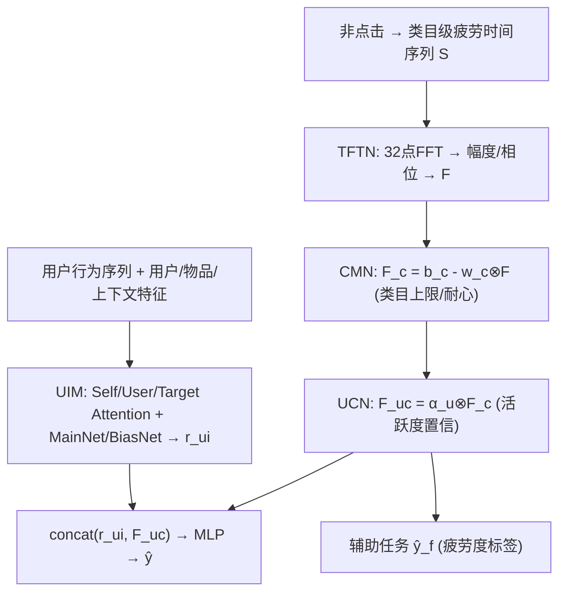

# FAN: Fatigue-Aware Network for Click-Through Rate Prediction in E-commerce Recommendation (面向电商推荐点击率预估的疲劳感知网络)

- **会议/期刊**: DASFAA 2023
- **作者与机构**: Ming Li, Naiyin Liu, Xiaofeng Pan (通讯), Yang Huang 等，阿里巴巴集团
- **推荐链路定位**: 精排（Ranking 阶段 CTR 预估）
- **研究方向**: CTR/CVR 预估与特征交叉 / 序列与会话推荐
- **论文原文**: [https://arxiv.org/abs/2304.04529v1](https://arxiv.org/abs/2304.04529v1)
- **开源代码**: [https://github.com/AaronPanXiaoFeng/FAN](https://github.com/AaronPanXiaoFeng/FAN)

## TL;DR (1分钟核心速览)

现有 CTR 模型要么只用点击（噪声大、兴趣建模偏斜），要么把非点击一律当负反馈、或依赖极度稀疏的显式「不喜欢」（曝光中不足 0.01%），都无法刻画「同类目推荐看太多而疲劳」这一负向兴趣。FAN 把用户对目标类目的非点击按请求粒度聚合成时间序列，用 32 点 FFT 取幅度/相位频谱，再经类目调制（疲劳上限 bias 与耐心 weight）和用户活跃度门控得到疲劳表征，并以辅助任务监督。在 Tmall 工业日志（8.36 亿曝光）上 AUC 从 DIN 0.7178 提升至 0.7249（+0.99%），在线 3 天 A/B 中 PCTR +1.63%、人均曝光类目数 LCEN +11.13%。

## Background & Motivation (背景与核心矛盾)

- **主流范式**: 电商精排 CTR 模型（DIN 及后续）以点击序列 + 注意力刻画正向兴趣；改进路线或引入非点击做正则（DFN/DUMN 借显式负反馈蒸馏），或用 explore-exploit 兼顾新颖性。
- **前人局限**: 其一，非点击不等于不喜欢（附近有同类替代、曝光未被注意），直接当负样本会与正样本冲突；其二，显式负反馈极度稀缺（不足曝光 0.01%，低于购买的 1/10），无法全面学习负向兴趣；其三，explore-exploit 路线仅用「相似物品曝光次数」等统计量近似疲劳，丢掉时间-频率分布信息。
- **核心洞察 (Key Insight)**: 疲劳天然是**类目级**而非物品级现象——电商通常会过滤近期重复曝光的同款，但同类目的持续堆叠才是疲劳根源；且疲劳存在**周期性演化**，时域计数无法区分「密集连刷」与「稀疏长尾」两种截然不同的疲劳形态。
- **本文切入点**: 把非点击转成类目级时间序列，显式地在频域建模疲劳强度，并与正向兴趣解耦后再融合。

## Method (核心方法设计)

### 1. 整体框架 (Overall Architecture)

FAN 由 UIM（用户兴趣模块）与 FRM（疲劳表征模块）双塔构成。UIM 走常规 DIN 式路径：共享 Embedding 层后，对行为序列做多头自注意力，再分别以用户向量、目标物品向量做 User Attention 与 Target Attention；拼接后经 MainNet 建模兴趣交互，另以 BiasNet 从用户/上下文特征建模行为偏置，二者拼接得 $r_{ui}$。FRM 接收本文新构造的疲劳时间序列$S$：先 FFT 得幅度与相位频谱并交互成$F$，再经类目调制$F_c=b_c-w_c\otimes F$与用户置信门控$F_{uc}=\alpha_u\otimes F_c$得到疲劳表征。最终拼接$r_{ui}$与$F_{uc}$ 过 MLP 输出点击概率，训练时叠加疲劳度辅助任务。

### 2. 关键设计拆解 (Key Designs)

1. **TFTN：时域计数 → 频域幅度+相位表征**：痛点是非点击序列只有「每次请求的同类目未点击数」这一标量强度，无法区分疲劳的节律形态。做法是对 $S=\{s_1,\dots,s_T\}$做$N$点 FFT 得$A,\phi=\mathrm{FFT}(S)$，再各自过两层 MLP 并做逐元素交互：
$\mathbf{F}=\mathrm{MLP}_A(A)\otimes \mathrm{MLP}_\phi(\phi)\in\mathbb{R}^{N}$物理直觉是频域同时给出**幅度（强度）与相位（位置）**，低频分量稳健、高频多为噪声，两个 MLP 相当于可学习的频率滤波，让模型自适应地区分「周期性疲劳累积」与「偶发曝光噪声」。序列构造附两条规则：第$i$次请求若点击了目标类目则$s_i=0$（属正向兴趣）；若该请求无目标类目物品则整条请求丢弃（与目标疲劳无关）。

2. **CMN + UCN：类别调制与用户置信门控**：痛点是不同类目下疲劳上限与用户耐心差异极大（数码 vs 服饰），且低频活跃用户的疲劳估计本就不可信。CMN 借鉴 APG 的动态参数思想，由类目嵌入 $e_c$ 生成偏置与权重：
$b_c=\mathrm{MLP}_b(e_c),\quad w_c=\mathrm{MLP}_w(e_c),\quad \mathbf{F}_c=b_c-w_c\otimes \mathbf{F}$即把「上限」建模为加性偏置、「耐心」建模为乘性缩放；UCN 再由用户活跃度嵌入生成门控$\alpha_u=\mathrm{MLP}_u(e_u^a)$得$\mathbf{F}_{uc}=\alpha_u\otimes\mathbf{F}_c$，按用户反馈丰富度缩放疲劳置信度。

3. **训练目标、疲劳标签与推理开销**：主损失为 logloss $\mathcal{L}_m$，并构造辅助疲劳标签：以**未来 3 天**行为为窗口，若用户点击了目标类目则该样本记为疲劳负例（未被过度曝光），若一定曝光次数后仍不点击则记为正例，其余样本丢弃。总损失
$\mathcal{L}=\mathcal{L}_m+\beta\mathcal{L}_f$，其中$\beta$ 随训练步从 0.01 线性升至 0.5，实现「先学兴趣、后学疲劳」的课程式引导。全流程无需负采样（曝光日志即样本），线上仅增加序列聚合 + 32 点 FFT 与数个轻量 MLP，开销可控。

## Experimental Setup & Evaluation Protocol (实验设置与评估协议)

- **数据集与预处理**: 取自 Tmall 移动端推荐场景 2022/08/24–2022/09/26 采样日志；无 5-core 过滤，直接以工业曝光日志为样本。

| 数据集 | #Users | #Items | #Interactions(曝光) | 稀疏度/密度 | 特征/场景说明 |
| :--- | :---: | :---: | :---: | :---: | :--- |
| train | 9.40M | 7.39M | 835.76M | 密度约 $1.2\times10^{-5}$ | 66.62M 点击 / 277.22K 购买 |
| test | 842.71K | 2.70M | 26.62M | 密度约 $3.5\times10^{-6}$ | 2.15M 点击 / 10.82K 购买 |

- **数据划分与防穿越 (Splitting Strategy)**: **全局时间戳切分**——8/24–9/25 训练，9/26 单日测试，两段完全不重叠；辅助标签使用样本之后 3 天行为，需注意其与测试日的时间窗关系。
- **排名评测协议 (Ranking Protocol)**: 并非 Full-Ranking 或 Sampled Ranking，而是**曝光级 point-wise CTR 评估**，指标为 AUC（5 次重复，报 mean±std）；线上指标为 PCTR、人均点击 IPV，以及多样性指标 LCEN / LCCN（人均曝光/点击叶子类目数）。
- **对比基线与超参设置**: 基线含 DIN（base）、DFN、DUMN、Gama；物品 ID 维度 64、类目/品牌 32、其余类别特征 8；UIM 用 8 头注意力、隐层 128；FRM 用 32 点 FFT；Adagrad（lr=0.01）、batch 1024，TensorFlow 1.4 + 10 参数服务器 + 4×V100。

## Key Experimental Results (实验关键数据)

### 1. 主实验对比 (Main Results)

| Model | 离线 AUC | 在线 PCTR | IPV | LCEN | LCCN |
| :--- | :---: | :---: | :---: | :---: | :---: |
| DIN (Base) | 0.7178 ±0.00247 | 0.00% | 0.00% | 0.00% | 0.00% |
| DFN | 0.7194 ±0.00585 | -0.30% | -0.31% | +0.85% | +0.53% |
| DUMN | 0.7218 ±0.00429 | +0.17% | -0.74% | +0.59% | +1.15% |
| Gama | 0.7225 ±0.00472 | +0.89% | +0.42% | -0.26% | +0.57% |
| FAN w/o FRM (UIM) | 0.7193 ±0.00238 | -0.85% | +0.79% | +2.52% | +1.41% |
| **FAN (ours)** | **0.7249 ±0.00176** | **+1.63%** | **+1.09%** | **+11.13%** | **+3.29%** |
| Improv. (vs DIN) | +0.99% | — | — | — | — |

### 2. 消融实验 (Ablation Study)

| 变体 | AUC (mean ±std.) | 相对 FAN |
| :--- | :---: | :---: |
| FAN w/o FRM (UIM) | 0.7193 ±0.00238 | -0.0056 |
| FAN w/o TFTN | 0.7225 ±0.00135 | -0.0024 |
| FAN w/o CMN | 0.7199 ±0.00147 | -0.0050 |
| FAN w/o UCN | 0.7237 ±0.00187 | -0.0012 |
| **FAN** | **0.7249 ±0.00176** | — |

### 3. 关键实验发现 (Key Findings)

1. **CMN 是 FRM 的命脉**：去除 CMN 掉 0.0050 AUC，几乎等于整块 FRM 移除（-0.0056），说明「类目差异化疲劳上限/耐心」承载了主要增益，而 TFTN 单独贡献为 -0.0024；频谱可视化也显示 TFTN 输出近似对称、呈二阶带阻滤波形态，CMN+UCN 后对称性消失并实现频率选择。
2. **离线与在线严重背离，只有 FAN 双向为正**：DFN/DUMN 离线 AUC 分别 +0.0016/+0.0040，但线上下滑（PCTR -0.30%、IPV -0.31% 等），印证显式负反馈稀疏导致泛化不足；Gama 虽 PCTR +0.89%，LCEN 却 -0.26%，说明仅做频域去噪而不显式建模疲劳，仍会加剧同类目过度曝光。
3. **疲劳建模直接换来多样性红利**：FAN 的 LCEN +11.13%、LCCN +3.29%，远高于仅叠加注意力的 UIM（+2.52%/+1.41%），证明收益并非来自更强的兴趣塔，而是来自对「不感兴趣」的显式刻画——用户被推出同类目信息茧房后，PCTR 与 IPV 同步提升（+1.63%/+1.09%）。

## Highlights & Limitations (亮点、对比与审稿批判)

- **与代表作对比 (vs. Prior Work)**: DIN 完全忽略非点击；DFN/DUMN 把非点击视作噪声、用稀缺显式负反馈去蒸馏，本质仍是「正则化兴趣塔」；Gama 同样用频域但目标是**去噪隐式负反馈以净化正兴趣**，FAN 则把频域用于**直接生成疲劳负向表征**，目标函数与表征语义完全不同。
- **可迁移亮点**: ①「按请求粒度把行为聚合成类目级时间序列 + FFT」这一特征构造可低成本迁移到短视频/信息流的审美疲劳、以及 POI 场景的同类地点疲劳；②辅助标签用「未来固定窗口 + 曝光次数阈值」自动生成弱监督，避免了人工标注，可复用到任何「过度曝光」类目标。
- **审稿级局限批判**: ①评估仅有单平台 Tmall 单日留出 + AUC，无 Full-Ranking/校准评估，也未在公开数据集（如 Taobao、AliExpress）复现，泛化性证据薄弱；②疲劳辅助标签的「一定曝光次数」阈值与 3 天窗口、FFT 点数 $N=32$、$\beta$ 上界 0.5 均为经验设定，论文未给敏感度曲线；③序列聚合需回溯用户近期全部请求，在超长序列下在线特征拼接与 32 点 FFT 的实时开销未被量化。

## Rating (四维评分)

- **方法创新性 (Novelty)**: ⭐⭐⭐⭐ （首次把「疲劳」作为可学习负向表征、用幅度×相位交互 + 类目动态调制的频域算子建模，思路新颖且有频谱可视化佐证）
- **评估协议与实验扎实度 (Protocol & Experiments)**: ⭐⭐⭐ （有真实线上 3 天 A/B 与多样性指标，但仅单数据集单日留出、AUC 单指标、无公开数据与显著性检验）
- **写作与数学规范度 (Clarity & Rigor)**: ⭐⭐⭐⭐ （模块划分清晰、公式简洁可复现，但疲劳标签生成规则与 $\beta$ 调度缺少理论论证与复杂度分析）
- **工业落地与复现价值 (Industrial & Practical Value)**: ⭐⭐⭐⭐ （代码开源、特征工程与 FFT 轻量、已在 Tmall 上线验证 PCTR 与多样性双赢，工程迁移成本低）

