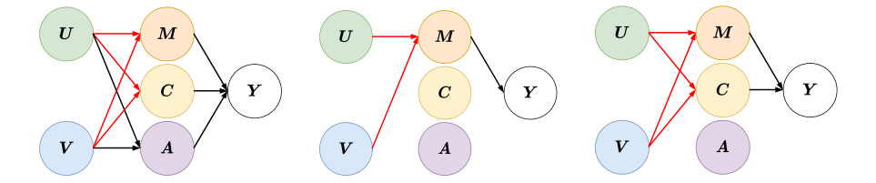
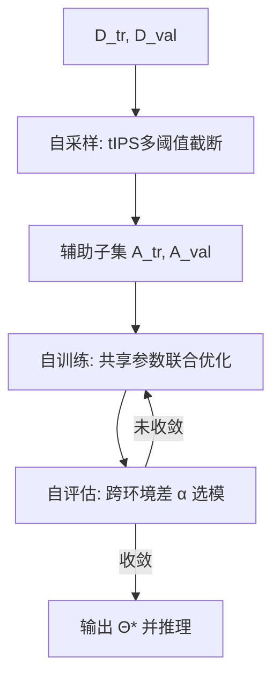
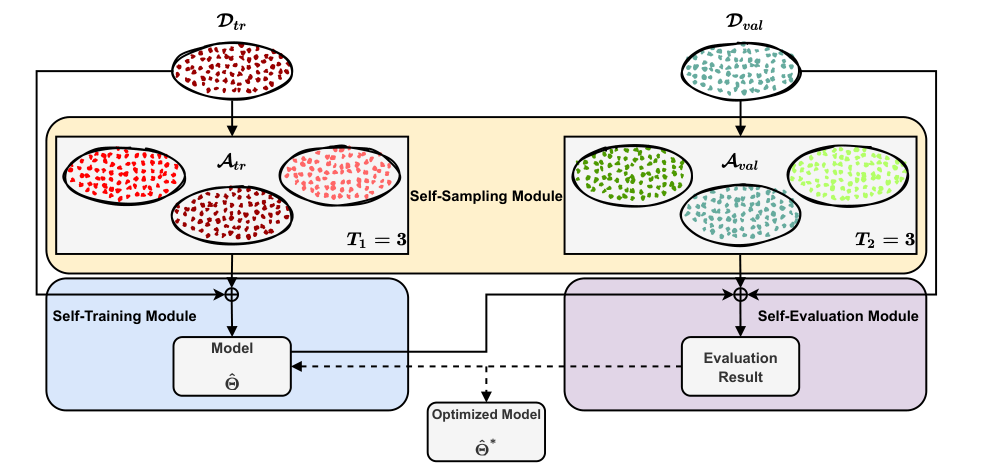

# Self-Sampling Training and Evaluation for the Accuracy-Bias Tradeoff in Recommendation（面向推荐中准确率-偏差权衡的自采样训练与评估）

- **会议/期刊**: DASFAA 2023 Industry Track
- **作者与机构**: Dugang Liu, Yang Qiao, Xing Tang, Liang Chen, Xiuqiang He, Weike Pan, Zhong Ming；深圳大学、腾讯FIT、广东省人工智能与数字经济实验室
- **推荐链路定位**: 精排（首页推荐排序；在线基础为多任务模型）
- **研究方向**: 去偏公平、可信隐私与工业架构
- **论文原文**: [论文原文链接](https://arxiv.org/abs/2302.03419v1)
- **开源代码**: [开源代码仓库链接](https://github.com/dgliu/DASFAA23_SSTE)

## TL;DR (1分钟核心速览)

工业推荐中“盲目去除全部偏差”未必提升效果，因为高收益基金等**有益偏差**被一并抹除。本文提出SSTE：用tIPS截断采样构造不同偏差强度的辅助训练/验证子集，以共享参数联合训练推断有益偏差，再用跨环境性能差$\alpha$做鲁棒自评估。Yahoo! R3与腾讯Product的无偏随机反馈测试上，SSTE-MF主指标AUC达0.7591/0.8525；腾讯理财通在线A/B平均提升CLPM 3.75%、COPM 7.20%、PAPM 12.11%。

## Background & Motivation (背景与核心矛盾)

- **主流范式**: 无随机数据时，去偏推荐多依赖IPS重加权、理论无偏估计器或特定网络架构；有随机数据时则做联合训练。
- **前人局限**: ①多数方法要求特定数据、架构与训练方式，工业落地成本高；②全去偏假设“偏差皆有害”，会移除有益偏差，在线uniform策略三周实验前期略优、后期退化。
- **核心洞察 (Key Insight)**: 反馈偏差可分解为有害偏差（如位置偏差）与有益偏差（如高收益产品应获更多曝光）；在不同偏差环境中稳定带来收益的“共识偏差”更可能有益。
- **本文切入点**: 不追求完全无偏，而是模拟多偏差环境，在训练与模型选择中保留有益偏差、抑制有害偏差。

<figure class="paper-figure" markdown="span">
  <figcaption>图2. 关于(a)传统推荐、(b)去偏推荐和(c)所提出的兼顾准确率与偏差权衡的解决方案的因果图，其中U、V、M、C、A和Y分别表示用户、物品、真实匹配偏好、有益偏差效应、有害偏差效应和反馈标签。</figcaption>
</figure>
图2：传统推荐、去偏推荐与本文准确率-偏差权衡目标的因果图对比。

## Method (核心方法设计)

### 1. 整体框架 (Overall Architecture)

输入有偏训练集$D_{tr}$与验证集$D_{val}$；自采样模块以不同tIPS截断阈值生成辅助子集$\mathcal{A}_{tr}=\{\hat{D}_{tr}^i\}_{i=1}^{T_1}$与$\mathcal{A}_{val}=\{\hat{D}_{val}^i\}_{i=1}^{T_2}$。自训练模块将$D_{tr}$与$\mathcal{A}_{tr}$共享部分参数联合优化，得到候选模型$\hat{\Theta}$；自评估模块联合$D_{val}$与$\mathcal{A}_{val}$计算跨环境性能差$\alpha$，据此选择最终模型$\hat{\Theta}^*$。训练与评估交替执行，直至收敛；推理仅用$\hat{\Theta}$，辅助子集规模远小于原数据，额外开销可控。

<figure class="paper-figure" markdown="span">
  <figcaption>图3. 所提出的SSTE的总体架构，其核心组件为自采样模块、自训练模块和自评估模块。</figcaption>
</figure>
图3：SSTE总体架构，包含自采样、自训练与自评估三个模块。

### 2. 关键设计拆解 (Key Designs)

1. **tIPS截断自采样（模拟不同偏差环境）**：现有IPS依赖估计精度，本文只把IPS概率当作“偏差环境生成器”。对样本$x_i$的先验采样概率$p(x_i)$设阈值$\epsilon_i^{tr}$，概率保护为$p'(x_i)=p(x_i)\mathbb{I}[p(x_i)<\epsilon_i^{tr}]+\mathbb{I}[p(x_i)\ge\epsilon_i^{tr}]$：重要样本被强制保留，不同阈值对应不同去偏强度。这样无需随机数据即可构造多组偏差分布，让模型学习跨环境稳定信号。
2. **自训练联合优化（推断有益偏差）**：令$\tilde{\Theta}=\{\tilde{\theta},\theta_s\}$、$\hat{\Theta}=\{\hat{\theta},\theta_s\}$，共享$\theta_s$但保留分支参数，优化$\mathcal{L}_{SSTE}=\mathcal{L}_{D_{tr}}(f(\tilde{\Theta},x_i),y_i)+\mathcal{L}_{A_{tr}}(g(\hat{\Theta},x_j),y_j)+\lambda\|\tilde{\Theta}\|+\lambda\|\hat{\Theta}\|$。跨多个模拟环境均带来增益的偏差被视为有益偏差；只在单一环境有效的偏差更可能是有害偏差。
3. **自评估与鲁棒选模**：对每个候选模型，在$D_{val}$与各$\hat{D}_{val}^i$上算主指标$e(\cdot)$，定义$\alpha=\max\{\max_i|e(D_{val})-e(\hat{D}_{val}^i)|,\max_{i,j}|e(\hat{D}_{val}^i)-e(\hat{D}_{val}^j)|\}$。若$e$越高越好，则以$e(D_{val})-\alpha$作为修正参考，惩罚跨环境不稳定模型。训练损失未报告额外负采样策略；推理用$\hat{\Theta}$，辅助分支仅训练期存在，在线开销接近原模型。

## Experimental Setup & Evaluation Protocol (实验设置与评估协议)

- **数据集与预处理**:

| 数据集 | #Users | #Items | #Interactions (train/val/test) | P/N (%) | 特征/场景说明 |
| :--- | :---: | :---: | :---: | :---: | :--- |
| Yahoo! R3 | 原文未列 | 原文未列 | 254,713 / 56,991 / 54,000 | 67.02/67.00/9.64 | 评分>3记正；有偏子集8:2划分，随机子集全用于无偏测试 |
| Product | 约2.8M | 560 | 7.13M / 1.63M / 0.87M (≈9.6M) | 5.21/5.20/4.34 | 腾讯理财通首页；有偏子集按时间8:2，随机子集作无偏测试 |

- **数据划分与防穿越**: Yahoo! R3按用户将有偏反馈8:2切训练/验证，随机反馈全部测试；Product有偏反馈按**全局时间戳排序**后8:2切分，随机反馈全部测试，避免未来信息穿越。
- **排名评测协议**: 在完整随机反馈测试集上计算AUC、P@5、P@10、R@5、R@10、nDCG@50，属于**无偏Full-Ranking代理**；原文未报告采样负例比例与额外训练负采样策略。
- **对比基线与超参**: 基线含IPS、SNIPS、CVIB、AT、Rel、DIB，分别接MF与NCF骨干；Optuna以验证AUC调参，embedding维度5–200，early stopping patience=5；SSTE设$T_1=T_2=1$。原文未报告显著性检验。

## Key Experimental Results (实验关键数据)

### 1. 主实验对比 (Main Results)

| 方法 (MF骨干) | Yahoo AUC | Yahoo nDCG | Yahoo P@5 | Yahoo P@10 | Yahoo R@5 | Yahoo R@10 | Product AUC | Product nDCG | Product P@5 | Product P@10 | Product R@5 | Product R@10 |
| :--- | :---: | :---: | :---: | :---: | :---: | :---: | :---: | :---: | :---: | :---: | :---: | :---: |
| MF | 0.7101 | 0.0447 | 0.0080 | 0.0074 | 0.0236 | 0.0446 | 0.8477 | 0.0696 | 0.0145 | 0.0180 | 0.0687 | 0.1707 |
| IPS-MF | 0.7128 | 0.0313 | 0.0033 | 0.0035 | 0.0088 | 0.0202 | 0.8507 | 0.0684 | 0.0139 | 0.0180 | 0.0663 | 0.1717 |
| SNIPS-MF | 0.7101 | 0.0334 | 0.0049 | 0.0048 | 0.0131 | 0.0271 | 0.8509 | 0.0684 | 0.0140 | 0.0181 | 0.0670 | 0.1717 |
| CVIB-MF | 0.7048 | 0.0479 | 0.0089 | 0.0069 | 0.0267 | 0.0413 | 0.8279 | 0.0705 | 0.0146 | 0.0185 | 0.0695 | 0.1761 |
| AT-MF | 0.7314 | 0.0663 | 0.0108 | 0.0100 | 0.0373 | 0.0676 | 0.8389 | 0.0649 | 0.0137 | 0.0169 | 0.0649 | 0.1595 |
| Rel-MF | 0.7440 | 0.0835 | 0.0151 | 0.0131 | 0.0508 | 0.0859 | 0.8519 | 0.0785 | 0.0177 | 0.0199 | 0.0838 | 0.1882 |
| DIB-MF | 0.7547 | 0.0920 | 0.0169 | 0.0145 | 0.0538 | 0.0930 | 0.8510 | 0.0781 | 0.0159 | 0.0202 | 0.0764 | 0.1922 |
| **SSTE-MF** | **0.7591** | **0.0981** | **0.0181** | **0.0153** | **0.0612** | **0.0999** | **0.8525** | **0.0878** | **0.0222** | **0.0211** | **0.1062** | **0.2010** |

**Improv.**（相对各列最强基线）：Yahoo! R3 AUC +0.58%、nDCG +6.63%、R@5 +13.75%；Product AUC +0.07%、nDCG +11.85%、R@5 +26.71%。NCF骨干下SSTE多数指标领先；Product的P@10/R@10略逊DIB-NCF（0.0228 vs 0.0241、0.2171 vs 0.2293）。

### 2. 消融与兼容性分析（原文未给标准w/o消融）

| 分析项 | 设置/对照 | 可验证结果 | 结论 |
| :--- | :--- | :--- | :--- |
| 端到端增益(MF) | MF → SSTE-MF | Yahoo AUC 0.7101→0.7591；Product 0.8477→0.8525 | 自采样+自训练+自评估整体有效 |
| 端到端增益(NCF) | NCF → SSTE-NCF | Yahoo AUC 0.7244→0.7561；Product 0.7930→0.8061 | 跨骨干可迁移 |
| 对强基线增益 | DIB-MF → SSTE-MF | Yahoo AUC +0.0044、nDCG +0.0061 | 鲁棒选模与联合训练带来额外收益 |
| 兼容IPS类 | SSTE+IPS/SNIPS | 图5中提升弱于非IPS基线 | IPS估计误差限制收益，但不破坏框架 |

### 3. 关键实验发现 (Key Findings)

1. **全去偏并非工业最优**：三周在线uniform策略前期略优、后期退化；SSTE保留有益偏差后，在线CLPM/COPM/PAPM分别平均提升3.75%/7.20%/12.11%，说明“权衡”比“清零”更符合金融推荐目标。
2. **Top-K排序收益显著大于AUC**：Yahoo! R3的nDCG与R@5分别提升6.63%/13.75%，Product达11.85%/26.71%，而AUC仅小幅提升，表明跨偏差环境训练更能改善头部排序与召回覆盖。
3. **兼容性和成本可控但受IPS质量约束**：SSTE可叠加MF/NCF及多数去偏基线；$T_1=T_2=1$、辅助子集远小于原数据，训练开销有限，但IPS类集成时收益被削弱，说明采样生成器仍依赖可用的倾向估计。

## Highlights & Limitations (亮点、对比与审稿批判)

- **与代表作对比 (vs. Prior Work)**: 相比DIB/Rel等仅追求无偏估计或特定理论目标，SSTE把偏差显式拆成有益/有害，并用“多环境一致性”做训练与选模；相比需随机数据联合训练的CausE/AutoDebias，它不要求随机数据与特定架构。
- **可迁移亮点**: ①用tIPS阈值扫描构造多偏差环境，可作为通用去偏数据增广；②用跨环境性能差$\alpha$做早停/选模，可直接迁移到工业多场景模型选择。
- **审稿级局限批判**: ①原文未提供逐组件w/o消融与显著性检验，离线证据主要来自端到端与兼容性分析；②自采样依赖IPS估计与截断阈值，$T_1/T_2$和阈值敏感性未充分展开；③在线仅金融首页单一场景，Product AUC提升仅0.07%，仍需更多业务与候选全库验证。

## Rating (四维评分)

- **方法创新性 (Novelty)**: ⭐⭐⭐⭐ （将偏差拆为有益/有害，并以多偏差环境一致性实现权衡，思路简洁且具因果图支撑）
- **评估协议与实验扎实度 (Protocol & Experiments)**: ⭐⭐⭐ （含公开集、工业集与在线A/B，随机反馈作无偏代理较可信；但缺标准消融与显著性检验）
- **写作与数学规范度 (Clarity & Rigor)**: ⭐⭐⭐⭐ （三模块与核心公式清晰，采样/选模逻辑直观；阈值选择与采样权重细节略简）
- **工业落地与复现价值 (Industrial & Practical Value)**: ⭐⭐⭐⭐⭐ （开源代码、腾讯理财通在线验证、兼容现有模型且辅助子集开销低，落地价值突出）

