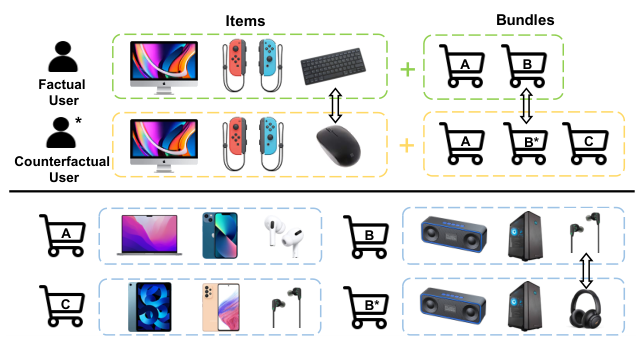
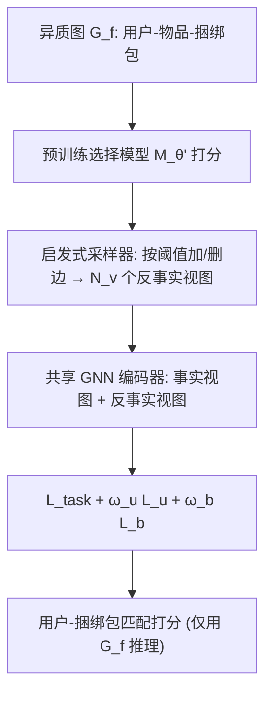

# Data-Augmented Counterfactual Learning for Bundle Recommendation (面向捆绑推荐的数据增强反事实学习)

- **会议/期刊**: DASFAA 2023
- **作者与机构**: Shixuan Zhu, Qi Shen, Yiming Zhang, Zhenwei Dong, Zhihua Wei（同济大学）
- **推荐链路定位**: 召回（用户-捆绑包匹配打分）
- **研究方向**: 图神经网络与知识图谱推荐 / 自监督对比学习与交互去噪
- **论文原文**: [https://arxiv.org/abs/2210.10555v2](https://arxiv.org/abs/2210.10555v2)
- **开源代码**: 暂未开源（文中声明将释出）

## TL;DR (1分钟核心速览)

捆绑推荐（BR）同时存在**用户侧**（用户-捆绑包交互稀疏）与**创作者侧**（捆绑包-物品从属关系稀疏）双重稀疏，图模型在有限边上学不出充分表征。本文提出 CLBR 学习范式：先用预训练模型打分的**启发式采样器**在用户-物品-捆绑包异质图上增/删边，生成"反事实"图视图；再用带**自适应阈值**的反事实损失约束同一节点在事实视图与反事实视图间的表示一致、同时推开异节点。范式可即插即用于 RGCN/BundleNet/BGCN/CrossCBR，在两个真实数据集的全库排序下 R@20/NDCG@20 稳定提升（NetEase 上 BGCN 提升 9.9%/7.8%，跨模型平均 1.3%–11.0%）。

## Background & Motivation (背景与核心矛盾)

- **主流范式**: BR 把用户-物品交互、捆绑包-物品从属关系与用户-捆绑包交互组织成异质图，用 GNN 编码 + 多任务/对比学习训练（BGCN、CrossCBR 为 SOTA）。
- **前人局限**: ① 图模型强依赖足量高质量边，而 BR 场景中用户-捆绑包交互与捆绑包-物品从属关系比普通推荐更稀疏，消息传播在低度节点上几乎失效；② 现有对比式增广（如 CrossCBR 的双视图、序列域的 CASR）多为**随机**扰动或基于 loss 的启发式采样，随机采样在需要大量生成数据时引入的噪声随采样率线性增长，反而伤害学习。
- **核心洞察 (Key Insight)**: 观测到的交互只是"反事实世界"的一个样本——若曝光机制或物品组合可变，用户可能接受内容相近的另一捆绑包。因此反事实数据可补足稀疏，但**噪声水平 $\eta$直接决定所需样本量**（PAC 分析：样本复杂度$\propto 1/(\epsilon^2(1-2\eta)^2)$），故必须先控噪再增广。
- **本文切入点**: 用预训练 BR 模型的相关性打分做"哪些边值得加/删"的启发式筛选，再用反事实约束吸收残余噪声，把增广从"随机扰动"变成"可控干预"。

<figure class="paper-figure" markdown="span">
  <figcaption>图1：电子商务中捆绑推荐的一个玩具示例，其中捆绑包是由多个产品组成的购物车。</figcaption>
</figure>

## Method (核心方法设计)

### 1. 整体框架 (Overall Architecture)

先在原始异质图 $\mathcal{G}_f$上预训练一个与推荐模型同构的选择模型$M_{\theta'}$，冻结其图编码器得到用户/捆绑包/物品嵌入；随后按$r_{ub},r_{ui},r_{bi}$三类比例，用启发式采样器迭代采样节点对并依据相关性阈值决定加边$\mathcal{E}^+$或删边$\mathcal{E}^-$，生成$N_v=4$个反事实视图$\mathcal{G}_c$。训练阶段每个 epoch 随机取一个反事实视图，与事实视图并行过同一 GNN 编码器，经归一化后计算"任务损失 + 反事实约束损失"更新$\theta$；推理仅用事实图$\mathcal{G}_f$，无额外在线开销。

### 2. 关键设计拆解 (Key Designs)

1. **启发式反事实采样器（把随机扰动换成相关性筛选）**：随机采样把与用户毫不相关的节点对也加成边，$\eta$高、需生成更多数据才能补偿。本文对批内节点对计算$rs_{i,j}=U_i^\top B_j$，仅当得分落在批内动态阈值之外才执行操作：

$$\mathcal{E}^+_{ub}\!\leftarrow\!\mathcal{E}^+_{ub}\cup\{(i,j)\}\ \text{if}\ rs_{i,j}>\kappa^+,\quad \mathcal{E}^-_{ub}\!\leftarrow\!\mathcal{E}^-_{ub}\cup\{(i,j)\}\ \text{if}\ rs_{i,j}\le\kappa^-$$

其中 $\kappa^+=\alpha^+\max_{batch}rs$、$\kappa^-=\alpha^-\min_{batch}rs$（$\alpha^+=0.8,\alpha^-=1.2$）。批内相对阈值免去全量节点对计算，同时保证"高相关才加边、低相关才删边"，使同等增广比例下噪声更低。

2. **自适应阈值反事实约束（吸收残余噪声）**：反事实世界虽改变交互，但用户偏好与捆绑包语义应稳定。作者以一致性项与"平均非一致性"项构造约束：

$$\sum_i D(U^c_i,U^f_i)\le\lambda_u\sum_i\sum_{j\neq i}D(U^c_j,U^f_i),\quad D(e_i,e_j)=-\exp(e_i^\top e_j/\tau)$$

左项拉近同一节点跨视图表示，右项以"该节点与其他所有节点跨视图距离均值"作**自适应阈值**：若某节点在潜空间中本就孤立（平均一致性低），则允许更大扰动而不至于混淆。相比 CASR 的常数阈值，该设计能随节点局部密度动态调节干预强度。

3. **训练目标、负采样与推理效率**：Lagrange 松弛后总损失为 $\mathcal{L}=\mathcal{L}_{tasks}+\omega_u L_u+\omega_b L_b$，其中$L_u=\frac{1}{N}\sum_i \mathrm{ReLU}\big(D(U^c_i,U^f_i)-\lambda_u\sum_{j\neq i}D(U^c_j,U^f_i)\big)$（$L_b$同理）。$\mathcal{L}_{tasks}$沿用 BPR，负采样率 1；全局均值项以 minibatch 内其他节点近似，不显式采样。理论侧给出两条引理：$\min L_{consis}\Leftrightarrow\min H(U^c|X,\mathcal{G})$（压缩方差）、$\min L_{unres}\Leftrightarrow\max H(U^c)$（保持均匀性），进而$\min\mathcal{L}\Rightarrow\max I(U^c;T),\min I(U^c|T)$，即表征对 BR 任务"最小充分"。

## Experimental Setup & Evaluation Protocol (实验设置与评估协议)

- **数据集与预处理**: 沿用 BGCN/DAM 公开版本的 NetEase（音乐歌单）与 Youshu（书单），已做常规过滤（交互数阈值过滤，具体 5-core 细节论文未重申）：

| 数据集 | #Users | #Items | #Bundles | #U-B | #U-I | #B-I |
| :--- | :---: | :---: | :---: | :---: | :---: | :---: |
| NetEase | 18,528 | 123,628 | 22,864 | 302,303 | 1,128,065 | 1,778,838 |
| Youshu | 8,039 | 32,770 | 4,771 | 51,377 | 138,515 | 176,667 |

- **数据划分与防穿越 (Splitting Strategy)**: 采用 BGCN 公开的**用户-捆绑包交互随机比例划分**（训练/验证/测试），非时间戳切分；增广只在训练图 $\mathcal{G}_f$ 上进行，测试交互不参与采样，无穿越。
- **排名评测协议 (Ranking Protocol)**: 遵循 BGCN/BundleNet 的**全库 Full-Ranking**（对全部未交互捆绑包排序），指标 Recall@{20,40} 与 NDCG@{20,40}；训练用 BPR 损失、负采样率 1。所有结果 10 次随机种子取均值±标准差，配对 t 检验 $p<0.01$。
- **对比基线与超参设置**: BPRMF、DAM（非图模型）、RGCN†、BundleNet、BGCN、CrossCBR（图模型），并对四个图模型分别叠加 CASR 与 CLBR；嵌入维度 $d=64$、batch 2048、Adam、$\tau=1$、$\omega_u,\omega_b\in\{0.01,\dots,30\}$ 网格搜索。

## Key Experimental Results (实验关键数据)

### 1. 主实验对比 (Main Results)

| 模型 | NetEase R@20 | N@20 | R@40 | Youshu R@20 | N@20 | R@40 |
| :--- | :---: | :---: | :---: | :---: | :---: | :---: |
| BPRMF | 3.512 | 2.010 | 6.217 | 19.63 | 11.17 | 27.35 |
| DAM | 4.721 | 2.404 | 7.732 | 21.02 | 12.05 | 28.92 |
| RGCN† | 4.652 | 2.370 | 7.714 | 20.52 | 11.52 | 28.68 |
| BundleNet | 4.776 | 2.545 | 8.120 | 22.45 | 12.00 | 30.59 |
| BGCN | 5.760 | 3.060 | 9.020 | 22.69 | 12.98 | 31.07 |
| BGCN+CASR | 5.911 | 3.092 | 9.315 | 22.70 | 13.16 | 31.87 |
| **BGCN+CLBR** | **6.330** | **3.298** | **9.885** | **24.74** | **14.10** | **34.29** |
| CrossCBR | 8.418 | 4.565 | 12.62 | 28.11 | 16.68 | 37.82 |
| CrossCBR+CASR | 8.423 | 4.569 | 12.66 | 28.16 | 16.70 | 37.85 |
| **CrossCBR+CLBR** | **8.721** | **4.683** | **12.85** | **28.48** | **16.98** | **38.30** |
| Improv.(BGCN, R@20) | +9.9% | +7.8% | +9.6% | +9.0% | +8.6% | +10.4% |

### 2. 消融实验 (Ablation Study)

以 BGCN 为宿主，Recall@20 / NDCG@20：

| 配置 | NetEase R | NetEase N | Youshu R | Youshu N |
| :--- | :---: | :---: | :---: | :---: |
| w/o 反事实损失（仅随机增广） | 5.922 | 3.094 | 23.36 | 13.21 |
| 常数阈值约束（类 CASR） | 6.146 | 3.138 | 24.16 | 13.59 |
| **自适应阈值（本文）** | **6.330** | **3.298** | **24.74** | **14.10** |
| 随机采样器 + UB/UI/BI 联合增广 | 6.266 | 3.241 | 24.60 | 13.99 |
| 启发式采样器 + 仅 UB 增广 | 6.264 | 3.253 | 24.57 | 13.90 |
| **启发式采样器 + UB/UI/BI 联合** | **6.330** | **3.298** | **24.74** | **14.10** |

### 3. 关键实验发现 (Key Findings)

1. **增广与约束缺一不可、且互补**：去掉反事实损失后 NetEase R@20 仅 5.922（低于完整版 6.330 约 6.4%），说明启发式采样仍留有偏离反事实分布的残余噪声；而把自适应阈值换成常数阈值也掉 2.9%，证明"按节点局部密度放松阈值"是有效增益而非装饰。
2. **采样器的控噪价值随数据规模放大**：同等增广比例下启发式优于随机（6.330 vs 6.266），差距虽小但方向一致；这与 PAC 结论呼应——随机采样需 $\propto 1/(1-2\eta)^2$ 更多样本，在稀疏的 Youshu 上启发式的相对优势更明显（14.10 vs 13.99 NDCG）。
3. **三类关系联合增广优于单关系**：仅增广 UB / UI / BI 时 R@20 分别为 6.264 / 5.980 / 6.184，联合后达 6.330，说明捆绑推荐的稀疏是"用户侧 + 创作者侧"复合稀疏，单边补数据无法覆盖反事实分布；同时增广比例在 0.02–0.1 区间性能平稳（Youshu 稳定在 24.65 以上），$\omega_u,\omega_b\in[0.01,1]$为平台期，但$>5$ 时约束主导总损失、性能骤降甚至劣于原模型。

## Highlights & Limitations (亮点、对比与审稿批判)

- **与代表作对比 (vs. Prior Work)**: 相比 BGCN（仅建模捆绑包级/物品级双图）、CrossCBR（双视图对比但依赖随机 dropout 式增广），CLBR 的差异在于**增广由预训练模型相关性驱动、且区分加边/删边方向**；相比序列域的 CASR（按 loss 选样本、常数阈值），本文把干预对象扩展到异质图的三类边并引入自适应阈值，噪声可控性更强。
- **可迁移亮点**: ① "预训练打分 + 批内相对阈值"的采样规则可低成本迁移到任何异质图推荐（社交、POI、跨域对齐）的图增广；② 以"节点与其他节点的跨视图平均距离"作自适应阈值，可替代对比学习中常见的固定 margin/温度。
- **审稿级局限批判**: ① 反事实视图需额外预训练一个同构模型，且每 epoch 双图前向，训练开销约翻倍，论文未给出收敛速度与显存对比；② 划分与排序协议沿用 BGCN 的随机划分而非时间切分，未做冷启动/低度节点分桶分析，稀疏缓解的"因果"归因仍偏间接；③ 增广比例、$\omega$虽称不敏感，但需逐模型逐数据集调参，且$\omega>5$ 即崩塌，鲁棒区间边界较硬。

## Rating (四维评分)

- **方法创新性 (Novelty)**: ⭐⭐⭐⭐ （把反事实"what-if"干预落到异质图三类边上，并用自适应阈值替代常数阈值，机制清晰且有 PAC + 信息论双重论证）
- **评估协议与实验扎实度 (Protocol & Experiments)**: ⭐⭐⭐⭐ （两数据集 × 四宿主模型 × 10 次重复 + $p<0.01$ 检验，主实验/消融/超参/可视化齐全；扣分在划分非时间切分、缺稀疏分桶分析）
- **写作与数学规范度 (Clarity & Rigor)**: ⭐⭐⭐⭐ （约束式、松弛式与两条引理推导完整，符号统一；公式排版有若干 OCR 噪声，采样复杂度未量化）
- **工业落地与复现价值 (Industrial & Practical Value)**: ⭐⭐⭐⭐ （推理零额外开销、范式即插即用、阈值批内计算成本低；但训练期双图前向与预训练模型使落地成本上升，代码尚未开源）

