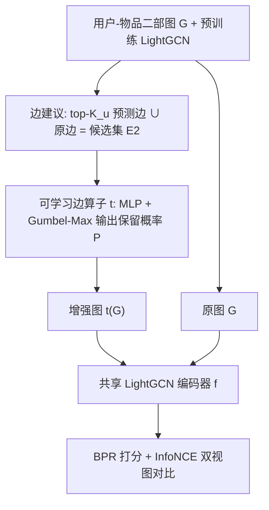
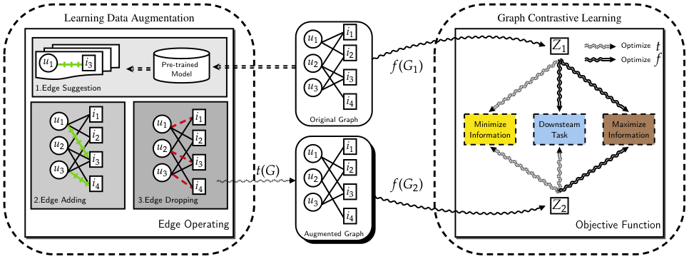

# Adversarial Learning Data Augmentation for Graph Contrastive Learning in Recommendation (推荐中图对比学习的对抗式可学习数据增强)

- **会议/期刊**: DASFAA 2023
- **作者与机构**: Junjie Huang, Qi Cao, Huawei Shen 等（中科院计算所数据智能系统研究中心、腾讯微信）；Ruobing Xie 等（腾讯）
- **推荐链路定位**: 召回 (GNN-based CF 表征学习)
- **研究方向**: 自监督对比学习与交互去噪 / 图神经网络推荐
- **论文原文**: [arXiv:2302.02317v1](https://arxiv.org/abs/2302.02317v1)
- **开源代码**: 暂未开源独立仓库（论文中指向的 `RUCAIBox/NCL` 为基线 NCL 的官方代码）

## TL;DR (1分钟核心速览)

图对比学习（GCL）推荐普遍依赖手工图增强（如随机边丢弃），增强不当反会损害表征；本文改用 InfoMin 视角，先由预训练 LightGCN 生成"边候选集"（原边 + top-$K_u$ 预测边），再用 Gumbel-Max 重参数化的 MLP 边算子学习可微的增删概率，与 LightGCN 编码器组成 min-max 对抗训练。在 Yelp/Gowalla/Amazon-Book/Alibaba-iFashion 四数据集、Full-Ranking 协议下全面超越 SGL、SimGCL、NCL，最稀疏的 Alibaba-iFashion 上 Recall@10 相对 NCL 提升 23.5%。

## Background & Motivation (背景与核心矛盾)

- **主流范式**: GNN-based CF（LightGCN）以 BPR 为下游损失，SGL/SimGCL/NCL 在其上叠加手工图增强 + InfoNCE，按 InfoMax 最大化同一节点两视图的一致性。
- **前人局限**: ① 增强策略全为启发式（边丢弃比例 $\rho$、node-dropping、随机噪声），SGL/SimGCL 对增强超参极度敏感，SimGCL 在稀疏的 Alibaba-iFashion 上甚至退化；② 只有"删边"无法补充稀疏度，而随机"加边"从$\mathcal{A}$采样复杂度$O(|V|^2)$ 且引入噪声。
- **核心洞察 (Key Insight)**: 按 InfoMin，好的视图应只保留完成下游任务所必需的最小信息；因此"增强的强度/方向"本身应被学习，而非拍定 —— 增强器应主动最小化与原始图视图的互信息。
- **本文切入点**: 把数据增强器 $t$显式参数化为"边算子"，与编码器$f$做对抗博弈：$f$要 InfoMax，$t$ 要 InfoMin。这是 InfoMin 首次被引入推荐场景的 GCL。

## Method (核心方法设计)

### 1. 整体框架 (Overall Architecture)

流程分三步：**边候选生成**（预训练 LightGCN 给每个用户预测 top-$K_u$个高可能交互边，与原边合并构成候选集$E_2$，$|E_0|=|E_1|$）→ **边算子$t$采样增强图**$t(G)$（对候选边逐一输出保留概率$p_{u,i}$，含增与删）→ **双视图对比**：原图$G_1=G$与增强图$G_2=t(G)$共享同一 LightGCN 编码器得到$Z_1,Z_2$，联合 BPR + InfoNCE 训练。训练采用类 GAN 的交替迭代：先冻结$f$更新$t$（InfoMin），再冻结$t$更新$f$（InfoMax），推理阶段只用$f(G)$做内积打分，$t$ 完全离线。

<figure class="paper-figure" markdown="span">
  <figcaption>图1：我们的框架 LDA-GCL 示意图。LDA-GCL 包含学习数据增强和图对比学习。</figcaption>
</figure>

### 2. 关键设计拆解 (Key Designs)

1. **边候选集构造（避免盲加噪声）**: 传统增强只在 $E_0$上做掩码$s(G)=\mathcal{A}\odot M$，无法缓解稀疏。本文先用预训练 GNN 给出用户$u$的 top-$K_u$物品（$K_u$取$u$在原图的度数），与原边等量合并成$E_2$：既把采样空间从$O(|V|^2)$降到$O(|E|)$，又保证新增边是"高置信潜在交互"而非随机噪声。

2. **可学习边算子 + Gumbel-Max 离散采样**: 若直接对掩码做梯度估计，离散 0/1 不可导。本文为每条候选边 $e_{u,i}$ 打一个由节点表征与边类型共同决定的权重：
$$\omega_{u,i}=\mathrm{MLP}\big([\,\mathbf{z}_u\odot\mathbf{z}_i\;\|\;\mathbb{I}_{E}(e_{u,i})\,\big]),\qquad p_{u,i}=\sigma\!\Big(\frac{\log\delta-\log(1-\delta)+\omega_{u,i}}{\tau}\Big)$$
其中 $\delta\sim\mathrm{Uniform}(0,1)$，$\tau$为温度。$\mathbb{I}_E$区分"原边/新增边"让算子对两类边学不同先验；Gumbel 噪声保证前向仍是硬采样、反向可传梯度；增强图邻接矩阵直接取$\mathcal{A}'=\begin{bmatrix}0&P\\P^{\top}&0\end{bmatrix}$ 的软权重形式，天然连续可微。

3. **对抗目标、负采样与推理开销**: 总目标为
$$\min_{t}\;\lambda_t I\big(f(G);f(t(G))\big)+\mathcal{L}\big(f(t(G)),y\big),\qquad \max_{f}\;I\big(f(G);f(t(G))\big)-\mathcal{L}\big(f(G),y\big)$$
互信息用 InfoNCE 估计（batch 内其余节点即负样本，**无需额外负采样**）。固定 $t$时$\mathcal{L}_f=\mathcal{L}_{\text{BPR}}+\lambda_{ssl}\mathcal{L}_{\text{NCE}}+\lambda_{reg}\|f\|_2^2$（$\lambda_{ssl}=0.1$沿用 SGL）；固定$f$时$\mathcal{L}_t=\mathcal{L}_{\text{BPR}}(f(t(G)),y)-\lambda_2\mathcal{L}_{\text{NCE}}+\lambda_{reg}\|t\|_2^2$，注意符号取负，即$t$主动"破坏"与$G$ 的互信息。代价是训练需两次前向 + 两个优化器，复杂度高于 SGL，推理无额外开销。

## Experimental Setup & Evaluation Protocol (实验设置与评估协议)

- **数据集与预处理**:

| 数据集 | #Users | #Items | #Interactions | 密度 | 特征/场景说明 |
| :--- | :---: | :---: | :---: | :---: | :--- |
| Yelp | 45,478 | 30,709 | 1,777,765 | 0.127% | 商户点评，过滤 <15 交互用户/物品，已去重 |
| Gowalla | 29,859 | 40,989 | 1,027,464 | 0.084% | LBSN 签到 |
| Amazon-Book | 58,145 | 58,052 | 2,517,437 | 0.075% | 图书评论，过滤 <15 |
| Alibaba-iFashion | 300,000 | 81,614 | 1,607,813 | 0.007% | 大规模极稀疏电商 |

- **数据划分与防穿越**: `比例划分` 8:1:1（随机抽 80% 训练 / 10% 验证 / 10% 测试），重复 5 次随机切分取均值；**未采用时间戳切分**，存在轻微未来交互泄漏风险。
- **排名评测协议**: 无偏 `Full-Ranking`，对用户全部未交互物品排序，报 Recall@{10,20,50} 与 NDCG@{10,20,50}。训练期每正样本均匀采 1 个负样本构成 BPR 三元组。
- **对比基线与超参**: 3 类共 9 个基线（MF：BPRMF/NeuMF/DMF；GNN：NGCF/DGCF/LightGCN；GCL：SGL-ED/SimGCL/NCL），全部基于 RecBole 复现；$d=64$，batch 4096，Adam，Xavier 初始化，early stopping patience=10（监控 NDCG@10），$p<0.05$ 显著性检验，单卡 V100S。

## Key Experimental Results (实验关键数据)

### 1. 主实验对比 (Main Results)

| 数据集 | 指标 | BPRMF | LightGCN | SGL | SimGCL | NCL | **LDA-GCL** | Improv. vs 最优基线 |
| :--- | :--- | :---: | :---: | :---: | :---: | :---: | :---: | :---: |
| Yelp | R@10 | 0.0499 | 0.0616 | 0.0664 | 0.0743 | 0.0713 | **0.0751** | +1.08% |
| Yelp | N@10 | 0.0335 | 0.0419 | 0.0456 | 0.0515 | 0.0489 | **0.0518** | +0.58% |
| Amazon-Book | R@10 | 0.0619 | 0.0783 | 0.0844 | 0.0872 | 0.0947 | **0.0975** | +2.96% |
| Amazon-Book | N@10 | 0.0431 | 0.0553 | 0.0606 | 0.0643 | 0.0685 | **0.0699** | +2.04% |
| Gowalla | R@10 | 0.1040 | 0.1355 | 0.1386 | 0.1487 | 0.1496 | **0.1505** | +0.60% |
| Gowalla | N@10 | 0.0738 | 0.0961 | 0.0999 | 0.1078 | 0.1081 | **0.1085** | +0.37% |
| Alibaba-iFashion | R@10 | 0.0297 | 0.0402 | 0.0518 | 0.0450 | 0.0490 | **0.0605** | +23.47% |
| Alibaba-iFashion | N@10 | 0.0158 | 0.0216 | 0.0280 | 0.0252 | 0.0267 | **0.0335** | +25.28% |

（所有最优值均有 $\ast$标记，$p<0.05$；Gowalla 上多数指标提升幅度在置信区间边缘。）

### 2. 消融实验 (Ablation Study)

| 变体 | Gowalla R@10 | Gowalla N@10 | Alibaba R@10 | Alibaba N@10 |
| :--- | :---: | :---: | :---: | :---: |
| LightGCN（无对比） | 0.1342 | 0.0962 | 0.0395 | 0.0212 |
| DA-GCL(0.0, 0.0) 仅对比无增强 | 0.1488 | 0.1085 | 0.0497 | 0.0274 |
| DA-GCL(0.1, 0.0) 随机删边 | 0.1492 | 0.1083 | 0.0529 | 0.0289 |
| DA-GCL(0.1, 0.1) 随机增+删 | 0.1479 | 0.1063 | 0.0553 | 0.0303 |
| DA-GCL(0.0, 1.0) 大量加边 | 0.1369 | 0.0973 | 0.0520 | 0.0282 |
| LDA-GCL (w NGCF) | 0.1488 | 0.1078 | 0.0589 | 0.0322 |
| LDA-GCL (w/o EA) 仅学习删边 | 0.1499 | 0.1087 | 0.0579 | 0.0319 |
| **LDA-GCL** | **0.1512** | **0.1090** | **0.0599** | **0.0330** |

### 3. 关键实验发现 (Key Findings)

1. **稀疏度越低收益越大**：按用户交互数分 5 组，Alibaba-iFashion 上 LDA-GCL 相对 LightGCN 在 Group3/2/1 分别提升 27.9%/45.5%/51.8%，而 SGL 在 Gowalla 的高交互 Group3/4 上反而不如 LightGCN —— 说明**可学习增强解决了"增强过强伤害稠密用户"的老问题**，全组保持不退化。
2. **加边贡献集中于稀疏场景**：去掉边添加（w/o EA）在 Gowalla 只掉 0.87%，但在 Alibaba-iFashion 掉 3.5%，验证"补边"是对抗稀疏的关键；但盲目加边（DA-GCL, $p_A=1.0$）会因噪声使 Gowalla 从 0.1488 跌回 0.1369，说明**候选边质量比数量更重要**（换成 NGCF 预训练即掉 0.0011~0.0016）。
3. **InfoMin 项确有增益但增益有限**：$\lambda_t=0$（无$\min_t I$）在两个数据集上都最差；$\lambda_t=0.1$相比 0.0 在 Alibaba 的 R@10/20/50 上提升 2.75%/3.30%/3.82%，但$\lambda_t>0$ 区间内曲线平坦，最佳值在 Gowalla 为 0.2、Alibaba 为 1.0 —— 超参不敏感但最优值随稀疏度漂移。

## Highlights & Limitations (亮点、对比与审稿批判)

- **与代表作对比**: SGL 用固定 $\rho$ 的随机边丢弃、双视图各自扰动；SimGCL 用均匀噪声扰动表征而完全放弃图结构，导致稀疏数据上退化；NCL 引入结构/语义邻居扩充对比对但增强仍非学习。LDA-GCL 的差异在于把"增强"本身作为可训练模块，并用 InfoMin 而非启发式规则约束其强度；与 AD-GCL 相比，本文把该思路从"小图无监督图分类 + 预训练微调"迁移到"单一大二部图 + 联合训练"场景。
- **可迁移亮点**: ① "预训练模型产候选边 + 可学习掩码"这套两阶段稀疏化采样，可直接搬到 SGL+ 的序列/多模态图增强；② 用 $\mathbb{I}_E$ 显式编码边来源作为算子输入的技巧，可用于区分真交互与合成样本，缓解假阳性污染。
- **审稿级局限批判**: ① 训练效率差：需双前向 + 两优化器交替，论文自身承认复杂度高，且未报告实际训练时间/收敛轮数对比；② 评估薄弱：随机 8:1:1 切分而非时间切分，存在未来信息泄漏；未做在线 A/B；Gowalla 上对 NCL 的提升仅 0.6%（R@10）且未标显著性，主要说服力来自单一最稀疏数据集；③ $K_u$ 直接用用户度数这一启发式设定未做敏感性分析。

## Rating (四维评分)

- **方法创新性 (Novelty)**: ⭐⭐⭐⭐ （首次把 InfoMin 引入推荐 GCL，边候选 + Gumbel-Max 可微掩码设计干净，但骨架与 AD-GCL 高度同构）
- **评估协议与实验扎实度 (Protocol & Experiments)**: ⭐⭐⭐ （4 数据集 + Full-Ranking + 5 次重复 + 显著性检验到位，但随机切分有泄漏、缺少时间/线上验证）
- **写作与数学规范度 (Clarity & Rigor)**: ⭐⭐⭐⭐ （InfoMin/InfoMax 双目标推导清晰、$\mathcal{L}_t$ 的负号来源讲透，算法伪代码完整；互信息估计与 InfoNCE 的等价变换略简）
- **工业落地与复现价值 (Industrial & Practical Value)**: ⭐⭐⭐ （推理零额外开销、可即插即用于 LightGCN 召回，但训练需对抗式双优化器、预训练候选边，工程成本偏高且无独立开源仓库）

