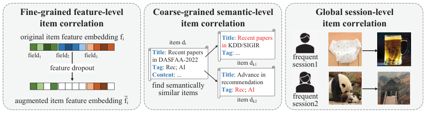
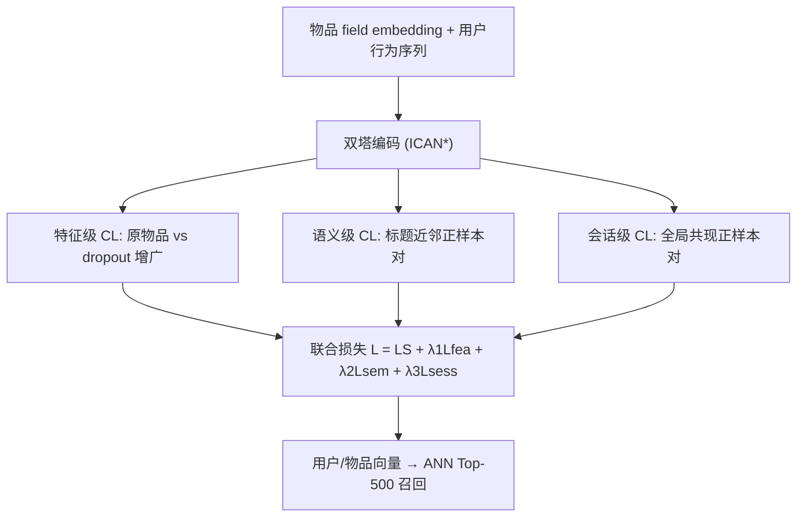
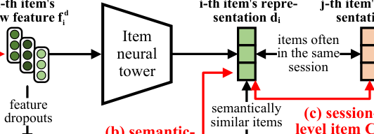

# Multi-granularity Item-based Contrastive Recommendation (多粒度基于物品的对比推荐)

- **会议/期刊**: DASFAA 2023
- **作者与机构**: Ruobing Xie, Zhijie Qiu, Bo Zhang, Leyu Lin（腾讯微信 WeChat, Tencent）
- **推荐链路定位**: 召回（Matching / Candidate Generation，双塔）
- **研究方向**: 自监督对比学习与交互去噪 / 协同过滤与双塔召回
- **论文原文**: [论文原文链接](https://arxiv.org/abs/2207.01387v2)
- **开源代码**: 暂未开源

## TL;DR (1分钟核心速览)

现有对比推荐几乎都把增广做在**用户侧**（行为/属性扰动），忽略了物品侧丰富的多粒度信息，而双塔召回中物品表征直接决定内积打分。本文提出 MicRec，把**特征级（dropout 增广）、语义级（标题/tag 近邻）、会话级（全局共现）** 三个即插即用的物品侧对比任务作为辅助损失叠加到任意双塔模型上。在 6.36 亿点击的 Video-636M 与 7600 万点击的 News-76M 上按时间切分、全库 HIT@500 评测，相对 SOTA 物品侧 CL 基线 RFM* 提升 2.8%–4.1%，物品覆盖率提升 29.3%，线上 7 天 A/B 全指标显著正向。

## Background & Motivation (背景与核心矛盾)

- **主流范式**: 工业召回采用双塔结构，用户/物品塔分别编码后以余弦相似度做 ANN 检索；为缓解稀疏性，近年大量工作引入对比学习（CL）作为自监督辅助损失。
- **前人局限**: 其一，现有 CL4Rec 的增广几乎全是**用户侧**（行为序列裁剪、属性掩码、图扰动），物品表征只作为被动的负样本参与；其二，少数物品侧工作（如 RFM/CFM）只做**单一粒度**的特征掩码，无法覆盖语义与行为关联。
- **核心洞察 (Key Insight)**: 一个物品可从三个粒度被描述——细粒度特征（field/element dropout）、粗粒度语义（标题、类目、内容）、全局会话行为（如 `尿布→啤酒`、`熊猫→长城` 这类特征与语义都不相似却高频共现的关联）。三者互补，恰好补上 CTR 标签无法给出的长尾训练信号。
- **本文切入点**: 把三种物品相关性统一写成三个 InfoNCE 辅助任务，即插即用地挂在任意 embedding-based 召回模型上。

<figure class="paper-figure" markdown="span">
  <figcaption>图1. 真实推荐系统中的多粒度物品相关性。</figcaption>
</figure>

## Method (核心方法设计)

### 1. 整体框架 (Overall Architecture)

以 ICAN（去掉多域设计，记 ICAN*）为基座：用户塔用 Transformer 编码 20 条近期行为序列，拼接用户特征后经 3 层 MLP 得 $u_i$；物品塔用 3 层 MLP 对物品 field embedding 做特征交叉得$d_k$。主损失为 sampled softmax 召回损失$\mathcal{L}_S$，另设三个物品侧 CL 头（各自一层 projector）并行训练，推理时只保留双塔与 ANN 索引——因此**线上内存与算力与基座完全一致**，仅离线训练时长增至约 2 倍。

### 2. 关键设计拆解 (Key Designs)

1. **特征级物品 CL（对齐 + 均匀性）**：把物品原始特征 $\mathbf{f}^d_i$做 dropout 得增广$\bar{\mathbf{f}}^d_i$，正样本即自身增广，相似度$g_f = \mathrm{MLP}_f(\mathbf{f}^d_i)^\top \mathrm{MLP}_f(\bar{\mathbf{f}}^d_j)$，按 InfoNCE 计损失。关键细节：负样本**随机采样**而非 in-batch 采样，以避免 in-batch 负样本过度压制热门物品（线上已验证）。增广策略比较了 element 级、field 级与多值类别特征（tag）随机丢弃，最终采用 **field 级 + 类别特征 dropout，掩码率 0.5** 效果最佳。
2. **语义级物品 CL（跨物品粗粒度关联）**：正样本集合 $\mathcal{P}^t_i$由物品标题的 BERT 句向量余弦 top-k 近邻构成（也可用同 tag/类目或内容编码器），损失为$\mathcal{L}_{sem}=-\sum_{d_i}\sum_{d_k\in\mathcal{P}^t_i}\log\frac{\exp(g_t(d_i,d_k)/\tau)}{\sum_{d_j\in\mathcal{N}^t_i}\exp(g_t(d_i,d_j)/\tau)}$。与特征级 CL 的本质差别是正样本对为**两个不同物品**$(d_i,d_k)$，而非$( \mathbf{f}^d_i,\bar{\mathbf{f}}^d_i)$，因此可为交互稀少的长尾物品提供额外训练机会。
3. **会话级物品 CL（全局行为共现）**：扫描训练集全部会话（1 小时内点击视为共现）构建共现矩阵，物品 $d_i$的正样本集$\mathcal{P}^s_i$按其 top-k 共现次数**加权采样**，负样本$\mathcal{N}^s_i$取自从未与$d_i$共现的物品，损失形式同$\mathcal{L}_{sess}$。它编码的是"无意识众包"式隐式关联，是特征/语义两路无法覆盖的补充信号。

**训练目标与开销**：$\mathcal{L}=\mathcal{L}_S+\lambda_1\mathcal{L}_{fea}+\lambda_2\mathcal{L}_{sem}+\lambda_3\mathcal{L}_{sess}$，视频域取$\lambda=(1.0,0.3,0.1)$、新闻域$(1.0,0.1,0.1)$，温度统一$\tau=1$，三个 CL 任务各采样至多 50 个负样本；负采样策略为随机负采样（免 in-batch），推理零额外开销。

<figure class="paper-figure" markdown="span">
  <figcaption>图2. MicRec 中提出的三个即插即用的基于物品的 CL 任务。</figcaption>
</figure>

## Experimental Setup & Evaluation Protocol (实验设置与评估协议)

- **数据集与预处理**: 两个自建工业数据集，含用户 ID、tag、provider 等 8（视频）/17（新闻）个 field，按数据掩码脱敏：

| 数据集 | #Users | #Items | #Sessions | #Clicks | 特征/场景说明 |
| :--- | :---: | :---: | :---: | :---: | :--- |
| Video-636M | 25,476,322 | 2,406,028 | 58,595,540 | 635,774,650 | 短视频点击，8 field，测试集 4700 万 |
| News-76M | 6,364,403 | 1,056,630 | 11,455,920 | 76,303,835 | 新闻点击，17 field，测试集 720 万 |

- **数据划分与防穿越 (Splitting Strategy)**: **全局时间戳切分**（按时间先后划分 train/test），避免未来交互泄漏。
- **排名评测协议 (Ranking Protocol)**: 采用 **Full-Ranking 全库检索命中** 的 `HIT@N`（N=50/100/200/500），模拟线上从百万级候选召回数百条的真实链路；作者明确论证召回阶段不应使用 NDCG/AUC 这类对序敏感的排序指标。训练侧为随机负采样（候选集 {10,20,50} 网格搜索取至多 50）。多样性用 **item coverage**（测试集中模型能给出预测的物品占比）衡量。
- **对比基线与超参设置**: FM / YoutubeDNN / DeepFM / AutoInt / ICAN*（基座）/ RFM*（SOTA 物品侧 CL，已适配为特征 dropout 版本）；embedding 维度 $d=64$，MLP 输出 128-64-64，Adam$\alpha=0.001$，batch 4096，5 次运行取均值，离线 t-test$p<0.01$、线上$p<0.05$。

## Key Experimental Results (实验关键数据)

### 1. 主实验对比 (Main Results)

| Model | Video@50 | Video@100 | Video@500 | News@50 | News@100 | News@500 |
| :--- | :---: | :---: | :---: | :---: | :---: | :---: |
| FM | 0.1731 | 0.2487 | 0.4495 | 0.2466 | 0.3072 | 0.4843 |
| YoutubeDNN | 0.1779 | 0.2576 | 0.4719 | 0.2691 | 0.3307 | 0.5188 |
| DeepFM | 0.1825 | 0.2587 | 0.4776 | 0.2659 | 0.3268 | 0.5171 |
| AutoInt | 0.1859 | 0.2626 | 0.4857 | 0.2716 | 0.3431 | 0.5316 |
| ICAN* | 0.1872 | 0.2627 | 0.4873 | 0.2748 | 0.3438 | 0.5403 |
| RFM* (SOTA item CL) | 0.1967 | 0.2752 | 0.5065 | 0.2911 | 0.3609 | 0.5605 |
| **MicRec** | **0.2047** | **0.2831** | **0.5209** | **0.3018** | **0.3719** | **0.5758** |
| Improv. vs RFM* | +4.07% | +2.87% | +2.84% | +3.68% | +3.05% | +2.73% |
| Improv. vs ICAN* | +9.35% | +7.77% | +6.90% | +9.83% | +8.17% | +6.57% |

**线上 A/B（视频域，7 天，400 万用户）**：整体 ACC +3.287%、ADT +1.389%、冷启动用户 ACC-c **+11.517%**、ADT-c +6.472%；视频域 ACC +5.643%、ADT +2.824%、ALR +4.138%、AFR +5.165%；冷启动次日留存额外 +1.54%。

### 2. 消融实验 (Ablation Study)

| 版本 (Video-636M) | HIT@50 | HIT@500 | Item Coverage |
| :--- | :---: | :---: | :---: |
| **MicRec (fea+sem+sess)** | **0.2047** | **0.5209** | 16.1% |
| w/o 特征级 CL | 0.2008 | 0.5092 | 17.2% |
| w/o 语义级 CL | 0.2033 | 0.5134 | 16.2% |
| w/o 会话级 CL | 0.2012 | 0.5108 | **9.3%** |
| w/o 全部物品 CL (=ICAN*) | 0.1872 | 0.4873 | 12.4% |

### 3. 关键实验发现 (Key Findings)

1. **增益随 N 增大而稳定、且在更大 N 上更"值钱"**：MicRec 相对 RFM* 在 HIT@500 上仍有 +2.84%/+2.73% 的稳定领先，隐含百万级候选集下被召回的正样本绝对增量远高于 HIT@50，这正是召回阶段最关心的指标；相对基座 ICAN* 的提升在 6.6%–9.8% 区间，说明三级 CL 的收益远超单一特征掩码。
2. **三路 CL 缺一不可，但分工不同**：移除任一路 HIT@500 掉 0.75%–1.17%；而**多样性几乎全部由会话级 CL 贡献**——去掉它 coverage 从 16.1% 崩到 9.3%，反之去掉特征级 CL coverage 反升至 17.2%（随机负采样之外的对齐约束倾向于收缩表征多样性）。因此最终版本是"以精度为优先、保留可接受多样性"的折中，而非各路最优的简单叠加。
3. **冷启动与长尾是最大受益者**：语义级 CL 通过标题近邻为交互稀少的物品补训练信号，会话级 CL 引入全局共现；线上冷启动用户 ACC-c +11.52%、ADT-c +6.47%、次日留存 +1.54%，显著高于整体的 +3.29%/+1.39%，印证了"物品侧自监督信号间接改善冷启动用户预测"的传导路径。

## Highlights & Limitations (亮点、对比与审稿批判)

- **与代表作对比 (vs. Prior Work)**: 与 **RFM/CFM** 相比，本文不止于特征掩码，而是把语义近邻与会话共现两类**跨物品正样本对**纳入对比，且刻意放弃 in-batch 负采样以避免热门物品被过度压制；与 **S3-Rec** 的物品/属性/句子级 CL 相比，本文面向百万级双塔**召回匹配**而非序列排序，并额外引入全局会话共现粒度；与 **SGL/SimGCL 等用户侧图对比**方法正交，可与之叠加使用。
- **可迁移亮点**: ①"随机负采样优于 in-batch"的工程结论，在热门度长尾分布极偏的工业召回里可直接复用；②用共现矩阵 top-k 加权采样构造正样本对，是一种免人工标注、可增量更新的行为侧增广范式。
- **审稿级局限批判**: ①会话级 CL 需在全量训练集上扫描构建物品共现矩阵并周期性重建，空间/计算复杂度随物品数近似平方增长，论文未给出显式复杂度与增量更新方案；②仅用两个内部工业数据集、无公开基准复现，且代码"future release"未落地，可比性受限；③语义正样本强依赖标题质量与 BERT 编码，$\lambda$ 与掩码率 0.5 虽称鲁棒但仍属经验网格搜索，缺少敏感度曲线与理论分析。

## Rating (四维评分)

- **方法创新性 (Novelty)**: ⭐⭐⭐⭐ （首次系统性提出特征/语义/会话三级物品侧 CL，思路朴素但切入角度此前被忽视，缺乏理论刻画）
- **评估协议与实验扎实度 (Protocol & Experiments)**: ⭐⭐⭐⭐ （两工业级数据集 + 全库 HIT 协议 + 7 天线上 A/B + 显著性检验齐全，唯缺公开数据集）
- **写作与数学规范度 (Clarity & Rigor)**: ⭐⭐⭐⭐ （三个 InfoNCE 公式统一、增广策略对比清晰，但复杂度与超参敏感度分析偏薄）
- **工业落地与复现价值 (Industrial & Practical Value)**: ⭐⭐⭐⭐⭐ （即插即用、线上零额外推理开销、可跨 ICAN/YoutubeDNN/AutoInt 复用，已服务百万级用户）

