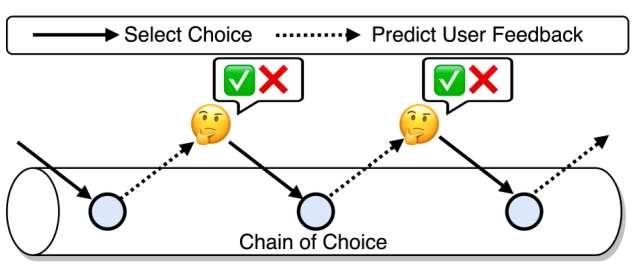
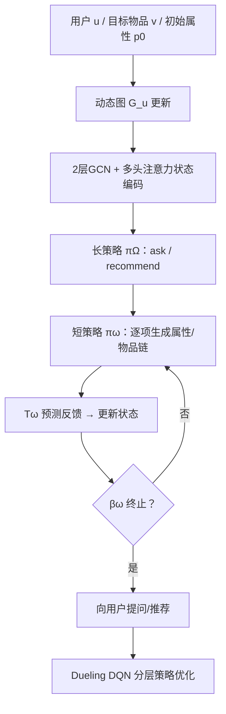
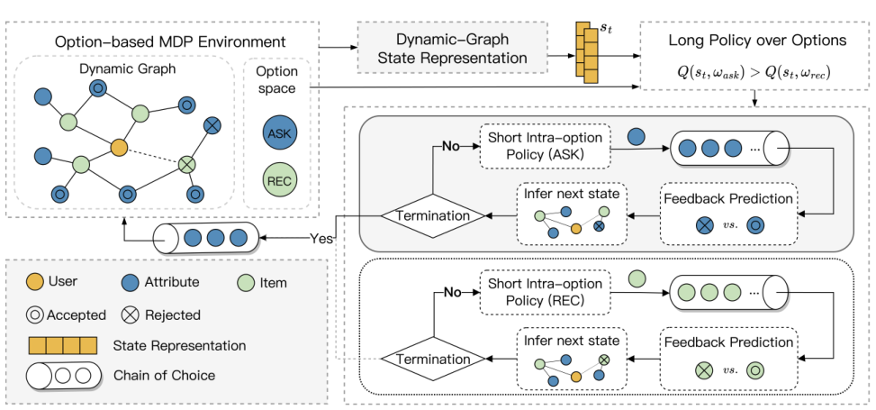

# Chain-of-Choice Hierarchical Policy Learning for Conversational Recommendation (面向对话推荐的链式选择分层策略学习)

- **会议/期刊**: DASFAA 2024
- **作者与机构**: Wei Fan, Weijia Zhang, Weiqi Wang, Yangqiu Song, Hao Liu；香港科技大学 & 香港科技大学（广州）
- **推荐链路定位**: 端到端交互策略（多轮询问+推荐）
- **研究方向**: 对话推荐与智能体仿真 / 强化学习与动态探索推荐
- **论文原文**: [论文原文链接](https://arxiv.org/abs/2310.17922v2)
- **开源代码**: 暂未开源

## TL;DR (1分钟核心速览)

针对现有对话推荐每轮只能询问单一属性类型、且独立选属性导致轮次多与属性冗余的问题，本文提出 MTAMCR 场景与 CoCHPL 分层策略：长策略选“问/推”，短策略按用户反馈预测逐级生成属性/物品链。在四个基准上，Yelp/Amazon-Book 的 SR@15、AT、hDCG 相对最强基线平均提升 18.3%/8.6%/6.9%。

## Background & Motivation (背景与核心矛盾)

- **主流范式**: 将多轮对话推荐建模为 MDP，用 RL 在每轮选择二值问题或单一属性类型下的多选题，再决定推荐物品。
- **前人局限**: ① 每轮仅覆盖一个属性类型，用户需多轮才能暴露“运动/耐克/黑色”等多类型偏好；② 现有 RL 方法按 top-K Q 值独立选属性，忽略前序选择对后续选择的影响，易产生同质、冗余问题。
- **核心洞察 (Key Insight)**: 一轮内的多个选择本质是**有依赖的序列**：若已预测用户接受“Nike”，下一步问“颜色”比继续问“品牌”更有信息增益；每选一项后预测反馈并重估状态，可让链式选择更连贯。
- **本文切入点**: 提出 MTAMCR 场景，并用选项框架（options）把“问/推”高层动作与“属性/物品链”低层动作分层建模。

<figure class="paper-figure" markdown="span">
  <figcaption>图2. 每一轮中，智能体进行决策：先选择一个选项，再预测用户反馈以推断后续状态。基于预测状态，智能体选择下一选项，并持续重复该过程，直至该轮最终到达终止点。</figcaption>
</figure>
图 2：链式选择示意：每步选择后预测用户反馈并推断下一状态。

## Method (核心方法设计)

### 1. 整体框架 (Overall Architecture)

输入用户 $u$、目标物品$v$与初始属性$p_0$。每轮先由长策略$\pi_\Omega$在$\{\omega_{ask},\omega_{rec}\}$中选择动作类型；短策略$\pi_\omega$在动态候选集上逐项生成属性/物品链，反馈预测函数$\mathcal{T}_\omega$推断用户接受/拒绝并推进内在状态，终止函数$\beta_\omega$决定何时停止该轮链。动态图$G_u$ 每步更新，2 层 GCN 与多头注意力编码状态。训练用每个 option 独立经验池、Dueling DQN 及 MSE/终止梯度/反馈预测损失；推理时先完整生成链再与用户交互。

<figure class="paper-figure" markdown="span">
  <figcaption>图3. Chain-of-Choice Hierarchical Policy Learning 概览。</figcaption>
</figure>
图 3：Chain-of-Choice Hierarchical Policy Learning 整体框架。

### 2. 关键设计拆解 (Key Designs)

1. **MTAMCR 与选项式 MDP 环境**：把每轮拆成高层 option $\omega_T$与低层链式动作$a_t$，状态-选项对$(s_t,\omega_T)$含$\{u,V^{(t)},P^{(t)},\omega_T\}$；候选集随接受/拒绝历史动态收缩：$V^{(t)}_{cand}=V_{P^{(t)}_{acc}}\setminus V^{(t)}_{rej}$，$P^{(t)}_{cand}=P_{V^{(t)}_{cand}}\setminus(P^{(t)}_{acc}\cup P^{(t)}_{rej})$。这样既允许跨属性类型提问，又显著缩小每步动作空间。

2. **Chain-of-Choice 短策略（反馈预测+终止）**：针对 top-K 独立选择的缺陷，短策略逐项选 $a_t$，用$\mathcal{T}_\omega(s_t,a_t)\approx\mathbb{I}(a_t\text{ accepted})$推断下一状态；$Q_U(s_t,\omega_T,a_t)=r(s_t,a_t)+\gamma U(\omega_T,s_{t+1})$，其中$U(\omega_T,s_{t+1})=(1-\beta_{\omega_T}(s_{t+1}))Q_\Omega(s_{t+1},\omega_T)+\beta_{\omega_T}(s_{t+1})\max_\omega Q_\Omega(s_{t+1},\omega)$。前序选择改变状态，后续选择因此有条件依赖，终止函数自适应决定链长。

3. **动态图状态表征与分层策略训练**：用 $w^{(t)}_v=\sigma(e_u^\top e_v+\sum_{p\in P^{(t)}_{acc}}e_v^\top e_p-\sum_{p\in P^{(t)}_{rej}}e_v^\top e_p)$给候选加权，2 层 GCN + 多头注意力编码；Dueling DQN 估$Q_U$，$\mathcal{L}(\theta_Q,\theta_S)=\mathbb{E}_{d_t\sim\mathcal{D}}[(y_t-Q_U(s_t,\omega_T,a_t;\theta_Q,\theta_S))^2]$；终止网络按 option-critic 梯度、反馈预测用 MSE。无额外负采样，候选集由拒绝历史过滤；推理开销随链长线性增加。

## Experimental Setup & Evaluation Protocol (实验设置与评估协议)

- **数据集与预处理**: 四个基准统计如下（密度为约值）：

| 数据集 | #Users | #Items | #Interactions | 稀疏度/密度 | 特征/场景说明 |
| :--- | :---: | :---: | :---: | :---: | :--- |
| LastFM | 1,801 | 7,432 | 76,693 | 0.573% | 8,438 属性/34 类型；音乐+社交 |
| Yelp | 27,675 | 70,311 | 1,368,606 | 0.070% | 590 属性/29 类型；商户两层 taxonomy |
| Amazon-Book | 30,291 | 17,739 | 478,099 | 0.089% | 988 属性/40 类型；≥10 交互 |
| MovieLens | 20,892 | 16,482 | 454,011 | 0.132% | 1,498 属性/24 类型；评分>3 |

- **数据划分与防穿越 (Splitting Strategy)**: 原文未报告显式 Leave-One-Out/比例切分；采用会话级 episode 在线训练（10,000 episodes）与模拟用户评测，每 episode 随机采样用户-目标物品-初始属性，最大 15 轮；复现需固定 episode 采样种子与用户模拟器。
- **排名评测协议 (Ranking Protocol)**: 非全库 Full-Ranking；每轮在动态候选集上做 top-K 推荐（$k_v=10$），hDCG@(T,K) 衡量目标物品在推荐列表中的排名；属性询问每轮最多$k_p=3$，候选由接受属性过滤，不是固定负采样排序。
- **对比基线与超参设置**: 8 个基线：Abs Greedy、Max Entropy、CRM、EAR、SCPR、UNICORN、MCMIPL、DAHCR；并设 -S（单类型多选）与 -M（多类型 top-K）变体。TransE 预训练节点，2 层 GCN；$T_{\max}=15$，$k_v=10$，$k_p=3$；Adam$1e-4$，$\gamma=0.999$；$r_{ask\_acc}=1e-2$，$r_{ask\_rej}=-1e-4$，$r_{rec\_rej}=-1e-4$，$r_{rec\_suc}=1$（MovieLens 的$r_{ask\_acc}=1e-5$）。原文未报告显著性检验。

## Key Experimental Results (实验关键数据)

### 1. 主实验对比 (Main Results)

表 2 汇总 SR@15 / AT / hDCG；AT 越低越好，`Improv.%` 为相对最强基线的变化（SR↑/AT↓/hDCG↑）。

| 方法 | LastFM SR@15 / AT / hDCG | Yelp SR@15 / AT / hDCG | Amazon-Book SR@15 / AT / hDCG | MovieLens SR@15 / AT / hDCG |
| :--- | :---: | :---: | :---: | :---: |
| UNICORN | 0.788 / 7.58 / 0.349 | 0.520 / 11.31 / 0.203 | 0.498 / 10.42 / 0.179 | 0.863 / 4.62 / 0.523 |
| DAHCR | 0.925 / 6.31 / 0.431 | 0.626 / 11.02 / 0.192 | 0.522 / 10.14 / 0.188 | 0.875 / 4.34 / 0.535 |
| MCMIPL-S | 0.942 / 5.44 / 0.431 | 0.631 / 10.25 / 0.225 | 0.556 / 9.57 / 0.264 | 0.879 / 3.92 / 0.581 |
| DAHCR-S | 0.933 / 5.67 / 0.429 | 0.668 / 10.15 / 0.232 | 0.572 / 9.45 / 0.272 | 0.895 / 3.89 / 0.603 |
| UNICORN-M | 0.892 / 5.96 / 0.426 | 0.634 / 10.35 / 0.233 | 0.584 / 9.69 / 0.261 | 0.887 / 4.10 / 0.587 |
| MCMIPL-M | 0.973 / 4.59 / 0.466 | 0.675 / 10.11 / 0.256 | 0.667 / 8.98 / 0.293 | 0.891 / 3.68 / 0.609 |
| DAHCR-M | 0.965 / 4.61 / 0.451 | 0.681 / 10.23 / 0.241 | 0.689 / 8.45 / 0.301 | 0.874 / 3.98 / 0.593 |
| **CoCHPL** | **0.991 / 3.75 / 0.493** | **0.846 / 9.36 / 0.267** | **0.775 / 7.61 / 0.330** | **0.908 / 2.85 / 0.628** |
| **Improv.% vs 最强基线** | +1.8 / -18.3 / +5.8 | +24.2 / -8.5 / +4.3 | +12.5 / -9.9 / +9.6 | +1.5 / -22.6 / +3.1 |

### 2. 消融实验 (Ablation Study)

| 方法 | Yelp SR@15 | Yelp AT | Yelp hDCG | Amazon SR@15 | Amazon AT | Amazon hDCG |
| :--- | :---: | :---: | :---: | :---: | :---: | :---: |
| CoCHPL | **0.846** | **9.36** | **0.267** | **0.775** | **7.61** | **0.330** |
| w/o 长策略 over options | 0.693 | 10.21 | 0.225 | 0.649 | 9.12 | 0.278 |
| w/o 短策略 (ask) | 0.655 | 10.29 | 0.221 | 0.612 | 9.54 | 0.270 |
| w/o 短策略 (rec) | 0.756 | 10.05 | 0.245 | 0.685 | 8.99 | 0.285 |
| w/o 终止函数 | 0.798 | 9.67 | 0.253 | 0.744 | 8.34 | 0.302 |
| w/o 反馈预测 | 0.782 | 9.95 | 0.248 | 0.732 | 8.12 | 0.311 |

### 3. 关键实验发现 (Key Findings)

- **多类型链式询问是主收益来源**：Yelp 上去掉 `ask` 短策略使 SR 从 0.846 降至 0.655（-22.6%），降幅大于去掉 `rec` 的 0.756；Amazon-Book 同样从 0.775 降至 0.612，说明“逐项问属性”比“直接推荐”更关键。
- **长策略 over options 决定交互骨架**：去掉后 Yelp/Amazon SR 降至 0.693/0.649，AT 升至 10.21/9.12，证明先判断“该问还是该推”比单纯 top-K 选属性更重要。
- **终止与反馈预测各自有效**：去掉终止函数 Yelp SR 0.846→0.798、AT 9.36→9.67；去掉反馈预测 SR→0.782、AT→9.95。链式生成若没有停点学习与用户反馈模拟，会同时损害成功率与效率。

## Highlights & Limitations (亮点、对比与审稿批判)

- **与代表作对比 (vs. Prior Work)**: MCMIPL 仅支持单类型多选，DAHCR 虽分层选动作类型但属性/物品仍按 top-K 独立选取；CoCHPL 在同一轮内用反馈预测重估状态，使选择之间存在真正依赖，属性组合更多样。
- **可迁移亮点**: ① 用 options 框架解耦“高层动作类型”与“低层序列生成”，可迁移到多目标重排或对话式检索；② 终止函数+反馈预测器可作为轻量用户模拟器，缓解离线 RL 的交互数据瓶颈。
- **审稿级局限批判**: 评估完全依赖模拟用户，缺少真实用户研究或线上 A/B；训练时每步可见真实反馈、推理时用预测反馈，存在 exposure bias。此外，链式自回归生成增加每轮决策开销，且依赖属性 schema/知识图谱覆盖；未开源代码，复现成本较高。

## Rating (四维评分)

- **方法创新性 (Novelty)**: ⭐⭐⭐⭐ （MTAMCR 场景与 chain-of-choice 分层 RL 结合自然，选项内反馈预测+终止机制有实质增量）
- **评估协议与实验扎实度 (Protocol & Experiments)**: ⭐⭐⭐ （四数据集、8 基线+6 变体较完整，但模拟用户评测且未报告显著性检验）
- **写作与数学规范度 (Clarity & Rigor)**: ⭐⭐⭐⭐ （状态/选项/终止/反馈公式定义清楚，算法流程完整；部分训练细节需附录补全）
- **工业落地与复现价值 (Industrial & Practical Value)**: ⭐⭐⭐ （分层策略可嵌入销售/客服对话系统，但无开源代码且链式推理延迟需工程优化）

