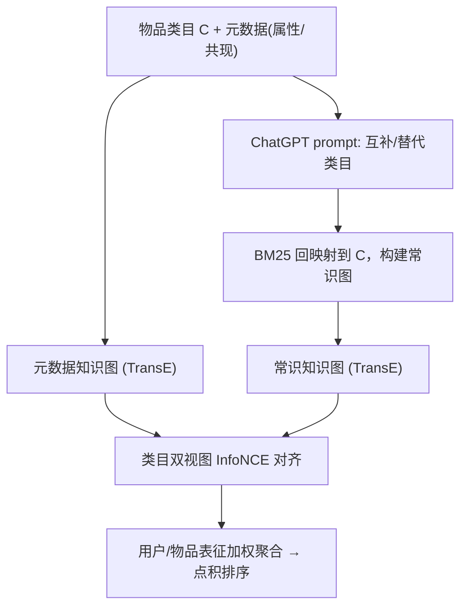
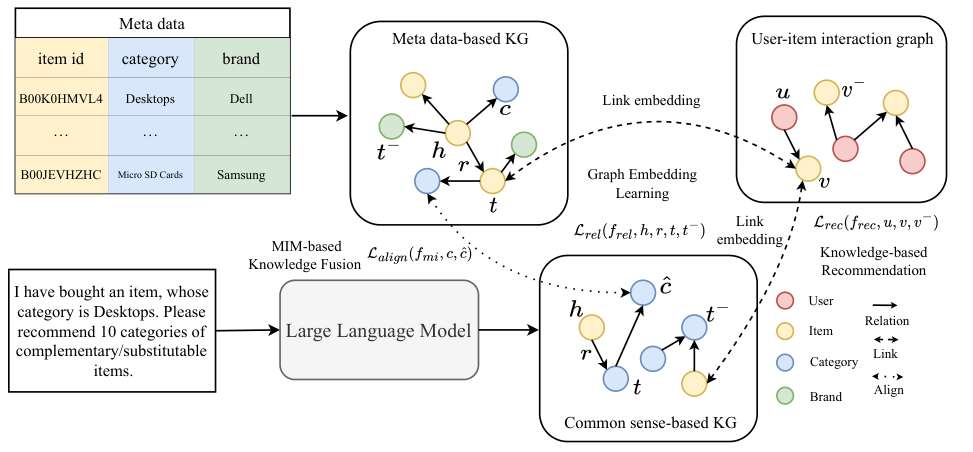

# Common Sense Enhanced Knowledge-based Recommendation with Large Language Model (基于大语言模型常识增强的知识推荐)

- **会议/期刊**: DASFAA 2024
- **作者与机构**: 杨盛浩、马为之(通讯)、孙培杰、张敏、艾清遥、刘奕群（清华大学 DCST / AIR）；蔡明琛（美团）
- **推荐链路定位**: 召回（用户/物品表征学习）
- **研究方向**: 图神经网络与知识图谱推荐 / 大语言模型推荐
- **论文原文**: [https://arxiv.org/abs/2403.18325v1](https://arxiv.org/abs/2403.18325v1)
- **开源代码**: [https://github.com/ysh-1998/CSRec](https://github.com/ysh-1998/CSRec)

## TL;DR (1分钟核心速览)

知识推荐依赖的元数据知识图（属性 + 共现）在交互稀疏时几乎失效，属性关系信息量又极低。本文用 ChatGPT 离线生成"类目互补/替代"常识边，构建类别级常识知识图 CSRec，并指出直接硬合并两张图会因知识空间鸿沟而掉点，改用基于互信息最大化（InfoNCE）的软融合以类目为桥对齐双视图。该框架即插即用于 CKE/CFKG：Amazon Office 上 CFKG 的 nDCG@10 由 0.0684 升至 0.0742（相对 +8.5%），Electronics 上 HR@10 由 0.2712 升至 0.2766。5-core、8:1:1 划分、全库排序协议。

## Background & Motivation (背景与核心矛盾)

- **主流范式**: CKE/CFKG/KGCN/KGAT 一类知识推荐把物品属性与"also buy/view"共现关系建成元数据知识图，用 TransR/TransE+GCN 做嵌入传播来补交互稀疏。
- **前人局限**: ① 属性边提供的信息过于单薄、区分度低；② 共现边本质仍是协同信号，交互稀少时同样无法抽取，冷启动场景彻底失效。
- **核心洞察 (Key Insight)**: 常识是"数据无关"且普适的高层语义——"买了手机就该配壳"并不需要任何共现统计即可成立，因此它天然可作为元数据图的**正交补充**，且完全可从 LLM 世界知识中离线批发获取。
- **本文切入点**: 把常识结构化到**类目层级**（互补 / 替代两种关系），再解决"两张图知识空间不同、不能硬拼"的融合难题。

## Method (核心方法设计)

### 1. 整体框架 (Overall Architecture)

框架由三支构成：一是**常识图构建**——对数据集中每个物品类目 $c\in C$用两条模板化 prompt 询问 ChatGPT「我买了 {category}，请推荐 10 个互补/替代类目」，得到伪类目后用 BM25 以数据集类目集为语料检索回映射，形成类目-类目边，并进一步把物品挂接到这些类目上以增密；二是**双图独立嵌入**——元数据图与常识图各自用 pairwise 三元组损失优化（TransE 式打分），互不干扰；三是**互信息对齐融合**——以类目在两图中的两份表征$c,\hat{c}$作为同一对象的两视图，用 InfoNCE 拉近。最终用户/物品表征按$\lambda$ 掩码加权拼接双图实体向量，点积打分，BPR 训练，评估时全库排序。

<figure class="paper-figure" markdown="span">
  <figcaption>图1. 基于常识的推荐的整体框架。</figcaption>
</figure>

### 2. 关键设计拆解 (Key Designs)

1. **类目级常识图构建（把非结构化常识变成可传播的边）**：若以物品为实体，常识的抽象层级与物品粒度错位且复杂度 $O(|V|^2)$ 不可行；本文改用类目作实体，关系限定为互补与替代两类最贴合推荐直觉的语义，LLM 返回的伪类目经 BM25 检索落回真实类目集，从而把"常识"转成结构化三元组（Electronics 上产出 62k 实体 / 553k 三元组，规模仅元数据图的 1/5 却覆盖全部类目）。
2. **MIM 软融合（关键负向发现：硬合并会掉点）**：两图一源于属性统计、一源于抽象常识，知识空间差异巨大，直接把节点边拼在一起会污染图嵌入学习（图 2 中 Merge 恒低于 Only-meta）。作者以类目为桥，视 $c$与$\hat{c}$为同一类目的两个视图，最大化$I(c,\hat{c})$，用 InfoNCE 下界实现：$\mathcal{L}_{align}=-\sum_{c\in\tilde{C}}\log\frac{\exp(f_{mi}(c,\hat{c})/\tau)}{\sum_{\tilde{c}\in\tilde{C}}\exp(f_{mi}(c,\tilde{c})/\tau)}$，其中$f_{mi}$取点积、$\tilde{C}$为全体类目（即 in-batch 负样本），$\tau$在$\{0.5,\dots,0.01\}$ 搜。直觉上它只要求"同类目跨图一致"，不强求两图共享同一坐标系，从而兼容异构知识源。
3. **训练目标与推理开销**: 总损失 $\mathcal{L}=\mathcal{L}_{rec}+\mathcal{L}_{rel}+\hat{\mathcal{L}}_{rel}+\mathcal{L}_{align}$，其中$\mathcal{L}_{rec}$为 BPR（每正样本配 1 个随机负样本），两个$\mathcal{L}_{rel}$分别对元数据图与常识图做带尾实体破坏$t^{-}$ 的 pairwise 排序损失；常识图构建与 prompt 全部离线完成，在线仅多一次实体向量查表与加权求和，推理开销与基模型同阶。

## Experimental Setup & Evaluation Protocol (实验设置与评估协议)

- **数据集与预处理**: 采用 `5-core` 过滤，物品侧统计如下：

| 数据集 | #Users | #Items | #Interactions | 平均交互数 | 场景说明 |
| :--- | :---: | :---: | :---: | :---: | :--- |
| Amazon Electronics | 177,578 | 59,236 | 1,551,783 | 8.73 | 大类目、强稀疏 |
| Amazon Office | 4,906 | 2,421 | 53,258 | 10.86 | 小规模、办公用品 |

- **数据划分与防穿越 (Splitting Strategy)**: 按 `8:1:1` 比例随机划分 train/valid/test，并以 nDCG@10 做 early stopping（patience=10）。未采用全局时间戳切分，存在轻微未来信息泄漏风险。
- **排名评测协议 (Ranking Protocol)**: 明确采用无偏 `Full-Ranking`——"评估阶段直接依据 $y_{u,v}$对全部候选物品排序"，未做负采样截断，指标为 HR@10/50、nDCG@10/50；显著性以$*$/$**$ 标注（未明示检验方法）。
- **对比基线与超参设置**: CF 基线 BPR、NeuMF；知识基线 CKE、CFKG，并同时报告其"仅元数据图(meta)""仅常识图(cs)"两个变体；嵌入维度搜 ${64,128,300}$，学习率${3e\text{-}4,1e\text{-}3,3e\text{-}3,1e\text{-}2}$，batch=2048，RecBole 实现，LLM 使用 ChatGPT。

## Key Experimental Results (实验关键数据)

### 1. 主实验对比 (Main Results)

| Dataset | Model | HR@10 | HR@50 | nDCG@10 | nDCG@50 |
| :--- | :--- | :---: | :---: | :---: | :---: |
| Electronics | BPR | 0.2273 | 0.4425 | 0.1294 | 0.1759 |
| | NeuMF | 0.2096 | 0.4238 | 0.1179 | 0.1639 |
| | CKE$_{meta}$ | 0.2288 | 0.4480 | 0.1303 | 0.1777 |
| | CFKG$_{meta}$ | 0.2712 | 0.4949 | 0.1568 | 0.2054 |
| | **CSRec(CKE)** | **0.2343** | **0.4546** | **0.1331** | **0.1807** |
| | **CSRec(CFKG)** | **0.2766** | **0.5025** | **0.1615** | **0.2106** |
| | Improv. (CFKG) | +1.99% | +1.54% | +3.00% | +2.53% |
| Office | BPR | 0.1233 | 0.3252 | 0.0635 | 0.1050 |
| | NeuMF | 0.1360 | 0.3513 | 0.0634 | 0.1082 |
| | CKE$_{meta}$ | 0.1392 | 0.3368 | 0.0676 | 0.1088 |
| | CFKG$_{meta}$ | 0.1394 | 0.3437 | 0.0684 | 0.1105 |
| | **CSRec(CKE)** | **0.1423** | **0.3470** | **0.0698** | **0.1121** |
| | **CSRec(CFKG)** | **0.1488** | **0.3592** | **0.0742** | **0.1176** |
| | Improv. (CFKG) | +6.74% | +4.51% | +8.48% | +6.42% |

### 2. 消融实验 (Ablation Study)

| 配置 | Elec-CKE HR@10 | Elec-CFKG HR@10 | Elec-CFKG nDCG@10 | Office-CFKG HR@10 | Office-CFKG nDCG@10 |
| :--- | :---: | :---: | :---: | :---: | :---: |
| Only meta (原模型) | 0.2288 | 0.2712 | 0.1568 | 0.1394 | 0.0684 |
| Only common sense | 0.2266 | 0.2287 | 0.1293 | 0.1307 | 0.0594 |
| 硬合并 w/o MIM (图 2) | ↓ 低于 Only meta | ↓ 低于 Only meta | ↓ | ↓ | ↓ |
| **CSRec (MIM 软融合)** | **0.2343** | **0.2766** | **0.1615** | **0.1488** | **0.0742** |

### 3. 关键实验发现 (Key Findings)

1. **常识图不能单打独斗，只能做补丁**：仅用常识图的 CFKG$_{cs}$ 在 Electronics 上 HR@10 从 0.2712 暴跌至 0.2287（−15.7%），说明类目级常识缺少个性化共现信号；而两者融合后反超原模型至 0.2766，验证"正交互补"而非"替代"的定位。
2. **融合方式比知识本身更关键**：图 2 中硬合并（Merge）在 CKE 与 CFKG 上均低于"仅元数据"基线，而 MIM 对齐在所有 4 个指标、2 个数据集上稳定优于 meta 与 Merge，说明跨知识空间的坐标系对齐是收益来源，而非简单增加边数。
3. **冷启动与长尾是主要受益区**：冷用户分组 $[10,15]$内 CSRec(CFKG) 的 HR@10 相对提升 **34%**，冷物品分组$(15,20]$ 提升约 **21%**；但 CSRec(CKE) 在极冷物品组反而下降，作者归因于常识本身存在流行度偏置，最冷物品的类目难以被 LLM 常识覆盖。

## Highlights & Limitations (亮点、对比与审稿批判)

- **与代表作对比 (vs. Prior Work)**: 相比 CKE/CFKG 仅依赖数据集内属性与共现（数据依赖、冷启动失效），CSRec 引入**数据无关**的 LLM 常识，且以模型无关的插件形式耦合；相比 P5/TALLRec 等把 LLM 当推荐器或重排器的路线，本文让 LLM **只做离线知识生产**，规避了在线推理延迟与 LLM 交互数据缺失的短板。
- **可迁移亮点**: ① "让 LLM 生成类别级关系 → BM25 回映射到封闭词表"是把开放世界知识注入结构化图的一条低成本、可落地管线，可直接迁移到跨域/多场景的类目对齐；② 用 InfoNCE 做双知识源视图对齐（而非硬拼图），适用于任何"多源异构 KG 融合"场景。
- **审稿级局限批判**: ① 常识只到**类目层级**且仅互补/替代两类关系，无法刻画细粒度物品属性差异；② 依赖 ChatGPT 的离线调用，论文未固定模型版本、温度与 prompt 变体，**可复现性与结果稳定性存疑**；③ 仅在两个 Amazon 子集与两个基模型上验证，缺乏时间戳切分实验和线上验证，且公式 (1)(2) 中 $E_u$ 复用为物品嵌入，符号存在笔误。

## Rating (四维评分)

- **方法创新性 (Novelty)**: ⭐⭐⭐⭐ （"LLM 生产类目常识 + MIM 双视图软融合"组合新颖，硬合并失效的负向发现具有实证价值，但单点技术均为已有组件的巧妙拼装）
- **评估协议与实验扎实度 (Protocol & Experiments)**: ⭐⭐⭐ （采用无偏 Full-Ranking 与 5-core 值得肯定，消融/冷启动分组实验完整，但仅 2 个数据集、随机划分缺时间切分、显著性检验方法未交代）
- **写作与数学规范度 (Clarity & Rigor)**: ⭐⭐⭐ （框架与 MIM 推导清晰，但符号表存在重复定义与笔误，消融仅以柱状图呈现而无具体数值）
- **工业落地与复现价值 (Industrial & Practical Value)**: ⭐⭐⭐⭐ （代码开源、常识图离线一次构建零在线开销、插件式即插即用，非常适合作为工业知识推荐的低成本增益模块）

