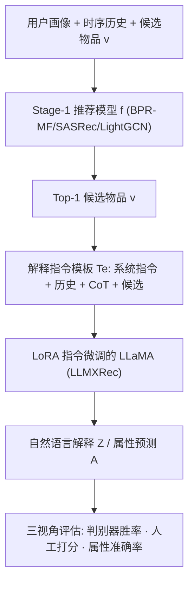
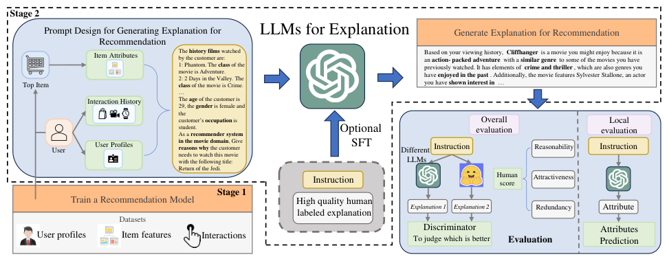

# Unlocking the Potential of Large Language Models for Explainable Recommendations (释放大语言模型在可解释推荐中的潜力)

- **会议/期刊**: DASFAA 2024
- **作者与机构**: Yucong Luo, Mingyue Cheng, Hao Zhang, Junyu Lu, Qi Liu, Enhong Chen（中国科学技术大学）
- **推荐链路定位**: 精排之后（推荐结果已定，只生成解释，不回流影响排序）
- **研究方向**: 大语言模型推荐 / 对话推荐与可解释理由生成
- **论文原文**: [论文原文链接](https://arxiv.org/abs/2312.15661v3)
- **开源代码**: [开源代码仓库链接](https://github.com/GodFire66666/LLM_rec_explanation)

## TL;DR (1分钟核心速览)

现有可解释推荐要么把解释嵌进模型（可读性差、依赖评论作监督），要么用模板化 post-hoc 解释（多样性低、无法反映模型真实推理），且几乎都由小模型完成。本文提出 **LLMXRec**：Stage-1 任意推荐模型输出 Top-1 物品，Stage-2 用 LoRA 指令微调的 LLaMA 生成个性化解释，并提出「LLM 判别器胜率 / 人工三维打分 / 属性预测准确率」三视角评估协议。在 ML-100k、Mind、Steam 三数据集（Leave-One-Out）上，胜率相对最佳 SOTA（GPT-4）在 Mind/Steam 提升 **31.18%–31.79%**。

## Background & Motivation (背景与核心矛盾)

- **主流范式**: 解释推荐分两派——Embedded（在模型中联合训练文本/图像解释）与 Post-hoc（训练后用模板或检索从模型输出反推解释）；P5、M6-Rec 用数百 M 级小模型统一多任务。
- **前人局限**: ① Embedded 方法的解释并非优化目标，可读性、与打分的因果一致性差，检索式方案在稀疏数据下失效且受版权约束；② Post-hoc 模板数量有限，解释多样性被预设句式锁死，可能歪曲模型真实推理路径。
- **核心洞察 (Key Insight)**: 推荐精度与解释质量本应解耦——LLM 具备语义理解与常识推理能力，可在**不触碰排序精度**的前提下承担解释生成；但一旦换成 LLM，传统基于 ground-truth 模板的指标（BLEU/ROUGE/USP 类）全部失效，评估协议本身成为空白。
- **本文切入点**: 用两阶段解耦框架 + 指令微调提升可控性，并首次为「无标准答案的解释」设计整体（判别器、人工）与局部（属性预测）三层评估。

## Method (核心方法设计)

### 1. 整体框架 (Overall Architecture)

Stage-1 用用户-物品交互训练任意推荐模型 $f$（本文取 BPR-MF / SASRec / LightGCN），对用户$u$输出 Top-1 候选物品$v$；Stage-2 将$u$的画像、按时间排序的历史$h_u$、$v$的标题与类别填入统一自然语言模板，构造解释指令$I_e=T_e(u,v,h_u)$，由 LLM 生成解释$Z=G(I_e)$。训练侧用 LoRA 指令微调 LLaMA，并混入属性预测任务做多任务调优；评估侧则分别用微调后的 LLM 判别器、5 名标注员盲评、以及「隐去某属性让模型反推」的准确率三条路径闭环验证。

<figure class="paper-figure" markdown="span">
  <figcaption>图 1：两阶段框架与评估</figcaption>
</figure>

### 2. 关键设计拆解 (Key Designs)

1. **解耦式两阶段 + 四段式指令模板（保证模型无关与可控性）**：痛点在于 embedded 方法把解释绑死在特定模型上、换模型即失效。本文 Stage-1 完全冻结、Stage-2 只读 $u,h_u,v$ 的文本化信息，模板由「系统角色设定 + 按时序排列的历史（含类别）+ CoT 提示 + 带类别/属性的候选物品」四段拼成；CoT 让模型显式模仿「先看历史偏好、再对齐候选属性」的人类推理链条，从而把开放式生成收敛为可控的条件生成。

2. **LoRA 参数高效指令微调 + 属性预测多任务（把解释能力"注射"进底座模型）**：未微调的 LLaMA/ChatGLM 常答非所问或拒答（图 5 中 ChatGLM 直接回复"信息不足"）。作者冻结原参数 $\Phi$、只更新低秩增量$\theta$，条件语言建模目标为

$$\max_{\theta}\sum_{(x,y)\in\mathcal{M}}\sum_{t=1}^{|y|}\log P_{\Phi+\theta}\left(y_t\mid x,y_{<t}\right)$$

其中 $x$为指令输入、$y$ 为人工撰写的解释。除 240 条高质量人工解释外，另构造属性预测指令集（隐去年龄/职业/价格/流行度等，令模型从历史反推），与新任务共享同一 LoRA 权重做多任务调优——直觉是「能反推出隐藏属性」等价于解释具备局部忠实性。

3. **LLM 判别器与训练目标（把评估也做成一个指令微调任务）**：无 ground-truth 时无法算精确率，作者将两两比较形式化为分类：$D(T_d(I_e,\text{Exp}_1,\text{Exp}_2))\in\{1,2\}$，仅保留「人工标注与 GPT-4 标注一致」的样本训练（1440 条训练 / 360 条测试），以消除单一标注源偏差。主指标为胜率与平均排名：

$$WR=\frac{\text{某 LLM 获得的胜场数}}{\binom{n}{2}\cdot N},\qquad RO=\frac{1}{N}\sum_{i=1}^{N}\text{Rank}_i$$

训练负采样无需设计（生成式任务用教师强制），推理开销集中在每次请求一次 LLM 前向 + 一次判别器前向，均为单条解码级别。

## Experimental Setup & Evaluation Protocol (实验设置与评估协议)

| 数据集 | #Users | #Items | #Interactions | 稀疏度/密度 | 特征/场景说明 |
| :--- | :---: | :---: | :---: | :---: | :--- |
| ML-100k | 943 | 1,682 | 100,000 | 106.04 次/用户（稠密） | 电影评分即交互；用户年龄/性别/职业，物品类别 |
| Mind | 50,001 | 5,370 | 2,740,998 | 54.82 次/用户 | 新闻阅读；用户兴趣、新闻类别 |
| Steam | 2,567,538 | 32,135 | 3,043,146 | **1.19 次/用户（极稀疏）** | 游戏购买；价格、流行度 |

- **数据划分与防穿越**: Stage-1 采用标准 `Leave-One-Out`（每用户最后一条交互作测试、倒数第二条作验证，其余训练）；Stage-2 解释生成时历史取最近 $L$ 条（ML-100k 最多 50，Mind/Steam 为 10），候选为用户 Top-1，**严格不泄漏测试物品的标签属性**。
- **排名评测协议**: 推荐侧不做采样排序，直接取模型 **Full-Ranking 下的 Top-1** 物品作为被解释对象；解释侧无正负样本概念，以成对胜率 $WR$、平均排名$RO$ 与人工 1–10 分（Reasonability / Attractiveness / Redundancy）评估。
- **对比基线与超参**: 解释生成器基线为 LLaMA、ChatGLM、GPT-3.5、GPT-4；Stage-1 基线覆盖 BPR-MF（MF 类）、SASRec（序列类）、LightGCN（图类），三数据集分别默认 BPR-MF / SASRec / LightGCN 为主模型。LLMXRec 仅用 **240 条**人工解释微调，判别器用 1440 条。

## Key Experimental Results (实验关键数据)

### 1. 主实验对比 (Main Results)

判别器胜率 / 平均排名（数值越低排名越好；▲% 为对最佳 SOTA 的相对提升）：

| Rec 模型 | LLM | WR (ML-100k) | WR (Mind) | WR (Steam) | RO (ML-100k) | RO (Mind) | RO (Steam) |
| :--- | :--- | :---: | :---: | :---: | :---: | :---: | :---: |
| BPR-MF | LLaMA | 0.176 | 0.062 | 0.229 | 4.256 | 4.750 | 4.083 |
| BPR-MF | ChatGLM | 0.084 | 0.189 | 0.025 | 4.611 | 4.242 | 4.902 |
| BPR-MF | GPT-3.5 | 0.515 | 0.501 | 0.496 | 2.911 | 2.994 | 3.015 |
| BPR-MF | GPT-4 | 0.853 | 0.757 | 0.755 | 1.571 | 1.972 | 1.980 |
| BPR-MF | **LLMXRec** | **0.872** | **0.993** | **0.995** | **1.488** | **1.028** | **1.020** |
| BPR-MF | ▲% | +2.23% | **+31.18%** | **+31.79%** | +5.28% | +47.87% | +48.48% |
| SASRec | GPT-4 | 0.842 | 0.755 | 0.760 | 1.624 | 1.976 | 1.959 |
| SASRec | **LLMXRec** | **0.899** | **0.994** | **0.990** | **1.396** | **1.021** | **1.041** |
| SASRec | ▲% | +6.74% | +31.62% | +30.19% | +14.07% | +48.33% | +46.86% |
| LightGCN | GPT-4 | 0.854 | 0.757 | 0.756 | 1.572 | 1.970 | 1.978 |
| LightGCN | **LLMXRec** | **0.873** | **0.992** | **0.995** | **1.489** | **1.033** | **1.022** |
| LightGCN | ▲% | +2.17% | +30.93% | +31.63% | +5.25% | +47.56% | +48.33% |

### 2. 消融与因素分析

| 分析维度 | 设置 | 关键结果 |
| :--- | :--- | :--- |
| 微调消融 | LLaMA → LLMXRec | ML-100k/BPR-MF 胜率 0.176 → 0.872（**+70 个绝对点**）；平均排名由第 4 升至第 1 |
| 数据量 | 150 → 300 → 更多人工解释 | 胜率随数据单调上升，Mind/Steam 在 **300 条**后饱和；ML-100k 仍持续上升 |
| 历史长度 | 10 → 20 → 更长 | 胜率随长度上升，Steam/Mind 在 **20** 后基本停滞（兴趣已被充分刻画） |
| 侧信息 | 无 → 加用户画像 | ML-100k 加画像版本胜率 **85.1%**，压制无画像版本；加物品类别同样显著 |
| 局部解释 | 属性预测准确率 | 职业 0.024→**0.127**（+98.44%，BPR-MF）、流行度 0.683→**0.944**、价格 0.642→**0.984**；但 Steam 性别 −4.97%、SASRec 物品品类 −1.20% |
| 性别偏差 | 解释词数 男 vs 女 | LLaMA 差 6.31 词、GPT-4 差 1.00 词、LLMXRec 差 **2.79** 词（弱于 GPT-4 但优于其余） |

### 3. 关键实验发现 (Key Findings)

1. **指令微调的收益呈"两极分化"且与底座能力负相关**：LLaMA 在 Mind/Steam 上基线胜率仅 0.06/0.23，微调后跃至 0.99 以上（相对提升 31%）并反超 GPT-4；而在 ML-100k 上 GPT-4 本身已达 0.853，增益仅 2.23%——说明**指令微调解决的是"格式对齐与拒答"，而非补足知识**，当底座已有充足电影领域语料时天花板很快出现。
2. **解释质量高度依赖输入侧信息而非模型规模**：仅追加用户画像即可让胜率冲到 85.1%，而把历史从 20 条拉到 50 条几乎无收益，表明 LLM 的瓶颈在"是否被告知关键属性"，而不是"看到多少行为"；这也解释了为何局部属性预测（价格 +53%、流行度 +38%）提升远大于整体解释胜率提升。
3. **可解释性与推荐精度确实可解耦，但沿用同一套指标会误导**：三种结构完全不同的 Stage-1 模型（MF/序列/图）下 LLMXRec 的解释排名几乎不变（RO 均在 1.02–1.49），证明解释质量与推荐器类型弱相关；反之若用模板匹配类指标评估，LLMXRec 的"重写式"解释会被系统性低估，凸显本文三视角协议的必要性。

## Highlights & Limitations (亮点、对比与审稿批判)

- **与代表作对比 (vs. Prior Work)**: 相比 P5 / M6-Rec 这类"用评论当监督、把解释塞进小模型多任务框架"的方案，本文彻底放弃评论 ground-truth，改为人工解释指令微调；相比纯模板 post-hoc 方法（"people also bought"），LLMXRec 零模板、可迁移到任意领域且不损害 Stage-1 精度；相比直接用 GPT-4 零样本，它在 Mind/Steam 上以 240 条样本实现反超。
- **可迁移亮点**: ① "隐去属性让模型反推"是检验解释忠实性（faithfulness）的廉价代理任务，可直接移植到任何 LLM 解释系统；② 判别器仅用「人工与 GPT-4 标注一致」的样本训练，是一种低成本降噪的 LLM-as-Judge 冷启动技巧。
- **审稿级局限批判**: ① **评估闭环自证**：主结论依赖自家微调的 LLaMA 判别器，判别器与生成器同底座同数据分布，存在偏好自家文风的系统性风险，缺少与 BLEU/BERTScore/人工一致性交叉验证；② **解释不回流、只做 Top-1**：Stage-2 对排序零贡献，"解释提升推荐精度"仅在结论里被列为未来工作；且生成 + 判别双次 LLM 前向，工业场景下每用户解释成本远高于模板方案，论文未给出时延/吞吐数据；③ 微调数据仅 240 条且集中在电影/新闻/游戏三域，跨域泛化与冷启动用户（Steam 平均 1.19 次交互）的解释质量未被单独分桶分析。

## Rating (四维评分)

- **方法创新性 (Novelty)**: ⭐⭐⭐ （两阶段解耦本身并不新颖，真正增量在于"三视角评估协议 + 属性反推代理任务"，工程整合价值大于机理创新）
- **评估协议与实验扎实度 (Protocol & Experiments)**: ⭐⭐⭐⭐ （3 数据集 × 3 推荐器 × 5 生成器的交叉验证充分，胜率/排名/人工/属性四类证据齐全，但缺显著性检验与判别器自身可靠性分析）
- **写作与数学规范度 (Clarity & Rigor)**: ⭐⭐⭐⭐ （公式简洁、LoRA 目标与 WR/RO 定义清晰，模板与评估指令均完整给出，便于复现；理论分析基本为零）
- **工业落地与复现价值 (Industrial & Practical Value)**: ⭐⭐⭐⭐ （代码与全部原始结果开源，Stage-2 与线上排序解耦、可按需开关，适合作为解释层的即插即用方案；但双次 LLM 推理成本与偏差控制仍需工程侧补足）

