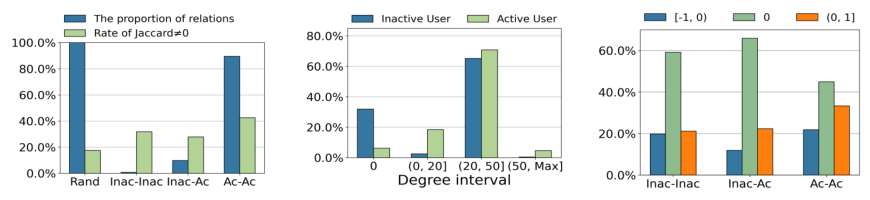
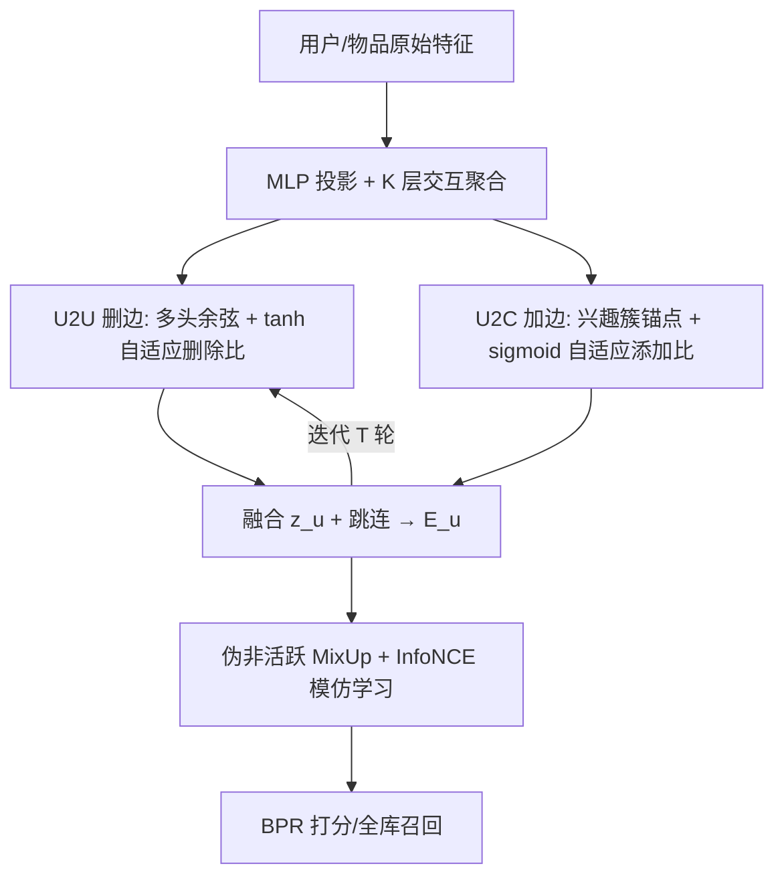
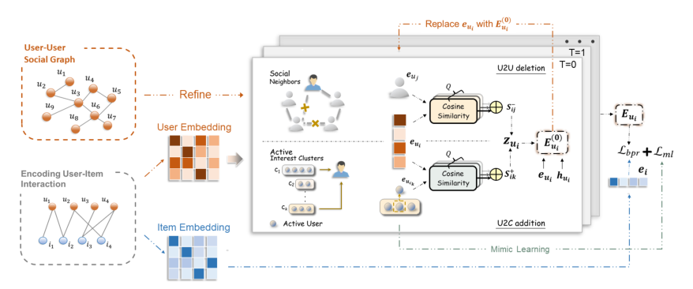

# Learning Social Graph for Inactive User Recommendation (面向非活跃用户推荐的社会关系图学习)

- **会议/期刊**: DASFAA 2024
- **作者与机构**: Nian Liu, Shen Fan, Ting Bai, Peng Wang, Mingwei Sun, Yanhu Mo, Xiaoxiao Xu, Hong Liu, Chuan Shi（阿里巴巴集团、鹏城实验室）
- **推荐链路定位**: 召回（用户/物品表征学习）
- **研究方向**: 社交与群组推荐 / 冷启动与长尾推荐
- **论文原文**: [论文原文链接](https://arxiv.org/abs/2405.05288v3)
- **开源代码**: [开源代码仓库链接](https://github.com/liun-online/LSIR)

## TL;DR (1分钟核心速览)

本文直指"原始社交关系对非活跃用户几乎无益"这一工业痛点：淘宝亿级采样数据显示，真实社交边的兴趣 Jaccard 重合率不足 50%（仅略高于随机配对），且 31.9% 的非活跃用户是完全孤立的（活跃用户仅 6.2%）。LSIR 因此把图结构学习（GSL）引入社交推荐：用多头余弦相似度做 **U2U 删边**，用"用户→活跃兴趣簇"的 **U2C 加边** 替代全局点对点搜索以压制复杂度，再用 **模仿学习** 让活跃用户模拟非活跃分布以训好加边器。在采样 1000 负例排序协议下，Flickr NDCG@10 相对最优基线提升 **129.58%**，Yelp +18.05%，工业 AliData II +13.69%。

## Background & Motivation (背景与核心矛盾)

- **主流范式**: DiffNet++、S²-MHCN、SEPT 等 GNN 社交推荐一律在**原始社交图**上做邻居聚合，默认"社交边即有益信号"。
- **前人局限**: ① **质量差**——淘宝数据上 Inac-Inac / Inac-Ac / Ac-Ac 三类关系的兴趣重合率均 ≤50%，与随机配对差距很小；② **数量少**——非活跃用户社交度数普遍偏低，31.9% 为零度节点，其交互与社交两个信息源同时枯竭。
- **核心洞察 (Key Insight)**: 论文进一步观察"新增边"的效果，发现与非活跃用户新建连接带来的 Jaccard 增益近乎随机，而与**活跃用户**新建连接则稳定正收益——即"补高质量活跃信息"比"删噪"更稀缺、更有价值。
- **本文切入点**: 不在原始图上做修补式正则，而是显式"学一张新社交图"：删噪边 + 把非活跃用户接到少量活跃兴趣簇锚点上，并用模仿学习解决"非活跃表征太弱、连不到正确簇"的鸡生蛋问题。

<figure class="paper-figure" markdown="span">
  <figcaption>图1. 基于 Taobao 的社交关系工业观察。</figcaption>
</figure>

## Method (核心方法设计)

### 1. 整体框架 (Overall Architecture)

LSIR 分三阶段闭环。**① 交互编码**：用户/物品原始特征经单隐层 MLP + PReLU 投影到 $d$维公共空间得$\boldsymbol{h}_u,\boldsymbol{h}_i$，再做$K$层对称归一化加权和聚合（刻意不用非线性/特征变换，避免过度平滑），取各层均值$\boldsymbol{e}_u=\frac{1}{K}\sum_{k=0}^{K}\boldsymbol{e}_u^{(k)}$为交互表征。**② 社交图精炼**：在该表征上执行 U2U 删边与 U2C 加边，融合得社交表征$\boldsymbol{z}_u$，并以残差跳连融合$\boldsymbol{E}_u^{(0)}=W_f[\boldsymbol{h}_u\|\boldsymbol{e}_u\|\boldsymbol{z}_u]+\boldsymbol{b}_f$；随后**迭代$T$轮**，用更新后的$\boldsymbol{E}_u$ 重新学图结构。**③ 模仿学习**：把活跃用户与随机非活跃用户做 MixUp，生成"伪非活跃"表征，用 InfoNCE 强制其仍对齐真实兴趣簇锚点。训练用 BPR，推理按内积排序。

<figure class="paper-figure" markdown="span">
  <figcaption>图2. 我们提出的 LSIR 的概览，包括 3 个组件：1) 编码用户-物品交互，2) 社交图上的图结构学习（U2U 删除与 U2C 添加），3) Mimic Learning。</figcaption>
</figure>

### 2. 关键设计拆解 (Key Designs)

1. **U2U 删边（自适应保留高质量邻居）**：痛点是有噪边但不能一刀切删光——非活跃用户本就邻居少，删多了表征退化。作者用多头加权余弦算保留概率 $S^{-}_{ij}=\frac{1}{Q}\sum_{q}\cos(W_n^{(q)}\boldsymbol{e}_{u_i},W_n^{(q)}\boldsymbol{e}_{u_j})$，并用交互数驱动的 tanh 删除比$p_{\text{del}}(|I(u_i)|)=\tanh(|I(u_i)|/r_1)$控制删多少：交互越少 →$p_{\text{del}}\to 0$ → 越保守地保留社交信息。直觉是"信息预算守恒"：物品侧信息越缺，越不能从社交侧再抽走。
2. **U2C 加边（用兴趣簇锚点替代 $O(m^2)$点对点搜索）**：传统 GSL 需对每对节点算概率，$O(m^2d)$在工业规模不可行。LSIR 先用物品原始特征聚成$l$个兴趣簇$c_i$，为每个活跃用户按 Jaccard 依$\arg\max_{c_i}\mathcal{J}(I(u^+),c_i)$分配到簇，再选簇内 Jaccard 最高的用户作**锚点**$u_{c_k}$，把候选空间从"全体活跃用户"压缩到$l$个锚点。加边概率$S^{+}_{ik}$同样多头余弦（锚点侧单独投影$W_c$），添加比取$p_{\text{add}}=\sigma(-|I(u_i)|/r_2)$，与删边比恰好互补——越非活跃，补得越多。融合式：$\boldsymbol{z}_{u_i}=\alpha\big(\sum_{j\in\mathcal{N}^U_{u_i}}S^{-}_{ij}\boldsymbol{e}_{u_j}+\sum_{k\in\mathcal{N}^C_{u_i}}S^{+}_{ik}\boldsymbol{e}_{u_{c_k}}\big)+(1-\alpha)\boldsymbol{e}_{u_i}$。整体复杂度$O(|\varepsilon|dK+Q(|\zeta|+ml)d)$，对$|\varepsilon|,|\zeta|$ 线性，远低于传统 GSL。
3. **模仿学习与训练目标**：U2C 困境在于——加边依赖 $\boldsymbol{e}_u$，而非活跃用户的$\boldsymbol{e}_u$恰恰只由寥寥几个物品聚合而来，根本指不准真正的兴趣簇。作者构造伪非活跃表征$\hat{\boldsymbol{e}}_{u^+}=\beta\boldsymbol{e}_{u^+}+(1-\beta)\boldsymbol{e}_{u^-}$（Inactive Mixture），并用 InfoNCE 要求它依然靠近自己的真实簇锚点：

$$\mathcal{L}_{\text{ml}}=-\sum_{u^+}\log\frac{\exp(\cos(\hat{\boldsymbol{e}}_{u^+},\boldsymbol{e}_{u_{c_j}})/\tau)}{\sum_{k\neq j}\exp(\cos(\hat{\boldsymbol{e}}_{u^+},\boldsymbol{e}_{u_{c_k}})/\tau)}$$

   总损失 $\mathcal{L}_{\Omega}=\mathcal{L}_{\text{bpr}}+\xi\mathcal{L}_{\text{ml}}$，BPR 负例为均匀随机采样（免难负例挖掘），推理阶段无额外开销。

## Experimental Setup & Evaluation Protocol (实验设置与评估协议)

- **数据集与预处理**: 两个公开集（Flickr、Yelp）与两个淘宝工业集（AliData I/II），按交互数阈值 $\epsilon$ 标注非活跃用户（"inactive cutoff"）：

| 数据集 | #Users | #Inactive | #User-User | #Items | #User-Item | 阈值 $\epsilon$ |
| :--- | :---: | :---: | :---: | :---: | :---: | :---: |
| Flickr | 8,358 | 2,386 | 187,273 | 82,120 | 327,815 | ≤2 |
| Yelp | 17,237 | 5,445 | 143,765 | 38,342 | 204,448 | ≤3 |
| AliData I | 40,428 | 12,071 | 323,608 | 115,502 | 1,016,122 | ≤7 |
| AliData II | 103,440 | 23,335 | 984,555 | 2,417,818 | 12,095,268 | ≤20 |

- **数据划分与防穿越 (Splitting Strategy)**: 用户维度按交互量阈值划分活跃/非活跃（非时间戳切分）；原文未明确交代训练/测试集切分比例与时间窗，是本论文评估协议上的**主要信息缺口**。
- **排名评测协议 (Ranking Protocol)**: `Sampled Ranking`——每个用户随机采 **1000 个未交互物品**作负例，与 ground-truth 混合排序取 Top-K（$K\in\{10,20\}$），沿用 DiffNet++ 设置；指标 NDCG / HR / Precision。**未采用 Full-Ranking**，绝对数值偏乐观，但组间可比。
- **对比基线与超参设置**: 通用推荐 BPR / LightGCN / SimGCL，社交推荐 SBPR / DiffNet++ / S²-MHCN / SEPT，冷启动 MeLU / TaNP；嵌入维度 $d=64$，Glorot 初始化 + Adam，学习率 1e-4~1e-2，$r_1,r_2\in\{2,10,50,100\}$，头数$Q\in\{1,2,3\}$，$\xi\in\{0.1,0.01\}$。

## Key Experimental Results (实验关键数据)

### 1. 主实验对比 (Main Results)

非活跃用户 Top-10 / Top-20 结果（NDCG@10 与 HR@10 摘录）：

| 数据集 | 指标 | BPR | LightGCN | SimGCL | SBPR | DiffNet++ | S²-MHCN | MeLU | TaNP | **LSIR** | Improv. |
| :--- | :--- | :---: | :---: | :---: | :---: | :---: | :---: | :---: | :---: | :---: | :---: |
| Flickr | N@10 | 0.0503 | 0.0797 | 0.0648 | 0.0659 | 0.1251 | 0.0990 | 0.0660 | 0.0781 | **0.2872** | +129.58% |
| Flickr | H@10 | 0.0731 | 0.1350 | 0.0951 | 0.0997 | 0.1752 | 0.1413 | 0.1154 | 0.1391 | **0.3927** | +124.14% |
| Yelp | N@10 | 0.1437 | 0.1636 | 0.1847 | 0.1678 | 0.2261 | 0.1845 | 0.1485 | 0.1562 | **0.2669** | +18.05% |
| Yelp | H@10 | 0.2185 | 0.2439 | 0.2709 | 0.2525 | 0.3288 | 0.2742 | 0.2492 | 0.2642 | **0.3804** | +15.69% |
| AliData I | N@10 | 0.1634 | 0.1629 | 0.1815 | 0.1644 | 0.1793 | 0.1817 | 0.1648 | 0.1696 | **0.2018** | +11.06% |
| AliData II | N@10 | 0.1126 | 0.1812 | 0.1757 | 0.1327 | OOM | OOM | 0.1777 | 0.1808 | **0.2060** | +13.69% |
| AliData II | H@20 | 0.1575 | 0.1955 | 0.1787 | 0.1664 | OOM | OOM | 0.1812 | 0.1855 | **0.2663** | +30.73% |

活跃/整体用户 NDCG@10（表 3）显示 LSIR 未牺牲其他人群：Flickr 活跃用户 0.1010（≈DiffNet++ 0.1011）但整体 0.1542（最优）；Yelp 活跃 0.2317、整体 0.2418 均最优；AliData II 整体 0.3048 与 SEPT 0.3050 基本持平。

### 2. 消融实验 (Ablation Study)

| 变体 | Yelp N@10 | Yelp N@20 | AliData I N@10 | AliData I N@20 |
| :--- | :---: | :---: | :---: | :---: |
| LSIR + 原始图 (UU) | 0.2211 | 0.2551 | 0.1984 | 0.2186 |
| LSIR + IDGL | 0.2066 | 0.2404 | 0.1883 | 0.2062 |
| LSIR + GAUG | 0.1974 | 0.2317 | OOM | OOM |
| LSIR w/o U2C | 0.2590 | 0.2903 | 0.1991 | 0.2187 |
| LSIR w/o U2U | 0.2622 | 0.2994 | 0.2009 | 0.2200 |
| **LSIR** | **0.2669** | **0.3038** | **0.2018** | **0.2214** |

### 3. 关键实验发现 (Key Findings)

1. **增益与社交图稠密度强正相关**：Flickr 人均社交邻居 22.41、增益 +129.58%，而 AliData I 仅 8.00、增益 +11.06%，顺序严格对应，说明 LSIR 的本质是"把冗余噪边重分配为高质量锚点边"，边越多的图留给结构学习的空间越大。
2. **"加"比"删"更关键，通用 GSL 反而不如不学**：去掉 U2C 后 Yelp N@10 掉 0.0079，去掉 U2U 仅掉 0.0047；而 LSIR+IDGL（0.2066）甚至低于直接用原始图的 LSIR+UU（0.2211），因其随机锚点忽略了重要用户——证明 **U2C 的簇式约束搜索**是性能主来源，而非 GSL 这一概念本身。
3. **模仿学习对加边器的增益约 6% NDCG@10**，与"伪非活跃 Mixture 让弱表征仍能对齐正确簇"的设计动机一致；此外聚类数 $C=30$在两数据集同时最优，$C$ 太小覆盖不了兴趣多样性、太大则非活跃用户匹配不到簇，说明该方法对簇粒度中等敏感。

## Highlights & Limitations (亮点、对比与审稿批判)

- **与代表作对比 (vs. Prior Work)**: 与 DiffNet++ / S²-MHCN / SEPT 等"在原始社交图上做更强的聚合/超图/自监督"的路线根本不同——LSIR 认为**输入图本身是错的**，先修图再聚合；与 IDGL / GAUG / Pro-GNN 等通用 GSL 相比，它用"活跃兴趣簇锚点"把候选空间从 $O(m^2)$降到$O(ml)$，并首次把 GSL 用于社交推荐场景。
- **可迁移亮点**: ① $p_{\text{del}}/p_{\text{add}}$ 这对"信息预算互补"的自适应比例函数（用交互数作调节变量）可直接迁移到跨域补全、冷启动侧信息注入；② 锚点式加边可复用于大规模异构图上的"稀疏节点→簇"连边，避免全量相似度计算。
- **审稿级局限批判**: ① **评估协议偏弱**——1000 负例采样排序 + 未披露训练/测试切分与时间窗，无法排除信息泄漏，且缺少 Full-Ranking 与显著性检验；② **兴趣簇构建脱离端到端**：簇由物品原始特征聚类并固定，锚点选择基于 Jaccard 启发式，若原始特征缺失（纯 ID 场景）则方法退化；③ 未报告在线 A/B 与推理时延，仅以复杂度分析论证可扩展性。

## Rating (四维评分)

- **方法创新性 (Novelty)**: ⭐⭐⭐⭐ （"修图而非强聚合"的视角 + 锚点式 U2C 把 GSL 降到工业可用复杂度，模仿学习解决加边器的表征冷启动，闭环自洽）
- **评估协议与实验扎实度 (Protocol & Experiments)**: ⭐⭐⭐ （四个数据集含两个工业集、活跃/整体用户双视角完整，但采样 1000 负例、切分细节缺失、无显著性检验）
- **写作与数学规范度 (Clarity & Rigor)**: ⭐⭐⭐⭐ （三个工业观察非常清晰地推导出三个模块，公式与复杂度分析完整；U2C 的聚类与锚点选择流程描述略显工程化）
- **工业落地与复现价值 (Industrial & Practical Value)**: ⭐⭐⭐⭐⭐ （阿里真实场景验证、代码开源、复杂度对边数线性且在 100M 级 AliData II 上跑通，工程可复现性高）

