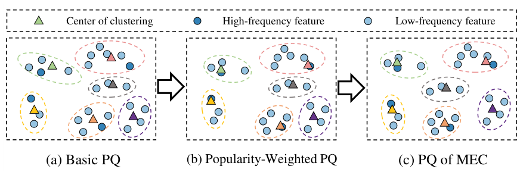
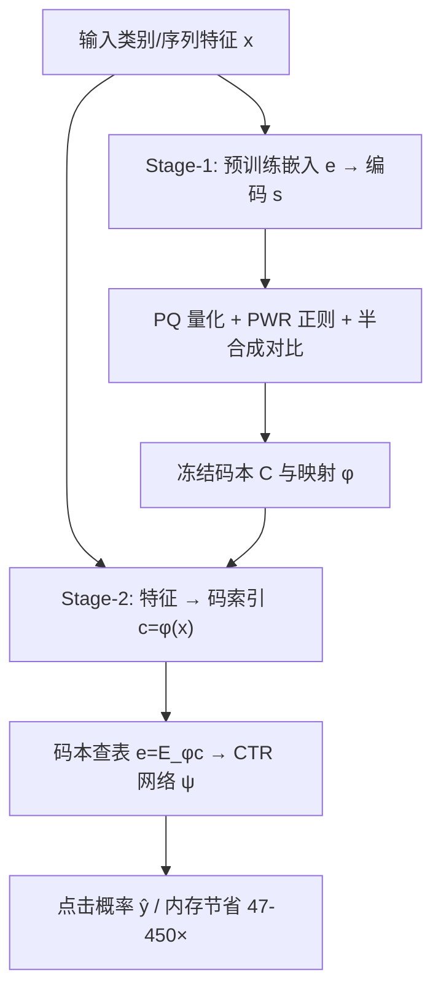
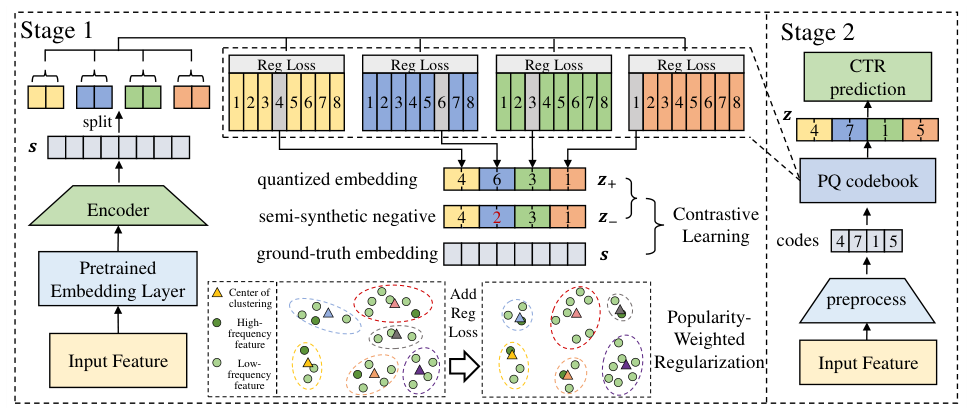

# A Universal Framework for Compressing Embeddings in CTR Prediction (面向 CTR 预估的通用嵌入压缩框架)

- **会议/期刊**: DASFAA 2026（arXiv:2502.15355）
- **作者与机构**: Kefan Wang, Hao Wang, Defu Lian, Enhong Chen 等（中国科学技术大学 MINE 实验室；华为新加坡研究院；清华大学深圳国际研究生院）
- **推荐链路定位**: 精排（特征嵌入层预处理，模型无关插件）
- **研究方向**: CTR/CVR 预估与特征交叉 / 工业级内存高效架构
- **论文原文**: [arXiv:2502.15355v1](https://arxiv.org/abs/2502.15355v1)
- **开源代码**: [USTC-StarTeam/MEC](https://github.com/USTC-StarTeam/MEC)

## TL;DR (1分钟核心速览)

CTR 精排模型的参数量几乎全部堆在嵌入表上（工业场景动辄数百 GB），哈希法有碰撞噪声、朴素 PQ 量化则忽略码本分配与码分布的质量。MEC 提出与模型无关的两阶段框架：先用辅助 CTR 模型预训练嵌入并学 PQ 码本，再以**流行度加权正则**（熵约束）平衡高低频特征的码分配、以**半合成硬负样本对比学习**拉平码嵌入分布，最后用冻结码本量化特征训练下游模型。在 Criteo/Avazu 与华为 4 亿曝光工业集上，内存降至 1/47–1/450，AUC 相对基线不降反升（Avazu +0.33%/+0.41%）。

## Background & Motivation (背景与核心矛盾)

- **主流范式**: DeepFM/DCNv2/GDCN 等特征交叉网络 + 超大规模稀疏嵌入表，嵌入维度统一设为 40；内存优化则分两派——哈希（DHE、DoubleHash、QR-Trick）与量化（PQ、DPQ、AutoDPQ、xLightFM、CCE）。
- **前人局限**: ① 哈希把语义无关特征映射进同一桶，碰撞噪声直接损伤表征；② 现有量化方法只优化重建误差，**码本分配失衡**——低频长尾特征抢占聚类中心，掩盖高频特征的表征（图 1a），而简单按频率加权又反向压制低频（图 1b）；③ 量化后码嵌入高度聚集、同质化，CTR 区分度下降。
- **核心洞察 (Key Insight)**: 嵌入压缩的瓶颈不在"压缩率"，而在"量化后码分布的均匀性"——码本利用率越均衡，嵌入区分度越高；但均匀性必须与特征流行度耦合，否则长尾/头部二选一必将失衡。
- **本文切入点**: 把"频率加权"与"分布均匀约束"解耦成正则项（软加权而非硬加权），再用对比学习在码空间做分布整形。

<figure class="paper-figure" markdown="span">
  <figcaption>图 1. 不同量化方法的分布</figcaption>
</figure>

## Method (核心方法设计)

### 1. 整体框架 (Overall Architecture)

两阶段解耦量化与推理：Stage-1 用辅助 CTR 模型（默认 DeepFM）预训练稠密嵌入 $e=\mathcal{F}_{\text{Emb}}(x)$，经编码器得$s=\text{Encoder}(e)$，切分为$M$个子向量并由 PQ 码本量化，训练目标为重建损失 + 流行度正则 + 对比损失；收敛后**只保留码本$C$与量化映射$\phi$**。Stage-2 将原始特征直接映射为码索引$c=\phi(x)$，用码本初始化嵌入表$E_\phi$后接下游 CTR 网络$\hat{y}=\psi(e)$ 训练二分类损失。在线推理只需查小码本，彻底消除 GPU-CPU 大表换入换出。

<figure class="paper-figure" markdown="span">
  <figcaption>图 2. 我们的 MEC 框架概览。该框架包括两个阶段：预训练和下游任务训练。第一阶段（左）通过结合现有嵌入学习 PQ 码本。第二阶段（右）基于 PQ 码本对输入特征进行量化，并用于训练下游任务的 CTR 模型。在线推理时，将预量化特征输入下游任务，以实现内存高效的 CTR 预测。</figcaption>
</figure>

### 2. 关键设计拆解 (Key Designs)

1. **流行度加权正则 PWR（软频率平衡）**：直接按频次 $n_j$加权会让头部特征垄断聚类中心（图 1b）。本文先用对数分桶平滑权重$r_j=\lfloor\log_2(n_j)\rfloor$，再把权重聚合到"每个码被分配到的流行度质量"上，用修正熵度量分配均匀度：
$$p_i=\frac{\sum_{j\in S_i} r_j}{\sum_{j\in S} r_j},\qquad \mathcal{L}_{\text{reg}}=\exp\Big(-\sum_{i=1}^{K} p_i\log(p_i+\epsilon)\Big)$$
直觉：$p_i$越接近均匀分布熵越大、$\mathcal{L}_{\text{reg}}$ 越小；log 桶化保证高频特征能独占码字、低频特征被迫共享码字，实现"头部独占、长尾共享"的自适应码本预算。

2. **对比乘积量化（码空间分布整形）**：真实特征码 $c=[j_1,\dots,j_M]$以概率$\rho$随机替换单个子码得半合成码$z$：$G(z_i)=\text{Uni}(\{1..K\})$若$X\sim\text{Bernoulli}(\rho)$，否则$z_i=c_i$。半合成码既贴近真实分布又足够"错"，是理想硬负样本。以编码向量$s$为锚、池化后码嵌入$c'$为正、$K$个半合成码嵌入$z'$ 为负做 InfoNCE：
$$\mathcal{L}_{\text{con}}=-\frac{1}{N}\sum_{i=1}^{N}\log\frac{\exp(\text{sim}(s,c'))}{\exp(\text{sim}(s,c'))+\sum_{j=1}^{K}\exp(\text{sim}(s,z'_j))}$$
作用：把量化码推离彼此、逼近各自编码向量，缓解 PQ 码字塌缩导致的表征同质化。

3. **训练目标、负采样与推理开销**：Stage-1 总损失 $\mathcal{L}=\mathcal{L}_{\text{recon}}+\alpha\mathcal{L}_{\text{reg}}+\beta\mathcal{L}_{\text{con}}$，其中$\mathcal{L}_{\text{recon}}=\lVert s-q\rVert_2^2$；Stage-2 为二分类交叉熵$\mathcal{L}_{\text{binary}}$。负样本为**在线生成的半合成硬负**（非 in-batch），无需额外大 batch。码本大小选 2048、PQ 划分数$M=4$；Stage-1 训练在 Criteo 上从 24.07s 增至 25.56s（+6%），推理侧嵌入查表耗时因词表缩小降约 50%。

## Experimental Setup & Evaluation Protocol (实验设置与评估协议)

- **数据集与预处理**（沿用 AFN 的预处理与特征工程）：

| 数据集 | #Interactions | #Feature Fields | #Features | 稀疏度/规模说明 |
| :--- | :---: | :---: | :---: | :--- |
| Criteo | 45,840,617 | 39 | 1,086,810 | 13 连续 + 26 类别，1 周点击日志 |
| Avazu | 40,428,968 | 22 | 2,018,012 | 11 天日志，长尾分布显著 |
| Industrial (华为) | >400M 曝光 | 数百 | 32 字段词表 >10 万，最大 600 万 | 私域广告集，传统全量嵌入层 3142.3MB |

- **数据划分与防穿越**: Criteo/Avazu 按**时间顺序 7:2:1** 划分训练/验证/测试；工业集按 **6:1:1** 划分。未使用 Leave-One-Out。
- **排名评测协议**: 本质为 CTR 二分类排序评估，采用 **AUC**（越高越好）与 **LogLoss**（越低越好），在全量测试集上计算，属全样本评估而非负采样排序；另报告**全模型参数内存 (Params)** 作为效率指标。
- **对比基线与超参设置**: 基线含代表性强排序模型 LR/FM/AFM/AFN/SAM/DeepFM/AutoInt/DCNv2/GDCN/PNN，以及哈希量化类 DHE、xLightFM（均以 GDCN / PNN 为主干实例化）。统一嵌入维度 $d=40$、batch=10,000、Adam 优化器，学习率$\{10^{-1}\sim10^{-4}\}$、L2$\{0\sim10^{-1}\}$、dropout$0\sim0.9$；码本大小$\{256,512,1024,2048\}$、PQ 层数$\{2,4,8\}$。实验重复 5 次取均值，并做 **Wilcoxon 符号秩检验**（$p<0.05$）。

## Key Experimental Results (实验关键数据)

### 1. 主实验对比 (Main Results)

| 模型 | Criteo AUC↑ | Criteo LogLoss↓ | Criteo Params↓ | Avazu AUC↑ | Avazu LogLoss↓ | Avazu Params↓ |
| :--- | :---: | :---: | :---: | :---: | :---: | :---: |
| AFM | 0.8045 | 0.4475 | 166.92MB | 0.7541 | 0.3760 | 103.91MB |
| DeepFM | 0.8069 | 0.4447 | 169.38MB | 0.7533 | 0.3744 | 105.60MB |
| DCNv2 | 0.8099 | 0.4415 | 199.67MB | 0.7520 | 0.3746 | 116.37MB |
| GDCN | 0.8098 | 0.4417 | 172.86MB | 0.7507 | 0.3761 | 107.81MB |
| DHE$_{\text{GDCN}}$ | 0.8087 | 0.4427 | **8.089MB** | 0.7505 | 0.3758 | 5.707MB |
| xLightFM$_{\text{GDCN}}$ | 0.8089 | 0.4422 | 7.659MB | 0.7504 | 0.3760 | 5.097MB |
| PNN | 0.8099 | 0.4418 | 168.80MB | 0.7531 | 0.3750 | 105.06MB |
| DHE$_{\text{PNN}}$ | 0.8088 | 0.4429 | 4.028MB | 0.7517 | 0.3763 | 2.957MB |
| xLightFM$_{\text{PNN}}$ | 0.8092 | 0.4423 | 3.598MB | 0.7524 | 0.3758 | 2.347MB |
| **MEC$_{\text{GDCN}}$** | **0.8102** | **0.4415** | 7.649MB | **0.7538** | **0.3728** | 4.567MB |
| **MEC$_{\text{PNN}}$** | **0.8105** | **0.4412** | **3.588MB** | **0.7556** | **0.3736** | **1.817MB** |
| **Improv. (MEC$_{\text{PNN}}$ vs PNN)** | +0.074% | −0.14% | −97.9% (47×) | +0.33% | −0.37% | −98.3% (58×) |

工业集：PRAUC 0.91913→**0.91918**，PCOC 0.96561→**0.96673**，AUC 0.84141→**0.84143**，LogLoss 0.40721→**0.40683**，Params 3142.3MB→**7.014MB**（约 448×，降 99.78%）。

### 2. 消融实验 (Ablation Study)

| 变体（主干 PNN） | Criteo AUC | Criteo LogLoss | Avazu AUC | Avazu LogLoss |
| :--- | :---: | :---: | :---: | :---: |
| PNN（未压缩上界） | 0.8099 | 0.4418 | 0.7531 | 0.3750 |
| basic PQ（仅重建损失） | 0.8084 | 0.4437 | 0.7528 | 0.3746 |
| freq. PQ（硬频率加权） | 0.8077 | 0.4451 | 0.7511 | 0.3755 |
| w/o reg.（去 PWR） | 0.8092 | 0.4421 | 0.7540 | 0.3741 |
| w/o cons.（去对比） | 0.8096 | 0.4418 | 0.7542 | 0.3739 |
| **MEC$_{\text{PNN}}$（完整）** | **0.8105** | **0.4412** | **0.7556** | **0.3736** |

量化器选型：AQ+GDCN 0.8025/0.7407、RQ+GDCN 0.8094/0.7513、PQ+GDCN **0.8102/0.7538**（RQ 存在码间相关性使对比学习不稳定，AQ 引入冗余噪声）。预训练模型可替换：FM / DeepFM / DCNv2 作 Stage-1 主干，最终 AUC 在 0.8104–0.8105（Criteo）、0.7542–0.7556（Avazu），差异极小。

### 3. 关键实验发现 (Key Findings)

1. **量化不是性能税，而是"先降后升"**：basic PQ 相对 PNN 掉 0.0015（Criteo）/0.0003（Avazu）AUC；补上 PWR 与对比损失后反超未压缩的 PNN 达 +0.0006/+0.0025，说明压缩收益来自正则化带来的表征去噪，而非单纯降内存。
2. **硬频率加权是负收益项**：freq. PQ 在 Criteo 掉至 0.8077（比 basic PQ 再低 0.0007）、Avazu 掉至 0.7511，验证"头部垄断码本"假设；而两个组件互补——去掉 reg 或 cons 任一项均无法追平完整版（Avazu 差距 0.0014–0.0016），两者分别负责码分配平衡与码分布整形。
3. **压缩率与效果的 gain 在长尾数据上更明显**：Avazu（长尾重）MEC$_{\text{PNN}}$ 相对 PNN 提升 +0.33%，约为 Criteo（+0.074%）的 4.5 倍；工业超大规模（32 字段词表 >10 万）场景下以 1/448 内存换取 PCOC +0.0011 与 LogLoss −0.0004，说明收益随词表长尾化而放大。

## Highlights & Limitations (亮点、对比与审稿批判)

- **与代表作对比 (vs. Prior Work)**: 相比 DHE/xLightFM，MEC 不做端到端哈希压缩，而是"预训练—量化—冻结再训"两阶段解耦，先保表征再压内存，规避碰撞噪声；相比 DPQ/AutoDPQ/CCE，MEC 不追求更细的自适应码本尺寸，而是首次把**码分配的流行度平衡**与**码嵌入的分布均匀性**显式写进损失；相比 RQ/AQ，论证了 PQ 的独立子码本才是与对比学习兼容的量化器。
- **可迁移亮点**: ① "对数分桶权重 + 修正熵正则"是处理长尾码本/聚类预算分配的通用配方，可直接移植到向量量化召回（RQ-VAE 语义 ID 的码本坍缩问题）；② 半合成硬负样本（随机替换单个子码）构造代价近乎为零，适用于任何离散化表征的对比训练。
- **审稿级局限批判**: ① Stage-1 需先用辅助 CTR 模型预训练全量稠密嵌入，"预训练内存峰值"未评估，工业落地仍需一次大表训练；② 评估仅 AUC/LogLoss 与参数量，缺少线上 QPS/延迟与显存占用实测，也未与 Full-Ranking 场景下的召回一致性联动验证，且嵌入维度固定为 40，未讨论更小/更大维度下的压缩边界；③ 超参 $\alpha,\beta,K,M$敏感性仅以曲线呈现，最优值（$\alpha=0.001,\beta=0.01$）在三个数据集上是否同源缺乏迁移性讨论。

## Rating (四维评分)

- **方法创新性 (Novelty)**: ⭐⭐⭐⭐ （首次把"码分配流行度平衡 + 码分布均匀性"作为量化 CTR 的显式优化目标，两阶段解耦设计简洁且模型无关）
- **评估协议与实验扎实度 (Protocol & Experiments)**: ⭐⭐⭐⭐ （两公开集 + 4 亿级工业私域集，5 次重复 + Wilcoxon 检验，量化器/预训练主干/AQ-RQ-PQ 多维度消融完整，但缺少线上延迟与显存实测）
- **写作与数学规范度 (Clarity & Rigor)**: ⭐⭐⭐⭐ （PWR 与半合成负样本公式定义清晰、动机图直观，熵正则与 $p_i$归一化推导可复现；部分符号如$d$ 兼指嵌入维度与码本大小略有含混）
- **工业落地与复现价值 (Industrial & Practical Value)**: ⭐⭐⭐⭐⭐ （代码开源、插件式接入任意 CTR 主干，47–450× 内存压缩 + 训练开销仅 +6%，已含华为工业集验证，落地确定性高）

