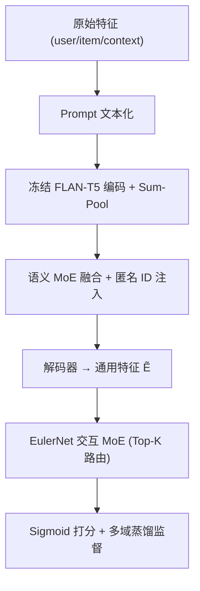
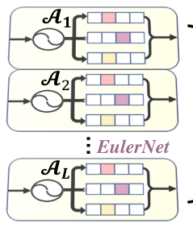

# UFIN: Universal Feature Interaction Network for Multi-Domain Click-Through Rate Prediction (通用特征交互网络：多域点击率预估)

- **会议/期刊**: DASFAA 2026
- **作者与机构**: Zhen Tian, Wayne Xin Zhao, Ji-Rong Wen（中国人民大学高瓴人工智能学院）；Changwang Zhang, Xin Zhao, Zhao Cao（华为 Poisson Lab）
- **推荐链路定位**: 精排（CTR 预估与特征交叉主干）
- **研究方向**: CTR/CVR 预估与特征交叉 / 跨域与多场景推荐
- **论文原文**: [论文原文链接](https://arxiv.org/abs/2311.15493v1)
- **开源代码**: [开源代码链接](https://github.com/RUCAIBox/UFIN)

## TL;DR (1分钟核心速览)

多域 CTR 模型普遍依赖 ID 特征做域间知识共享：既要承受"跷跷板"效应，又因 ID 语义不可迁移而无法上线新平台。UFIN 把原始特征改写为自然语言 prompt，用冻结的 FLAN-T5 编码、轻量解码器再投影回"特征模态"得到**通用特征**，随后交给 MoE 架构的 EulerNet 专家自适应学习各域的交互阶数，并以 Top-K 路由保证任意两域至少共享一个专家，最后用多域知识蒸馏补齐 LLM 缺失的协同信号。8 个数据集上，Amazon 多域 AUC 相对最优基线提升 0.11%–1.58%（Toy+1.37%、Food+1.58%），跨平台 MovieLens-1M 上提升 0.12% 而 LogLoss 降低 1.07%，线上推理延迟仅 0.0476 ms。

## Background & Motivation (背景与核心矛盾)

- **主流范式**: 单域 CTR 用 ID embedding + 高阶特征交叉（DeepFM/xDeepFM/DCNv2）；多域 CTR 用共享底层 + 域特定子网（SharedBottom/MMoE/STAR/PEPNet）缓解域分布差异。
- **前人局限**: ① 跨域方法全部绑定 ID 查表，特征原生语义在哈希中被丢弃，模型无法迁移到新平台；② 语义方法（P5 纯生成、CTRL 对比对齐）反过来丢掉了用户-物品的协同共现信号，AUC 在多域上反而退化。
- **核心洞察 (Key Insight)**: 文本与特征是**可互转的两种模态**——"这部电影很搞笑"与"这本书很怪趣"可共同抽象出 `amusing` 这一通用属性，因此交互模式可以在语义空间中被跨域共享，而不必绑定 ID。
- **本文切入点**: 走"原始特征 ⇒ 文本 ⇒ 通用特征 ⇒ 自适应交互"的链路，把可迁移性交给 LLM 语义、把协同性交给可学习的交互阶数与知识蒸馏。

## Method (核心方法设计)

### 1. 整体框架 (Overall Architecture)

输入侧将 user/item/context 三类字段按"句号分隔句、逗号分隔字段"拼成 prompt 文本；冻结的 FLAN-T5 提取末层隐状态，经 sum-pooling + LayerNorm 得到句向量 $\mathbf{s}$，再由 L 个 SLP 专家 + 门控路由融合成域感知语义$\mathbf{z}$，并与匿名 ID 特征相加得$\tilde{\mathbf{z}}$；解码器用$n_u$个投影矩阵把$\tilde{\mathbf{z}}$还原为$n_u$个**通用特征**$\tilde{\mathbf{E}}$（即回到特征模态）；交互层由 L 个 EulerNet 专家组成，按语义路由 Top-K 选择后输出 logits，与域特定 LR 适配器 logits 相加过 Sigmoid；训练时另有各域 EulerNet 教师网络做 logit 级蒸馏监督。

<figure class="paper-figure" markdown="span">
  <figcaption>图1：UFIN 的整体框架采用编码器-解码器架构，后接特征交互网络。编码器-解码器完成从文本到特征模态的转换，得到一组通用特征。特征交互网络由多个自适应学习专家组成，每个专家自动学习每个给定领域内潜在的真正交互阶数。此外，引入语义门控路由器以自适应整合所有专家，从而学习跨不同领域的通用特征交互。</figcaption>
</figure>

### 2. 关键设计拆解 (Key Designs)

1. **文本→特征模态的通用表征学习（encoder-decoder）**：ID 查表既丢语义又不可跨平台 $\to$用 sum-pooling 而非 [CLS] 保留 token 级字段语义，再以多投影矩阵解码出多个特征槽位：$\tilde{\mathbf{e}}_j=\mathrm{LayerNorm}(\mathbf{V}_j\tilde{\mathbf{z}})$。**关键点在于解码回"特征模态"而非直接 MLP 打分**——论文指出 MLP 难以刻画字段级共现，只有还原成特征列表才能接上 FM/EulerNet 式交互算子。语义侧再用域专家 MoE 规避跷跷板：$\mathbf{z}=\sum_{j=1}^{L}\sigma(\mathbf{W}_j\mathbf{s}+\mathbf{b}_j)\cdot g_j,\ g=\mathrm{Softmax}(\mathbf{W}_g\mathbf{s})$；无文本可用的匿名 ID 通过$\tilde{\mathbf{z}}=\mathbf{z}+\sum_{k}\mathbf{U}_k\mathbf{h}_k$ 辅助注入。

2. **MoE + EulerNet 的自适应交互阶数共享**：各域真实交互阶数不同，人工设定最大阶既不准也不可迁移 $\to$在外层对 EulerNet 的复向量空间交互再做一层 MoE：$\zeta=\sum_{j=1}^{L}F(\tilde{\mathbf{E}};\mathcal{A}_j)\cdot\tilde{g}_j$，其中$F(\tilde{\mathbf{E}};\mathcal{A})=\mathbf{w}^{\top}\sum_{\boldsymbol{\alpha}\in\mathcal{A}}\tilde{\mathbf{e}}_1^{\alpha_1}\odot\cdots\odot\tilde{\mathbf{e}}_{n_u}^{\alpha_{n_u}}$，阶数$\alpha$被转成可学习系数而非枚举。路由取$\tilde{\mathbf{g}}=\mathrm{TopK}(\mathrm{Softmax}(\tilde{\mathbf{W}}_g\tilde{\mathbf{z}}))$，**定理 1** 保证当$K>\lceil L/2\rceil$时任意两域专家集合必有交集$S_u\cap S_v\neq\varnothing$，即强制存在共享交互模式（论文取$L=7,K=5$，与图 5 的共享专家可视化一致）。

3. **多域知识蒸馏与训练目标**：LLM 表示天然缺乏共现相关性 $\to$每域预训一个 EulerNet 作教师，用 logit 对齐补课：$\mathcal{L}_{KD}=\sum_{p=1}^{M}\sum_{i=1}^{N_p}\|\zeta^{G}_{p,i}-\zeta_{p,i}\|^2$；总损失$\mathcal{L}=\mathcal{L}_{KD}+\mathcal{L}_{CTR}$（BCE）。教师仅在训练期存在，推理时丢弃；FLAN-T5 全程冻结且隐状态可离线缓存，在线只跑轻量交互主干，Amazon 上 UFIN$_{t+f}$ 延迟 0.0476 ms，而 P5 为 6.5737 ms。

## Experimental Setup & Evaluation Protocol (实验设置与评估协议)

- **数据集与预处理**: Amazon 取 5-core 后的 7 个子集构成多域；MovieLens-1M 与 Amazon 用户/物品完全不重叠，用于跨平台。评分 4–5 记正、1–2 记负、**丢弃评分 3**。

| 数据集 | #Users | #Items | #Interactions | 稀疏度/密度 | 特征/场景说明 |
| :--- | :---: | :---: | :---: | :---: | :--- |
| Amazon 合计 | 1,002,827 | 2,530,874 | 7,427,505 | 2.9e-6 | 7 域混合，用户侧仅 ID |
| - Movies | 295,908 | 40,792 | 2,141,592 | 1.8e-4 | 标题+长描述 |
| - Books | 585,167 | 191,826 | 4,077,731 | 3.6e-5 | 文本丰富、极稀疏 |
| - Electronics | 184,876 | 26,336 | 780,698 | 1.6e-4 | 标题短 |
| - Food | 14,552 | 5,474 | 86,518 | 1.1e-3 | 小域 |
| - Instruments | 1,429 | 736 | 7,835 | 7.5e-3 | 极小域、最强迁移考验 |
| - Office | 4,890 | 1,805 | 36,572 | 4.1e-3 | 小域 |
| - Toys | 19,231 | 9,142 | 116,559 | 6.6e-4 | 中等稀疏 |
| MovieLens-1M | 6,041 | 3,669 | 739,012 | 3.3e-2 | 跨平台目标域（类型+年份） |

- **数据划分与防穿越 (Splitting Strategy)**: 随机 **80%/10%/10%** 训练/验证/测试；跨平台设定先在 Amazon 七域混合数据上预训，再在 MovieLens-1M 上微调。另设零样本设定：在 Movies/Books/Electronics 上训练，直接在 Instruments/Toys 的**重叠用户**子集上测试、不做任何微调。
- **排名评测协议 (Ranking Protocol)**: 采用**全样本二分类排序评测**（非负采样），指标为 **AUC** 与 **LogLoss**；显著性以 $p<0.01$ 检验，AUC/LogLoss 变化达 0.001 量级即视为显著。
- **对比基线与超参设置**: 12 个基线覆盖单域（DeepFM、xDeepFM、DCNv2、EulerNet）、多域（SharedBottom、MMoE、HMoE、AESM²、STAR、PEPNet）与语义（P5、CTRL）三族，统一用 FuxiCTR 复现并网格搜索。Embedding 维 $d=16$，通用特征槽$n_u=7$，专家数$L=7$，$K=5$，SLP 隐层 128，Adam，batch 1024，学习率$\{10^{-3},10^{-4},10^{-5}\}$，L2$\{10^{-3},10^{-5},10^{-7}\}$。

## Key Experimental Results (实验关键数据)

### 1. 主实验对比 (Main Results)

下表"最强基线"取该数据集上全部 12 个基线中的最优 AUC 与最优 LogLoss（可能来自不同模型）：

| 数据集 | 最强基线 AUC / LogLoss | UFIN$_t$AUC / LogLoss | UFIN$_{t+f}$ AUC / LogLoss | Improv. (AUC / LogLoss) |
| :--- | :---: | :---: | :---: | :---: |
| Movies | 0.8568 / 0.2670 (DeepFM) | 0.8515 / 0.2741 | **0.8582** / **0.2649** | +0.16% / +0.79% |
| Books | 0.8166 / 0.2458 (EulerNet) | 0.8130 / 0.2514 | **0.8215** / **0.2437** | +0.60% / +0.85% |
| Electronics | 0.7524 / 0.3181 (EulerNet) | 0.7337 / 0.3336 | **0.7532** / **0.3185** | +0.11% / ≈0 |
| Food | 0.7208 / 0.2810 (xDeepFM / PEPNet) | 0.7231 / 0.2903 | **0.7322** / **0.2774** | +1.58% / +1.28% |
| Instruments | **0.6780** / **0.1711** (PEPNet / STAR) | 0.6635 / 0.1720 | 0.6768 / 0.1798 | – / – |
| Office | 0.7788 / 0.1974 (STAR) | 0.7590 / 0.2179 | **0.7812** / **0.1945** | +0.31% / +1.47% |
| Toys | 0.7856 / 0.2116 (DCNv2 / AESM²) | 0.7768 / 0.2262 | **0.7964** / **0.2061** | +1.37% / +2.59% |
| MovieLens-1M（跨平台） | 0.9018 / 0.3086 (EulerNet) | 0.9024 / 0.3096 | **0.9029** / **0.3053** | +0.12% / +1.07% |

### 2. 消融实验 (Ablation Study)

原文消融以图（图 3）给出，故下表记录组件构成与观测到的方向性结论（Amazon 七域平均）：

| 变体 | 移除的内容 | 观测效果 |
| :--- | :--- | :--- |
| w/o KD | 多域知识蒸馏项 $\mathcal{L}_{KD}$ | AUC 明显下降，LogLoss 上升，验证协同信号必须由教师补入 |
| w/o MoE-E | 语义融合 MoE（退化为 $\mathbf{z}=\mathbf{s}$） | 下降，说明域独立语义子空间是抗跷跷板的关键 |
| w/o UniF | 解码出的通用特征 $\tilde{\mathbf{e}}_j$（直接把$\tilde{\mathbf{z}}$ 喂 MLP） | 降幅最大，证实"回到特征模态再做交互"不可替代 |
| w/o Uid | 匿名用户 ID 融合 $\sum_k \mathbf{U}_k\mathbf{h}_k$ | 小幅下降，ID 仍是语义缺失时的必要补充 |
| 交互专家替换 | MLP → AutoInt → CIN → CrossNet → **EulerNet** | AUC 单调递增，EulerNet 最优，确认自适应阶数是容量来源 |

### 3. 关键实验发现 (Key Findings)

1. **小域收益最大，大域只是持平**：Food/Toys/Office 三个稀疏域 AUC 分别 +1.58%/+1.37%/+0.31%、LogLoss 相对降低 1.28%/2.59%/1.47%，而数据最丰的 Movies 仅 +0.16%，Electronics 的 LogLoss 改善甚至未过 0.001 显著线——通用交互模式的价值随域内样本减少而放大，正好对应冷启动场景。
2. **零样本迁移可越级**：仅在 Movies/Books/Electronics 上训练后直接在 Instruments/Toys 重叠用户上测试，UFIN 全面优于 EulerNet/P5/CTRL/STAR，且在 Instruments 上反超**全量训练**的单域模型（图 2），说明 $K>\lceil L/2\rceil$ 的专家交集约束确实学到了跨域共享交互。
3. **文本是唯一可迁移载体，而 ID 在预训练下反而受害**：跨平台实验中 Embedding 查表经 Amazon 预训练后 AUC 掉 0.08%（0.8997→0.8990），而 FLAN-T5 升 0.19%（0.9013→0.9030）、T5 升 0.21%，直接证伪"多域共享 ID embedding"路线；同时 $K$从 1 增至 4/5 时性能持续上升，超过 5（即$>L/2$ 过多共享）后反降，共享与域特化的平衡点与定理 1 的下界吻合。

## Highlights & Limitations (亮点、对比与审稿批判)

- **与代表作对比 (vs. Prior Work)**: STAR/PEPNet 以 ID embedding 为共享单元，域内有效但跨平台不可用；P5 把 CTR 变文本生成，完全丢失协同共现，AUC 在多域上低至 0.57–0.64；CTRL 用对比学习把 LLM 知识蒸馏进 AutoInt，但学生容量与多域共享结构受限，在 Instruments 上明显掉点。UFIN 首次把"通用特征 + 自适应交互阶数 + 专家交集约束"组合起来，同时给出 Table I 的四维能力矩阵与定理证明。
- **可迁移亮点**: ① "冻结 LLM 编码 + 离线缓存隐状态 + 在线只跑轻量交互网"的部署范式，可无痛替换任意精排主干；② Top-K 路由 $K>\lceil L/2\rceil$ 的集合交集定理，是一个廉价且可证明的跨域共享约束，可直接搬进 MMoE/PLE 类多任务结构。
- **审稿级局限批判**: ① 增益量级偏小且不稳：Electronics LogLoss、Instruments 两项均未胜出，Movies/MovieLens 的 AUC 提升不足 0.2%，"Improv." 缺乏置信区间与多随机种子方差报告；② 通用特征槽数 $n_u$与专家数$L$强绑定（均为 7），部署到域数变化的业务需重新搜参，且$K$ 在小域上敏感（Toys/Instruments 的排序波动未见分析）；③ prompt 消融表明收益取决于字段信息量而非模板格式，但仍依赖人工挑选语义字段，纯 ID 域（如 Amazon 用户侧）只能靠辅助 embedding 兜底，泛化边界未充分刻画。

## Rating (四维评分)

- **方法创新性 (Novelty)**: ⭐⭐⭐⭐ （"文本→通用特征→自适应阶数交互"的三段式迁移路线与专家交集定理均为首次组合，但单点技术多沿用 FLAN-T5 与 EulerNet）
- **评估协议与实验扎实度 (Protocol & Experiments)**: ⭐⭐⭐⭐ （8 数据集 × 12 基线 + 多域/跨平台/零样本三套协议齐全，含 $p<0.01$ 检验；扣分于消融仅以图示、缺方差与小域敏感性分析）
- **写作与数学规范度 (Clarity & Rigor)**: ⭐⭐⭐⭐ （公式编号完整、定理 1 附反证法证明、复杂度与缓存推理交代清楚；但域符号 $L$与损失维度$M$ 混用、部分基线归类含糊）
- **工业落地与复现价值 (Industrial & Practical Value)**: ⭐⭐⭐⭐⭐ （代码已开源，在线延迟 0.0476 ms 与 ID 模型同量级，教师网络与 LLM 全部离线，是少见的"LLM 增益但零在线成本"方案）

