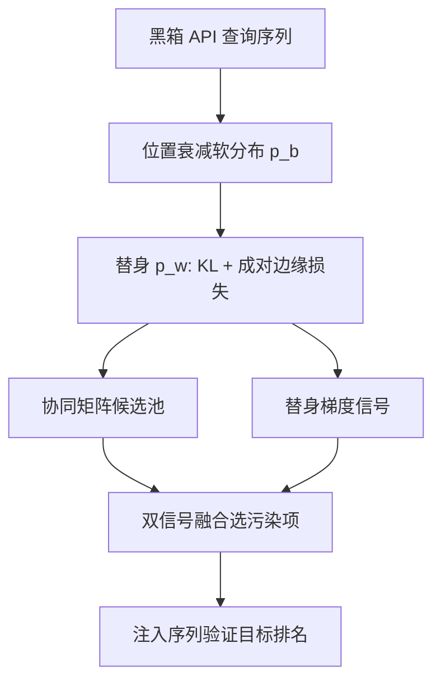
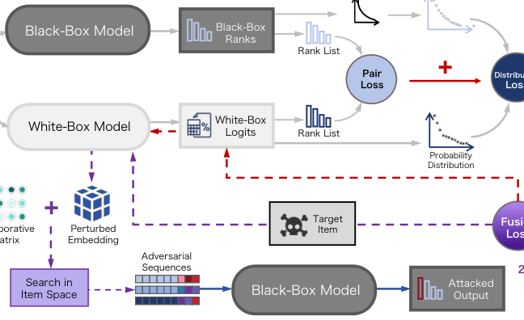

# A Cognitive Distribution and Behavior-Consistent Framework for Black-Box Attacks on Recommender Systems (面向推荐系统黑盒攻击的认知分布与行为一致性框架)

- **会议/期刊**: DASFAA 2026
- **作者与机构**: Hongyue Zhang 等，中科院信息工程研究所 / 中国科学院大学网络空间安全学院 / NSFOCUS
- **推荐链路定位**: 端到端安全审计（黑箱模型抽取 + 用户序列投毒）
- **研究方向**: 去偏公平可信隐私与工业架构 / 序列推荐
- **论文原文**: [论文原文链接](https://arxiv.org/abs/2602.10633v2)
- **开源代码**: 暂未开源

## TL;DR (1分钟核心速览)

针对序列推荐黑箱攻击的两大痛点——蒸馏只用硬排序/成对偏好而丢失排名位置价值，纯梯度污染项语义异常易被检测——本文提出双增强框架：以位置衰减认知分布对齐取代顺序对齐做模型蒸馏，并融合协同共现先验与梯度信号生成行为一致的污染序列。在 ML-1M/Steam/Beauty 全库排序评测下，Agreement@1 较 DFME 最高提升约 22%，黑箱攻击成功率 0.93–0.98。

## Background & Motivation (背景与核心矛盾)

- **主流范式**: 黑箱攻击先以有限 API 查询蒸馏高保真替身模型（DFME/ME-MIA），再在替身嵌入空间用梯度搜索污染项注入用户序列，操纵目标物品排名。
- **前人局限**: ①蒸馏仅用 top-k 硬排序或成对偏好（BPR/Hinge），忽略不同名次的连续价值差异与注意力衰减，蒸馏信号稀疏、替身易过拟合；②纯梯度污染的选取只看嵌入邻近，缺语义关联，序列统计异常，轻易被异常检测防御识破。
- **核心洞察 (Key Insight)**: 用户对列表自上而下注意力指数衰减（首因效应/位置偏见），其衰减曲线与 NDCG 折损 $d(j)=1/\log_2(j+1)$ 单调同构；真实污染项应同时满足协同共现自然性与梯度攻击有效性。
- **本文切入点**: 抽取目标由"顺序对齐"升级为"认知分布对齐"，污染项生成由"纯梯度"改为"协同+梯度双信号融合"。

## Method (核心方法设计)

### 1. 整体框架 (Overall Architecture)

框架为两阶段闭环。阶段一（认知分布对齐蒸馏）：从随机种子出发按位置衰减/温度策略自回归采样构造查询序列，对每个查询向黑箱 API 取 top-k 列表，将其重构为带位置衰减的软注意力分布，与替身模型输出的 softmax 分布做 KL 对齐并辅以成对边缘损失训练替身 $f_w$。阶段二（行为一致污染生成）：以历史协同矩阵构建语义候选池，结合替身梯度方向对候选打分，双信号融合选污染项并贪心/beam 组装注入序列，回黑箱验证目标物品排名提升。

<figure class="paper-figure" markdown="span">
  <figcaption>图1：双增强黑盒攻击框架。</figcaption>
</figure>

### 2. 关键设计拆解 (Key Designs)

1. **位置衰减认知分布蒸馏**：痛点是用一一硬序标签蒸馏信号稀薄。将黑箱名次 $j$映射为认知价值$v(j)=\alpha^{j-1}$并软化为$p_b(i_j|x)=\dfrac{\exp(v(j)/\tau_b)}{\sum_{t=1}^{k}\exp(v(t)/\tau_b)}$，用$\mathcal{L}_{KL}(x)=KL(p_b(\cdot|x)\Vert p_w(\cdot|x;\tau_w))$ 做全局分布对齐。直觉：把离散排序还原为可微的注意力强度分布，替身学到的是"名次有多重要"而非仅"谁排在谁前"。

2. **双信号行为一致污染生成**：纯梯度候选语义割裂。先由协同矩阵按条件相关度 $\tilde{s}(j|i^*)$取 Top-K 组成语义候选池$H=\mathcal{N}_t\cup\text{Top-K}(\text{sim}_g)$，再加权梯度对齐与协同相关度：$S(j)=w_g\cdot\text{sim}_g(j)+w_s\cdot\tilde{s}(j|i^*),\ w_g+w_s=1$，仅在$H$ 内选优。直觉：协同项保证"像真实行为"，梯度项保证"真能推排名"，从而兼顾隐蔽与有效。

3. **训练目标、查询与推理效率**：总损失 $\mathcal{L}_{distill}=\lambda\mathcal{L}_{pair}+(1-\lambda)\mathcal{L}_{KL}$，$\mathcal{L}_{pair}$含序内边缘$\delta_1$与负样本边缘$\delta_2$保局部排序稳定；$\lambda$ 大偏局部精排、小偏全局认知迁移。查询预算受控（自回归采样至预设长度/预算），无冗余重查询；攻击侧用贪心/beam 搜索并黑箱少量校正，开销随注入长度线性增长。

## Experimental Setup & Evaluation Protocol (实验设置与评估协议)

- **数据集与预处理**（三数据集覆盖稠密到极稀疏）：

| 数据集 | #Users | #Items | 平均长度 | 稀疏度 | 场景说明 |
| :--- | :---: | :---: | :---: | :---: | :--- |
| ML-1M | 6,040 | 3,416 | 166 | 95.16% | 电影，稠密长序列 |
| Steam | 334,542 | 13,046 | 13 | 99.90% | 游戏，中稀疏 |
| Beauty | 40,226 | 54,542 | 9 | 99.98% | 电商，极稀疏短序列 |

- **数据划分与防穿越**: 采用 `Leave-One-Out` 风格：`x[:T-2]` 训练、倒数第二个测验证、最后一个测试。
- **排名评测协议**: 无偏 `Full-Ranking`（全库未交互排序），指标 Recall@10、NDCG@10 及黑箱—替身一致性 Agreement@K（Agr@1/Agr@10）。
- **对比基线与超参**: 抽取基线 DFME、ME-MIA；攻击基线 RandAlter、DQN、WhiteBox-SimAlter、DFME-based pollution。替身架构 NARM/SASRec/BERT4Rec；Adam lr=0.001、batch=128、最大长度 200(ML-1M)/50(Steam,Beauty)；认知衰减 $\alpha=0.97$、温度 0.5。污染长度为序列 1%（ML-1M 10 条、Steam/Beauty 2 条）。

## Key Experimental Results (实验关键数据)

### 1. 主实验对比 (Main Results)

ML-1M 模型抽取（替身架构 × 方法，`BlackBox` 为目标系统参照）：

| 替身架构 | 方法 | N@10 | R@10 | Agr@1 | Agr@10 |
| :--- | :--- | :---: | :---: | :---: | :---: |
| NARM | BlackBox | 0.626 | 0.819 | - | - |
| | DFME | 0.615 | 0.812 | 0.571 | 0.747 |
| | ME-MIA | 0.615 | 0.811 | 0.551 | 0.724 |
| | Ours | 0.617 | 0.813 | **0.601** | **0.757** |
| SASRec | DFME | 0.602 | 0.802 | 0.454 | 0.662 |
| | ME-MIA | 0.594 | 0.820 | 0.528 | 0.711 |
| | Ours | 0.595 | 0.818 | **0.573** | **0.724** |
| BERT4Rec | DFME | 0.559 | 0.775 | 0.335 | 0.581 |
| | ME-MIA | 0.560 | 0.773 | 0.308 | 0.569 |
| | Ours | 0.571 | 0.782 | **0.409** | **0.631** |

攻击侧（Fig.3）：WhiteBox-Ours 目标命中率较最强基线约 +2.4%，黑箱成功率 0.93–0.98；Steam/Beauty 抽取上 Ours 的 Agr 亦全面领先（Beauty NARM Agr@10 0.381→**0.468**，约 +22.8%）。

### 2. 消融实验 (Ablation Study)

ML-1M N@10，格式化两组件（ME=模型抽取、PPA=投毒攻击）：

| 配置 | BERT4Rec | NARM |
| :--- | :---: | :---: |
| ME(Pair)+PPA(Gradient) | 0.817 | - |
| ME(Fusion)+PPA(Gradient) | 0.837 | - |
| ME(Pair)+PPA(Gradient+Behavioral) | 0.8187 | - |
| ME(Fusion)+PPA(Gradient+Behavioral) | - | **0.8996** |

### 3. 关键实验发现 (Key Findings)

- **认知分布对齐是核心驱动、行为一致是协同增益**：BERT4Rec 上仅换融合损失即 0.817→0.837，而仅加行为一致仅 0.817→0.8187；两者合并 NARM 达 0.8996，说明"先精准获取排序知识，再保隐蔽"存在强协同。
- **复杂架构与稀疏场景收益最大**：BERT4Rec 上 Agr@1 由 0.335 升至 0.409（约 +22%，远超基线下滑趋势），Beauty 上 Agr@10 相对 DFME +22.8%，表明连续值蒸馏对硬标签噪声更鲁棒。
- **衰减因子存在最优窄区间**：$\alpha$ 从 0.7 升至 0.97 时 Agr@1/Agr@10 稳定上升（约 +18%/+10%），超过 0.97 轻微回落，印证首因效应/位置偏见的认知先验，实用区间 0.95–0.97。

## Highlights & Limitations (亮点、对比与审稿批判)

- **与代表作对比 (vs. Prior Work)**: DFME 仅用成对排序蒸馏离散序；ME-MIA 加 BPR+Hinge；INFAttack 用影响函数梯度。本文首次把位置衰减软分布引入提取（对标 NDCG 折损），并将"协同共现+梯度"融合到污染生成，实现从"显性操纵"到"隐性影响"的转变。
- **可迁移亮点**: ①位置衰减软标签蒸馏可迁到排序知识蒸馏/模型压缩（不丢名次价值）；②协同+梯度双信号选样可迁到负采样与对抗样本生成，兼顾有效性与自然性。
- **审稿级局限批判**: ①隐蔽性主要靠个案分析（Fig.6）与替身评估，缺与真实异常检测防御的定量对抗；②仅覆盖 NARM/SASRec/BERT4Rec 三类序列结构，且假设攻击者可获历史协同矩阵；③抽取查询预算与在线延迟未充分量化。

## Rating (四维评分)

- **方法创新性 (Novelty)**: ⭐⭐⭐⭐ （位置衰减认知分布对齐并论证与 NDCG 折损单调同构，是相对现有成对蒸馏的清晰增量）
- **评估协议与实验扎实度 (Protocol & Experiments)**: ⭐⭐⭐⭐ （3 数据集×3 架构+Full-Ranking+Agreement@K 齐全，消融与超参分析到位；攻击仅 Fig.3 无表略欠完整）
- **写作与数学规范度 (Clarity & Rigor)**: ⭐⭐⭐⭐ （分布/融合公式简洁清楚，NDCG 等价性论证严谨，复杂度与查询预算描述偏弱）
- **工业落地与复现价值 (Industrial & Practical Value)**: ⭐⭐⭐ （未开源，攻击与防御审计价值高，但复现依赖协同矩阵与查询预算，工程部署需补充延迟评估）

