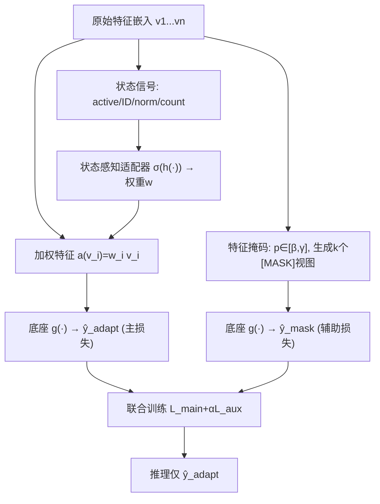
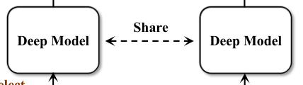
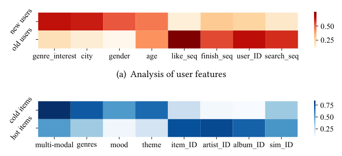

# AdaF^2M^2: Comprehensive Learning and Responsive Leveraging Features in Recommendation System (自适应特征建模与特征掩码框架)

- **会议/期刊**: DASFAA 2025
- **作者与机构**: Yongchun Zhu, Jingwu Chen, Ling Chen, Yitan Li, Feng Zhang, Xiao Yang, Zuotao Liu；ByteDance / Douyin Group
- **推荐链路定位**: 召回 + 精排（模型无关插件）
- **研究方向**: 去偏公平与工业系统 / 冷启动与长尾推荐
- **论文原文**: [https://arxiv.org/abs/2501.15816v1](https://arxiv.org/abs/2501.15816v1)
- **开源代码**: 暂未开源

## TL;DR (1分钟核心速览)

针对真实推荐长尾导致模型过度依赖ID类特征、忽视非ID元特征的问题，本文提出模型无关框架AdaF^2M^2：训练期随机掩码特征做多前向任务监督，并用状态感知适配器按用户/物品状态重加权特征。在DouyinMusic-4B/20B与MovieLens-1M上即插即用提升，线上排序整体活跃天数+0.212%、时长+0.442%，冷启动物品曝光与互动亦显著改善。

## Background & Motivation (背景与核心矛盾)

- **主流范式**: 工业推荐以ID嵌入、ID行为序列和高阶特征交叉为核心，特征建模多聚焦“更强的交互层”。
- **前人局限**: 长尾分布使头部用户/物品主导训练，模型过度依赖ID特征，非ID元特征学习不足；同时，基于特征自身生成权重的方法也被头部样本支配，长尾特征权重低、梯度小，冷启动更脆弱。
- **核心洞察 (Key Insight)**: 若在训练中随机遮蔽ID类特征，模型会被迫用年龄、类别、主题等元特征完成预测；而用户/物品“状态信号”可作为外部条件，决定哪些特征应被放大。
- **本文切入点**: 用特征掩码做“反事实式”多视图监督，并将自适应加权与掩码训练解耦，避免低权重特征梯度消失。

## Method (核心方法设计)

### 1. 整体框架 (Overall Architecture)

输入为特征嵌入序列。训练时并行生成 $k$个随机掩码视图，分别经底座$g(\cdot)$ 做任务监督；主路径用状态信号生成特征权重，再加权后经同一底座预测。两路仅在训练期通过联合损失耦合，推理仅保留主路径，因此掩码不增加线上前向延迟。

<figure class="paper-figure" markdown="span">
  <figcaption>图1：基于特征掩码框架的自适应特征建模（AdaF2M2）。</figcaption>
</figure>

### 2. 关键设计拆解 (Key Designs)

1. **特征掩码多前向任务训练**：痛点是对ID特征的过度依赖使非ID特征缺少监督。本文对每个样本以概率 $p\in[0.1,0.5]$将若干特征嵌入替换为各自独立的$[\mathrm{MASK}]_i$，生成$k$ 个增强视图；与MaskNet式自监督不同，这里直接对每个视图计算任务交叉熵：
   $\mathcal{L}_{aux}=\sum_{(\mathbf{x},y)\in\mathcal{D}}\sum_{i=1}^{k}\mathrm{CE}(y,\hat{y}^{i}_{mask})$。
   直觉是：去掉ID后仍要预测正确，模型必须学习可泛化的元特征，同时模拟真实缺失/噪声。
2. **状态感知适配器**：现有方法用 $h([\mathbf{v}_1,\dots,\mathbf{v}_n])$从特征自身生成权重，易被头部样本支配。本文改用外部状态信号$\mathbf{r}_{active},\mathbf{r}_{ID},\mathbf{r}_{norm},\mathbf{r}_{count}$（活跃天数、ID嵌入、ID嵌入范数、交互计数），生成
   $w_{1:n}=\sigma(h([\mathbf{r}_{active},\mathbf{r}_{ID},\mathbf{r}_{norm},\mathbf{r}_{count}]))$，
   并令 $a(\mathbf{v}_i)=w_i\mathbf{v}_i$。Sigmoid优于Softmax，可避免头部主特征压制长尾特征。
3. **解耦训练与推理效率**：加权嵌入的梯度按 $w_i$缩放，低权重特征易梯度消失。本文将适配器仅用于主损失$\mathcal{L}_{main}$，掩码分支不经过适配器，总损失为
   $\mathcal{L}=\mathcal{L}_{main}+\alpha\mathcal{L}_{aux}$，$\alpha=0.2$。
   离线实验取 $k=1$；训练无负采样，直接以曝光样本做二分类；推理仅用$\hat{y}_{adapt}$。

## Experimental Setup & Evaluation Protocol (实验设置与评估协议)

- **数据集与预处理**: MovieLens-1M不做5-core过滤，评分≥4转正；DouyinMusic取曝光日志，Finish为标签。

| 数据集 | #Users | #Items | #Interactions | 稀疏度/密度 | 特征/场景说明 |
| :--- | :---: | :---: | :---: | :---: | :--- |
| DouyinMusic-4B | 未披露 | 未披露 | 4B+ | 未披露；长尾 | 2周日志，100+特征 |
| DouyinMusic-20B | 未披露 | 未披露 | 20B+ | 未披露；长尾 | 8周日志，100+特征 |
| MovieLens-1M | 6,040 | 3,706 | 1,000,209 | 4.47% | 用户/电影/类型特征 |

- **数据划分与防穿越**: DouyinMusic按全局时间戳切分：4B为10/2/2天，20B为6/1/1周；MovieLens-1M随机6:2:2。
- **排名评测协议**: 离线为曝光样本二分类AUC/UAUC，并非Full-Ranking Top-K，也无采样负例；线上A/B按用户平均Active Days、Duration等指标，报告95%置信区间。
- **对比基线与超参**: 基线含FM、YouTube DNN、AFN、DCN-V2、EulerNet，另用双塔做消融；Adam学习率网格$\{0.001,0.005,0.01,0.02,0.1\}$，嵌入维度$\{16,32,64,128,256\}$，batch=256，MLP为512-128-1，$\alpha=0.2$。

## Key Experimental Results (实验关键数据)

### 1. 主实验对比 (Main Results)

| 模型 | ML-1M AUC | +AdaF^2M^2 AUC | RelaImpr | Douyin-20B ΔAUC | Douyin-4B ΔAUC |
| :--- | :---: | :---: | :---: | :---: | :---: |
| FM | 0.7767 | 0.7808 | +0.53% | **+0.41%** | **+0.46%** |
| YouTube DNN | 0.7857 | 0.7871 | +0.18% | +0.15% | +0.18% |
| AFN | 0.7878 | 0.7889 | +0.14% | +0.25% | +0.23% |
| DCN-V2 | 0.7886 | 0.7905 | +0.24% | +0.21% | +0.45% |
| EulerNet | 0.7911 | **0.7921** | +0.13% | +0.19% | +0.36% |

线上A/B：排序整体Active Days +0.212%、Duration +0.442%，新用户+0.333%/+0.540%，老用户+0.206%/+0.434%；召回FM+0.066%/+0.195%，双塔+0.073%/+0.184%。冷启动0-128曝光组物品曝光数+19.638%、Like+18.495%。

### 2. 消融实验 (Ablation Study)

| 变体（DouyinMusic-20B，双塔） | ΔAUC | ΔUAUC | 线上Active Days | 线上Duration |
| :--- | :---: | :---: | :---: | :---: |
| 仅Feature Mask | +0.05% | +0.03% | +0.006% | +0.078% |
| 仅Adapter | +0.12% | +0.11% | +0.022% | +0.091% |
| 完整AdaF^2M^2 | **+0.15%** | **+0.17%** | **+0.073%** | **+0.184%** |
| MaskNet替代 | +0.14% | +0.12% | +0.033% | +0.048% |

### 3. 关键实验发现 (Key Findings)

1. **掩码与适配器互补，而非简单叠加**：完整模型离线ΔAUC +0.15%、ΔUAUC +0.17%，高于仅Adapter的+0.12%/+0.11%与仅Mask的+0.05%/+0.03%；线上完整模型+0.073%/+0.184%，也显著优于仅Adapter的+0.022%/+0.091%。
2. **状态感知确实偏向冷启动与长尾特征**：新用户线上提升+0.333%/+0.540%，高于老用户+0.206%/+0.434%；图2热图显示新用户权重集中于genre_interest、city、gender、age，老用户集中于like_seq、finish_seq、user_ID。
3. **掩码训练优于自监督式MaskNet**：完整模型线上Active Days/Duration为+0.073%/+0.184%，MaskNet为+0.033%/+0.048%；冷启动0-128曝光组Like提升+18.495%，说明任务导向多前向监督更能激活非ID特征。

<figure class="paper-figure" markdown="span">
  <figcaption>图2：不同状态用户/物品的平均特征权重热图。</figcaption>
</figure>

## Highlights & Limitations (亮点、对比与审稿批判)

- **与代表作对比 (vs. Prior Work)**: DropoutNet主要对ID嵌入做dropout；MaskNet用自监督对比损失；AFN/DCN-V2聚焦特征交互。AdaF^2M^2则对全特征做任务导向多前向掩码，并用外部状态信号适配加权，且将两者解耦训练。
- **可迁移亮点**: 特征掩码可作为任意CTR/召回底座的训练期数据增强；状态信号（活跃度、ID范数、交互计数）可低成本迁移到冷启动或多场景推荐。
- **审稿级局限批判**: 离线仅报告AUC/UAUC而非Top-K全库排序，且Douyin数据与代码未公开，复现受限；线上增益绝对幅度较小，Adapter单独上线不显著，且训练需额外$k$次前向与状态特征维护，需关注工程成本与超参敏感性。

## Rating (四维评分)

- **方法创新性 (Novelty)**: ⭐⭐⭐⭐ （掩码+状态适配器并不复杂，但“任务导向多前向+解耦训练”针对长尾ID依赖的切入点清晰）
- **评估协议与实验扎实度 (Protocol & Experiments)**: ⭐⭐⭐⭐ （含4B/20B工业数据、多场景线上A/B与消融，但缺Full-Ranking与公开代码）
- **写作与数学规范度 (Clarity & Rigor)**: ⭐⭐⭐⭐ （损失、适配器与梯度问题解释清楚，数据集统计与理论分析略简）
- **工业落地与复现价值 (Industrial & Practical Value)**: ⭐⭐⭐⭐⭐ （已在抖音集团召回/排序/冷启动多场景部署，推理无额外延迟，模型无关性强）

